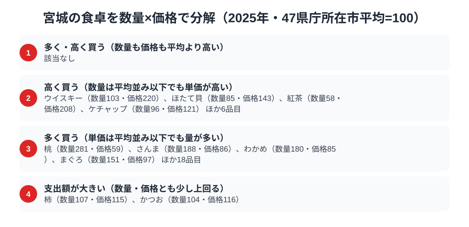

海に面した宮城県仙台市の食卓には、加工された海の幸が並びます。家計調査を見ると、2025年のかまぼこの消費支出額は8,072円で全国1位でした。一方、チューハイ・カクテルの消費支出額は6,949円で13位と、上位には入っていません。

さらにわかめの消費支出額は2,461円で全国3位です。1位は隣の岩手県で2,997円、三陸の海を共有する両県が上位に並んでいます。ただし同じ岩手県でも、かまぼこは38位、チューハイは7位と順位は品目ごとに大きく異なります。海産の加工品と海藻が強く、酒は中位という宮城県民の食卓を、家計調査のデータから読み解きます。この記事では、データから確かに言えることと、仮説にとどまることを分けて書きます。

> [!NOTE]
> 家計調査の都道府県データは、県庁所在市（宮城県は仙台市）の二人以上世帯を対象にした年間支出額です。県全体ではなく仙台市在住世帯の家計簿から見た傾向であり、支出「金額」であって消費「量」そのものではありません。笹かまぼこのように土産物として県外へ出荷される分や、外食での支出は、世帯の家計簿に計上されない場合があります。

## チューハイ・カクテル — 宮城県は6,949円で13位

<source-link href="/ranking/chuhai-consumption-expenditure">チューハイ・カクテル消費支出額ランキングをもっと見る</source-link>

宮城県のチューハイ・カクテル消費支出額は6,949円で13位です。1位は新潟県で9,039円、2位は山口県で8,919円、3位は北海道で8,559円と続き、最下位の長崎県は2,785円で、1位の新潟県とは3.2倍の差があります。東北では岩手県が7,650円で7位に入っており、宮城は同じ東北の岩手より下に位置しています。

13位は47都道府県の中では上位3割に入る位置で、突出して高いわけでも低いわけでもない中位です。この順位の理由は、今回のデータだけでは断定できません。[仮説]として、仙台が牛たん・海鮮などつまみの選択肢が豊富な外食の街であり、飲酒の支出の一部が家計簿に表れにくいことが影響している可能性があります。単年の順位はぶれが大きいため、13位が構造的なものかどうかも、複数年の推移を見ないと言えません。

## かまぼこ — 宮城県は8,072円で1位、笹かまの本場

<source-link href="/ranking/fish-paste-consumption-expenditure">かまぼこ消費支出額ランキングをもっと見る</source-link>

かまぼこの消費支出額は宮城県が8,072円で1位です。2位は長崎県で6,533円、3位は富山県で5,417円でした。かまぼこの名産地として知られる県が上位に並ぶ、産地色の強いランキングです。最下位の沖縄県は2,172円で、宮城とは3.7倍の差があります。

宮城1位の背景には、仙台名物「笹かまぼこ」の存在があると考えられます。白身魚のすり身を笹の葉形に焼き上げた笹かまぼこは、土産物としてだけでなく、地元の食卓でもおかずやおつまみとして食べられているのでしょう。長崎、富山とそれぞれ由来は異なりますが、いずれも練り物加工が根づいた土地という共通点が[仮説]として挙げられます。

## わかめ — 宮城県は2,461円で3位、1位は隣の岩手県

<source-link href="/ranking/wakame-consumption-expenditure">わかめ消費支出額ランキングをもっと見る</source-link>

わかめの消費支出額は宮城県が2,461円で3位です。1位は岩手県で2,997円、2位は長野県で2,478円で、宮城は長野県のすぐ後ろにつけています。最下位の和歌山県は786円で、1位の岩手県とは3.8倍の開きです。

三陸海岸は宮城・岩手の両県にまたがる養殖地で、隣り合う2県が上位に並ぶのは、漁場文化圏が消費に反映された結果とも考えられます。ただし2位は内陸の長野県であり、産地だけでは説明できません。[仮説]として、日常の汁物や酢の物での使用頻度の高さも関わっているのかもしれません。

## 宮城の食卓に並ぶ海産の加工品と海藻

2025年の宮城県は、かまぼこが1位、わかめが3位と、海産の加工品と海藻が上位に並びました。一方でチューハイ・カクテルは13位にとどまり、酒より海産物の強さが目立つ結果でした。ただし、これを「三陸の海の幸が食卓を貫いている」と一括りにすることはできません。

その最も分かりやすい例が、同じ三陸の岩手県です。岩手県はわかめで1位の2,997円ですが、かまぼこは2,588円で38位です。宮城県のかまぼこ8,072円とは3.1倍の差があり、チューハイは岩手県が7,650円で7位と宮城県より上にいます。三陸の海を共有していても、どの品目が強いかは県ごとに違います。かまぼこが強いのは、海の近さよりも、笹かまぼこという仙台の練り物文化の影響が大きいのかもしれません（[仮説]。支出額のデータだけでは、かまぼこの原料魚の産地までは確かめられません）。

かつお1本に支出が集中する高知の「特化型」や、カップ麺・ほたて・りんごと品目ごとに背景の異なる青森の「多面型」と比べると、宮城は海産の加工品と海藻に特徴が表れる食卓です。同じ海産物でも品目によって上位の県が岩手や長野などにずれる点は、単純な地域括りでは見えにくい点です。

## 数量×価格で分解する仙台市の食卓

<source-link href="/ranking/wakame-consumption-quantity">わかめ消費量ランキングをもっと見る</source-link>

家計調査の支出額は、突き詰めると「数量×価格」に分解できます。同じ支出額が大きくても、たくさん買っているからなのか、単価の高いものを選んでいるからなのかでは、食卓の姿がまったく異なります。ここでは47都道府県庁所在市の平均を100とした数量指数と価格指数で、仙台市の食卓を品目ごとに見ていきます。2025年は、数量・価格とも平均より高い品目は該当なしでした。

2025年に「多く買う」側に分類されたのは、桃（数量281・価格59）、さんま（数量188・価格86）、わかめ（数量180・価格85）、まぐろ（数量151・価格97）などです。わかめ消費量（数量）は平均を大きく上回る一方、単価は平均より低めです。全国3位という支出額は「たくさん食べている」ことの表れといえます。

この節の主題である海産物に絞ると、数量が効く品目と単価が効く品目に分かれます。さんま（数量188・価格86）、わかめ（数量180・価格85）、まぐろ（数量151・価格97）は、単価は平均並みか低めで、数量の多さが支出額を支えています。一方、ほたて貝（数量85・価格143）は買う量こそ平均を下回りますが、単価が高く、価格の面で宮城の特徴が出ています。かつお（数量104・価格116）は数量・価格とも少し上回る品目です。宮城の海産物は、「たくさん買う」魚介と「良いものを選んで買う」魚介が混在しており、一本の読みでは括れません。

「高く買う」側には海産物以外にウイスキー（数量103・価格220）、紅茶（数量58・価格208）、ケチャップ（数量96・価格121）が並びます。柿（数量107・価格115）も数量・価格とも少し上回って支出額が大きい品目です。

> [!TIP]
> 価格指数は「支出額÷数量」から求めた相対値のため、買っている品種やブランド、グレードの違いを含みます。ウイスキーの価格指数220は、同じ量でも高い銘柄を選んでいる可能性と、そもそも銘柄の構成が違う可能性の両方を含み、純粋な市場価格の高低とは異なります。

この指数の基準は家計調査の全国値ではなく、47都道府県庁所在市（二人以上世帯）の単純平均を100としたものです。対象は2025年の仙台市（二人以上世帯）の年間データです。

## まとめ

- かまぼこ消費支出額は宮城県が8,072円で1位、仙台名物「笹かまぼこ」の日常消費が反映
- わかめは宮城県が2,461円で3位、1位は隣県の岩手県で2,997円
- チューハイ・カクテルは宮城県が6,949円で13位、1位は新潟県で9,039円
- かまぼこ最下位は沖縄県が2,172円、わかめ最下位は和歌山県が786円
- 数量×価格では、わかめは数量で支出額を押し上げる側に分類された

宮城県の他の統計は[宮城県の地域プロフィール](/areas/04000)、食品・家計消費の地域差は[経済カテゴリ一覧](/category/economy)から、東北の食文化の比較は[青森の食卓の記事](/blog/aomori-food-culture)からもご覧いただけます。
