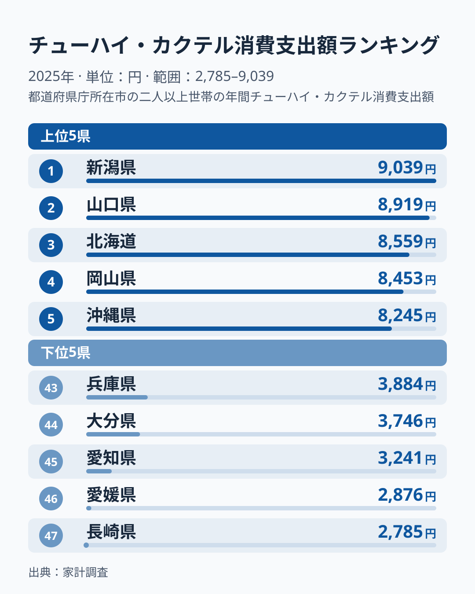
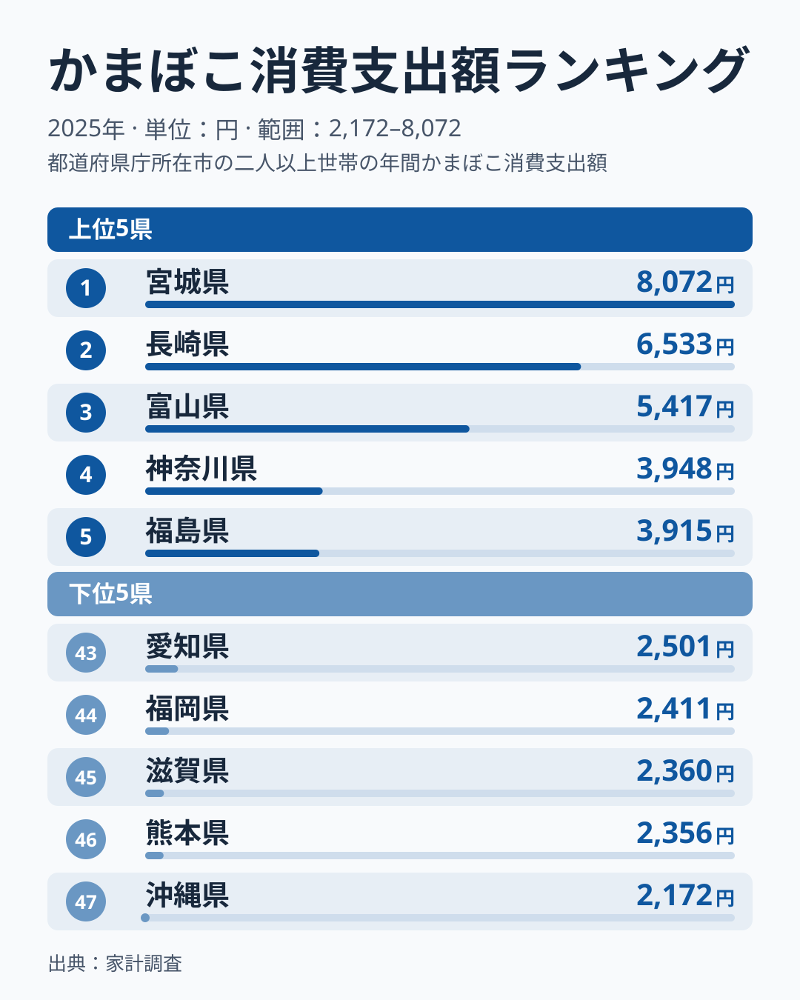
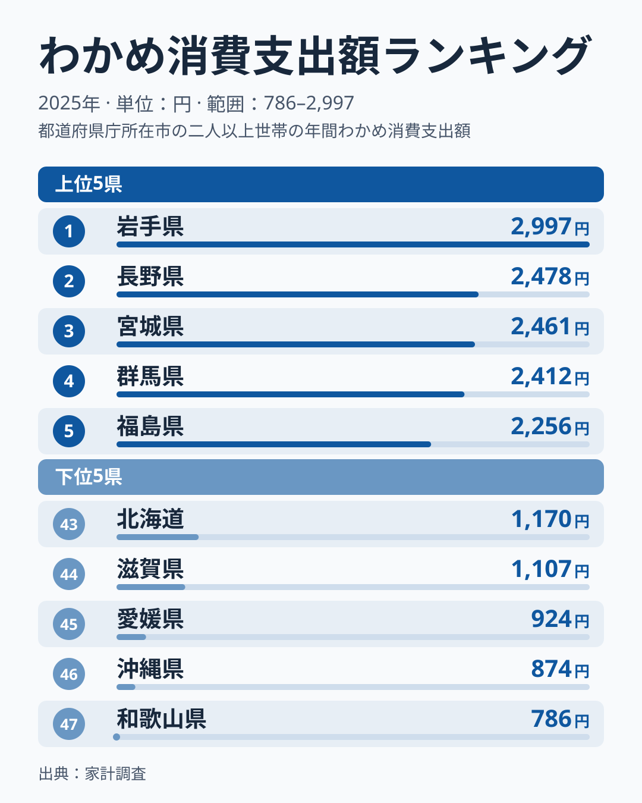
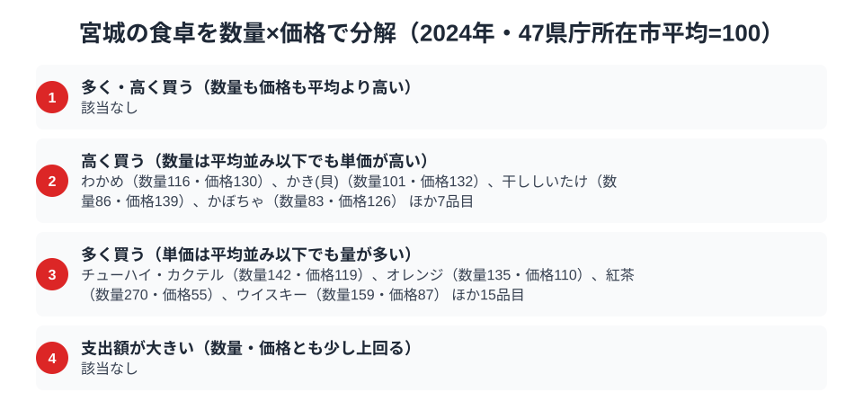

海に面した宮城県仙台市の食卓には、加工された海の幸が並びます。家計調査を見ると、2025年のかまぼこの消費支出額は8,072円で全国1位でした。一方、チューハイ・カクテルの消費支出額は6,949円で13位と、前年までのような首位ではありません。

さらにわかめの消費支出額は2,461円で全国3位です。1位は隣の岩手県で2,997円、三陸の海を共有する両県が上位に並んでいます。海産加工品が強い一方で酒はなぜ順位を下げたのか、宮城県民の食卓を家計調査のデータから読み解きます。

> [!NOTE]
> 家計調査の都道府県データは、県庁所在市（宮城県は仙台市）の二人以上世帯を対象にした年間支出額です。県全体ではなく仙台市在住世帯の家計簿から見た傾向であり、支出「金額」であって消費「量」そのものではない点にご注意ください。

## チューハイ・カクテル — 宮城県は6,949円で13位

<source-link href="/ranking/chuhai-consumption-expenditure">チューハイ・カクテル消費支出額ランキングをもっと見る</source-link>

宮城県のチューハイ・カクテル消費支出額は6,949円で13位です。1位は新潟県で9,039円、2位は山口県で8,919円、3位は北海道で8,559円と続き、最下位の長崎県は2,785円で、1位の新潟県とは3.2倍の差があります。東北では岩手県が7,650円で7位に入っており、宮城は同じ東北の岩手より下に位置しています。

仙台は牛たん・海鮮などつまみの選択肢が豊富な外食文化を持ち、家庭でも缶チューハイを気軽な晩酌に選ぶ層がいると考えられます。ただし単年の順位はぶれが大きく、13位という位置が構造的なものかどうかは断定できません。[仮説]として、前年は首位だった反動や、外食での支出が家計簿に表れにくいことが影響している可能性があります。

## かまぼこ — 宮城県は8,072円で1位、笹かまの本場

<source-link href="/ranking/fish-paste-consumption-expenditure">かまぼこ消費支出額ランキングをもっと見る</source-link>

かまぼこの消費支出額は宮城県が8,072円で1位です。2位は長崎県で6,533円、3位は富山県で5,417円でした。かまぼこの名産地として知られる県が上位に並ぶ、産地色の強いランキングです。最下位の沖縄県は2,172円で、宮城とは3.7倍の差があります。

宮城1位の背景には、仙台名物「笹かまぼこ」の存在があると考えられます。白身魚のすり身を笹の葉形に焼き上げた笹かまぼこは、土産物としてだけでなく、地元の食卓でもおかずやおつまみとして食べられているのでしょう。長崎、富山とそれぞれ由来は異なりますが、いずれも練り物加工が根づいた土地という共通点が[仮説]として挙げられます。

## わかめ — 宮城県は2,461円で3位、1位は隣の岩手県

<source-link href="/ranking/wakame-consumption-expenditure">わかめ消費支出額ランキングをもっと見る</source-link>

わかめの消費支出額は宮城県が2,461円で3位です。1位は岩手県で2,997円、2位は長野県で2,478円で、宮城は2位のすぐ後ろにつけています。最下位の和歌山県は786円で、1位の岩手県とは3.8倍の開きです。

三陸海岸は宮城・岩手の両県にまたがる養殖地で、隣り合う2県が上位に並ぶのは、漁場文化圏が消費に反映された結果とも考えられます。ただし2位は内陸の長野県であり、産地だけでは説明できません。[仮説]として、日常の汁物や酢の物での使用頻度の高さも関わっているのかもしれません。

> [!WARNING]
> 家計調査は支出金額の調査であり、消費量そのものではありません。笹かまぼこのように土産物として県外へ出荷される分は、宮城県内の家計簿には計上されない点にも注意が必要です。支出額はあくまで「仙台市の世帯が自分の財布から払った金額」であり、宮城の水産加工品全体の生産・消費規模を直接示すものではありません。

## 宮城の食卓を貫くもの

宮城県民の食卓を貫くのは、「三陸の海の幸」です。かまぼこは海の恵みを加工品として日常に取り込み、わかめは三陸ブランドの一角として食卓に上っています。一方でチューハイ・カクテルは13位にとどまり、2025年は酒より海産物の強さが目立つ結果でした。

かつお1本に支出が集中する高知の「特化型」や、カップ麺・ほたて・りんごと品目ごとに背景の異なる青森の「多面型」と比べると、宮城は海産加工品に特徴が表れる食卓です。かまぼこの1位とわかめの3位という並びは、同じ三陸の海産物でも品目によって上位の県が岩手や長野などにずれることを示しており、単純な地域括りでは見えにくい点です。

## 数量×価格で分解する仙台市の食卓

<source-link href="/ranking/chuhai-consumption-quantity">チューハイ・カクテル消費量ランキングをもっと見る</source-link>

家計調査の支出額は、突き詰めると「数量×価格」に分解できます。同じ支出額が大きくても、たくさん買っているからなのか、単価の高いものを選んでいるからなのかでは、食卓の姿がまったく異なります。ここでは47都道府県庁所在市の平均を100とした数量指数と価格指数で、仙台市の食卓を品目ごとに見ていきます。2025年は、数量・価格とも平均より高い品目は該当なしでした。

2025年に「多く買う」側に分類されたのは、桃（数量281・価格59）、さんま（数量188・価格86）、わかめ（数量180・価格85）、まぐろ（数量151・価格97）などです。わかめは単価が平均より低めでも数量が多く、全国3位という支出額は「たくさん食べている」ことの表れといえます。2024年にはわかめの価格指数が130で「高く買う」側だったため、同じ品目でも年によって支出額を押し上げる要因が入れ替わっています。

「高く買う」側にはウイスキー（数量103・価格220）、ほたて貝（数量85・価格143）、紅茶（数量58・価格208）、ケチャップ（数量96・価格121）などが並びます。また、柿（数量107・価格115）とかつお（数量104・価格116）は、数量・価格とも少し上回って支出額が大きい品目です。

> [!TIP]
> 支出額のランキングだけを見ていると、「たくさん食べている」のか「高いものを選んでいる」のかを取り違えがちです。宮城の場合、わかめは数量で、ウイスキーや紅茶は価格で支出額を押し上げており、同じ支出額の大きさでも中身の理由は異なります。

この指数の基準は家計調査の全国値ではなく、47都道府県庁所在市（二人以上世帯）の単純平均を100としたものです。価格指数は「支出額÷数量」から求めた相対値のため、買っている品種やブランド、グレードの違いを含み、純粋な市場価格の高低とは異なります。対象は2025年の仙台市（二人以上世帯）の年間データです。

## まとめ

- かまぼこ消費支出額は宮城県が8,072円で1位、仙台名物「笹かまぼこ」の日常消費が反映
- わかめは宮城県が2,461円で3位、1位は隣県の岩手県で2,997円
- チューハイ・カクテルは宮城県が6,949円で13位、1位は新潟県で9,039円
- かまぼこ最下位は沖縄県が2,172円、わかめ最下位は和歌山県が786円
- 数量×価格では、わかめは数量で支出額を押し上げる側に分類された

宮城県の他の統計は[宮城県の地域プロフィール](/areas/04000)、食品・家計消費の地域差は[経済カテゴリ一覧](/category/economy)から、東北の食文化の比較は[青森の食卓の記事](/blog/aomori-food-culture)からもご覧いただけます。
