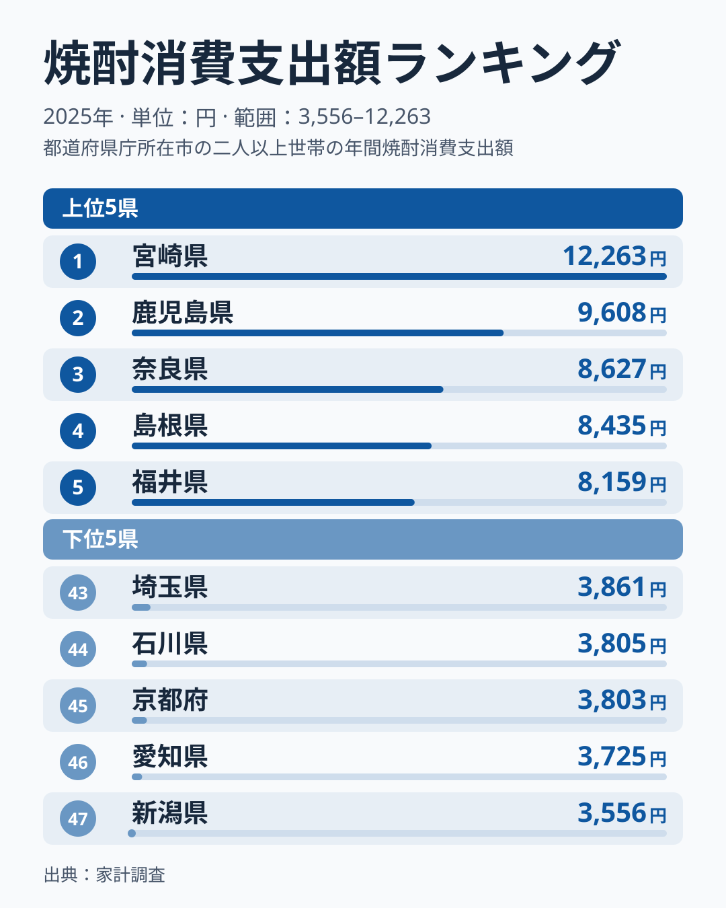
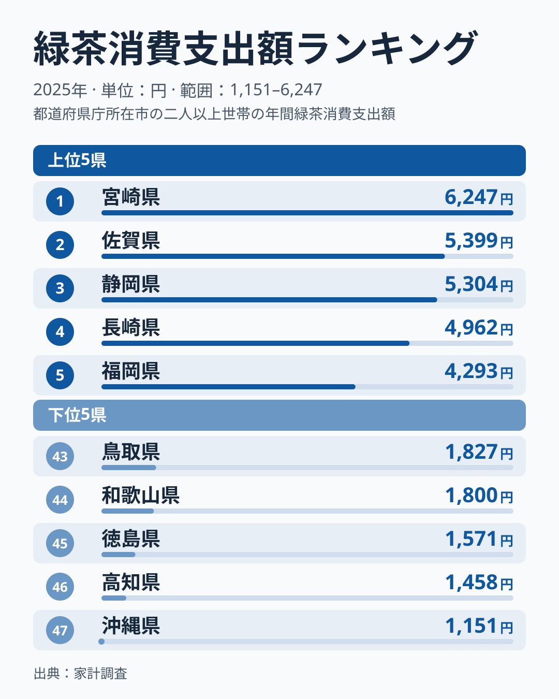
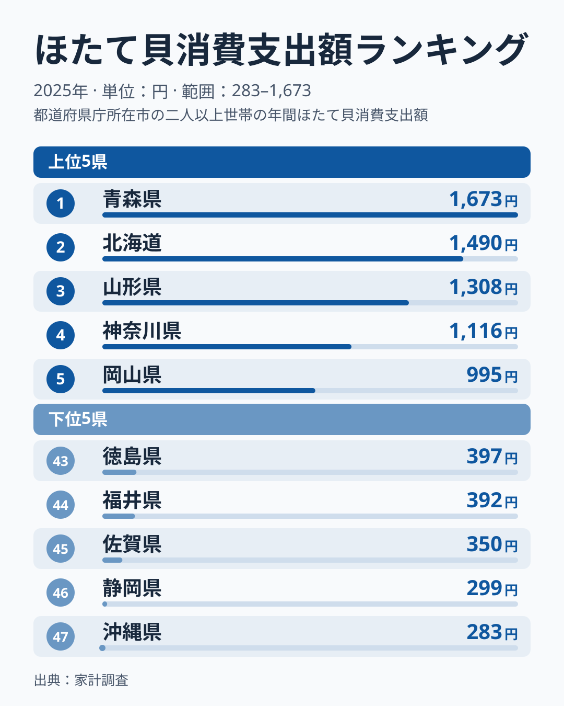
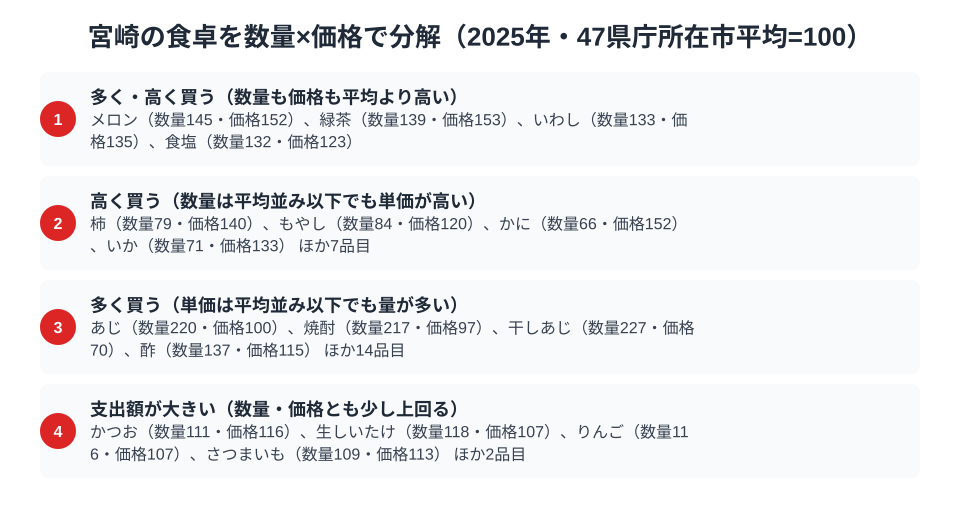

宮崎県の食卓には、南国ならではのはっきりした個性があります。総務省の家計調査（品目別）で宮崎市の二人以上世帯を見ると、2025年の焼酎の消費支出額は12,263円で全国1位です。全国屈指の焼酎どころであることが、数字にも明快に表れています。

さらに緑茶も6,247円で全国1位と、宮崎は「飲みもの」の品目で全国の先頭に立ちます。ところが同じ宮崎が、ほたて貝では501円で36位にとどまります。この記事では、焼酎・緑茶・ほたてという3つの品目を横断しながら、南国・宮崎の食卓の輪郭を「何を飲み、何を食べるか」の両面から読み解きます。

> [!NOTE]
> 数字は宮崎市の二人以上世帯の年間支出額で、宮崎県全体の値ではありません。単年の順位はぶれやすいため、ここでの理由づけは [仮説] として読んでください。

## 焼酎 — 全国1位12,263円、上位2県を南九州が占める

<source-link href="/ranking/shochu-consumption-expenditure">焼酎消費支出額ランキングをもっと見る</source-link>

宮崎県の焼酎消費支出額は12,263円で全国1位です。2位は鹿児島県の9,608円で、最下位の新潟県は3,556円、1位との差は約3.4倍あります。

上位5県を見ると、1位の宮崎県と2位の鹿児島県が九州で、3位は奈良県、4位は島根県、5位は福井県です。上位2県を南九州が占める一方で、3位以下には近畿・中国・中部の県が並んでおり、九州の県が上位を独占しているわけではありません。南九州が首位と2位を占める点は、芋焼酎などの産地が近いことが背景にある、というのが [仮説] です。

宮崎では晩酌に焼酎を選ぶ家庭が多く、お湯割り・水割り・ロックと楽しみ方も幅広いといわれます。ただし家計調査からわかるのは支出額までで、飲み方の傾向までは読み取れません。

## 緑茶 — 全国1位6,247円、茶どころ静岡を上回る

<source-link href="/ranking/green-tea-consumption-expenditure">緑茶消費支出額ランキングをもっと見る</source-link>

宮崎県の緑茶消費支出額は6,247円で全国1位です。2位は佐賀県の5,399円、3位は静岡県の5,304円、4位は長崎県の4,962円、5位は福岡県の4,293円でした。

上位5県のうち静岡県以外の4県は九州で、緑茶では九州勢の存在感が目立ちます。茶どころとして知られる静岡県は3位で、宮崎が上回りました。宮崎には「日向茶」「都城茶」といった茶産地があり、地元で茶葉が手に入りやすいことが家庭での消費を支えている、というのが [仮説] です。

なお家計調査は単年・一市の値ですので、静岡との順位の入れ替わりを構造的な逆転と断定することはできません。

## ほたて貝 — 501円で36位、寒流の貝との距離

<source-link href="/ranking/scallop-consumption-expenditure">ほたて貝消費支出額ランキングをもっと見る</source-link>

宮崎県のほたて貝消費支出額は501円で36位です。1位の青森県は1,673円、2位は北海道の1,490円、3位は山形県の1,308円で、最下位の沖縄県は283円でした。1位と最下位の差は約5.9倍あります。宮崎は最下位ではなく、47県のなかで下位寄りに位置する、というのが実態です。

上位に青森県と北海道が並ぶのは、ほたての主産地が寒流域であることと整合的です（[青森県の食卓](/blog/aomori-food-culture)ではほたてが全国1位）。一方、宮崎は暖かい日向灘に面し、ほたての産地から遠いため食卓での存在感が小さい、というのが [仮説] です。

> [!WARNING]
> 今回のデータにはほたての数量や単価の指数がありません。宮崎の501円が低いのは、買う量が少ないからか、単価が低いからかは判別できません。「ほとんど食べない」と決めつけず、金額が小さいという事実だけを読み取ってください。

## 数量×価格で見ると、焼酎は量・緑茶は量と単価で支える

<source-link href="/ranking/shochu-consumption-quantity">焼酎消費量ランキングをもっと見る</source-link>

「支出額 = 数量 × 価格」に分解すると、宮崎市の食卓はさらにくっきり見えてきます。家計調査で数量と価格の両方が分かる食料品目を、47県庁所在市の平均を100とした指数で確かめると、2025年は数量・価格ともに平均を上回る「多く・高く買う」品目として、メロン（数量145・価格152）、緑茶（数量139・価格153）、いわし（数量133・価格135）、食塩（数量132・価格123）の4品目が挙がりました。前年（2024年）はこの区分が「該当なし」でした。

緑茶は前年、数量108・価格154で「高く買う」区分に入っていました。2025年は数量が139まで伸びて「多く・高く買う」区分に移っています。一方、焼酎は数量217・価格97で、量は平均を大きく上回るのに単価は平均並み以下という「多く買う」型です。同じ「飲みもの全国1位」でも、緑茶は量と単価の両方で、焼酎は量で支出額を押し上げています。焼酎消費量は平均を大きく上回る一方、単価指数は平均並みなので、少なくとも高価格帯に偏った買い方ではなく、量で支出額を押し上げていると読めます。

> [!NOTE]
> 指数100は47県庁所在市の平均で、全国の平均や中央値ではありません。価格指数は「支出額÷数量」から求めた見かけの単価で、銘柄やパック単位の違いも含みます。対象は宮崎市の二人以上世帯・2025年の年間データです。

「高く買う」区分には、柿（数量79・価格140）、もやし（数量84・価格120）、かに（数量66・価格152）、いか（数量71・価格133）のほか、図では計11品目が示されています。「多く買う」区分には、あじ（数量220・価格100）、焼酎、干しあじ（数量227・価格70）、酢（数量137・価格115）のほか、図では計18品目が示されています。あじや干しあじは単価が平均並み以下で量が多く、魚を手頃な価格で多く買う傾向がうかがえますが、産地や入手経路はデータからはわかりません。地元で魚が手に入りやすいためではないか、というのは [仮説] です。

「支出額が大きい」区分には、かつお（数量111・価格116）、生しいたけ（数量118・価格107）、りんご（数量116・価格107）、さつまいも（数量109・価格113）のほか、図では計6品目が示されています。いずれも数量・価格がともに平均を少し上回る品目で、宮崎の食卓で突出はしないものの、支出額を底上げしている品目と読めます。

ほたてが下位寄りの理由は、産地との距離という [仮説] にとどまり、今回のデータだけでは裏付けられません。また、この分類は2025年単年の姿で、複数年で確かめたものではありません。

## まとめ

- 焼酎消費支出額は宮崎県が全国1位（12,263円）、2位の鹿児島県と合わせて上位2県を南九州が占める
- 緑茶も全国1位（6,247円）、2位は佐賀県、3位は静岡県
- ほたて貝は501円で36位、上位は青森県・北海道など寒流域の県 [仮説]
- 数量×価格では、緑茶は量も単価も高く、焼酎は量で支出額を押し上げている

宮崎県の他の統計は[宮崎県の地域プロフィール](/areas/45000)、食品・家計消費の地域差は[経済カテゴリ一覧](/category/economy)からご覧いただけます。
