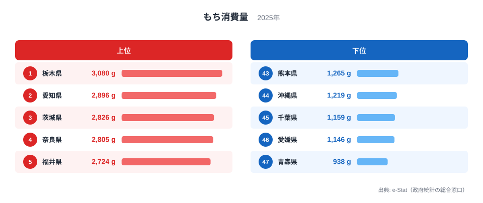

「餅といえば、雪深い北陸や米どころ新潟」――そんなイメージを持つ人は多いはずです。ところが2025年の家計調査で、もち（餅）の年間購入量を都道府県庁所在市で比べると、トップに立ったのは**[栃木県](/areas/09000)**でした。新潟県は16位、富山県は18位にとどまっています。

ここでいう購入量とは、家計調査の品目「もち」について、都道府県庁所在市に住む二人以上世帯が1年間に買った量を、1世帯あたりのグラム数で表したものです。2025年の1位は栃木県の3,080g、最下位は[青森県](/areas/02000)の938gで、その差は**3.3倍**です。

この記事では、まず順位の事実を整理します。そのうえで、上位と下位が地方ごとにきれいに分かれていないことを、同じ地方の中で順位がどれだけ散らばるかで確かめます。なぜその順位になるのかについては、このデータだけでは確かめられない部分が大きいため、確かめられたことと仮説を分けて書きます。

> [!NOTE]
> このランキングは、総務省の家計調査（県庁所在市の二人以上世帯、暦年）にある品目「もち」の年間購入量です。県全体の消費量ではなく、支出額でもありません。世帯平均の値なので、県民1人あたりの量や、県内の市町村すべての傾向と読み替えることはできません。

## もち購入量ランキング2025：上位は地方に偏らない

まず2025年の上位と下位を見てみましょう。

トップは栃木県の3,080gです。2位は愛知県で2,896g、3位は茨城県で2,826gでした。4位は奈良県で2,805g、5位は福井県で2,724gです。1位と2位の差は184gで、栃木県は愛知県の約1.06倍にあたります。この程度の差は、後で述べる標本の小ささを考えると、順位をそのまま実態の差とみなせるほど大きくはありません。

上位5県を地方で分けると、北関東が2県、東海が1県、近畿が1県、北陸が1県です。6位以降も、6位の神奈川県は2,708g、7位の和歌山県は2,622g、8位の兵庫県は2,598g、9位の群馬県は2,566g、10位の宮崎県は2,562gと続きます。上位10県には関東、近畿、北陸、東海、九州が混ざっており、特定の地方が上位を独占する形にはなっていません。

最下位の青森県は938gで、1位の栃木県の3割ほどです。上位10位の最下限である宮崎県の2,562gと比べても、青森県は4割に届きません。順位表の両端は、数字の上でははっきり離れています。

<source-link href="/ranking/mochi-consumption-quantity">もち消費量ランキングの全47都道府県を見る</source-link>

## 同じ地方の中でも順位は大きく散らばる

地方ごとの傾向を確かめるために、同じ地方の県が何位に並んでいるかを見てみます。47都道府県の中央にあたる24位は三重県の1,953gで、栃木県はその約1.6倍です。

関東では、栃木県が1位、茨城県が3位、神奈川県が6位、群馬県が9位、埼玉県が12位、東京都が13位と上位に並びます。ところが千葉県は45位の1,159gで、同じ関東でも1位の栃木県との間に約2.7倍の開きがあります。

東北も同じです。山形県は17位で2,201gですが、岩手県は29位、福島県は30位、宮城県は37位、秋田県は40位、青森県は47位です。山形県と青森県の間には、同じ東北の中で2倍以上の差があります。「東北は餅をよく買う」「関東は少ない」といった地方単位のくくりでは、この順位は説明できません。

近畿もばらつきます。奈良県が4位、和歌山県が7位、兵庫県が8位、滋賀県が11位と上位に入る一方、大阪府は25位の1,911g、京都府は33位の1,690gです。地方で見ると一様に見えるものが、県庁所在市ごとに並べると別々の位置に落ちる、というのがこのランキングの読み方の基本です。

## 最下位グループ：千葉・愛媛・沖縄が下位に並ぶ

下位5県を見ると、47位の青森県が938g、46位の愛媛県が1,146g、45位の千葉県が1,159g、44位の沖縄県が1,219g、43位の熊本県が1,265gです。青森県だけが1,000gを割り、それ以外の4県は1,100g台から1,200g台に集まっています。

下位グループは東北、四国、関東、沖縄、九州にまたがります。最下位に近い県に共通する地域の特徴は、このデータからは読み取れません。43位から47位までの顔ぶれは、上位と同じく、地方のくくりでは整理できない並びです。

> [!WARNING]
> 家計調査は、調査対象世帯が毎年入れ替わる標本調査です。県庁所在市ごとの調査世帯数は多くないため、単年の順位には標本誤差が含まれます。1位と2位のように差が小さい順位は、実態の差とは限りません。順位の入れ替わりを食習慣の変化と読む場合は、複数年の平均で確かめる必要があります。

## 発見1：「餅どころ」の新潟・北陸は中位に

雪国・米どころというイメージの強い新潟県は16位で2,240g、富山県は18位で2,195g、石川県は19位で2,098gです。いずれも47都道府県の真ん中より上にはいるものの、上位10県には入っていません。北陸4県で上位に入ったのは、5位で2,724gの福井県だけです。

米どころの代表格とされる秋田県は40位の1,413gで、新潟県の約6割にとどまります。この結果から、少なくともこの購入量のデータでは、米の産地であることと餅の購入量が多いことが単純に結びついているとは言えません。

[仮説] 米どころでは、自宅でついた餅や贈答の餅が多く、店で買う量に表れにくいために購入量が中位にとどまる可能性があります。ただし、この仮説を確かめるには、自家製の餅や贈答の餅まで含めた消費量の統計との突き合わせが必要で、本データだけでは判断できません。

## 発見2：東京13位・大阪25位は「大都市は少ない」とは言えない

大都市に目を向けると、東京都は13位で2,464g、大阪府は25位で1,911gです。東京都は上位10県に近い位置にあり、大阪府は中央付近にいます。大都市だから購入量が少ない、という単純な見方は当てはまりません。

東京都の2,464gは、3位の茨城県の2,826gとは約360g、最下位の青森県の938gとは約1,500g離れています。大都市圏の県庁所在市が、上にも下にも並ばず、中位から上位寄りに位置している、というのがデータから言えることです。

東京都と大阪府の位置の違いについても、原因はデータからは特定できません。世帯構成、買い物の方法、調査世帯の偏りなど複数の説明が考えられますが、いずれもこの記事のデータでは検証できていません。確かめるには、世帯の人数別や年齢別にもちの購入量を分けた集計が必要です。

## まとめ

- 2025年のもち購入量の1位は**栃木県**の3,080gで、2位は愛知県の2,896g、3位は茨城県の2,826gでした。
- 最下位は**青森県**の938gで、1位の栃木県との差は**3.3倍**です。
- 餅どころとされる新潟県は16位、富山県は18位、石川県は19位で、上位10県には入りませんでした。
- 関東では栃木県が1位、千葉県が45位、東北では山形県が17位、青森県が47位と、同じ地方の中でも順位が大きく散らばります。
- 1位と2位の差は約6%で、単年の家計調査では実態の差と言い切れません。原因の説明は仮説にとどまります。

## データについて

総務省「家計調査」（2025年）の品目「もち」について、都道府県庁所在市の二人以上世帯の年間購入量（グラム）を、e-Stat 経由で整備・集計したものです。順位はこの記事に載せたデータの値から付けています。
