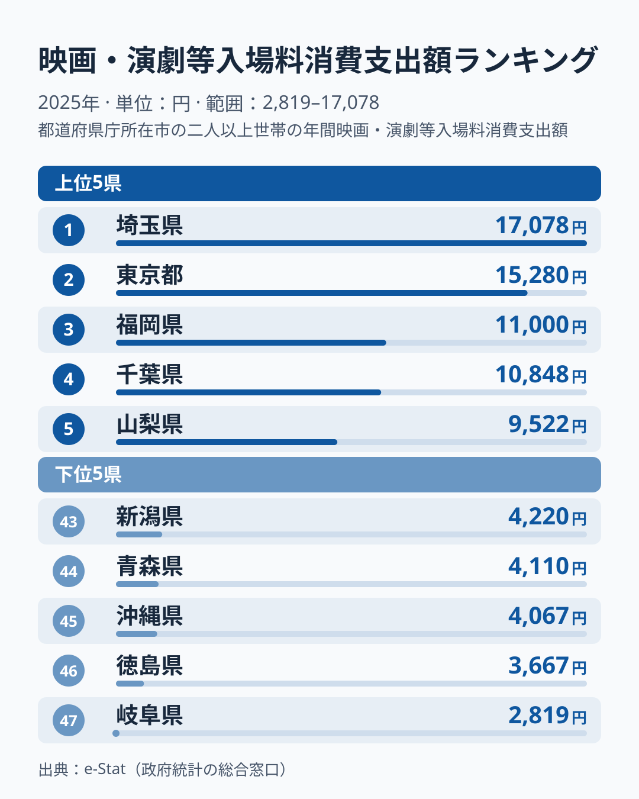
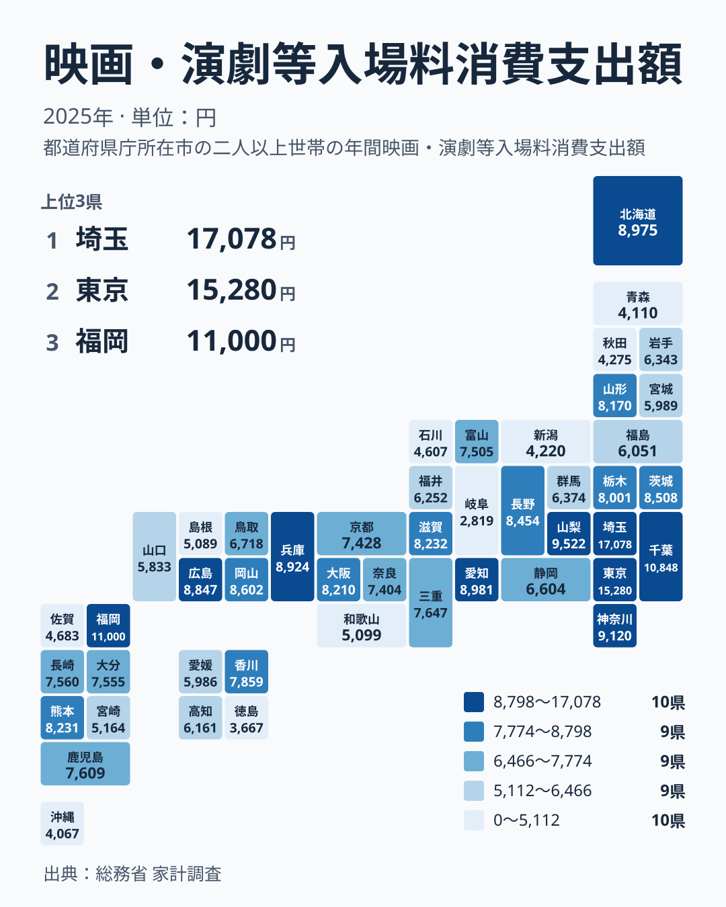

映画館や劇場のチケット代に、私たちは年間どれくらいのお金を使っているのでしょうか。総務省「家計調査」の「映画・演劇等入場料」の消費支出額を2025年の都道府県庁所在市で見ると、1位の埼玉県は17,078円、47位の岐阜県は2,819円で、約6.1倍もの開きがあります。

意外なのは、1位が東京都ではなく埼玉県だという点です。東京都は15,280円で2位にとどまり、埼玉県が約1割上回っています。この記事では、上位・下位の顔ぶれを確かめたうえで、映画館や劇場へのアクセスのしやすさ、家計の余裕、地域の余暇の過ごし方がどう絡み合っているのかを、単年のデータの限界も踏まえながら読み解きます。

> [!NOTE]
> この指標は総務省「家計調査」の「映画・演劇等入場料」の消費支出額です。映画館の入場料だけでなく、劇場・音楽ホールでの観劇・コンサート等の入場料も含む合算値のため、映画館の集客力だけを表す数値ではありません。また調査の対象は各都道府県の県庁所在市の二人以上世帯で、県全体の平均ではない点にもご注意ください。

## 上位と下位

<source-link href="/ranking/movie-theater-consumption-expenditure">映画・演劇等入場料ランキングをもっと見る</source-link>

1位は埼玉県の17,078円で、2位の東京都15,280円を1,798円上回りました。3位の福岡県は11,000円で、2位との間に4,280円の大きな段差があります。上位5県は埼玉県、東京都、福岡県、千葉県10,848円、山梨県9,522円の順で、このうち3つが首都圏です。続く神奈川県も9,120円で、上位6県のうち4つを首都圏の1都3県が占めている点が、今回の最も目立つ特徴です。

首都圏で支出が多い理由として、まず考えられるのは供給の厚みです。大型シネマコンプレックス、ミニシアター、劇場、ライブホールが集積し、電車で行ける範囲に選択肢が多いほど、入場料を払う機会は増えます。ただし東京都より埼玉県が多い点は、施設の数だけでは説明できません。[仮説] 家計調査は住んでいる市の世帯で集計するため、さいたま市の世帯が都心の劇場やライブ会場で買ったチケット代も、埼玉県の値に入ります。都心へ出やすい通勤圏のつくりが影響している可能性がありますが、他の年の値と突き合わせないと確かめられません。

7位以降は愛知県8,981円、北海道8,975円、兵庫県8,924円、広島県8,847円と、地方の中核都市を抱える県が続きます。一方、大阪府は16位の8,210円、京都府は25位の7,428円で、関西の大都市圏が必ずしも上位に入るわけではありません。大都市圏かどうかだけで順位が決まらないことは、この並びからも読み取れます。

下位を見ると、47位岐阜県2,819円、46位徳島県3,667円、45位沖縄県4,067円、44位青森県4,110円、43位新潟県4,220円と、地域のまとまりのない顔ぶれが並びます。注目したいのは岐阜県で、7位の愛知県8,981円とは隣り合う県でありながら3分の1以下です。[仮説] 理由として、鑑賞頻度の低さや、他の娯楽への配分の違いが混ざっている可能性があります。ただし家計調査の県庁所在市の値は標本が小さく、単年の順位は動きやすいため、ここから構造を断定することはできません。

## 単年の順位をどう読むか

> [!WARNING]
> 家計調査は県庁所在市の限られた標本から平均を出すため、映画や演劇のように買う世帯と買わない世帯が分かれる品目は、年によって順位が大きく入れ替わります。この記事の順位は2025年単年の結果であり、「埼玉県が恒常的に東京都を上回る」「岐阜県が構造的に最下位」と読むのは適切ではありません。

映画や演劇の入場料は、買う世帯と買わない世帯の差が大きい品目です。数回の大型公演やライブのチケットを購入した世帯が標本に入るだけで、市の平均は数千円単位で動きます。この記事で見るべきなのは、1位と2位の入れ替わりそのものより、首都圏に上位が集まる大きな傾向と、下位が特定の地方に固まらず散らばるという2つの点です。順位の細かな上下は、複数年の値で確かめるまで断定を避けるのが安全です。

## 発見:首都圏は濃く、下位は特定の地域に固まらない

地図で全47都道府県を俯瞰すると、濃い色（支出額が高い県）は関東と福岡県、山梨県、愛知県、北海道に点在し、薄い色（支出額が低い県）は東北から北陸の日本海側、四国東部、九州の佐賀県、沖縄県などに散らばっています。下位10県には、岐阜県、徳島県、沖縄県、青森県、新潟県、秋田県4,275円、石川県4,607円、佐賀県4,683円、島根県5,089円、和歌山県5,099円が入ります。

東北・北陸だけを見ても、青森県、新潟県、秋田県、石川県が下位10県に入る一方で、山形県は17位の8,170円と中位の上のほうにあります。四国でも、香川県は19位の7,859円ですが、徳島県は46位、愛媛県は35位の5,986円、高知県は32位の6,161円と、地方単位でくくれるほどそろっていません。「都市か地方か」という二分法でも、「地方ごとの傾向」でも整理しきれない散らばり方です。

こうした結果は、施設へのアクセスだけでなく、地域の余暇文化や娯楽費の配分の違いが混ざっていることを示唆します。映画・演劇を娯楽の中心に据える世帯が多い地域では施設が少なくても一定の支出が維持され、アウトドアやスポーツなど他の娯楽に予算が向かう地域では、施設が豊富でも入場料の支出は伸びにくいと考えられます。ただし、どちらの要因がどれだけ効いているかは、この1年分のデータだけでは分離できません。

> [!TIP]
> 娯楽費全体に占める割合や、他の余暇関連支出（外食費・スポーツ観戦費等）と合わせて見ると、「その地域がどんな娯楽にお金を使っているか」という消費文化の輪郭がより鮮明になります。映画・演劇への支出が低い地域が娯楽費自体を切り詰めているのか、別の娯楽に振り替えているのかは、関連ランキングと突き合わせることで見えてきます。

## まとめ

- 1位は埼玉県で17,078円、47位は岐阜県で2,819円と、約6.1倍の差がある
- 東京都は15,280円で2位に入り、埼玉県が東京都を約1割上回った
- 上位6県のうち4つを首都圏の1都3県が占め、福岡県と山梨県がそこに割って入る
- 下位10県は岐阜県、徳島県、沖縄県、青森県、新潟県などで、特定の地方に固まらず散らばっている
- 県庁所在市の標本が小さく、順位は単年で動きやすい。理由は [仮説] として、他の年のデータで確かめる必要がある

映画・演劇への支出は家計の消費行動の一部です。あわせて[外食費](/ranking/dining-out-consumption-expenditure)の地域差を見ると、その地域がどんな娯楽・消費にお金を配分しているのかがより立体的に見えてきます。都道府県ごとの経済指標をまとめて確認したい場合は[経済カテゴリ一覧](/category/economy)、1位の埼玉県の暮らし全体を知りたい場合は[埼玉県の特徴ページ](/areas/11000)もあわせてご覧ください。
