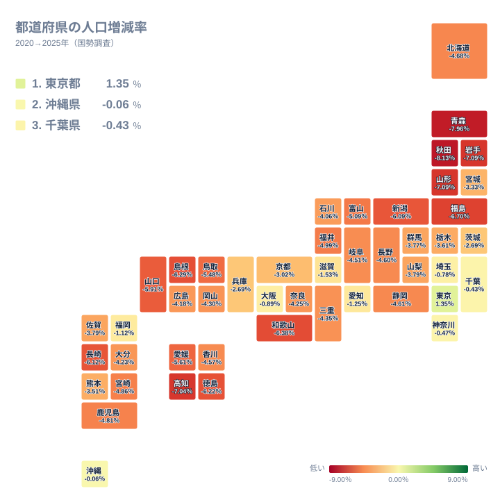
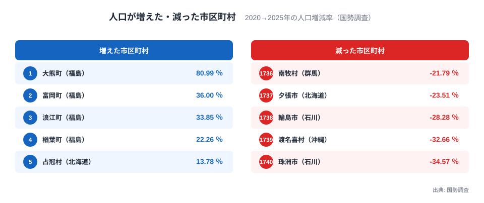
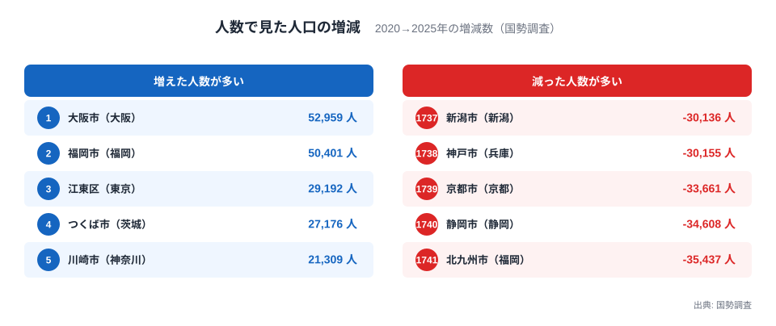
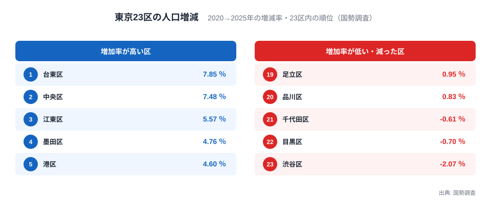

2020年から2025年の5年間に人口が増えた都道府県は、47のうち東京都だけでした。では市区町村まで目を移すと、増えた自治体はどれくらいあるのでしょうか。令和7年国勢調査の確定値で増減率を計算できる1,740市区町村を並べると、増えたのは169で、残る1,571は減っています。

その幅は極端です。最も増えたのは福島県の大熊町で+80.99%、最も減ったのは石川県の珠洲市で-34.57%でした。この記事では、率の高低だけでなく、人数、人口の規模、東京23区の中の差まで重ねて、増減の数字をどう読めばよいかを確かめます。増減の背景については、データから確かめられることと、出来事の時期が重なっているという事実だけを書きます。

## 県では東京都だけ、市区町村では169が増えた

都道府県の地図では、プラスは東京都の+1.35%だけです。2位の沖縄県も-0.06%とわずかに減り、最も減ったのは秋田県の-8.13%、次いで青森県が-7.96%でした。都道府県別の詳しい読み方は、[5年で人口が増えたのは東京だけ](/blog/census-2025-population-change-rate-prefecture)にまとめています。

ただし、県の数字は県内の市区町村の人口をまとめて計算した率で、市区町村ごとの違いは見えません。同じ石川県でも、金沢市は-2.08%、津幡町は+0.78%、珠洲市は-34.57%と、市町ごとの値は大きく離れています。県の地図だけでは、人口が増えた町や急減した町は見えません。次の節から、1,740の市区町村の値を直接見ていきます。

> [!NOTE]
> ここでの増減率は、2025年の国勢調査の人口を、2025年10月1日現在の境域に組み替えた2020年の国勢調査の人口と比べたものです。年次の人口推計に基づく増減率とは期間も出典も異なります。2020年の人口が0人だった福島県の双葉町は率を計算できないため、ランキングは1,740市区町村です。

<source-link href="/ranking/census-population-change-rate-5y">5年間の人口増減率ランキングをもっと見る</source-link>

## 最大+80.99%、最小-34.57%、真ん中は-7.02%

1,740市区町村の増減率の中央値は-7.02%で、半数の自治体が7%以上減っています。減少率が10%を超えた市区町村は488、15%を超えたのは77、20%を超えたのは珠洲市、渡名喜村、輪島市、夕張市、南牧村の5つです。逆に、増加率が10%以上だったのは大熊町、富岡町、浪江町、楢葉町、占冠村、つくば市の6つしかありません。

図の左側、増えた側の上位5つのうち4つは福島県の町で、大熊町が+80.99%、富岡町が+36.00%、浪江町が+33.85%、楢葉町が+22.26%です。5つ目は北海道の占冠村の+13.78%で、6番目に茨城県のつくば市が+11.25%で続きます。右側、減った側の下位5つは、珠洲市が-34.57%、沖縄県の渡名喜村が-32.66%、輪島市が-28.28%、北海道の夕張市が-23.51%、群馬県の南牧村が-21.79%でした。

増加率が10%以上の6つのうち、図の外にあるつくば市は性格が違います。2025年の人口は268,832人と大きいのに、27,176人増えて+11.25%に達しました。人口が大きい自治体は、少しの人数の動きでは率が上がりません。2025年の人口が10万人以上の277市区町村のうち、増加率が10%を超えたのはつくば市だけです。ただし、この指標は人口の総数の差でしかなく、出生と死亡の差である自然増減と、転入と転出の差である社会増減には分かれていません。なぜ増えたのかを確かめるには、人口動態統計や住民基本台帳人口移動報告との照合が要ります。

下位側の夕張市（北海道）、南牧村（群馬県）、渡名喜村（沖縄県）は、2025年の人口がそれぞれ5,610人、1,260人、233人と小規模です。人口が小さい自治体ほど減りやすいという傾向は、後の節でデータとともに確かめます。

あわせて見る: [5年間の人口増減率 市区町村ランキング](/municipalities/ranking/census-population-change-rate-5y)

## 増えた福島の4町は、2020年の人口が小さかった

大熊町（福島県）の人口は、2020年が847人、2025年が1,533人です。2020年の数字は2025年10月1日現在の境域に組み替えた値で、5年間で686人増えました。増加人数は多くありませんが、出発点が小さいために率は+80.99%に達します。富岡町は766人増で+36.00%、浪江町は651人増で+33.85%、楢葉町は826人増で+22.26%でした。いずれも増えたのは数百人規模です。

時期の面では、福島県の公表によると、富岡町、大熊町、双葉町、浪江町、葛尾村、飯舘村の6町村に設定された特定復興再生拠点区域の避難指示は、2022年6月から2023年11月にかけてすべて解除されました。この5年間は、その時期を含んでいます。増加率の上位4つのうち、大熊町、富岡町、浪江町はこの6町村に入っています。楢葉町はこの6町村に入っていないため、この記事では解除の時期との並置は行いません。いずれの町でも、国勢調査の人口の総数からは、増えた人が以前の住民なのか新しく住み始めた人なのかは分かりません。

双葉町（福島県）は、この比較の外にいます。2020年の人口が0人で、2025年は211人でした。0人を基準にした率は計算できないため、増減率ランキングには入っていませんが、人数では211人増えています。福島県で率を計算できる58市町村のうち人口が増えたのは6で、大熊町、富岡町、浪江町、楢葉町、飯舘村、大玉村です。双葉町を加えると、59市町村のうち7が増えたことになります。増えた自治体の少なさと、増えた自治体の増加率の高さが、同じ県の中に並んでいます。

## 減った石川の6市町は、能登半島に並んでいる

珠洲市（石川県）の人口は、2020年の12,929人から2025年の8,459人へ、4,470人減りました。輪島市（石川県）は24,608人から17,649人へ、6,959人の減少で、率は-28.28%です。2024年1月1日16時10分に起きたマグニチュード7.6（暫定値）の能登半島地震では、内閣府の防災白書によると、石川県の輪島市と志賀町で震度7が観測されました。今回の5年間はこの地震の時期を含んでいます。

注目したいのは石川県内の並びです。石川県の19市町のうち、減少率が大きい6つは、珠洲市、輪島市、能登町、穴水町、志賀町、七尾市で、石川県が能登6市町と呼ぶ地域に当たります。能登町は-18.92%、穴水町は-17.72%、志賀町は-14.63%、七尾市は-12.15%で、6番目の七尾市でも減少率は12%を超えます。7番目の宝達志水町は-9.32%でした。

ここで注意したいのは、この指標が2020年10月と2025年10月の人口の差でしかない点です。地震の前から続く人口減少と、地震の後の転出や死亡の影響を、この数字だけで切り分けることはできません。言えるのは、石川県で人口が大きく減った6市町が、震度7が観測された輪島市と志賀町を含む能登半島の市町と重なっている、という事実までです。

## 率は小さな町ほど大きく振れる、人数で見ると景色が変わる

人数で並べ替えると、顔ぶれは一変します。増えた人数が最も多いのは大阪市の52,959人で、福岡市の50,401人、江東区の29,192人、つくば市の27,176人、川崎市の21,309人が続きます。減った人数が最も多いのは北九州市の35,437人減で、静岡市の34,608人減、京都市の33,661人減、神戸市の30,155人減、新潟市の30,136人減です。人数で見ると、上位も下位も人口の多い都市が並びます。なお、人数の順位は双葉町を含む1,741市区町村が対象で、大阪市や福岡市のような政令指定都市は区に分けず1市、東京23区は1区ずつ数えています。

率では目立たない数字が、人数では大きく見えます。北九州市の-3.77%は中央値の-7.02%より減少が小さく、率の順位では目立ちません。大阪市の+1.92%も、率では78番目です。一方で渡名喜村は、わずか113人の減少が-32.66%になります。人口が233人しかなく、2020年の346人から3分の1近く減ったためです。1万人以上増えた市区町村は19、1万人以上減った市区町村は58で、全国の人口の動きを大きく左右するのは、率が極端な小さな町より、人数が大きく動く都市です。

> [!WARNING]
> 増減率の下位に並ぶのは小規模な自治体です。減少率の大きい50市区町村のうち47、100市区町村のうち92は、2025年の人口が1万人未満でした。人口が少ないほど、数十人から数百人の動きでも率が大きく動くため、率の順位だけで地域どうしの深刻さを比べると、規模の違いを読み違えます。増減数も併せて確認してください。

小さい町の下位への集中は、率の振れ幅だけでは説明できません。率を計算できる1,740市区町村のうち、2025年の人口が1万人未満の564市区町村（約3割）では、539で人口が減り、増減率の中央値は-10.78%でした。1万人以上の1,176市区町村の中央値は-4.93%です。小さい町は、率が振れやすいだけでなく、全体として減りやすい集団でもあります。夕張市や南牧村の減少は、数字の揺れとして片づけられない動きです。珠洲市や輪島市も、率の振れの問題ではありません。珠洲市は4,470人、輪島市は6,959人と、人数でも大きく減っています。

<source-link href="/ranking/census-population-change-5y">都道府県別の5年間の人口増減数ランキングを見る</source-link>

あわせて見る: [5年間の人口増減数 市区町村ランキング](/municipalities/ranking/census-population-change-5y)

## 東京23区は20区が増加、3区が減少

東京23区は、20区で人口が増え、3区で減りました。図は23区の中での順位で、増加率が最も高いのは台東区の+7.85%（16,602人増）、次いで中央区が+7.48%（12,662人増）、江東区が+5.57%（29,192人増）、墨田区が+4.76%、港区が+4.60%です。台東区は全国の1,740市区町村でも7番目に高く、中央区は12番目に高い増加率でした。

下位側には、23区で唯一-2%を下回る渋谷区の-2.07%（5,057人減）、目黒区の-0.70%（2,006人減）、千代田区の-0.61%（410人減）が並びます。品川区の+0.83%と足立区の+0.95%を合わせた5区が、23区で増加率の低い側です。同じ東京都の都心部でも、中央区は+7.48%、港区は+4.60%と増えている一方で、千代田区は-0.61%、渋谷区は-2.07%と減っており、都心の区が一様に増えているわけではありません。

23区の増減率は+7.85%から-2.07%まで広がります。23区の人口を合計すると増減数は210,833人、増減率は+2.17%です。都道府県で唯一のプラスだった東京都の+1.35%は、23区に多摩地域と島しょ部を加えた都全体の率なので、23区だけで見るより低くなります。県の単位で見えた「東京だけが増えた」という事実は、区に分けると「増えた区が20、減った区が3」という、もう一段細かい姿に変わります。区ごとの人口は[東京都のページ](/areas/13000)からたどれます。

> [!TIP]
> 人口の増減は、率と人数をセットで読むと誤読が減ります。増加率と増加人数がともに上位10に入るのはつくば市、台東区、流山市の3つだけで、これらは率も人数も大きく動いた地域です。率が高くても数百人規模なら、小さな町の動きです。気になる自治体は、[珠洲市](/areas/17000/cities/17205)、[輪島市](/areas/17000/cities/17204)、[大熊町](/areas/07000/cities/07545)のように市区町村ページで人口の水準もあわせて確認できます。

## まとめ

- 2020年から2025年に人口が増えた都道府県は東京都だけで、率を計算できる1,740市区町村では169が増え、1,571が減りました。
- 増減率は大熊町（福島県）の+80.99%から珠洲市（石川県）の-34.57%まで広がり、中央値は-7.02%でした。
- 増加率の上位4つは福島県の町で、2020年の人口が小さい分、数百人の増加でも率が大きく出ています。
- 石川県で減少率が大きい6市町は能登半島にあり、2024年の能登半島地震の時期と重なりますが、この指標では原因を分けられません。
- 率の下位は小規模な自治体に偏り、1万人未満の市区町村は全体として減りやすい集団です。人数で見ると、大阪市や北九州市のような大都市が上位と下位に並びます。
- 東京23区は20区が増え、3区が減りました。23区の合計は+2.17%で、都全体の+1.35%より高くなっています。

カテゴリ全体は[人口・世帯の統計](/category/population)から見られます。
