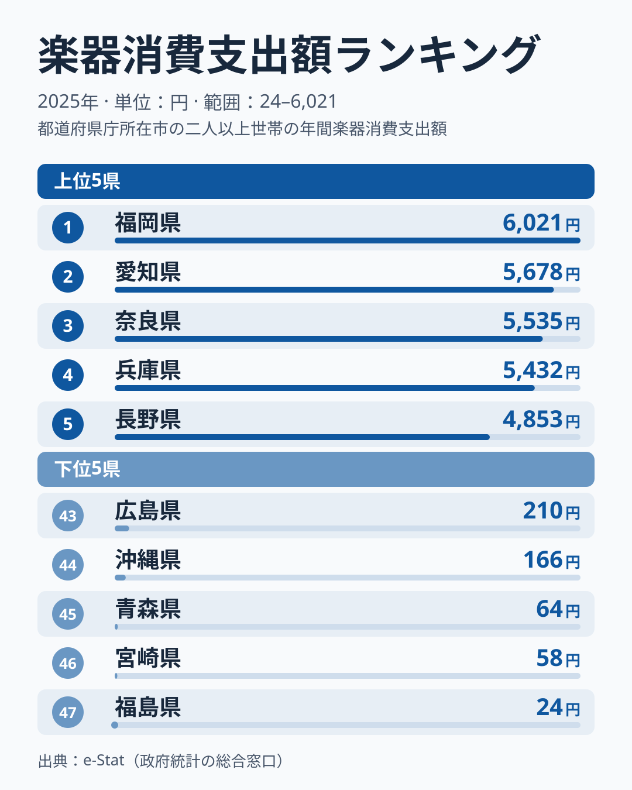

総務省「家計調査」2025年データによると、1世帯当たり年間の楽器消費支出額は福岡県が6,021円で全国1位、最下位の福島県はわずか24円でした。その格差は実に**251倍**に達し、家計調査の数百の支出項目を見渡しても、これほど倍率の大きい地域差はめったにありません。さらに意外なのは、前年の2024年に首位だった埼玉県が、2025年は1,157円の19位まで下がっている点です。「楽器を買う県」は固定されたものではなく、1年で顔ぶれが入れ替わります。本記事ではこの極端で不安定な分布を可視化し、「楽器を買う地域・買わない地域」をどこまで読み取れるのかを整理します。

先に結論の核心をお伝えすると、この251倍という数字は「福岡県民が福島県民の251倍も音楽好き」という意味ではありません。家計調査の楽器支出は、ピアノなど数十万円する高額品を買った世帯がいるかどうかで県平均が大きく跳ねる、**揮発性の高い指標**です。だからこそ単純な「音楽県ランキング」として読むと誤読します。その読み違いを避けながら、データから何が言えるのかを丁寧に追っていきましょう。

> [!NOTE]
> この指標は「世帯が1年間に楽器の購入に使った金額」の平均値で、楽器演奏の頻度や音楽好きの人口比ではありません。対象は都道府県庁所在市の二人以上世帯で、県全体の値ではありません。ピアノ・電子オルガン・ギターなど耐久消費財としての楽器が中心で、数年に一度の高額購入が平均を押し上げる構造を持ちます。

## 上位5と下位5 — 福岡が1位、下位は事実上ゼロ

1位は福岡県の6,021円で、2位愛知県が5,678円、3位奈良県が5,535円、4位兵庫県が5,432円、5位長野県が4,853円と続きます。1位と2位の差は約1.06倍にすぎず、上位5県は5,000円前後にひしめいています。前年のように首位が2番手の約2倍も離れる突出型ではなく、今年は上位が横並びの分布です。東京都も7位で4,424円と上位に入り、「文化消費は大都市が強い」という通説と整合する顔ぶれになりました。ただし大阪府は28位で489円にとどまり、大都市圏なら一律に高いわけではありません。

一方、下位5を見ると様相が一変します。最下位の福島県は24円、46位の宮崎県は58円、45位の青森県は64円で、これは「1世帯が年間でほぼ楽器を購入していない」水準です。44位沖縄県が166円、43位広島県が210円と続きますが、いずれも3桁円台以下にとどまり、上位の数千円とはまったく別の世界です。グラフの下位側のバーが目視できないほど短いのは、上位との桁が違いすぎるためで、この見た目そのものが251倍という格差を物語っています。中位（13位新潟県2,193円、14位神奈川県2,089円など）も含めた47都道府県の全順位は、ランキングページで確認できます。

<source-link href="/ranking/musical-instrument-consumption-expenditure">楽器消費支出額ランキングの全47都道府県を見る</source-link>

なぜこれほど上下が開くのか。鍵は「平均値」という集計方法にあります。家計調査は各県で抽出された世帯の平均を取るため、調査対象世帯のなかにピアノなど高額楽器を購入した家庭が数件あるだけで、県全体の平均が一気に跳ね上がります。逆に、たまたま誰も大型楽器を買わなかった年は、消耗品の弦やリードの数百円分しか計上されず、福島県のような極端な低値になります。つまりこの指標は、年ごとの「当たり外れ」が大きい揮発性の高いデータなのです。

> [!WARNING]
> 家計調査の楽器支出は単年では大きく振れます。ある県が今年1位でも翌年は中位に沈むことが珍しくありません。「福岡=音楽県」と固定的に解釈するのは危険で、評価するなら複数年の平均で見る必要があります。本記事の順位は2025年単年のスナップショットである点に注意してください。

## 1年で顔ぶれが入れ替わる — 前年との比較が示す揮発性

同じランキングの2024年と並べると、この指標の不安定さが具体的に見えます。2024年に首位だった埼玉県は、2025年は1,157円の19位まで下がりました。同じ年に2番手だった岩手県も、2025年は557円の27位です。逆に福岡県は2024年が中位でしたが、2025年は6,021円で首位に上がっています。最下位も入れ替わり、2024年に最下位だった和歌山県は2025年は351円の32位で、代わりに福島県が24円で最下位になりました。

2024年と2025年で上位5位に残った県は、3位の奈良県だけです。奈良県は2年続けて3位で、金額もほぼ同じ水準でした。この結果は、ほとんどの県の順位が「毎年の高額購入の有無」で動いている一方、奈良県のように安定して楽器にお金を使う地域がある可能性を示唆しています。ただし2年分だけでは偶然の一致との区別がつかないため、今後の年次で確かめる必要があります。

## 地域のくくりでは説明しきれない

下位5は福島・宮崎・青森・沖縄・広島と、東北・九州・中国の県が混在します。一見すると「地方圏は楽器を買わない」という地理パターンに見えますが、データを丁寧に追うとこの単純化は成り立ちません。

同じ九州の中で比べてみましょう。福岡県は1位の6,021円、長崎県も10位の2,476円と上位に入る一方、宮崎県は46位の58円で、福岡県とは約104倍の差があります。東北でも宮城県は15位の2,051円ですが、福島県は24円で約85倍の差です。中国地方では岡山県が22位の903円、鳥取県が23位の902円であるのに対し、広島県は43位の210円で、約4.3倍の差があります。近畿でも兵庫県の5,432円に対し大阪府は489円で、約11倍の開きです。地方ブロック単位でも、都市か地方かの二分法でも、楽器支出の上下は説明できません。

首都圏の内部も同様にばらつきます。東京都は7位の4,424円、千葉県が9位の3,145円、神奈川県が14位の2,089円、埼玉県が19位の1,157円で、東京都は埼玉県の約3.8倍です。隣り合う県のあいだでこれだけ値が違うのは、地域の文化的な傾向よりも、標本世帯の個別事情の影響が大きいことを示唆しています。

## なぜ揺れるのか — 3つの仮説で読み解く

単年の順位を額面どおりに受け取らないために、この分布を生む要因を3つの仮説として整理します。いずれも本記事のデータだけでは裏付けが足りず、検証が必要な仮説である点を明記します。

- **[仮説A] 単年スパイク説**：家計調査は1世帯当たりの平均値のため、特定世帯がピアノなど高額楽器を購入すると県平均が大きく跳ねます。前年に首位だった埼玉県が1年で19位に動き、福岡県が中位から首位に上がった事実は、この説と整合します。検証には3年以上の連続データで、同じ県が連年で上位を維持するかを確かめる必要があります。
- **[仮説B] 音楽教育インフラ説**：上位の奈良・兵庫・愛知・福岡には、ピアノ教室・吹奏楽部活動・音大進学率など音楽教育インフラの厚みがある可能性があります。子どもの習い事として楽器を購入する家計が一定数存在する地域構造が、消費支出に反映されているという解釈です。検証には音楽教室数や吹奏楽部加盟校数との相関分析が必要です。
- **[仮説C] 楽器流通アクセス説**：大型楽器店へのアクセス性が購入機会を規定している可能性です。ただしヤマハ・河合といった国内大手メーカーの本社・工場が集中する静岡県は25位の689円で、製造拠点と消費の地理は一致しません。この点は仮説Cに不利な観察事実です。

> [!TIP]
> 揮発性の高い家計支出項目を読むときは、「単年の1位」より「複数年で安定して上位／下位にいるか」を見るのがコツです。1年だけ突出した県は高額購入のスパイク、毎年下位の県は構造的に楽器需要が薄い可能性が高い、と切り分けられます。本記事の順位も、来年は顔ぶれが入れ替わる前提で眺めてください。

楽器という消費は、住宅・教育・趣味が交差する文化資本の指標です。福岡県が1位に立ち、福島県が最下位に沈む今年の構図は、昨年の埼玉県が首位だった地図とはまったく別のものでした。家計調査の各支出項目を横断して眺めると、こうした地域ごとの暮らしの輪郭が見えてきますが、単年の順位を地域性の根拠にするのは控えるべきです。

## まとめ

- 楽器消費支出額1位は福岡県6,021円、47位は福島県24円で**251倍の開き**がありました
- 2位愛知県5,678円、3位奈良県5,535円と上位は横並びで、東京都も7位4,424円と上位に入りました
- 前年に首位だった埼玉県は19位1,157円に下がり、2年続けて上位5位に残ったのは3位の奈良県だけです
- 下位5は東北・九州・中国に分かれ、同じ地方内でも福岡県と宮崎県で約104倍の差があり、地方ブロックでは説明できません
- 1世帯当たり平均値ゆえ高額購入による単年スパイクの影響が大きく、複数年平均での再検証が次の課題です

楽器支出のような暮らしの細部に注目すると、都道府県ごとの家計の個性が見えてきます。ほかの家計支出の地域差は、企業・家計・経済カテゴリのランキング群もあわせてご覧ください。

- [企業・家計・経済カテゴリのランキング一覧](https://stats47.jp/category/economy)
- [福岡県のプロフィール（1位の県の家計全体像）](https://stats47.jp/areas/40000)
- [福島県のプロフィール（47位の県の家計全体像）](https://stats47.jp/areas/07000)
