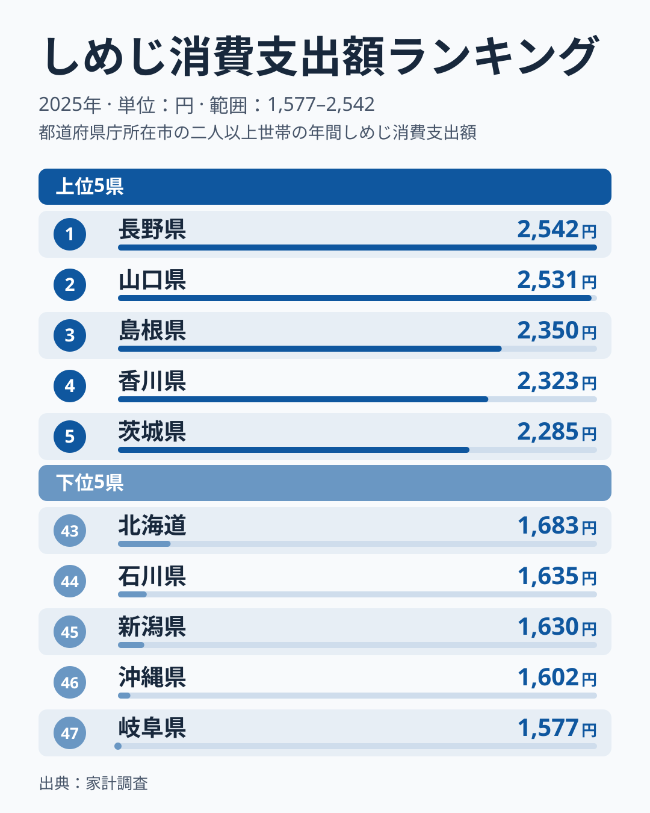
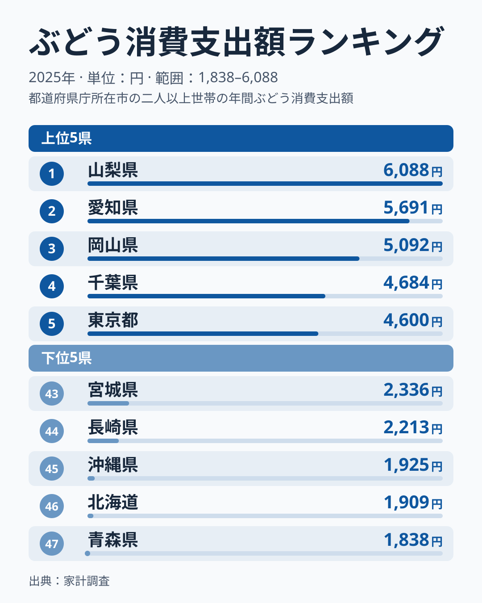
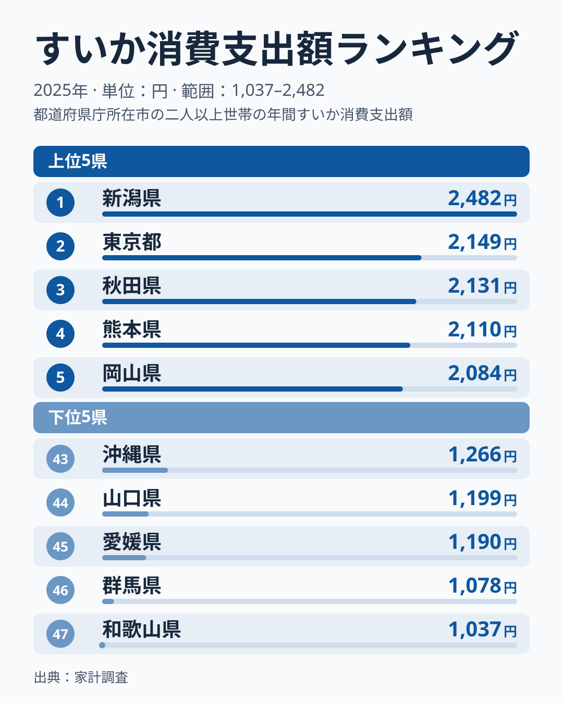
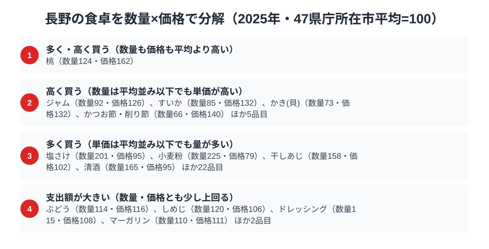

日本の屋根とも呼ばれる山岳県・長野。海に面しない内陸県ですが、高原の気候が育む農産物で食卓は豊かだと思われがちです。総務省の家計調査（品目別）の2025年で長野市の二人以上世帯を見ると、全国1位なのはしめじ（2,542円）で、ぶどうは6位（4,487円）、すいかは15位（1,782円）でした。きのこは首位でも、ぶどうとすいかの2品目では、果物の信州というイメージほどには上位に並びません。

結論を先に書くと、47都道府県庁所在市の平均を100とした指数（数量×価格に分解した相対値）で見て、長野市の世帯が多く買うのは塩さけ（数量201）と小麦粉（数量225）、高く買うのはすいか（価格132）です。桃は数量124・価格162と、量も単価も平均を大きく上回ります。

きのこ王国のしめじ、信州のぶどう、高原のすいか。この記事では3つの品目を横断しながら、長野市の食卓が「どこで日本一なのか」「どこで意外と控えめなのか」を読み解きます。

> [!NOTE]
> 家計調査の都道府県データは、県庁所在市（長野県は長野市）の二人以上世帯を対象にした年間支出額です。県全体ではなく長野市在住世帯の値で、単年の順位はぶれやすい点を、以下の解釈では前提にしています。ぶどうやすいかの産地は長野市とは別の地域にもあり、ここで比べるのは産地ではなく長野市の世帯の支出額です。

## しめじ — 全国1位2,542円、きのこ王国

<source-link href="/ranking/shimeji-consumption-expenditure">しめじ消費支出額ランキングをもっと見る</source-link>

長野県のしめじ消費支出額は2,542円で全国1位です。ただし2位の山口県が2,531円で、差は11円しかありません。3位の島根県が2,350円なので、長野と山口が頭ひとつ抜けた2強という構図です。一方、最下位の岐阜県は1,577円で、1位との差は1.6倍ほどです。

長野はえのき・しめじ・なめこなど、栽培きのこの生産量で全国トップを誇る「きのこ王国」といわれます。[仮説] 地元で新鮮なきのこが手頃に手に入る環境が、しめじの支出額を支えているのかもしれませんが、この調査だけでは検証できません。首位との差が11円しかないため、翌年は順位が入れ替わっても不思議ではありません。数量×価格に分解すると、しめじは数量指数が120、価格指数が106で、単価よりも量の多さが支出額を押し上げています（詳しくは後半の分解節で見ます）。

## ぶどう — 全国6位4,487円、首位は山梨

<source-link href="/ranking/grape-consumption-expenditure">ぶどう消費支出額ランキングをもっと見る</source-link>

果物ではぶどうが長野市の主役です。ぶどうの消費支出額は4,487円で全国6位でした。1位は山梨県で6,088円、2位は愛知県で5,691円、3位は岡山県で5,092円です。4位は千葉県で4,684円、5位は東京都で4,600円と続き、上位5県に長野は入りませんでした。

長野は巨峰やシャインマスカットなど高品質なぶどうの産地で、隣県の山梨とともに日本のぶどう栽培を代表します。それでも消費額で見ると、山梨はもちろん、愛知県や東京都にも上位を譲っています。[仮説] 出荷が県外の市場へ向かうぶん、地元の家計に回る金額は産地の大きさほど伸びない可能性があります。産地であることと家庭の支出額が大きいことは別、という点は、この記事全体を読むうえでの前提です。

## すいか — 全国15位1,782円、数量は少なく単価で支える

<source-link href="/ranking/watermelon-consumption-expenditure">すいか消費支出額ランキングをもっと見る</source-link>

すいかの消費支出額は1,782円で、全国15位です。1位は新潟県の2,482円、2位は東京都の2,149円、3位は秋田県の2,131円です。4位は熊本県で2,110円、5位は岡山県で2,084円でした。47都道府県のうち15位は上位3分の1に入る位置ですが、首位の新潟県とは700円の開きがあります。最下位の和歌山県は1,037円です。

長野は「波田すいか」など高原ですいか栽培が盛んなことで知られます。ただし波田すいかの産地は松本市で、この順位は長野市の世帯の支出額です。県内の産地の評判と長野市の食卓という、別の地域どうしの対比である点に注意してください。長野市の家計では、上位に並ぶほどではありませんでした。上位に新潟、東京、秋田、熊本、岡山と地域がばらばらに並んでおり、産地の近さだけで順位が決まっているわけではなさそうです。

> [!WARNING]
> 家計調査は支出金額の調査で、物価や単価の違いも金額に影響します。しめじは1位と2位の差が11円、すいかは10位の奈良県が1,821円で15位の長野市との差が39円と、順位の近い県どうしの金額差はごく小さい点に注意してください。

## 果物の信州は弱いのか

3品目を並べると、長野市の食卓は「きのこは強いが、ぶどうとすいかは産地ほど強くない」という姿です。きのこ王国のしめじは全国1位、信州のぶどうは6位、高原のすいかは15位でした。ただし果物は2品目だけの比較で、りんごなど他の信州果物の順位はここでは確かめていません。

次の節で見るように、桃は数量も価格も平均を大きく上回っており、「果物は弱い」と言い切ることはできません。支出額の順位は一面にすぎないため、数量と価格の両方から食卓を見直してみます。

## 数量×価格で分解する長野市の食卓

支出額の順位だけでは、「たくさん食べているから支出額が大きいのか」「単価の高いものを買っているから支出額が大きいのか」を区別できません。支出額を数量×価格に分解し、47都道府県庁所在市の平均をそれぞれ100として長野市の指数を求めると、しめじは数量指数が120、価格指数が106、ぶどうは数量指数が114、価格指数が116でした。どちらも数量と価格の両方が平均を少し上回っており、支出額が上位に来るのは、量も単価も平均よりやや大きい積み重ねの結果と読めます。

すいかは違います。数量指数は85と平均を下回る一方、価格指数は132と高くなっています。長野市のすいかは、たくさん買うからではなく、単価の高いものを少なく買う形で支出額が支えられていると読めます。[仮説] 購入している品種や大きさの違いが単価に表れている可能性がありますが、この調査からは確かめられません。

果物の中で目立つのは桃です。桃は数量指数が124、価格指数が162と、数量も価格も平均を大きく上回ります。この区分で「多く・高く買う」に入ったのは桃だけで、ぶどうやしめじは「支出額が大きい（数量・価格とも少し上回る）」の区分でした。量で稼ぐ代表は塩さけ（数量201・価格95）と小麦粉（数量225・価格79）です。長野市の食卓は、桃のように量も単価も高いもの、塩さけや小麦粉のように量で稼ぐもの、すいかのように単価で稼ぐものに分かれています。

<source-link href="/ranking/peach-consumption-quantity">桃消費量ランキングをもっと見る</source-link>

なお、図に載る品目を区分ごとに挙げると、高く買う区分にはジャム（数量92・価格126）、かき(貝)（数量73・価格132）、かつお節・削り節（数量66・価格140）、多く買う区分には干しあじ（数量158・価格102）、清酒（数量165・価格95）、支出額が大きい区分にはドレッシング（数量115・価格108）、マーガリン（数量110・価格111）が入ります。それぞれ「ほか」の品目は図の注記にまとめてあります。

> [!NOTE]
> ここでの指数は「47都道府県庁所在市の単純平均」を100とした相対値で、家計調査の全国平均値そのものではありません。価格指数は購入している品種・銘柄・グレードの違いも反映します。対象は二人以上世帯・長野市の年間データ（2025年）です。

## まとめ

- しめじ消費支出額は長野県が全国1位（2,542円）、ただし2位の山口県は2,531円で僅差
- ぶどうは全国6位（4,487円）、1位の山梨県は6,088円
- すいかは全国15位（1,782円）、数量指数は85と平均を下回り、価格指数132の単価の高さで支出額を保っている
- 桃は数量124・価格162と量も単価も高く、塩さけ・小麦粉は量で、すいかは単価で支出額を作っている

長野県の他の統計は[長野県の地域プロフィール](/areas/20000)、食品・家計消費の地域差は[経済カテゴリ一覧](/category/economy)、ほかの品目の順位は[ランキング一覧](/ranking/)からご覧いただけます。
