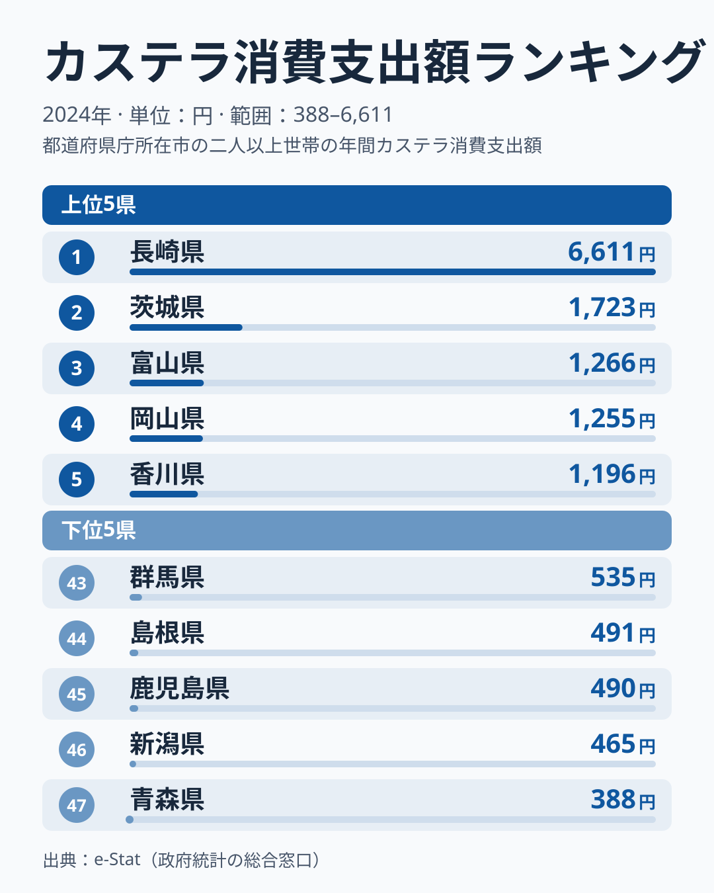
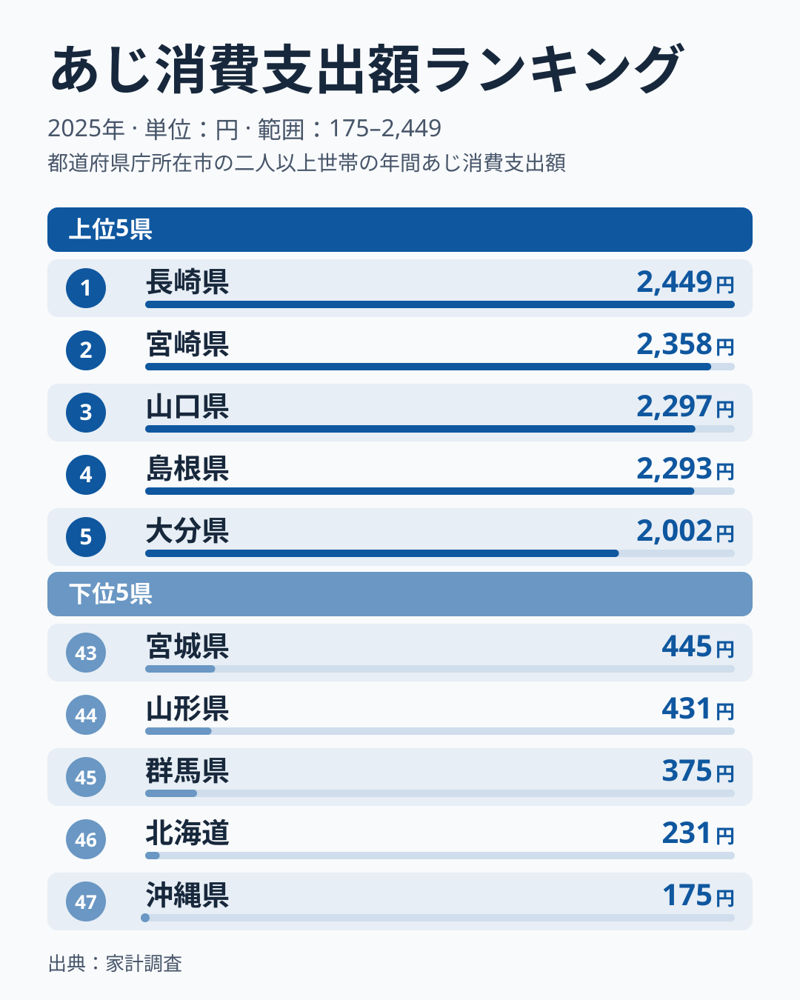
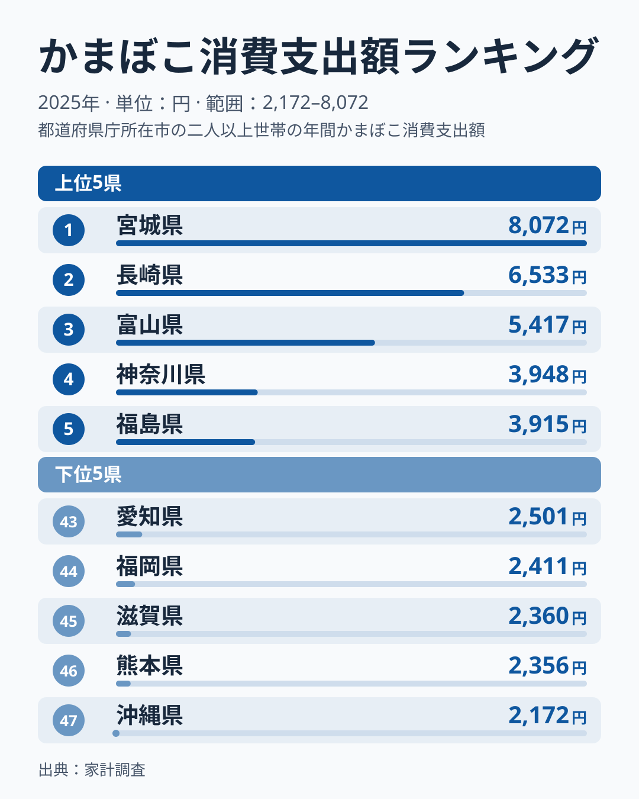

長崎県の食卓といえばカステラを思い浮かべる人が多いはずです。2025年の家計調査でも、長崎市の二人以上世帯がカステラに使った年間支出額は5,223円で、全国1位でした。ところが長崎が1位なのはカステラだけではありません。あじの年間支出額も2,449円で全国1位、かまぼこは6,533円で全国2位です。

では長崎は何でも多く買う県なのかというと、そうではありません。まぐろは47位、菓子類全体では31位に沈みます。この記事では、カステラ、あじ、かまぼこの三つの図で長崎の突出ぶりを確かめ、そのうえで「突出する品目」と「そうでない品目」の差から食卓の特徴を読み解きます。カステラだけを掘り下げた分析は[カステラ支出、長崎だけ別格の16.5倍差](/blog/castella-expenditure-ranking)にまとめていますので、この記事は長崎の食卓を品目横断で見る位置づけです。

> [!NOTE]
> 数値は総務省「家計調査」の2025年(暦年)の結果で、都道府県庁所在市(長崎県は長崎市)に住む二人以上世帯の1世帯あたり年間支出額です。県全体の値でも、個人の消費量でもありません。標本が小さいため、順位の小さな差は年によって入れ替わります。

## カステラ — 5,223円で全国1位、2位の3.6倍

<source-link href="/ranking/castella-consumption-expenditure">カステラ消費支出額ランキングをもっと見る</source-link>

2025年のカステラ消費支出額は、長崎県が5,223円で1位です。2位は富山県の1,445円、3位は三重県の1,430円、4位は愛知県の1,381円、5位は京都府の1,363円と続きます。2位から5位までが1,300円台から1,400円台に固まっているため、5,223円という長崎の数字は2位の3.6倍にあたり、順位表の中で一つだけ高く突き出ています。

下位に目を移すと、47位は山形県の316円、46位は岩手県の510円、45位は山梨県の535円です。1位の長崎と47位の山形を比べると16.5倍の差があり、1品目でこれほど差が開くのは珍しい分布です。

カステラは南蛮菓子として長崎に伝わったとされ、古くからこの土地に根づいた菓子として知られています。[仮説] 長崎では贈答品や手土産としてだけでなく、自宅用としても日常的に買われており、観光土産を主とする他県とは購入の頻度や場面が違うのかもしれません。家計調査は長崎市に住む世帯が実際に購入した金額を集計しているため、地元での購入習慣が数字に表れている可能性はありますが、この図だけでは理由を特定できません。

## あじ — 長崎は1位、ただし2位以下との差はわずか

<source-link href="/ranking/horse-mackerel-consumption-expenditure">あじ消費支出額ランキングをもっと見る</source-link>

あじの年間支出額は、長崎県が2,449円で全国1位です。2位は宮崎県で2,358円、3位は山口県で2,297円、4位は島根県で2,293円、5位は大分県で2,002円でした。カステラと違い、1位と2位の差は91円しかありません。長崎は「突出」というより、九州3県と中国2県が並ぶ上位グループの先頭にいる、という読み方が正確です。

一方で下位には、47位の沖縄県が175円、46位の北海道が231円、45位の群馬県が375円、44位の山形県が431円、43位の宮城県が445円と並びます。1位の長崎と47位の沖縄の差は14.0倍で、カステラの16.5倍に近い開きです。上位がすべて西日本で、下位に北海道や東北の県が目立つ点は、あじという魚の流通や食べ方の地域差が大きいことを示しています。

[仮説] 長崎では近海で獲れる魚を日常的に買う習慣があり、それがあじへの支出に表れているのかもしれません。ただし家計調査は産地を問わず「あじ」という品目の支出額を集計しているので、地元産かどうかまでは分かりません。

> [!WARNING]
> あじの1位と2位の差は91円で、2位の宮崎県の金額に対して4%に満たない差です。家計調査は標本が小さい統計なので、翌年に長崎と宮崎の順位が入れ替わっても不自然ではありません。「長崎がぶっちぎりで1位」ではなく、「西日本の上位グループの一角」と読むのが安全です。

## かまぼこ — 長崎は全国2位、九州では長崎だけが上位

<source-link href="/ranking/fish-paste-consumption-expenditure">かまぼこ消費支出額ランキングをもっと見る</source-link>

かまぼこの年間支出額は、1位が宮城県で8,072円です。2位は長崎県で6,533円、3位は富山県で5,417円でした。4位は神奈川県で3,948円、5位は福島県で3,915円となり、ここから金額が一段下がります。長崎の金額は宮城の8割にあたり、富山との差は1,116円です。また長崎と神奈川の差は2,585円あり、宮城、長崎、富山の3県が他の県から一段離れた位置にあることがわかります。

47位は沖縄県の2,172円で、1位の宮城県との差は3.7倍でした。カステラの16.5倍やあじの14.0倍に比べて差が小さいのは、かまぼこが全国どこでも買われる定番の食品であり、地域による極端な偏りが出にくいためと考えられます。

注目したいのは九州内の差です。同じ九州の福岡県は44位の2,411円、熊本県は46位の2,356円で、長崎だけが上位に入っています。九州の県であれば練り製品を多く買う、という単純な地域傾向ではなく、長崎県という土地に固有の購入習慣があることがうかがえます。[仮説] 魚を加工した練り製品が日常の食卓や贈答に使われる場面が多いことが背景にあるのかもしれませんが、この図だけでは確かめられません。

## 「何でも多い県」ではない — まぐろは47位、菓子全体は31位

ここまで見ると、長崎は買い物の金額が全体に大きい県のように見えます。しかし同じ2025年の家計調査で別の品目を見ると、その印象は崩れます。

魚介の中でも、まぐろの年間支出額は長崎県が1,362円で47位、つまり全国で最下位です。1位の静岡県は10,467円で、長崎との差は7.7倍に達します。魚介全体の支出額でも長崎県は82,029円の8位にとどまり、1位の富山県の88,929円とは大きな差がありません。魚が好まれる県ではありますが、あじが際立って多く、まぐろは買われていないという、魚種ごとの偏りが大きい県だと読めます。

菓子でも同じ傾向です。菓子類全体の年間支出額は長崎県が107,560円で31位、1位の埼玉県は125,627円でした。カステラは1位でも、菓子類全体では中位より下ということになります。長崎の甘いものへの支出が全体として多いのではなく、カステラという特定の品目に集中している様子がわかります。

こうして見ると、冒頭の問いへの答えは次のようになります。長崎の食卓は、カステラとあじ、かまぼこが強く、まぐろや菓子全体ではむしろ弱いという、品目ごとの偏りが大きい食卓です。1位が三つあるように見えても、それは「全部が多い」ことを意味しません。

まぐろ、魚介全体、菓子類全体の順位は、それぞれのランキングページで全県分を確かめられます。あわせて見る: [まぐろ消費支出額ランキング](/ranking/tuna-consumption-expenditure) / [魚介類消費支出額ランキング](/ranking/seafood-consumption-expenditure) / [菓子類消費支出額ランキング](/ranking/confectionery-consumption-expenditure)

## ほかの県の食卓と比べる

特定の品目だけが突き抜ける県は、長崎だけではありません。かつお節の消費で目立つ沖縄は[沖縄の食卓｜なぜかつお節だけ日本一?](/blog/okinawa-food-culture)で、肉の品目に特徴がある熊本は[熊本の肉は馬刺しだけではない？](/blog/kumamoto-food-culture)で、それぞれ家計調査から読み解いています。また、本場とされる地域が必ずしも上位に来ない例として、[香川の半分以下、福岡の生うどん・そば購入量](/blog/udon-soba-food-culture-prefecture-map)も参考になります。

どの県でも、順位の高い品目だけでなく、順位の低い品目を並べて見ることで、その県の食卓の偏りが見えてきます。長崎の場合、それはカステラやあじの強さと、まぐろの弱さの対比でした。

## まとめ

- カステラ消費支出額は長崎県が5,223円で全国1位、2位の富山県の3.6倍、47位の山形県とは16.5倍の差
- あじは長崎県が2,449円で1位だが、2位の宮崎県とは91円差で、九州3県と中国2県が並ぶ上位グループの先頭
- かまぼこは長崎県が6,533円で2位、同じ九州の福岡県は44位、熊本県は46位
- 一方でまぐろは47位、菓子類全体は31位で、長崎は「何でも多い県」ではない
- カステラやあじが多い理由は、地元での購入習慣が背景にあるかもしれないが、これは仮説にとどまる

長崎県の統計データは、[長崎県の地域プロフィール](/areas/42000)でも詳しく見られます。他の家計調査データは[経済カテゴリ一覧](/category/economy)からどうぞ。
