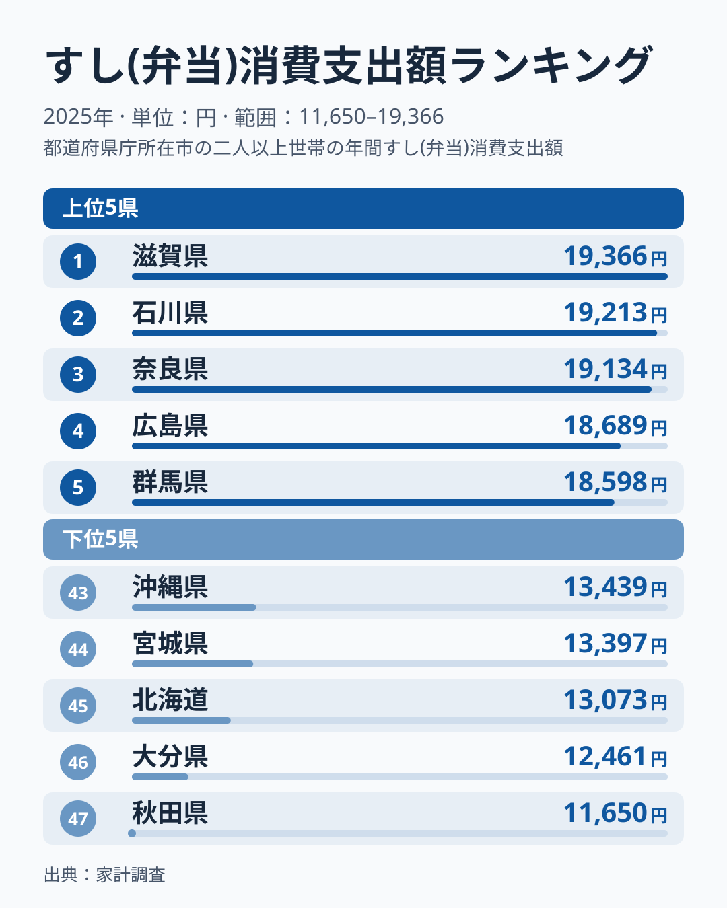
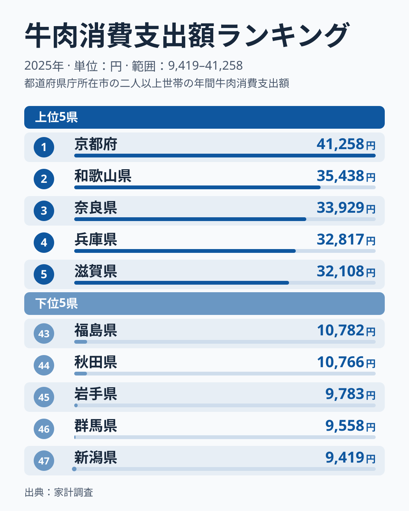
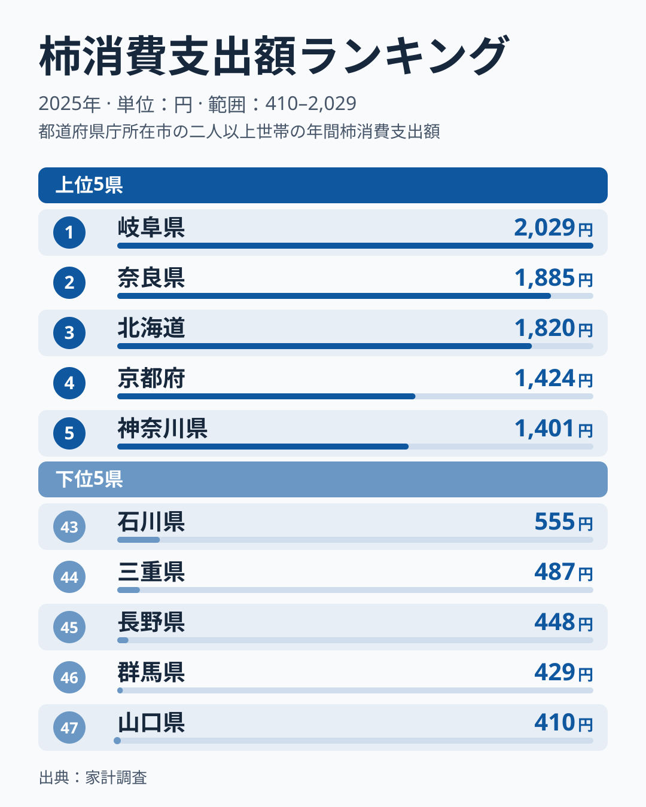
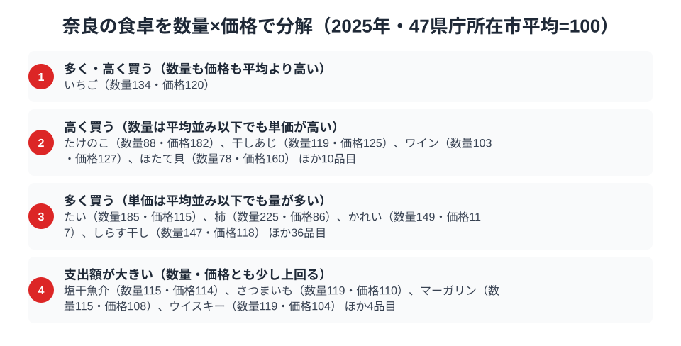

奈良県民の食卓を家計調査のデータで見ると、ひとつの驚きに突き当たります。「すし(弁当)」「牛肉」「柿」という、系統も価格帯もまるで違う3つの品目で、奈良がすべて全国3位以内に入っているのです。3品目の上位3県をすべて確かめても、3つとも顔を出すのは奈良だけです。

寿司はテイクアウトの惣菜、牛肉は食肉、柿は果物。ふつうならこれらは別々の地域が強みを持つはずです。ところが奈良では3つが同時に上位に並びます。この記事では、[家計調査（品目別）](/category/economy)の実データをもとに、共通の原因を断定するのではなく、確認できる順位の並びを軸に、考えられる背景を仮説として整理します。単年の順位は入れ替わりやすいため、結論ではなく読み解きの手がかりとしてお読みください。

> [!NOTE]
> 家計調査は都道府県庁所在市（奈良県は奈良市）の二人以上世帯を対象にした年間消費支出額の調査です。県全体ではなく県庁所在市の世帯が単位になるため、市部の消費傾向が強く反映される点に注意してください。

## すし(弁当) — 全国3位19,134円、上位3県は僅差

<source-link href="/ranking/sushi-takeout-consumption-expenditure">すし(弁当)消費支出額ランキングをもっと見る</source-link>

すし(弁当)の消費支出額は奈良県が19,134円で全国3位です。1位は滋賀県で19,366円、2位は石川県で19,213円と、上位3県は僅差に収まっています。最下位は秋田県で11,650円にとどまり、1位との差は1.7倍です。

奈良には柿の葉寿司という郷土食があります。[仮説] 寿司を持ち帰って食べる習慣が根付いていれば、テイクアウトの寿司支出が押し上げられる可能性があります。ただし、この記事のデータからは習慣の有無までは確かめられません。家計調査の市別の値は単年のぶれが大きく、1位から3位までが僅差でもあるため、順位そのものより「全国上位の水準にいる」ことを読み取るのが安全です。

## 牛肉 — 全国3位33,929円、上位5県が近畿で並ぶ

<source-link href="/ranking/beef-consumption-expenditure">牛肉消費支出額ランキングをもっと見る</source-link>

牛肉の消費支出額は奈良県が33,929円で全国3位です。1位は京都府で41,258円、2位は和歌山県で35,438円、4位は兵庫県で32,817円、5位は滋賀県で32,108円と、上位5位をすべて近畿の県が占めています。最下位は新潟県の9,419円で、1位との差は4.4倍に開きます。

確認できるのは、上位5位に近畿の府県が並んでいるという事実です。[仮説] 近畿の中で牛肉への支出が高い水準にそろっていることが背景にある可能性がありますが、理由まではこのデータから言えません。奈良は3位で、1位との差は7,329円です。

## 柿 — 全国2位1,885円、隣県との差が大きい

<source-link href="/ranking/persimmon-consumption-expenditure">柿消費支出額ランキングをもっと見る</source-link>

柿の消費支出額は奈良県が1,885円で全国2位です。1位は岐阜県で2,029円、3位は北海道で1,820円と続きます。最下位は山口県の410円で、1位との差は4.9倍と、3品目の中でもっとも格差が大きくなっています。

注目したいのは隣県との差です。和歌山県は同じ2025年の柿の消費支出額が833円で29位にとどまり（[和歌山の食卓記事](/blog/wakayama-food-culture)も参照）、隣り合う県でも柿の支出額には大きな開きがあります。近畿という括りでは説明できず、[仮説] 県ごとの食習慣の違いが表れている可能性がありますが、この記事のデータでは確かめられません。

> [!WARNING]
> ここで扱う数値は家計調査における「消費支出額」であり、消費量そのものではありません。また、柿の葉寿司のように柿を使った加工品がどの品目に計上されるかは、この記事では確認していません。

## 3品目の共通点は奈良だけ。近畿では括れない

上位3県の顔ぶれは品目ごとに異なります。すし(弁当)は滋賀県・石川県・奈良県、牛肉は京都府・和歌山県・奈良県、柿は岐阜県・奈良県・北海道で、3つに共通して顔を出すのは奈良県だけです。

1位との差を円で比べると、品目ごとに奈良の位置づけは違います。すし(弁当)は滋賀県と232円差、柿は岐阜県と144円差で、どちらも1位にほぼ並ぶ水準です。牛肉は1位との差が7,329円あり、3位でも1位からは離れています。近畿の府県が複数入るのは牛肉の上位で、柿では近畿から奈良県だけ、和歌山県は29位にとどまります。

そのため、共通原因を一つに絞るのは難しく、品目ごとに別々の背景が重なっている可能性があります。[仮説] 品目ごとに異なる要因が奈良で同時に働いているのかもしれません。単年の順位が偶然のぶれを含むのか、毎年続く傾向なのかは、複数年の推移を並べて見ないと区別できません。

## 数量×価格で分解する奈良市の食卓

<source-link href="/ranking/persimmon-consumption-quantity">柿消費量ランキングをもっと見る</source-link>

家計調査は品目ごとに支出額だけでなく、数量と価格のデータも別々に集計しています。支出額は「数量×価格」に分解できるため、47都道府県庁所在市の平均をそれぞれ100とした指数にすると、奈良市がその品目を「多く買っているのか」「高く買っているのか」を切り分けて読むことができます。図では奈良市の食卓を、図の区分名で次の4つに整理しています。区分名の括弧書きは目安で、例に挙がった品目の数値を見ると、境目は単純な「数量・価格が平均より上か下か」ではありません。図は境目の基準そのものを示していないため、以下は例の数値から読み取れる範囲の整理です。

- 多く・高く買う：いちご（数量134・価格120）の1品目のみで、数量も価格も平均を上回ります
- 高く買う：たけのこ（数量88・価格182）、ほたて貝（数量78・価格160）のように数量が平均を下回る品目のほか、干しあじ（数量119・価格125）、ワイン（数量103・価格127）のように数量が平均を上回る品目もあります。例の品目はいずれも、数量より価格の上振れのほうが大きくなっています
- 多く買う：柿（数量225・価格86）は価格が平均を下回りますが、たい（数量185・価格115）、かれい（数量149・価格117）、しらす干し（数量147・価格118）のように価格が平均を上回る品目もあります。例の品目はいずれも、価格より数量の上振れのほうが大きくなっています
- 支出額が大きい：塩干魚介（数量115・価格114）、さつまいも（数量119・価格110）、マーガリン（数量115・価格108）、ウイスキー（数量119・価格104）は、数量が15〜19、価格が4〜14ポイント平均を上回り、どちらの上振れ幅も小さい品目です

各区分の品目数は、図に示された例と「ほか」の数の合計で、「多く・高く買う」は1品目、「高く買う」は14品目、「多く買う」は40品目、「支出額が大きい」は8品目です。

すし(弁当)・牛肉・柿のうち、この図で数量と価格を確かめられるのは柿です。柿は数量225・価格86で「多く買う」に入ります。価格は平均を下回っており、特別高い単価で買っているわけではありません。支出額が全国2位になっているのは、単価ではなく柿消費量（購入量）の多さが理由と読めます。牛肉とすし(弁当)はこの図に品目として挙がっていないため、数量と価格のどちらが支出額を押し上げているのかは、ここからは判断できません。

支出額のランキングだけを見ると「たくさん食べているのか」「高いものを買っているのか」を区別できません。数量と価格に分解すると、柿のように購入量が突出して単価は平均を下回る品目と、たけのこのように購入量は平均を下回っても単価が高い品目を見分けられます。市別の値は単年のぶれが大きいため、この区分も2025年時点の姿として読んでください。

> [!NOTE]
> ここでの指数は47都道府県庁所在市の単純平均を100とした相対値で、家計調査の全国値そのものとは一致しません。また価格は支出額÷数量から逆算した相対的な単価であり、購入する品種やブランドの違いも含むため、純粋な価格水準の差とは限りません。

## まとめ

- すし(弁当)・牛肉・柿の3品目で上位3県に入るのは奈良県だけです
- 上位の顔ぶれは品目ごとに異なり、近畿という括りでは説明できません。共通の原因は断定できず、品目ごとの背景が重なった可能性があります（[仮説]）
- 数量×価格では、柿は数量225・価格86（47県庁所在市平均=100）で、単価ではなく購入量の多さが支出額を押し上げています
- [奈良県の地域プロフィール](/areas/29000)では、他の指標でも奈良県の特徴を確認できます
