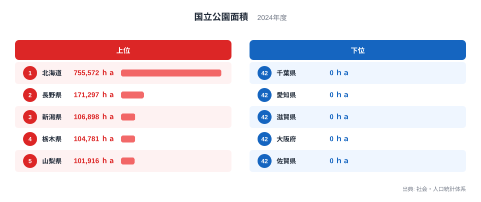
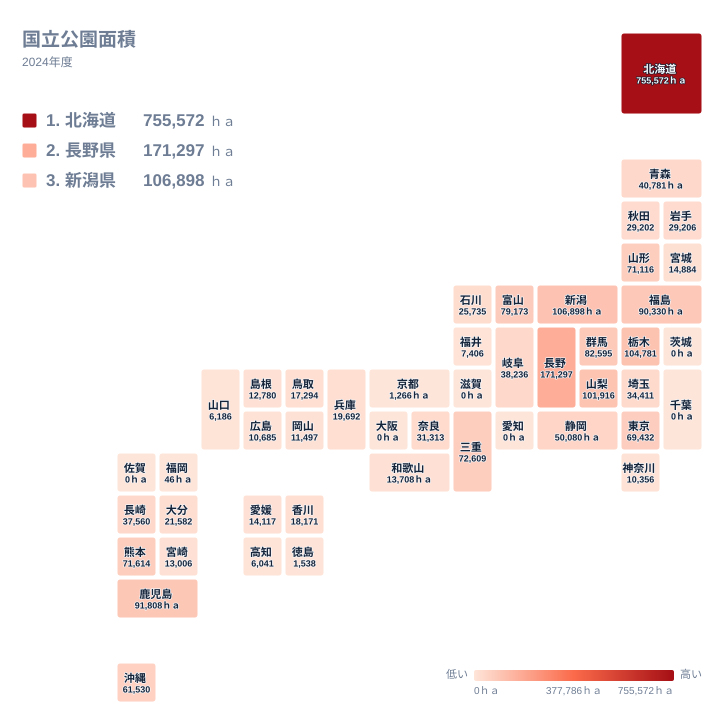

国立公園の面積は、都道府県を大きく二つに分けます。2024年のデータでは、1位の北海道が755,572ｈａです。一方で、42位から47位までの県は0ｈａと記録されています。この記事では、上位と下位がなぜこの順になるのかを、地形と土地利用の視点から整理します。ただし、手元にあるのは面積と順位だけです。理由として挙げる事柄は、確定した事実ではなく、背景にある可能性が高いと考えられる仮説として書きます。

## 国立公園面積の上位と下位を見る

まず、上位5県と下位5県を並べた図を見てください。

<source-link href="/ranking/national-park-area">国立公園面積ランキングをもっと見る</source-link>

上位は、1位の北海道が755,572ｈａ、2位の長野県が171,297ｈａ、3位の新潟県が106,898ｈａ、4位の栃木県が104,781ｈａ、5位の山梨県が101,916ｈａです。1位と2位の間には大きな開きがあります。755,572ｈａは171,297ｈａの4倍強にあたり、2位以下の県が束になっても、北海道に並ぶのは簡単ではありません。

下位は、47位の佐賀県から42位の茨城県まで0ｈａが続きます。該当するのは茨城県、千葉県、愛知県、滋賀県、大阪府、佐賀県の6県です。41位の福岡県は46ｈａで、0ｈａの県とほとんど変わらない水準です。最小が0ｈａのため、最大と最小の倍率は計算できません。この指標の差は、倍率というより「国立公園の区域がある県とない県」という違いとして読むのが適切です。

[北海道のデータ](/areas/01000)を見ると、ほかの指標でも北海道の規模の大きさが目に入ります。国立公園面積の突出も、その広い県土と無関係ではない可能性があります。

> [!NOTE]
> この指標は、国立公園として指定された区域の面積を、都道府県ごとに集計したものです。複数の県にまたがる公園は、各県の区域に分けて数えられていると考えられます。県の総面積に対する割合ではないため、県の大きさの違いも順位に影響します。

## 北海道が突出する背景

北海道が1位になる背景には、県土そのものの大きさと、まとまった自然地域が広く残っていることがあると考えられます。国立公園は、すぐれた自然の風景地を保護し、利用するための区域です。広い範囲に山岳や湿原、火山、海岸などが連なる地域ほど、指定面積は大きくなりやすいはずです。

ただし、本記事のデータには地形や土地利用の情報は含まれていません。そのため、北海道の755,572ｈａがどの地形に由来するのかは、この数字だけでは断定できません。分かるのは、2位の長野県と比べて4倍強の面積であるという事実までです。

2位以下を見ると、長野県、新潟県、栃木県、山梨県が続きます。長野県、新潟県、山梨県は中部、栃木県は関東です。中部と関東の山地を抱える県が上位に並ぶ構図は、山がちな県ほど国立公園の面積が大きくなりやすいという仮説と整合します。

## 本州の上位県と地理分布

次に、地理分布のタイルマップを見てください。

地図では、面積の大きい県が北海道に加え、中部と関東北部に集まっている様子が読み取れます。東北では福島県が7位で90,330ｈａ、山形県が12位で71,116ｈａです。九州・沖縄では、鹿児島県が6位で91,808ｈａ、熊本県が11位で71,614ｈａ、沖縄県が14位で61,530ｈａです。上位が東日本だけに偏っているわけではなく、九州・沖縄にも広い県があります。

[長野県のデータ](/areas/20000)で見ると、長野県は171,297ｈａで2位です。山岳地帯が広いことが背景にある可能性がありますが、この数字だけで地形との関係を証明することはできません。続く群馬県は8位で82,595ｈａ、富山県は9位で79,173ｈａ、三重県は10位で72,609ｈａです。

関東の中でも差があります。栃木県は4位で104,781ｈａ、群馬県は8位で82,595ｈａ、東京都は13位で69,432ｈａと上位に入ります。一方、茨城県と千葉県は0ｈａです。同じ地方の中でも、順位は大きく分かれます。

## 下位の県をどう読むか

0ｈａの県は、茨城県、千葉県、愛知県、滋賀県、大阪府、佐賀県です。これらの県が国立公園を持たない理由は、平野や市街地が広い県が多いことが背景にある可能性があります。ただし、土地利用の統計はここにないため、仮説の域を出ません。

ここで大切なのは、0ｈａが「自然が乏しい」ことを意味しない点です。県内に美しい景観や保護された自然があっても、国立公園の指定を受けていなければ、この統計には現れません。国定公園など別の制度の区域は含まれません。

また、国立公園は制度上、国が指定してきた区域です。指定の経緯が県ごとの差に影響している可能性はありますが、本記事のデータには指定時期の情報がなく、ここで検証することはできません。

> [!WARNING]
> 0ｈａの県と、46ｈａの福岡県のように極端に小さい県は、指定の有無で順位が大きく動きます。実際の面積差が小さくても順位は離れることがあります。順位だけで自然環境の豊かさを比べることは避けてください。

## 近畿の順位が割れる様子

中位から下位の県は数が多いので、ここでは一つの切り口として、同じ地方でどれだけ順位が割れるかを近畿で見ます。三重県は10位で72,609ｈａと上位に入ります。奈良県は20位で31,313ｈａ、兵庫県は25位で19,692ｈａ、和歌山県は30位で13,708ｈａです。京都府は40位で1,266ｈａ、滋賀県と大阪府は0ｈａです。

同じ近畿の7府県でも、上位から0ｈａまでが並びます。地方でひとまとめにして語れない指標だといえます。自分の県を位置づけるときは、地方の傾向よりも、県ごとの値と順位を直接確かめるほうが確実です。

## 数字を読み解くための視点

この指標を使うときは、順位と面積の両方を見てください。北海道の755,572ｈａは他県を大きく上回り、2位の長野県の4倍強です。長野県、新潟県、栃木県、山梨県は、いずれも10万ｈａを超える水準で並びます。

一方で、下位に近づくほど面積の差は小さくなります。徳島県は39位で1,538ｈａ、京都府は40位で1,266ｈａ、福岡県は41位で46ｈａです。この範囲では、順位が一つ動いても、実際の差は小さい場面があります。

[同じカテゴリの統計一覧](/category/landweather)では、土地や気候に関する他の指標を見られます。国立公園面積を、ほかの指標と並べて読むと、各県の自然条件をより立体的に理解できる可能性があります。

> [!TIP]
> 国立公園面積を読むときは、まず1位の北海道と2位の長野県の差に注目します。次に、0ｈａの県が並ぶ下位を見て、指定の有無という制度上の違いを確かめます。最後に、同じ地方の中で順位がどれだけ割れているかを比べると、県ごとの違いが見えてきます。

## データについて

この記事で使ったのは、社会・人口統計体系の「国立公園面積」です。2024年の都道府県別の値で、単位はｈａです。記事中の数値と順位は、すべてこの統計から引いています。

国立公園面積は、自然の豊かさそのものを測る指標ではありません。制度上の指定を受けた区域の広さを、都道府県ごとに集計した数字です。地形や土地利用、指定の経緯といった背景は、この統計からは直接確認できません。そのため、本文の理由づけは仮説として読んでください。

## まとめ

北海道は755,572ｈａで1位となり、2位の長野県の4倍強です。長野県、新潟県、栃木県、山梨県が10万ｈａを超えて続き、茨城県、千葉県、愛知県、滋賀県、大阪府、佐賀県は0ｈａです。

山地を抱える県が上位に集まり、平野や市街地の広い県が下位に集まるという見方は、数字と整合する仮説です。ただし、確かめられるのは面積と順位までです。自分の住む県や訪れたい県の値と順位を、ぜひ直接見比べてみてください。
