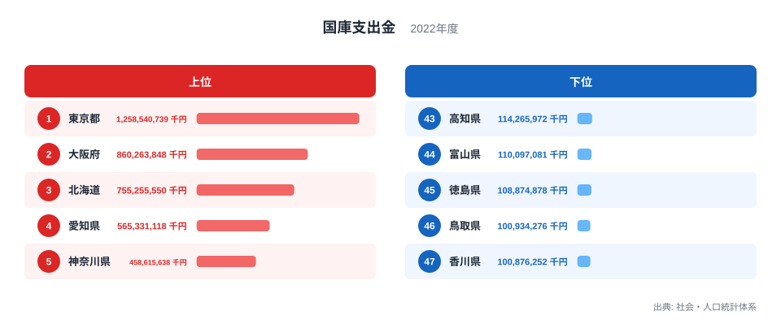
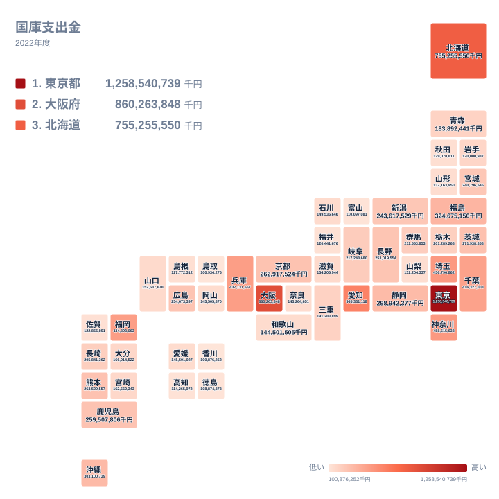

## 国から地方へ届くお金は、どの県に多いのか

道路や福祉、教育、災害復旧といった個別の事業のために、国が使い道を決めて自治体へ渡すお金があります。これが国庫支出金です。どの県にどれだけ届いているかを並べると、都道府県ごとの姿の違いが見えてきます。

2022年のデータで最も多かったのは東京都で、1,258,540,739千円でした。2位は大阪府の860,263,848千円、3位は北海道の755,255,550千円です。最も少なかったのは47位の香川県で、100,876,252千円でした。46位の鳥取県は100,934,276千円で、香川県とほとんど並んでいます。

この記事では、上位と下位の顔ぶれ、地方ごとの順位の散らばり、順位が人口の大きさだけでは読み切れない県の三点を順に見ていきます。使うのは県別の値と順位だけなので、事業の内訳や背景は推測の域を出ません。その点は本文中でも明示します。

> [!NOTE]
> ここで扱う値は、都道府県ごとの総額です。人口一人あたりや面積あたりに直していないため、人口規模の影響を受けうる指標です。順位の高さは、そのまま「国から手厚く扱われている」ことを意味しません。

## 上位と下位を並べると見えるもの

まず、上位5県と下位5県を図で確認します。

<source-link href="/ranking/national-treasury-disbursement-prefecture">国庫支出金ランキングをもっと見る</source-link>

上位は東京都、大阪府、北海道、愛知県、神奈川県の順です。4位の愛知県は565,331,118千円、5位の神奈川県は458,615,638千円でした。東京都と2位の大阪府の間には、398,276,891千円の差があります。2位から5位までは金額が段階的に下がっていくので、先頭の東京都だけが飛び抜けている形です。

北海道以外の4都府県は、いずれも人口の多い大都市圏にあります。総額の指標なので、人口が多い県が上位に来やすいのは自然な流れと考えられます。ただし人口の数値は今回のデータに含まれないため、どこまでが人口の影響かは、この記事では確かめられません。

下位は47位の香川県、46位の鳥取県、45位の徳島県、44位の富山県、43位の高知県です。徳島県は108,874,878千円、富山県は110,097,081千円、高知県は114,265,972千円でした。顔ぶれには四国の3県が含まれます。ただし四国は4県で、残る愛媛県は34位です。四国全体が下位に固まっているわけではなく、愛媛県だけが中位に位置しています。

> [!TIP]
> 下位の読み方には注意が必要です。47位の香川県は100,876,252千円、46位の鳥取県は100,934,276千円で、差は58,024千円しかありません。1位の東京都と2位の大阪府の差が398,276,891千円あることと比べると、下位の順位の違いはごく小さな差です。順位の数字より、金額の開きの大きさで見るのが読み違いを防ぐコツです。

## 地図で見る地域ごとの散らばり

次に、位置関係が分かるタイルマップで、順位の分布を見ます。

地図で目につくのは、地方の内部で順位が大きく開いている点です。関東は1都6県のうち、東京都が1位、神奈川県が5位、埼玉県が6位、千葉県が9位と、4都県が9位以内に入っています。一方で茨城県は13位、群馬県は22位、栃木県は24位です。関東の中だけで、1位から24位まで幅があります。

近畿はさらに開きが大きい地方です。大阪府が2位、兵庫県が7位にいる一方で、和歌山県は35位、奈良県は36位です。大阪府2位と奈良県36位の間には34の開きがあります。大都市を抱える府県に金額が寄る傾向は読み取れますが、その理由までは今回のデータでは示せません。

中国と四国は、順位が全体に後ろ寄りです。中国では広島県が17位で最も高く、鳥取県が46位で最も低くなっています。四国は愛媛県の34位が最上位で、高知県が43位、徳島県が45位、香川県が47位でした。両地方とも20位以内に入るのは広島県だけです。九州・沖縄は福岡県が8位、沖縄県が11位、熊本県が14位、鹿児島県が16位、長崎県が23位、大分県が28位、宮崎県が29位、佐賀県が41位と、8県が上位から下位まで広く分かれています。

> [!WARNING]
> この指標は2022年の1年分だけです。大きな事業が特定の年に集中すると、その県の金額が一時的に変わる可能性があります。1年の順位から、その県の「いつもの水準」を断定することはできません。

## 人口だけでは読み切れない県

人口が多い県が上位に来やすいとしても、順位がそれだけで決まるとは限りません。そこで気になるのが、北海道、福島県、沖縄県の三つです。人口は今回のデータにないため、以下は可能性の指摘にとどまります。

北海道は3位で、755,255,550千円でした。大都市圏の県に混じって上位に入っています。広い面積を持つ地域で、道路や港湾などの社会基盤を維持する事業が大きくなる可能性が考えられます。ただし、どの事業がどれだけ影響したかは、このデータでは確認できません。

福島県は10位で、324,675,150千円でした。9位の千葉県のすぐ後に続く順位です。東日本大震災後の復興にかかわる事業が影響している可能性はありますが、内訳は示されていないため、確かなことは言えません。同じ東北では、宮城県が20位の240,796,546千円、青森県が26位、岩手県が27位、山形県が37位、秋田県が39位でした。東北の中で、福島県の順位の高さは目立ちます。

沖縄県は11位で、303,100,739千円でした。福島県の一つ下の順位です。離島が多いことや、地域振興のための国の施策が関係している可能性は考えられますが、これも内訳が分からない以上、推測です。こうした県の順位は、人口の大きさだけで説明しきれない部分があるかもしれない、と受け止めておくのが妥当です。

## 東京都と大阪府、そして中位の県たち

トップ2の東京都と大阪府も見ておきます。東京都は1,258,540,739千円で、2位の大阪府の860,263,848千円を大きく上回ります。詳しい数値は[東京都のデータ](/areas/13000)や[大阪府のデータ](/areas/27000)でも確認できます。大阪府は全国2位であり、近畿はもちろん、中部や九州のどの県よりも多い金額でした。

中位の県も眺めてみます。静岡県は12位の298,942,377千円、茨城県は13位の271,938,858千円、熊本県は14位の263,529,557千円、京都府は15位の262,917,524千円です。10位台の県どうしは金額が近く、順位が一つ違うだけの差はごくわずかです。20位台後半以降も、青森県の183,892,441千円から香川県の100,876,252千円まで、金額はゆるやかに下がっていきます。

下位の層はとくに接近しています。香川県と鳥取県は、順位が一つ違うだけで金額はほぼ並んでいます。順位の入れ替わりが起きやすいのは、この下位と中位の層です。

別の財政指標と組み合わせたい場合は、[同じカテゴリの統計一覧](/category/administrativefinancial)から探してみてください。

## データについて

この記事で使ったのは、社会・人口統計体系の「国庫支出金」で、年は2022年、単位は千円です。47都道府県すべての値を使っています。順位は金額の大きい順です。

値は都道府県ごとの総額で、人口や面積で割った値ではありません。記事中で触れた事業や事情は、金額の大小を考えるための可能性の指摘であり、データから確かめたものではありません。

## まとめ

2022年の国庫支出金は、東京都の1,258,540,739千円から香川県の100,876,252千円まで、大きく開いていました。上位は東京都、大阪府、北海道、愛知県、神奈川県の順で、下位は香川県、鳥取県、徳島県、富山県、高知県でした。

同じ地方の中でも順位は大きく散らばり、関東や近畿では上位と下位の差がはっきり表れています。北海道、福島県、沖縄県のように、人口の大きさだけでは説明しきれない可能性のある県もあります。総額の順位を見るときは、事業の内訳が分からない点を踏まえ、背景は慎重に読む必要があります。
