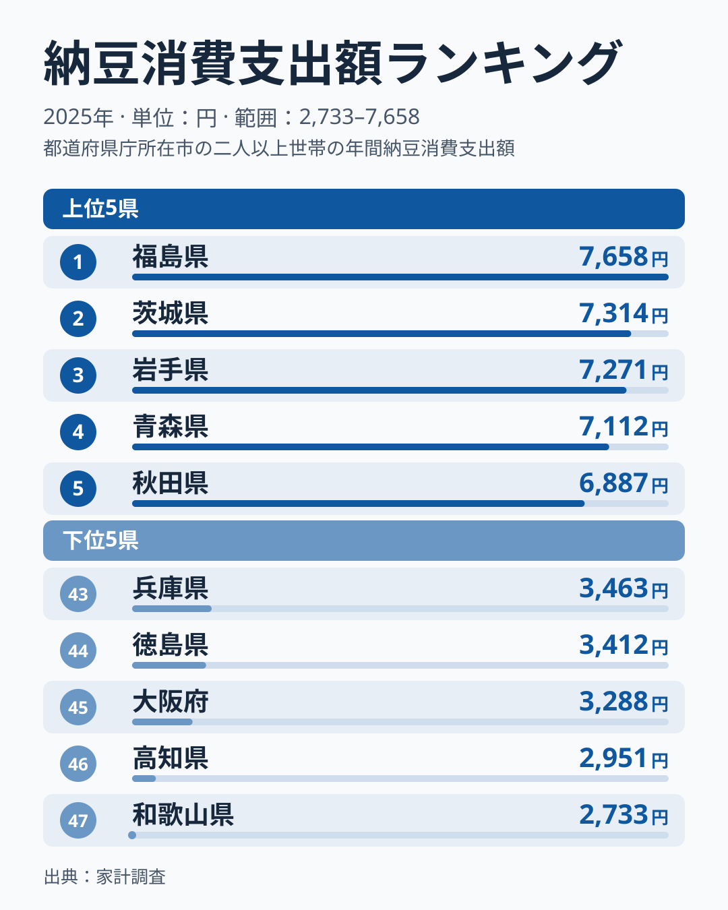
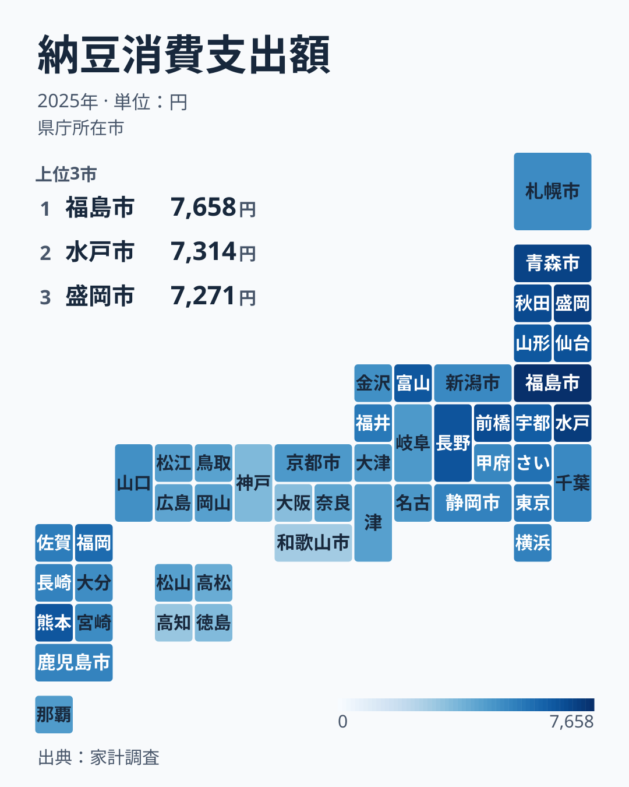

「納豆を食べる県・食べない県の境界は、いったいどこにあるのか」──関西出身者が「納豆は苦手」と言い、東北出身者が「毎朝食べる」と語る。この体感は、家計のデータにくっきり残っています。

総務省「家計調査」(2025年) で、1世帯あたりの納豆への年間支出額を都道府県別に並べると、1位は**[福島県](/areas/07000)の7658円**。対して最下位は**[和歌山県](/areas/30000)の2733円**で、その差は約2.8倍にのぼります。しかも上位と下位は、地図の上で見事に東西に分かれています。本記事では、この「納豆の東西境界」がどこに引かれているのかをデータで可視化します。

> [!NOTE]
> 数値は総務省「家計調査」(2025年、二人以上の世帯) の都道府県庁所在市別「納豆」年間支出額。消費「量」ではなく「支出額」のため、価格差の影響も含む。県全体ではなく県庁所在市の世帯が対象である点に注意。

## 上位・下位の顔ぶれ

上位10県は、1位が[福島県](/areas/07000)で7658円、以下、茨城・岩手・青森・[秋田県](/areas/05000)・群馬・宮城・長野・熊本・富山の順です。10県のうち9県は東日本の県で、九州から熊本が入っています。11位は山形、12位は栃木で、福島・岩手・青森・秋田・宮城・山形の東北6県はすべて11位以内、関東の茨城は2位、群馬は6位、栃木は12位と、いずれも12位以内に収まっています。

<source-link href="/ranking/natto-consumption-expenditure">納豆消費支出額の47都道府県ランキングをもっと見る</source-link>

図のとおり、上位5県の福島・茨城・岩手・青森・秋田はいずれも6887円以上で、下位5県の兵庫・徳島・大阪・高知・和歌山はいずれも3500円を下回り、最下位の和歌山は2733円です。上位5県の最低である秋田の6887円と、下位5県の最高である兵庫の3463円との間には、大きな開きがあります。ここで見えるのは、上位と下位の水準が大きく離れた二極の構図です。東北・茨城・群馬は「たくさん買う」側に、近畿・四国は「あまり買わない」側に、はっきり寄っています。

> [!TIP]
> 東北が強い理由としてよく挙がるのが、寒冷な気候と稲作・大豆生産との相性、そして「わら納豆」に代表される歴史的な保存食文化です。逆に近畿・四国では、出汁文化や他の発酵食品(なれずし等)が食卓の主役を担ってきた経緯があります。ただしこれらは家計調査から検証できる事柄ではなく、[仮説]の域を出ません。

## 東西の境界はどこに引かれているか

47都道府県すべての分布を地図で見ると、「東高西低」のグラデーションがより鮮明になります。

近畿は、京都が32位、滋賀が34位、三重が38位、奈良が41位、兵庫が43位、大阪が45位、和歌山が47位と、すべて32位以下です。四国も愛媛が36位、香川が42位、徳島が44位、高知が46位と、いずれも36位以下です。東北の福島が1位の7658円、岩手が3位の7271円であるのと比べると、水準の差は歴然としています。

境界が通るのは中部です。長野が8位で6604円、富山が10位で6532円と、東北並みの高水準を保ちます。福井は16位で5525円、静岡は20位で5234円、山梨は22位で5094円、新潟は24位で5024円と、その下の中位帯に並びます。石川は28位の4836円で、愛知は30位で4572円、岐阜は31位で4549円となり、近畿の水準に近づきます。三重は38位で4296円と、滋賀の34位4443円よりさらに低くなります。静岡の20位から愛知の30位へ、このあたりで水準が切り替わっています。ただし中部の順位は年ごとに大きく動きます。前年に17位だった岐阜は2025年に31位へ、25位だった福井は16位へと入れ替わっており、単年の順位から細かな境界線を引くのは危うい読み方です。県庁所在市の値は調査世帯数が少なく、ぶれが出やすいためです。

境界線は行政区分の「東日本／西日本」よりやや東に寄り、中部のうち静岡から愛知のあたりで切り替わる、と読むのが無理のないところです。

> [!NOTE]
> 首都圏は、埼玉が14位で5759円、東京が15位で5528円、神奈川が18位で5272円、千葉が23位で5032円と、14位から23位の中位帯にとどまります。これは人口流入により多様な出身者が混在し、東北ほどの一極的な消費にならないため、と説明されることが多いものの、[仮説]であり家計調査だけでは確かめられません。

同じ西日本でも、九州は低消費一色ではありません。[熊本県](/areas/43000)は9位で6535円と、東北の山形の11位や栃木の12位を上回りました。福岡は13位で5932円、佐賀は17位で5395円と、こちらも中位以上で、九州7県(沖縄を除く)の順位は9位から27位のあいだに散らばります。「西日本＝低消費」は一枚岩ではなく、低位に並ぶのは近畿と四国が中心です。熊本は前年も11位と上位でした。九州に納豆食の習慣が根づいているためという見方もできますが、これも[仮説]です。

## 歴史的背景と全国トレンド

納豆の地域差は近年に生まれたものではなく、稲作の副産物としての大豆利用と、わらに棲む納豆菌を使った発酵という、地域ごとの食文化の蓄積に根ざすと考えられます。一方で、健康志向や手軽さから、かつて「東日本の食べ物」とされた納豆が全国的に浸透しつつある可能性もありますが、この点も[仮説]として読む必要があります。

> [!WARNING]
> 本記事の指標は消費「量」ではなく「支出額」である。価格やパックサイズ、特売頻度の地域差が金額に影響するため、支出額が低い=食べる頻度が低い、と単純化はできない。あくまで家計の支出ベースの傾向として読み解く必要がある。

## 境界線の今後

上位に福島・茨城・岩手が並び、下位に和歌山・高知・大阪が並ぶという構図は、2025年も崩れていません。1位が福島で最下位が和歌山という組み合わせも、前年と同じです。食文化の境界は、平準化の波のなかでもしぶとく残っているようです。では境界はこれからも維持されるのでしょうか。

首都圏が中位にとどまること(東京が15位、神奈川が18位)は、多様な出身者が混在して一極的な食文化が薄まる現象と整合します。同様の論理で、若年世代の人口移動が進めば東北型・近畿型の境界線が徐々に溶けていく可能性はあります。一方で、地域食文化は親世代から子世代へ伝わる再生産性が高く、消費パターンの変化は緩やかになりやすいと考えられます。いずれも[仮説]であり、愛知・岐阜・三重の水準が今後どちらの方向へ動くかが、東西分断の維持と収束を占う指標になります。

## データについて

- 総務省統計局「家計調査」(2025年、二人以上の世帯、都道府県庁所在市別「納豆」年間支出額)
- 政府統計ポータル e-Stat 統計表ID 0004023605
- データは政府統計ポータル e-Stat を通じて整備。出典の利用は政府標準利用規約(CC BY 4.0 互換)に基づく
