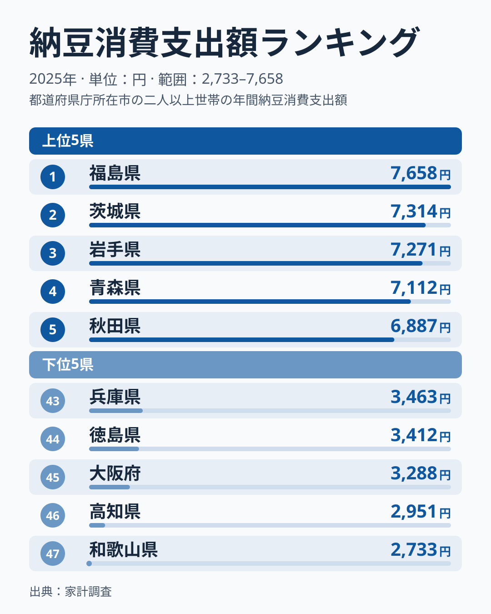
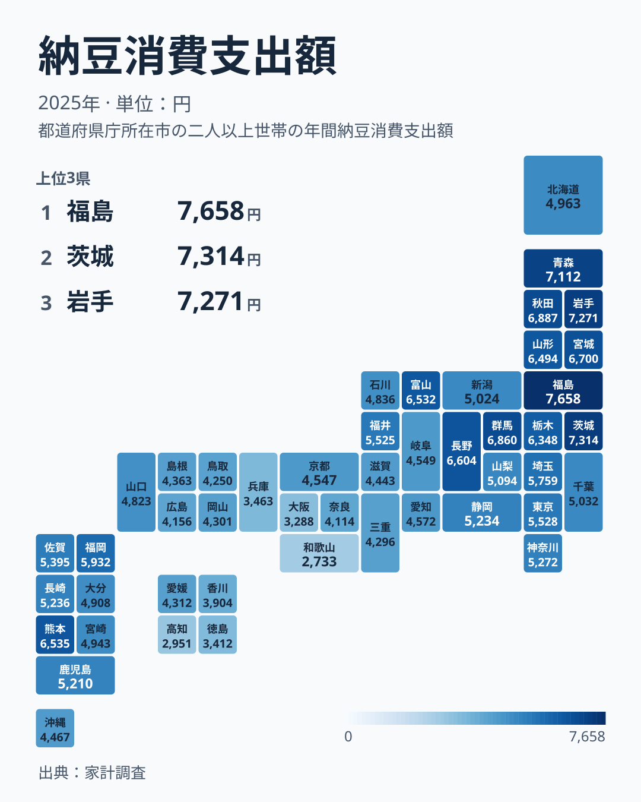
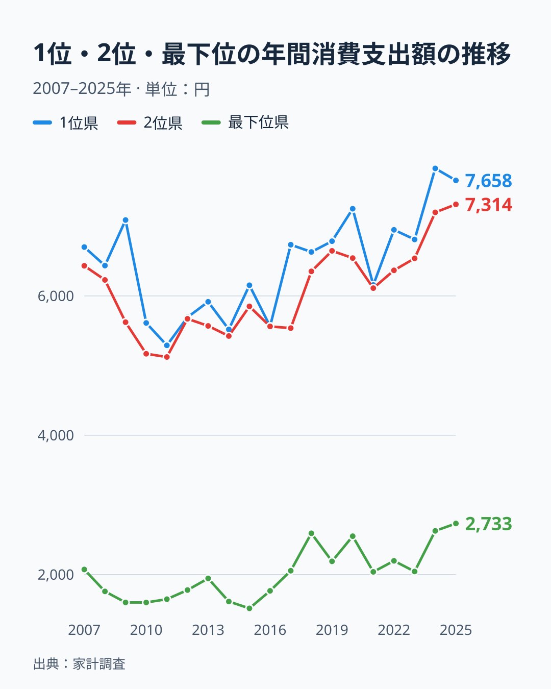

「納豆といえば茨城」――多くの人がそう思い浮かべるはずです。ところが2025年の総務省「家計調査」で1世帯が1年間に納豆へ使った金額を見ると、産地であるはずの茨城県はトップではありません。1位は福島県の7,658円で、最も少ない和歌山県の2,733円とはおよそ2.8倍の開きがあります。同じ日本の食卓でありながら、納豆への出費には大きな差があるのです。

では、この差は単純に「東日本は多く、西日本は少ない」という東西二分の構図なのでしょうか。結論から言うと、そう単純ではありません。上位に福島・茨城・岩手・青森・秋田が並び、下位5県を近畿・四国の府県が占めるのは確かですが、九州・沖縄は熊本県の9位から沖縄県の33位までに分布し、下位5県には入りません。この記事では、47都道府県の分布を地図で確認しながら、「産地と消費のズレ」と「地域差の実像」を読み解いていきます。

> [!NOTE]
> 本データは総務省「家計調査」（都道府県庁所在市の二人以上世帯）における納豆の年間消費支出額（円）。世帯が購入に使った金額であり、個人が食べる頻度や量そのものではない。物価や世帯人数の影響も受ける点に留意してほしい。

## 全体像 — 産地の茨城ではなく福島がトップ

2025年の納豆消費支出を高い順に並べると、1位は福島県で7,658円、続く茨城県は7,314円、岩手県は7,271円、青森県は7,112円、秋田県は6,887円と、上位5位までを福島・茨城・岩手・青森・秋田が占めます。「納豆の本場」というイメージの強い茨城県は福島県に次ぐ2位でした。ただし県庁所在市の値は年ごとのぶれが大きく、上位の並びは毎年入れ替わりうるため、単年の順位だけで産地の強弱を断定することはできません。一方、最下位は和歌山県の2,733円で、下位5県は和歌山・高知・大阪・徳島・兵庫と、近畿・四国の府県が占めています。

1位の福島県は7,658円、最下位の和歌山県は2,733円で、その開きはおよそ2.8倍です。納豆は安価な食品ですから、この金額差は「買う頻度」そのものの差を映していると考えてよいでしょう。

上位5県はいずれも6,800円を超え、下位5県はいずれも3,500円を下回ります。ここまでは福島・茨城・岩手・青森・秋田が高く、近畿・四国の府県が低いという傾向がはっきり見えますが、これがそのまま「西日本全体が下位」を意味するわけではありません。次の地図で47都道府県すべての分布を確認すると、その理由が見えてきます。

地図を見ると、福島・岩手・青森・秋田といった東北の県と茨城県・群馬県は濃い色（高い値）に染まり、下位には近畿と四国の府県が目立ちます。しかし九州・沖縄の8県は、この2つのグループのどちらにも当てはまりません。福岡県は5,932円で13位、鹿児島県は5,210円で21位と中位です。熊本県は6,535円で9位につけ、5位の秋田県の6,887円と並べても遜色のない水準です。一方、沖縄県は4,467円で33位でした。中国地方は、山口県の29位から広島県の40位の間に5県すべてが収まっています。つまりこの地図が示しているのは「東日本は高く西日本は低い」という単純な東西二分ではなく、上位の東北の県などと下位の近畿・四国の府県という限定的な対比であり、九州・沖縄と中国地方はそのどちらにも収まらない中位のグループなのです。

<source-link href="/ranking/natto-consumption-expenditure">47都道府県の納豆消費支出額ランキングをもっと見る</source-link>

> [!TIP]
> 納豆のように安くて日常的な食品では、支出額の差は「値段の差」よりも「買う回数の差」を強く反映します。高級品のランキングとは読み方が異なる点に注意してください。経済指標としての位置づけは[経済カテゴリの統計一覧](/category/economy)も参考になります。

## 福島・茨城・岩手が上位 — 東北の県が目立つ

上位5県を並べると、その顔ぶれの偏りがはっきりします。

トップは[福島県](/areas/07000)で、世帯あたり年間7,658円です。2位には茨城県が7,314円で入りました。3位は岩手県の7,271円、4位は青森県の7,112円、5位は秋田県の6,887円で、福島・岩手・青森・秋田と東北の4県が上位5県に並びます。6位は群馬県が6,860円、7位は宮城県が6,700円、8位は長野県が6,604円と続きます。7位以内には福島・岩手・青森・秋田・宮城の5県が入っており、山形県も6,494円で11位と、東北勢の厚みは際立っています。

東北で納豆がよく食べられてきた背景には、寒冷な気候と発酵食の伝統が関係しているという見方があります。冬の長い東北では、大豆を発酵させて長く保存し、たんぱく源として食べる文化が根づいてきたとされ、藁苞（わらづと）に包んで作る納豆はその保存食の系譜にあります。**[仮説]** ただしこの説明がすべてを説明するわけではありません。同じく寒冷な北海道は4,963円で25位と中位にとどまり、逆に温暖な熊本県は6,535円で9位と上位に入っています。気候だけでは割り切れない要因が他にもあると考えるのが妥当です。

> [!WARNING]
> 「茨城＝納豆」のイメージは水戸を中心とした生産（工場の集積）に由来しますが、消費支出で見ると2025年の茨城県は7,314円で2位、トップは7,658円の福島県です。両県の値は近く、単年の順位は動きやすい点にも注意が必要です。「たくさん作る県」と「たくさん買う県」は必ずしも一致しません。

## 1位と最下位の開き — 2007〜2025年の19年間

「1位」の値は、年によって大きく動いてきました。家計調査の納豆支出は2007年から2025年まで19年分が記録されており、1位県の支出額は2011年の5,290円から2024年の7,830円までの幅で推移しています。2025年は7,658円でした。

折れ線を見ると、1位（濃い線）と2位（中間の線）の差は年によって大きく縮みます。2016年は1位県が5,563円、2位県が5,562円とほぼ並び、2009年は1位県が7,089円、2位県が5,623円と離れました。一方で最下位（薄い線）は一貫して低い水準で推移しており、2015年の1,515円から2025年の2,733円までの範囲に収まっています。2025年の2,733円はこの19年間で最も高い値ですが、それでも1位県の水準とは大きな開きがあります。つまり上位の内側では順位や金額が入れ替わっても、上位と最下位の間の大きな開きは19年間続いているのです。

家計調査の消費支出額は、県庁所在市に住む世帯が1年間にいくら払ったかを集計したもので、どこで買った納豆かは問わず、他都市で買った分も住んでいる県庁所在市の支出として計上されます。僅差の年ほど翌年に順位が入れ替わっても不思議ではなく、その年その年の1位だけを見て「◯◯県が納豆の本場」と断定するのは早計です。

## 近畿・四国が下位 — 和歌山・高知・大阪（九州は中位）

一方、ランキングの底に目を移すと、こちらは近畿・四国にはっきり固まっています。

最下位は[和歌山県](/areas/30000)の2,733円です。1位の福島県の7,658円と比べると、およそ2.8倍の差があります。下位には高知県が2,951円、大阪府が3,288円、徳島県が3,412円、兵庫県が3,463円と、近畿と四国の府県が並びます。香川県も3,904円で42位と、このグループのすぐ上に位置しています。最下位5県はすべて近畿・四国の府県で占められています。

これに対して、地理的には西日本に含まれる九州・沖縄の8県は、熊本県の6,535円（9位）から沖縄県の4,467円（33位）までに分布しています。福岡県は5,932円で13位、鹿児島県は5,210円で21位と中位で、熊本県は上位グループに入っています。「西日本だから低い」わけではなく、下位5県を占めるのはあくまで近畿と四国の府県です。

近畿で納豆の支出が伸びない理由については、いくつかの食文化的な説明がなされてきました。関西では古くから昆布だしの文化が強く、独特の香りと粘りを持つ納豆が朝食の定番として定着しにくかったという見方があります。

> [!WARNING]
> 「近畿・四国では納豆を食べない」は言い過ぎです。全国チェーンのスーパーで納豆はどこでも手に入り、消費自体はあります。ここで見えているのは「ゼロかどうか」ではなく、あくまで**支出水準の差**です。最下位の和歌山県でも年間2,733円分は購入されています。極端な解釈には注意してください。

## この構図はなぜ続くのか

興味深いのは、この地域差が一過性ではなさそうなことです。2007年から2025年までの折れ線を見ると、1位県と最下位県の間には毎年大きな開きがあり、最下位の値は1位県の水準に近づいていません。上位の内側では1位と2位の差が年によって縮んだり広がったりしますが、上位と下位の間の開きそのものは続いています。

**[仮説]** この地域差が縮まりにくいのは、食習慣が世代を越えて家庭内で受け継がれるためと考えられます。検証するには同一県内での年代別・世帯主年齢別の支出推移を追う必要があり、本記事のデータ（県単位の年間支出）だけでは因果までは断定できません。

ここで一つの問いが立ちます。流通も価格もほぼ全国共通なのに、なぜ「買う回数」だけがこれほど地域で分かれ続けるのでしょうか。考えられるのは、納豆が「主食に添える定番」として朝食の型に組み込まれているかどうかの違いです。福島や岩手などでは「ご飯に納豆」が日常の型として残り、近畿・四国ではその型がそもそも薄いのかもしれません。型として根づいた習慣は、商品の入手しやすさとは別の論理で持続します。

同じような食文化の地域差は、ほかの食品でも見られます。たとえばマヨネーズの消費にも地域の偏りがあり、納豆とは異なる地図を描きます。食卓の地域性を横断して眺めると、それぞれの食品が独自の文化的背景を抱えていることが見えてきます。気になる人は[マヨネーズ消費支出ランキング](/ranking/mayonnaise-consumption-expenditure)や、その背景を掘り下げた[マヨネーズ消費の地域差を読み解いた記事](/blog/mayonnaise-consumption-expenditure)も合わせて読んでみてください。

## データについて

- 総務省「家計調査」（二人以上の世帯・都道府県庁所在市）納豆の年間消費支出額。ランキングと地図は2025年、年次推移は2007〜2025年の全19パーティション（e-Stat 経由で整備）

数値は調査年・対象世帯の定義に依存します。家計調査は標本調査であり、年ごとに多少の変動がある点に留意してください。

## まとめ

- 2025年の納豆消費支出は福島県が7,658円で最多、和歌山県が2,733円で最少となり、その差はおよそ2.8倍です。産地のイメージが強い茨城県は7,314円で2位で、トップではありません。
- 上位5県は福島・茨城・岩手・青森・秋田で、下位5県は和歌山・高知・大阪・徳島・兵庫の近畿・四国の府県です。
- ただし「西日本は一律に低い」わけではなく、九州・沖縄の8県は熊本県の6,535円（9位）から沖縄県の4,467円（33位）までに分布し、下位5県には入りません。
- 2007〜2025年の19年間で、1位県の支出額は5,290円から7,830円、最下位は1,515円から2,733円の範囲で推移しました。1位と2位の差は年によって縮む一方、1位と最下位の大きな開きは続いています。家計調査は購入場所を問わない居住地基準の集計であり、僅差の年ほど翌年の順位が動きやすい点に注意が必要です。
- 上位と下位の開きという大枠は19年間続いており、流通が均一化しても食習慣の慣性は強く残っている可能性があります。
