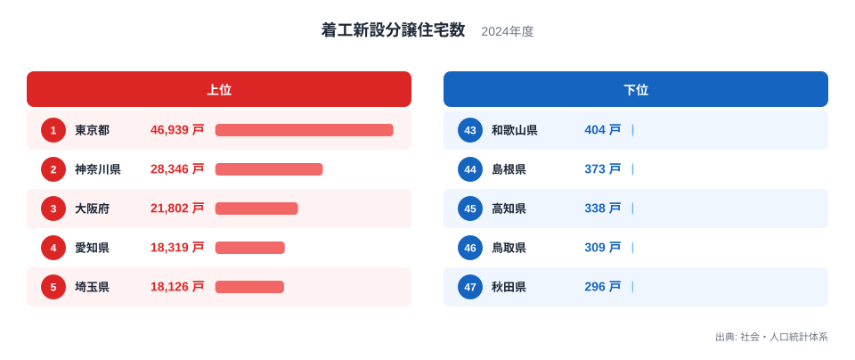
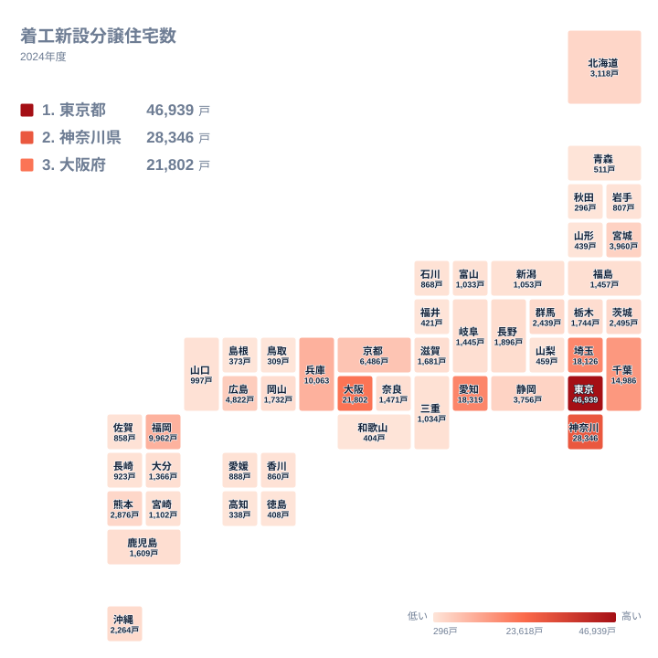

新しく着工される分譲住宅の戸数は、都道府県のあいだで大きく開いています。2024年の着工数で1位の東京都は46,939戸、47位の秋田県は296戸です。この記事では、順位表と地図から読み取れる分布の形を確かめます。そのうえで、なぜそうなるのかについては、データで言える範囲と仮説にとどまる範囲を分けて書きます。

## 上位と下位の分布を見る

まず、上位5都府県と下位5県を図で確認します。

<source-link href="/ranking/new-condo-starts">着工新設分譲住宅数ランキングをもっと見る</source-link>

上位の並びは、段差のある形をしています。1位の東京都は46,939戸、2位の神奈川県は28,346戸で、首位と2位のあいだに大きな開きがあります。3位の大阪府は21,802戸、4位の愛知県は18,319戸、5位の埼玉県は18,126戸です。4位と5位はほぼ並んでおり、上位は東京都が抜け、神奈川県が続き、その後ろに3府県が団子状に連なる構図です。

下位の形は対照的です。47位の秋田県は296戸、46位の鳥取県は309戸、45位の高知県は338戸、44位の島根県は373戸、43位の和歌山県は404戸と、5県すべてが296戸から404戸の範囲に収まっています。順位は1つずつ違っても、戸数の差はごくわずかです。上位の差が大きく、下位の差が小さいという非対称が、この指標の特徴です。

下位5県の所属は、秋田県が北海道・東北、鳥取県と島根県が中国、高知県が四国、和歌山県が近畿です。低い県は特定の地方に固まらず、複数の地方に散らばっています。

> [!NOTE]
> 着工新設分譲住宅とは、販売を目的に建てられる住宅で、2024年中に工事に着手した戸数を数えたものです。完成した戸数ではなく、着工した時点で数えます。マンションの1棟に含まれる住戸も、1戸ずつ積み上がります。

## 首都圏と大都市圏の上位

関東の4都県は、上位6位以内に集まっています。東京都が1位、神奈川県が2位、埼玉県が5位、千葉県が6位で、千葉県は14,986戸です。東京都に隣接する県が、それぞれ1万戸台から2万戸台の水準にあります。こうした並びは、東京都の周辺に大きな住宅の受け皿が広がっている可能性を示唆します。ただし、通勤や人口の動きは本データに含まれないため、因果までは確かめられません。

近畿では、3位の大阪府に続いて、7位の兵庫県が10,063戸、9位の京都府が6,486戸と、いずれも10位以内に入っています。間の8位には福岡県が9,962戸で入っており、近畿が途切れずに並ぶわけではありません。中部では4位の愛知県が18,319戸ですが、12位の静岡県は3,756戸、18位の長野県は1,896戸で、同じ地方でも水準が大きく違います。

地方の拠点を抱える県も、それぞれの地方では上位です。九州・沖縄では、8位の福岡県が9,962戸で最も多く、次の熊本県は14位で2,876戸です。中国では10位の広島県が4,822戸、北海道・東北では11位の宮城県が3,960戸で、13位の北海道の3,118戸を上回ります。大きな都市を持つ県ほど戸数が多く見えますが、都市の規模や産業との関係は、このデータだけでは検証できません。詳しくは[東京都のデータ](/areas/13000)や[神奈川県のデータ](/areas/14000)も確認できます。

> [!TIP]
> この指標が数えるのは分譲住宅だけで、施主が自分で建てる注文住宅や賃貸住宅は含まれません。戸数が少ない県でも、住宅の建設そのものが少ないとは限りません。住宅全体の動きを知りたいときは、別の着工指標とあわせて見てください。

## 地図で見る地理的な偏り

次は、47都道府県の分布を地図で確認します。

地図では、関東から近畿にかけての都市部に、色の濃い県が集まります。東京都、神奈川県、埼玉県、千葉県に加え、愛知県、大阪府、兵庫県が上位にそろい、福岡県もそれに続く位置です。着工が一部の大都市圏に偏っていることは、順位から確かに言えます。

一方、東北、中国、四国には、戸数の少ない県が目立ちます。秋田県は296戸、山形県は439戸、島根県は373戸、高知県は338戸です。人口や住宅の建て方の違いが関わっている可能性は考えられますが、本データには人口も注文住宅の戸数も含まれません。そのため、少ない理由を断定することはできません。

地方の内部でも差があります。九州・沖縄では、福岡県の9,962戸に対して、熊本県が2,876戸、沖縄県が2,264戸、鹿児島県が1,609戸です。熊本県は14位、沖縄県は17位で、この2県は北海道の3,118戸に近い水準にあります。ただし、こうした数字の背景にある理由は、このデータからは読み取れません。

> [!WARNING]
> 掲載しているのは2024年の1年分の値だけです。戸数の少ない県では、大型の分譲事業が1件あるかどうかで、順位が入れ替わる可能性があります。年ごとの変動はこのデータからは確認できないため、1年の順位だけで各県の住宅市場の力を判断しないでください。

## 中位の県に見る水準の近さ

中位に目を向けると、順位が近い県どうしの戸数差はかなり小さくなります。15位の茨城県は2,495戸、16位の群馬県は2,439戸で、ほぼ並んでいます。19位の栃木県は1,744戸で、この3県はすべて関東ですが、東京都や神奈川県とは水準が大きく離れています。

27位の宮崎県は1,102戸、28位の新潟県は1,053戸、30位の富山県は1,033戸、31位の山口県は997戸です。1,000戸前後の水準に多くの県が密集しており、わずかな戸数の違いで順位が動く層です。この帯の順位は、順位の上下そのものよりも、戸数がどの規模にあるかを見たほうが、実態に近づけます。

20位の岡山県は1,732戸、21位の滋賀県は1,681戸、13位の北海道は3,118戸です。滋賀県は近畿に属しながら、7位の兵庫県や9位の京都府とは大きく離れた位置にあります。近畿という同じ地方でも、府県によって水準が大きく違うことがわかります。

## 読み解くときのポイント

ここまでに確かめられたことを整理します。

- 上位は東京都が首位で、神奈川県が2位、大阪府が3位と続く
- 愛知県と埼玉県は、4位と5位でほぼ並ぶ
- 下位5県の戸数は、296戸から404戸の範囲に収まる
- 上位の差が大きく、下位の差は小さい
- 大阪府、兵庫県、京都府は、10位以内に入っている

なぜそうなるのかについては、人口、雇用、土地の使われ方、都市の成り立ちなどが関わっていると考えられます。ただし、本データには着工戸数と順位しかないため、これらの影響の大きさは示せません。原因を語るには、人口や世帯数、住宅の種類別の指標を別に重ねる必要があります。[同じカテゴリの統計一覧](/category/construction)から、住宅や建設に関する他の指標も探せます。

> [!NOTE]
> 都道府県別の着工数は、住宅が建つ場所で計上されます。購入者の住所地ではないため、隣接する県から通勤する世帯が買う住宅は、建設地の県に数えられます。

## データについて

この記事で使った数値は、社会・人口統計体系にある着工新設分譲住宅数の2024年の値です。単位は戸で、47都道府県すべての値があります。

数値は着工した住宅の戸数そのもので、人口や世帯数あたりに直した値ではありません。そのため、規模の大きい県が上位に来やすいことを前提に読む必要があります。

まとめると、1位の東京都は46,939戸、2位の神奈川県は28,346戸で、大都市圏に着工が集まっています。47位の秋田県は296戸で、下位は小さな差のなかに密集しています。この開きの理由は、本データだけでは説明しきれず、他の指標とあわせて検討する課題として残ります。
