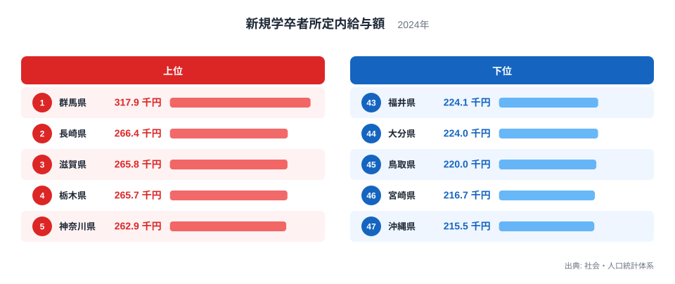
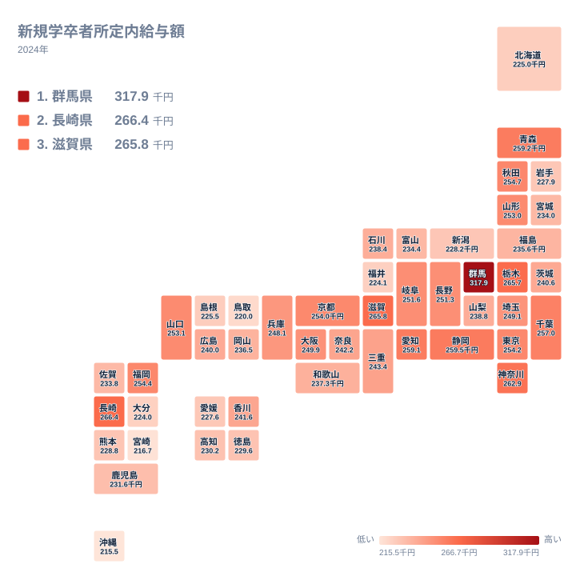

新規学卒者の所定内給与額は、県によってどれだけ違うのでしょうか。2024年の値を都道府県別に見ると、最も高かったのは群馬県の317.9千円、最も低かったのは沖縄県の215.5千円でした。同じ新規学卒者でも、県によって給与額には大きな開きがあります。

この記事では、上位と下位の顔ぶれ、地図で見た地方ごとの分布を確認します。そのうえで、背景として考えられることと、実データからは言えないことを分けて整理します。なお、この指標がどの学歴や性別の区分を指すのかは、手元の実データからは特定できません。そのため本文では「新規学卒者所定内給与額」という呼び方に揃えて書きます。

> [!NOTE]
> 対象は、社会・人口統計体系に載る2024年の新規学卒者所定内給与額で、単位は千円、月額の給与です。所定内給与とは、あらかじめ決まっている基本的な給与を指し、残業代などの時間外手当は含みません。学歴や性別などの区分は実データから読み取れないため、「その県の新卒者全体の平均」と受け取らないでください。

## 上位と下位の顔ぶれ

まず、上位5県と下位5県を図で確認します。

<source-link href="/ranking/new-graduate-scheduled-salary-university-male">新規学卒者所定内給与額ランキングをもっと見る</source-link>

この図で最初に目に入るのは、1位の群馬県が317.9千円で、2位の長崎県の266.4千円を大きく上回っている点です。2位から5位の4県は、262.9千円から266.4千円の範囲にまとまっています。具体的には、長崎県、滋賀県の265.8千円、栃木県の265.7千円、神奈川県の262.9千円です。つまり上位は、群馬県だけが突き抜け、そのすぐ後ろに2位以下の県が密集する形をしています。

下位5県も、値が近くに固まっています。43位の福井県は224.1千円、47位の沖縄県は215.5千円で、この5県は215.5千円から224.1千円の範囲に収まっています。上位5県では先頭だけが離れていましたが、下位5県には突出した県がありません。ランキングの両端では、順位のつき方の性格が違います。

もう一つ注意したいのは、順位の1つ差が意味する大きさが、場所によってまったく違うことです。1位と2位の間は大きな段差ですが、2位から5位の間や、43位から47位の間では、順位が入れ替わっても値はあまり変わりません。順位の数字だけで差を想像すると、読み違えることになります。

> [!WARNING]
> 1位の値が突出している理由は、この記事の実データでは確かめられません。実データに含まれるのは県ごとの値と順位だけで、回答した事業所の数や顔ぶれ、産業別の内訳は載っていません。集計対象の偏りが結果に影響している可能性もあるため、1位の値をそのまま県全体の給与水準や産業の強さと結びつけることは避けてください。

## 地図で見る地理分布

次に、47都道府県の分布を地図で確認します。

上位10県を、順位と値とともに挙げます。

- 1位 群馬県 317.9千円
- 2位 長崎県 266.4千円
- 3位 滋賀県 265.8千円
- 4位 栃木県 265.7千円
- 5位 神奈川県 262.9千円
- 6位 静岡県 259.5千円
- 7位 青森県 259.2千円
- 8位 愛知県 259.1千円
- 9位 千葉県 257千円
- 10位 秋田県 254.7千円

これを地方別に数えると、関東が群馬県、栃木県、神奈川県、千葉県の4県で最も多くなります。次いで、中部が静岡県と愛知県の2県、北海道・東北が青森県と秋田県の2県です。近畿は滋賀県の1県、九州・沖縄は長崎県の1県です。合計は10県で、上位は特定の地方に偏らず、5つの地方に散らばっています。中国と四国の県は、上位10県には入っていません。

一方、下位10県は次のとおりです。

- 38位 新潟県 228.2千円
- 39位 岩手県 227.9千円
- 40位 愛媛県 227.6千円
- 41位 島根県 225.5千円
- 42位 北海道 225千円
- 43位 福井県 224.1千円
- 44位 大分県 224千円
- 45位 鳥取県 220千円
- 46位 宮崎県 216.7千円
- 47位 沖縄県 215.5千円

地方別では、九州・沖縄が大分県、宮崎県、沖縄県の3県で最も多くなります。中部の新潟県と福井県、北海道・東北の岩手県と北海道、中国の島根県と鳥取県がそれぞれ2県ずつです。四国は愛媛県の1県で、合計は10県です。下位もやはり5つの地方にまたがっており、関東と近畿の県は含まれていません。

地方でひとまとめにして高低を語ることには無理があります。関東の7県を見ても、群馬県が1位、栃木県が4位、神奈川県が5位、千葉県が9位と上位に並ぶ一方、東京都は12位の254.2千円、埼玉県は19位の249.1千円、茨城県は24位の240.6千円です。同じ関東の中で、順位に大きな幅があります。

九州・沖縄でも同様です。長崎県は2位ですが、福岡県は11位の254.4千円、沖縄県は47位でした。東北では、青森県が7位、秋田県が10位、山形県が15位の253千円と上位から中位の手前に位置する一方、岩手県は39位です。地図の色が似た地方でも、県ごとの値はばらばらです。

## 上位の背景を考える

ここからは、実データから直接確かめられない部分を、仮説として扱います。上位には群馬県、栃木県、静岡県、愛知県など、製造業の盛んな県として知られる顔ぶれが入っています。そうした産業の事情が関わっている可能性はありますが、この記事の実データには産業別の情報がないため、顔ぶれから受ける印象にとどまります。

群馬県の値の高さについても、実データだけでは理由を説明できません。製造業の存在が影響しているのか、集計の偏りなのか、別の要因なのかは、産業別の賃金や事業所数など、別の統計と合わせて確かめる必要があります。県の詳しい数字は [群馬県のデータ](/areas/10000) で見られます。

長崎県は、九州・沖縄の中で唯一、上位5県に入りました。値は266.4千円で、3位の滋賀県や4位の栃木県と近い水準です。なぜこの位置になったのかは実データからはわかりません。県の数字は [長崎県のデータ](/areas/42000) で確認できます。

大都市の位置も確認しておきます。東京都は12位で254.2千円、大阪府は18位で249.9千円であり、どちらも上位5県には入っていません。ここから言えるのは、この2024年の値では、東京都と大阪府が上位5県に入っていないという事実までです。人口規模との関係は、この記事の実データでは検証できません。

## 下位の背景を考える

下位の県を見ると、沖縄県の215.5千円、宮崎県の216.7千円、鳥取県の220千円と、200台前半から半ばの値が並びます。その上の38位から44位までは、新潟県の228.2千円から大分県の224千円まで、値が連続して近接しています。下位は一部の県だけが極端に低いのではなく、似た値の県が長く連なっています。

下位に入る県の背景として、地域の賃金相場、企業の規模、産業の構成の違いなどが関わっている可能性はあります。ただし、これらは実データから裏づけられるものではなく、別の統計で確かめるべき仮説です。実データだけで言えるのは、下位10県が北海道・東北、中部、四国、中国、九州・沖縄の5つの地方に広がっているという分布の事実です。

低い県を一つの地域の特徴として語ることは、実態に合いません。同じ中部でも静岡県は6位、愛知県は8位ですが、新潟県は38位、福井県は43位です。同じ近畿でも、滋賀県は3位ですが、和歌山県は28位の237.3千円です。県ごとの個別の事情を見る必要があります。

同じ分野の他の指標と並べて見ると、県の特徴がより立体的に見えてきます。他の統計は [同じカテゴリの統計一覧](/category/educationsports) から探せます。

> [!TIP]
> この指標を読むときは、1位とそれ以外を分けて考えると読み違えにくくなります。1位の群馬県は317.9千円と突出していますが、2位の長崎県から5位の神奈川県までは262.9千円から266.4千円に密集しています。そのため、順位が1つ違うだけの差を大きな差と受け取らず、2位以下では値そのものを見て比べてください。

## データについて

この記事の数値は、社会・人口統計体系に収録された「新規学卒者所定内給与額」の2024年の値です。単位は千円で、47都道府県すべてが対象です。月ごとの給与額であり、年収ではありません。賞与や時間外手当は含まれないため、年間の収入を比べたいときは、別の統計を使う必要があります。

> [!NOTE]
> 学歴や性別などの区分は、この記事の実データからは確認できません。他の統計や他の年の値と比べるときは、同じ区分の値かどうかを必ず確かめてください。区分が違うと、県の順位や値の水準が大きく変わる可能性があります。

## まとめ

2024年の新規学卒者所定内給与額は、群馬県が317.9千円で最も高く、沖縄県が215.5千円で最も低くなりました。上位は群馬県だけが突出し、2位の長崎県から5位の神奈川県までは262.9千円から266.4千円に密集しています。下位も、沖縄県から福井県までの5県が215.5千円から224.1千円に固まっています。

上位10県は関東、中部、北海道・東北、近畿、九州・沖縄にまたがり、下位10県は九州・沖縄、中国、中部、北海道・東北、四国に広がっています。背景にある産業や地理の違いは、この記事の実データだけでは確かめられません。気になる県があれば、県ごとのデータや関連する統計とあわせて、さらに掘り下げてみてください。
