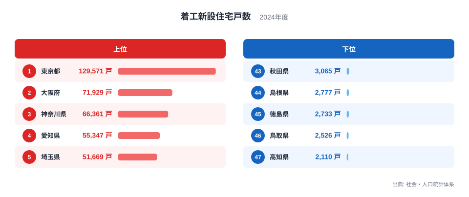
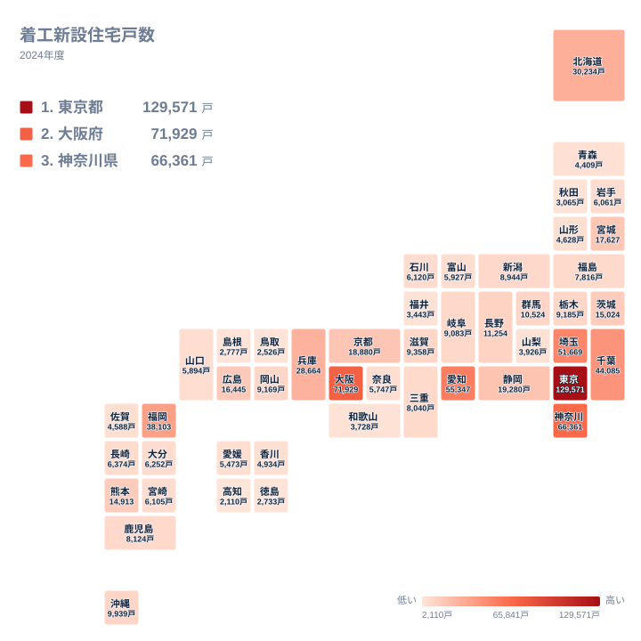

2024年に新しく工事が始まった住宅の数は、都道府県によって大きく異なります。最も多い東京都は129,571戸、最も少ない高知県は2,110戸でした。この記事では、上位と下位の顔ぶれを数字で比べ、地理的な分布を確かめたうえで、順位がそう並ぶ背景について、データだけでは断定できない部分は仮説として整理します。

## 上位と下位の顔ぶれ

まずは上位5県と下位5県を図で確認します。

<source-link href="/ranking/new-housing-starts">着工新設住宅戸数ランキングをもっと見る</source-link>

図で目を引くのは、1位の東京都の大きさです。東京都は129,571戸で、2位の大阪府の71,929戸を大きく上回ります。一方、2位の大阪府と3位の神奈川県の66,361戸は、5,568戸しか離れていません。1位と2位の間には大きな断層があり、2位以下は比較的なだらかに続く、という形です。4位の愛知県は55,347戸、5位の埼玉県は51,669戸で、3位から5位までは緩やかに下っていきます。

下位に目を移すと、47位は高知県で2,110戸、46位は鳥取県で2,526戸、45位は徳島県で2,733戸、44位は島根県で2,777戸、43位は秋田県で3,065戸です。所属は四国の高知県と徳島県、中国の鳥取県と島根県、東北の秋田県です。下位5県は2,000戸台から3,000戸台に収まっており、上位の開きに比べて狭い範囲に密集しています。

> [!NOTE]
> 着工新設住宅戸数は、1年間に工事が始まった新築住宅の戸数です。完成した戸数でも、いま建っている住宅の総数でもありません。工事に取りかかった時点で数えるため、年末に着工した住宅は、完成が翌年以降でも、着工した年の数字に入ります。

## 東京都と大都市圏が上位を占める構図

上位6県を見ると、1位の東京都に続き、2位は大阪府、3位は神奈川県、4位は愛知県、5位は埼玉県、6位は千葉県でした。関東の1都3県である東京都、神奈川県、埼玉県、千葉県は、いずれも6位以内に入っています。7位は九州・沖縄の福岡県、8位は北海道で、上位10県に東北の県は入っていません。東北で最も高いのは12位の宮城県です。

大阪府は71,929戸で2位です。近畿では、9位の兵庫県が28,664戸、11位の京都府が18,880戸でした。大阪府の戸数は兵庫県の2倍を超えており、近畿の中でも大阪府に着工が集まっていることが分かります。中部では、4位の愛知県が55,347戸、10位の静岡県が19,280戸で、両県の間にも大きな開きがあります。

こうした大都市圏への集中の背景として、人口や世帯が多い地域で新築の需要が大きいこと、都市部では集合住宅の着工が戸数を押し上げることなどが、一般にはよく指摘されます。ただし、この記事で使うのは着工戸数だけで、人口や住宅の種類別の内訳は含まれていません。そのため、これらはあくまで仮説であり、この値だけで確かめられる結論ではありません。

> [!TIP]
> 東京都や大阪府の順位を読むときは、県の大きさの違いを頭に置いてください。着工戸数は人口や面積で割っていない実数なので、大きな都府県ほど有利に並びます。他県と比べるときは、順位だけでなく、戸数の差がどの程度あるかを見るのがコツです。

## 地理分布で見る広がり

次に、47都道府県の分布を地図の形で確認します。

地図から読み取れる構造は、地方ごとに「核になる1県が抜けている」という点です。九州・沖縄では、7位の福岡県が38,103戸であるのに対し、次に高い熊本県は15位の14,913戸です。福岡県の戸数は熊本県の2倍を超えており、同じ地方でも着工が1県に集まっています。北海道の30,234戸（8位）や東北の宮城県の17,627戸（12位）、中国の広島県の16,445戸（13位）も、それぞれの地方で先頭に立つ県です。

地図で色の薄い側には、下位の高知県、鳥取県、徳島県、島根県、秋田県が含まれます。ただし、なぜ戸数が少ないのかという理由までは、着工戸数の値だけでは分かりません。

> [!WARNING]
> この記事の値は2024年の1年分だけです。着工戸数は景気や金利、大型の集合住宅の工事時期などで年ごとに増減しやすく、特に戸数の小さい県では、1件の大きな工事が順位を動かすことがあります。1年の順位だけで、その県の傾向が続くと決めつけることはできません。

## 中位の密集

中位に目を向けると、順位の差が小さくなります。24位の鹿児島県は8,124戸、25位の三重県は8,040戸、26位の福島県は7,816戸で、数百戸の違いで順位が入れ替わります。上位の開きが大きいのに対し、中位以下は密集しているという分布の形を覚えておくと、ランキングを読みやすくなります。

この層は、上位の大都市圏と、下位の3,000戸前後の県との中間に位置します。産業の集積や人口の動きが影響している可能性はありますが、それを裏づけるデータはこの記事の実データには含まれていません。個々の県について原因を断定せず、まずは順位と戸数の位置関係を押さえておくのがよいでしょう。

## まとめ：数字から言えること

最後に、データから確かに言える点を整理します。

- 東京都が129,571戸で1位です。2位の大阪府は71,929戸で、1位と2位の間に大きな差があります
- 大阪府と神奈川県の差は5,568戸にとどまり、2位から5位までは比較的なだらかに続きます
- 関東の1都3県は、いずれも6位以内に入っています
- 福岡県は38,103戸で、九州・沖縄の中では熊本県の14,913戸を上回っています
- 下位5県は、高知県、鳥取県、徳島県、島根県、秋田県で、2,110戸から3,065戸の範囲に収まっています

東京都の詳しい数字は[東京都のデータ](/areas/13000)で、大阪府の動きは[大阪府のデータ](/areas/27000)で確認できます。ほかの建設関連の指標とあわせて見たいときは、[同じカテゴリの統計一覧](/category/construction)をご覧ください。

着工戸数は、新築工事の勢いを映す数字です。ただし、その背景にある人口や産業の事情は、別のデータとあわせて確かめる必要があります。ランキングの順位を出発点にして、気になる県の数字を一つずつ見比べてみてください。

## データについて

この記事で使った統計の正式名称は着工新設住宅戸数で、出典は社会・人口統計体系です。対象年は2024年で、単位は戸です。47都道府県すべての値を使い、順位は戸数の多い順に付けています。
