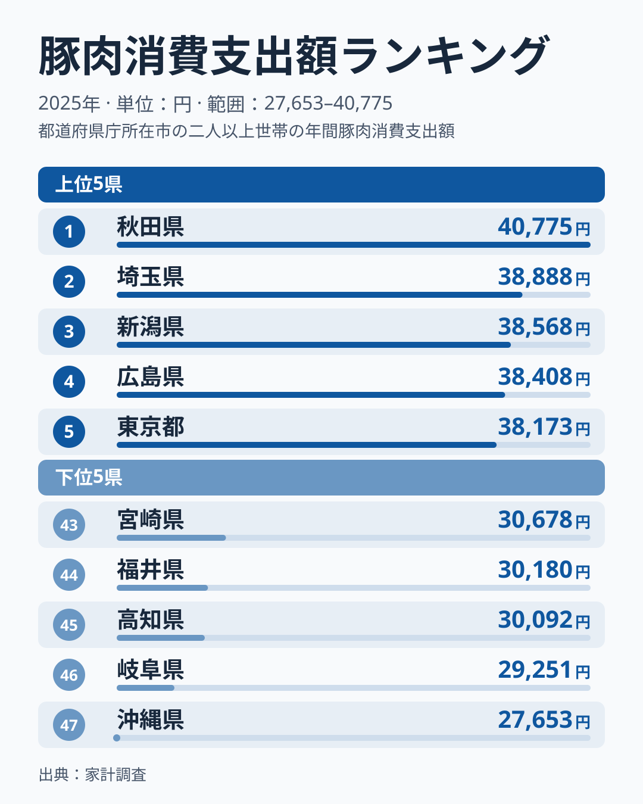
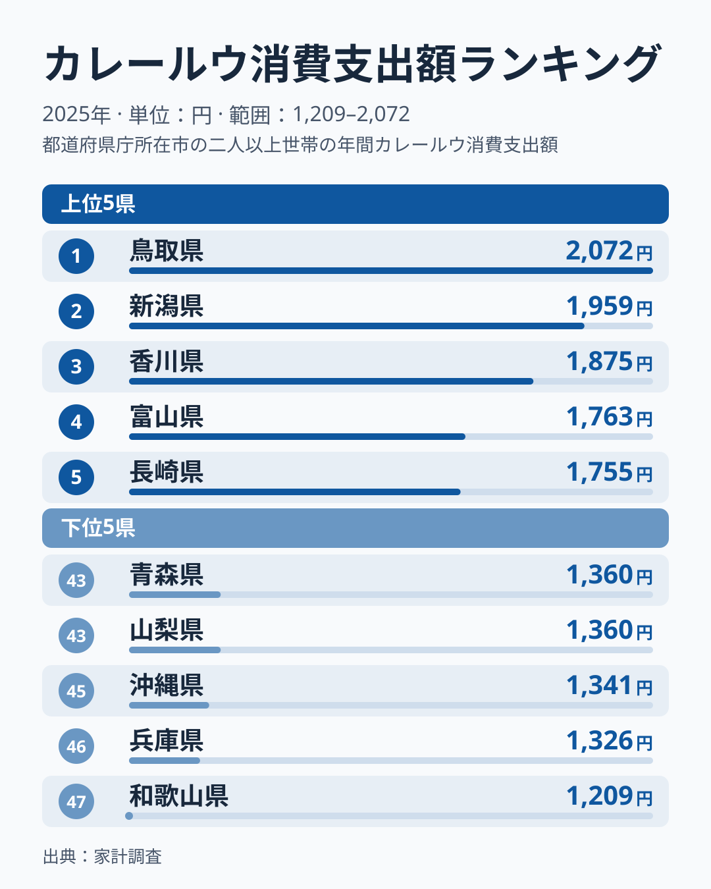
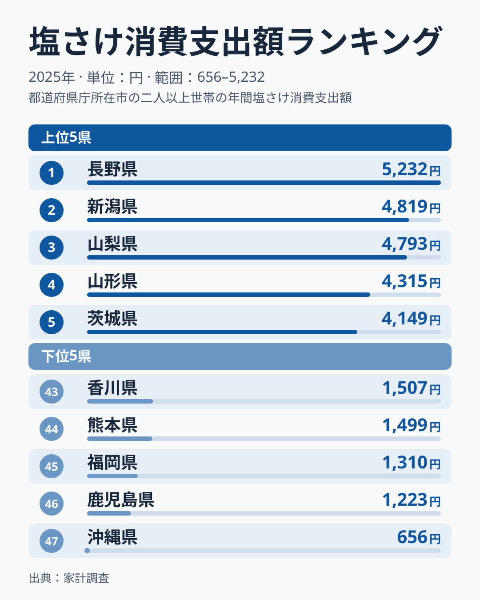
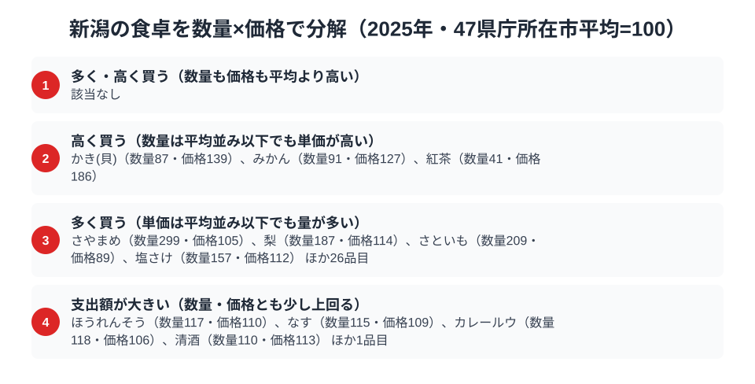

新潟県といえば米どころのイメージが強い県ですが、家計調査の品目別データを見ると、実は「ご飯のお供」への支出も全国の上位に入っています。総務省統計局の家計調査（2025年、都道府県庁所在市・二人以上世帯）によると、新潟市の豚肉消費支出額は年間38,568円で全国3位、カレールウは1,959円で全国2位、塩さけは4,819円で全国2位でした。3品目のどれでも首位には届きませんが、すべてで上位3位以内に入っているのは新潟市の特徴です。

なぜこの3品目がそろって新潟の上位に並ぶのでしょうか。手がかりは、どれも「白いご飯を大量に、おいしく食べるための脇役」だという共通点にあります。米の生産量日本一の県で、米に合わせる食材への支出も自然と積み上がった、という構図が見えてきます。この記事では3つのランキングを1つずつ確認しながら、新潟の食卓を貫く軸を探ります。

> [!NOTE]
> この記事の数値はすべて総務省統計局「家計調査（品目別支出）」2025年、都道府県庁所在市（新潟県は新潟市）・二人以上世帯の年間支出額です。県内全域の平均ではなく県庁所在市のデータである点にご注意ください。市ごとの値は調査世帯数が限られるため単年のぶれが大きく、順位の入れ替わりが起こりやすい点も踏まえて読む必要があります。

## 豚肉 — 3位38,568円、僅差で並ぶ上位

<source-link href="/ranking/pork-consumption-expenditure">豚肉消費支出額ランキングをもっと見る</source-link>

新潟市の豚肉消費支出額は38,568円で全国3位でした。1位は秋田県で40,775円、2位は埼玉県で38,888円です。新潟市は首位の秋田県と2,207円の差で、5位の東京都38,173円までを含めても上位5県は2,602円の幅に収まる僅差です。最下位は沖縄県で27,653円、新潟との差は約1.4倍にとどまり、豚肉は全国的に広く消費される食材であることがうかがえます。上位5県には秋田・埼玉・新潟・広島・東京と地域のまとまりも見られず、豚肉の支出は地域色が出にくい品目といえます。

新潟で豚肉の支出が高めに出る背景として考えられるのが、県内で親しまれる「タレかつ丼」に代表される、とんかつ・フライ文化の存在です。[仮説] 新潟市周辺では醤油ベースの甘辛いタレをかけたかつ丼が学校給食にも登場するほどの定番料理で、外食だけでなく家庭でも豚肉を揚げ物にして食べる習慣が根づいているため、支出が積み上がっているのではないかと考えられます。ただし単年の順位は1位から3位まで数千円以内でぶれるため、この仮説は複数年の推移で確かめる必要があります。

## カレールウ — 2位1,959円、雪国の定番おかず

<source-link href="/ranking/curry-roux-consumption-expenditure">カレールウ消費支出額ランキングをもっと見る</source-link>

カレールウの消費支出額で新潟市は1,959円、全国2位です。1位は鳥取県で2,072円、3位は香川県で1,875円でした。上位5県は鳥取県・新潟県・香川県・富山県・長崎県の順で、鳥取・新潟・富山と日本海側の県が3県入る一方、香川県と長崎県も入っており、雪国だけの傾向とは言い切れません。最下位の和歌山県は1,209円で、1位との差は約1.7倍、新潟との差は約1.6倍あり、豚肉に比べると地域差がはっきり出る品目です。

カレーは大量に作り置きできて日持ちがし、家族分をまとめて用意しやすい料理です。[仮説] 冬場に積雪で買い物が制限されやすい地域では、こうした「作り置きしやすいご飯のお供」への需要が高まり、新潟のカレールウ支出を押し上げているのかもしれません。新潟は豚肉の支出も全国3位に入っており、「ご飯に合う具だくさんのポークカレー」という組み合わせが家庭の定番になっている可能性もありますが、品目別の家計調査だけでは料理の中身までは確かめられません。

## 塩さけ — 2位4,819円、首位との差は413円

<source-link href="/ranking/salted-salmon-consumption-expenditure">塩さけ消費支出額ランキングをもっと見る</source-link>

塩さけの消費支出額は新潟市が4,819円で全国2位でした。1位は長野県で5,232円、首位との差は413円です。3位は山梨県で4,793円と新潟にわずか26円差で迫り、4位は山形県の4,315円、5位は茨城県の4,149円が続きます。1位の長野県と3位の山梨県は海のない県で、塩さけが保存のきく魚として内陸でも日常的に買われている可能性を示しています。最下位の沖縄県は656円で、新潟との差は約7.3倍、1位の長野県との差は約8.0倍もの開きがあり、3品目の中で最も地域差が大きい結果となっています。

新潟県には、江戸時代から鮭の伝統的な加工技術で知られる村上市があります。三面川に遡上する鮭を「塩引き鮭」として軒先に吊るして熟成させる文化が今も残り、正月のご馳走として塩さけを食べる習慣が県内に広く定着しています。[仮説] 塩気の強い焼き魚は白いご飯を何杯もおかわりするための一品であり、こうした食習慣が新潟市の塩さけ支出を全国上位に押し上げているのではないかと考えられます。

> [!WARNING]
> ここでの数値は世帯の「支出額」であり、購入量（グラム・尾数）そのものではありません。塩さけの単価は加工度によって差があるため、支出額の差が必ずしも消費量の差と一致するとは限らない点にご留意ください。また村上市の「塩引き鮭」のような贈答・特産品としての消費は、家計調査の品目別集計では個別に区分されず塩さけ全体に含まれます。

## 新潟の食卓を貫くもの

豚肉・カレールウ・塩さけという3つの上位に共通するのは、いずれも「白いご飯を大量に食べるための脇役」だという点です。とんかつも、ポークカレーも、焼いた塩さけも、それ単体ではなく茶碗のご飯とセットで完成する料理ばかりです。米の収穫量が全国トップクラスの新潟県だからこそ、ご飯を主役にした献立を支える食材への支出が、結果として全国の上位に積み上がったと考えられます。

注目したいのは、3品目の1位がそれぞれ秋田県・鳥取県・長野県と別々で、新潟市はどの品目でも首位を取っていない点です。ひとつの品目で突き抜けるのではなく、3品目すべてで上位3位以内に入る「安定した上位」が新潟市の特徴といえます。

同じように県境を接する[富山の食卓](/blog/toyama-food-culture)では、ぶりや昆布など「海の幸」を軸にした全国1位が並び、日本海側でも県ごとに個性が分かれます。一方、山を挟んで隣接する[山形の食卓](/blog/yamagata-food-culture)は、こんにゃくや筍など「山の幸」が中心で、新潟の「ご飯に合うおかず」路線とは異なる系統です。同じ雪国でも何を主役に据えるかで、家計の使い道は大きく変わってくることがわかります。

> [!TIP]
> 3品目の1位と最下位の差は、塩さけが約8.0倍、カレールウが約1.7倍、豚肉が約1.5倍と大きく違います。「新潟らしさ」を測るなら、地域差が大きい品目（塩さけ・カレールウ）のほうが県民性を強く映し出している可能性があります。豚肉のように全国で満遍なく消費される品目は、単独では地域色を判断しにくい点に注意が必要です。

## 数量×価格で分解する新潟市の食卓

<source-link href="/ranking/salted-salmon-consumption-quantity">塩さけ消費量ランキングをもっと見る</source-link>

ここまでの3品目はいずれも「支出額」で上位でしたが、支出額だけを見ても「たくさん買っている」からなのか「高い値段のものを買っている」からなのかは区別できません。そこで家計調査の塩さけ消費量などの消費量データも合わせて使い、支出額を数量×価格に分解してみます。品目ごとに47都道府県庁所在市の平均を100とした数量指数・価格指数を計算すると、新潟市の食卓を動かしている力がどちらなのかが見えてきます。

分解してみると、3品目とも数量指数が100を大きく上回っており、支出額の高さは購入量の多さが主因です。塩さけの数量指数は157で価格指数は112、カレールウの数量指数は118で価格指数は106、豚肉の数量指数は126で価格指数は88です。豚肉は平均より安い単価のまま多く買っており、塩さけとカレールウも単価は平均を1割前後上回る程度にとどまります。新潟市は高級な豚肉を選んで買っているのではなく、日常的な単価のまま量を多く消費した結果として、支出額が全国上位に積み上がっていると読み解けます。

家計調査の食料品目のうち「他の〜」を除く122品目を同じ方法で分けると、量も価格も平均を上回る「多く・高く買う」区分に入る品目はありません。平均並みの71品目を除くと、量だけが突出して多い「多く買う」区分が30品目で最大です。逆に単価の高さが際立つのは「紅茶」で、数量指数は41と平均を大きく下回りながら価格指数は186まで上がります。「かき(貝)」（数量87・価格139）や「みかん」（数量91・価格127）も同じ型で、他の食品とは異なる動き方をしています。新潟の食卓を支えているのは「高いものを選ぶ」文化ではなく、日々の食卓で「よく食べる」文化だと言えそうです。

支出額の順位だけを見ると「新潟市は高級な塩さけや豚肉を買っている」ように見えますが、数量指数と価格指数に分解すると、実際は量を多く買っていることが支出額を押し上げている品目がほとんどです。支出額ランキングを見るときは、消費量ランキングも合わせて確認すると、その地域の消費パターンをより正確に読み解けます。

> [!NOTE]
> ここでの数量指数・価格指数は「47都道府県庁所在市の単純平均を100」とした相対値であり、家計調査の全国平均値そのものではありません。また価格指数は支出額を数量で割った単価から算出しているため、同じ品目でも購入する銘柄・グレードの違いによる差も含まれます。数値はいずれも二人以上世帯・新潟市の2025年の年間値です。

## まとめ

- 豚肉消費支出額は新潟市が38,568円で全国3位（1位秋田県40,775円、2位埼玉県38,888円）
- カレールウ消費支出額は新潟市が1,959円で全国2位（1位鳥取県2,072円、3位香川県1,875円）
- 塩さけ消費支出額は新潟市が4,819円で全国2位（1位長野県5,232円、3位山梨県4,793円）、最下位の沖縄県656円とは約7.3倍差
- 3品目に共通するのは「白いご飯を大量に食べるための脇役」という役割で、どれも1位ではないものの上位3位以内に入る安定感が新潟らしさ
- 塩さけとカレールウは地域差が大きく、豚肉は全国的な地域差が小さい

[新潟県の地域プロフィール](/areas/15000)では、こうした食文化データ以外の経済・人口指標も確認できます。家計調査の品目別データをさらに広く見たい方は[経済カテゴリ一覧](/category/economy)からどうぞ。
