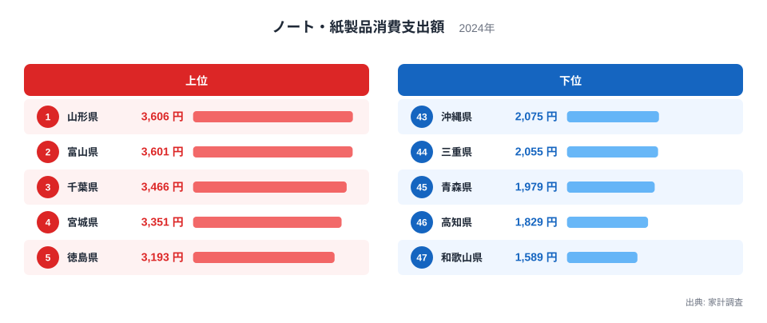
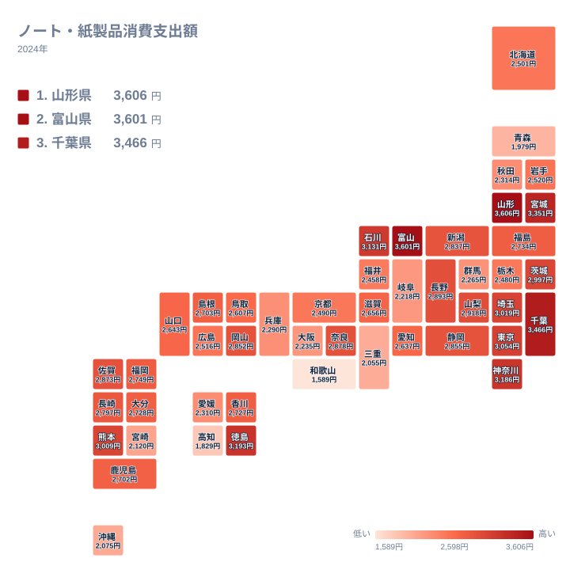

ノートやメモ帳、便箋といった紙製品。デジタル化が進んだ今でも、学校や仕事、暮らしの中で紙の出番はなくなっていません。では、その購入にかけるお金は、都道府県でどれほど違うのでしょうか。

家計調査の2024年のデータでは、ノート・紙製品への支出が最も多いのは山形県の3,606円でした。最も少ないのは和歌山県の1,589円です。最大と最小の比は約2.3倍で、日用品に近い小さな支出としては、はっきりした開きと言えます。

この記事では、上位と下位の顔ぶれ、地方ごとの並び方を順に見ていきます。そのうえで、差の理由についてはデータから言える範囲と、仮説にとどまる範囲を分けて整理します。

> [!NOTE]
> ここでの数値は、家計調査の「ノート・紙製品消費支出額」で、2024年の1世帯あたりの年間支出額(単位は円)です。ノートや便箋は、学齢期の子どもがいる世帯や、新年度に学用品をまとめて買う世帯に購入が偏りやすい品目です。そのため、県の値は「その県の人がどれだけ紙を使うか」というより、「紙製品を多く買う世帯がどれだけ含まれたか」の影響も受けます。個人の購入額ではない点に注意してください。

## 上位と下位の顔ぶれ

まず、上位5県と下位5県を図で確認します。

<source-link href="/ranking/notebooks-paper-consumption-expenditure">ノート・紙製品への支出ランキングをもっと見る</source-link>

1位は山形県で3,606円です。2位の富山県は3,601円で、差はわずかです。その後に3位の千葉県が3,466円、4位の宮城県が3,351円、5位の徳島県が3,193円と続きます。上位5県を地方で見ると、東北が山形県と宮城県の2県、中部が富山県、関東が千葉県、四国が徳島県です。4つの地方に分かれていて、一つの地方に偏った並びではありません。

下位は47位の和歌山県が1,589円、46位の高知県が1,829円、45位の青森県が1,979円です。44位の三重県は2,055円、43位の沖縄県は2,075円でした。地方で見ると、和歌山県と三重県の2県が近畿、高知県が四国、青森県が東北、沖縄県が九州・沖縄です。こちらも4つの地方にまたがりますが、近畿だけは下位5県のうち2県を占めています。

特に目を引くのは、1位の山形県と47位の和歌山県の距離です。約2.3倍という倍率は、この指標の振れ幅をよく表しています。県ごとのデータを手に取ってみると、数字の背景を考える手がかりになります。[山形県のデータ](/areas/06000)や[富山県のデータ](/areas/16000)では、他の指標も確認できます。

## 地図で見る地理的な広がり

次に、都道府県の位置関係をタイルマップで確かめます。

地図で目につくのは、関東の並び方です。ここでの関東は、茨城県、栃木県、群馬県、埼玉県、千葉県、東京都、神奈川県の7都県を指します。このうち千葉県が3位、神奈川県が6位、東京都が8位、埼玉県が9位、茨城県が11位と、5都県が11位以内に入っています。一方で栃木県は34位の2,480円、群馬県は39位の2,265円です。関東は上位に並ぶ県が多いものの、同じ地方の中でも差があります。

千葉県の3,466円と群馬県の2,265円を並べると、同じ関東でも大きく水準が違うことがわかります。「関東だから高い」とは言えず、県単位で見る必要があります。

近畿も同様です。奈良県は14位の2,878円ですが、和歌山県は47位の1,589円です。同じ近畿でも、滋賀県は26位、京都府は33位、兵庫県は38位、大阪府は40位、三重県は44位と、中位から下位にかけて広く散らばっています。地方という大きな単位だけでは、この指標は説明しきれません。

> [!TIP]
> この指標は年間の合計額なので、新学期の準備や年度替わりの手帳選びなど、特定の時期に集中する購入が含まれます。ある県が高いのは、毎月少しずつ買う家庭が多いからなのか、時期にまとめて買う家庭が多いからなのかは、この数字だけでは区別できません。順位だけで「紙をよく使う県」と決めつけないのが読み解きのコツです。

## 差の背景をどう考えるか

では、なぜ山形県や富山県が上位に入るのでしょうか。実データからは、直接の理由は示せません。要因は特定できないというのが正直なところです。

仮説として、世帯の構成が挙げられます。学齢期の子どもがいる世帯の割合が高い県では、学習用のノートの購入が増える可能性があります。ただし、その割合は今回の実データに含まれないため、確かめることはできません。

買い物環境も仮説のひとつです。書店や文具店が多い大都市圏が必ず上位になるわけではない点は、手がかりになります。東京都は8位、埼玉県は9位で、山形県と富山県が1位と2位を占めています。この並びは、店の多さだけでは説明しきれない可能性を示唆するにとどまります。標本調査の誤差も無視できないため、強い結論は避けるべきです。気候や暮らし方についても同様で、雪の多い地域が一様に高いという裏付けはありません。

> [!WARNING]
> 家計調査は標本調査で、都道府県別の値は調査された世帯の数が限られます。さらにノート・紙製品は支出額の小さな品目なので、少数の世帯の大きな買い物が平均を動かす余地があります。1位と2位が山形県3,606円、富山県3,601円とほぼ並ぶことからも、順位の細かな違いに大きな意味を持たせるのは避けてください。

## 中位の県と全体の見取り図

中位にも目を向けます。ここでは、上位5県と下位5県の間にある6位から42位までをひとまとめに見ます。静岡県は16位の2,855円、新潟県は18位の2,837円、福岡県は20位の2,749円です。愛知県は28位の2,637円、京都府は33位の2,490円でした。

目安として、13位の長野県は2,893円、32位の北海道は2,501円です。この間の順位では、値が2,500円台から2,800円台に収まっています。このあたりでは、1つの順位の違いが金額の差としては小さい場合があります。一方で、41位の岐阜県は2,218円、42位の宮崎県は2,120円で、43位以下との間に大きな段差はありません。順位の上下に一喜一憂するより、上位の山形県や富山県、下位の和歌山県や高知県のような両端の動きに注目するほうが、この指標の特徴をつかみやすくなります。

都市の規模や産業の有無で単純に分けられないことは、上位に山形県や富山県が入っていることからも見て取れます。

最後に、読むときのポイントをまとめます。

- 数値は世帯あたりの年間支出で、世帯人数の違いは反映されていません
- 購入額に時期の偏りがあっても、年間の合計では見えません
- 1年分のデータなので、傾向として確かめるには複数年の比較が必要です

1位の山形県と47位の和歌山県の差は、約2.3倍と実データ上は大きく開いています。ただし、この差の原因は今回のデータからは特定できません。世帯構成や買い物環境などは仮説として考えられますが、検証にはほかの指標との照合が必要です。

他の暮らしの指標とあわせて見たい方は、[同じカテゴリの統計一覧](/category/economy)から、関連するデータを探してみてください。

## データについて

ここで使った「ノート・紙製品消費支出額」は、家計調査(2024年)にもとづく、1世帯あたりの年間支出額です。単位は円で、全47都道府県の値が公表されています。

> [!NOTE]
> 家計調査の都道府県別の値は、県庁所在地と政令指定都市を中心とした調査にもとづく場合があります。そのため、県全体の姿を完全に表すとは限りません。県名で語られていても、都市部の暮らしを強く反映している可能性がある点に注意してください。

本文の順位と金額は、すべてこの実データから引いたものです。山形県の3,606円から和歌山県の1,589円までの幅は、日本の暮らしの多様さの一端を映しています。
