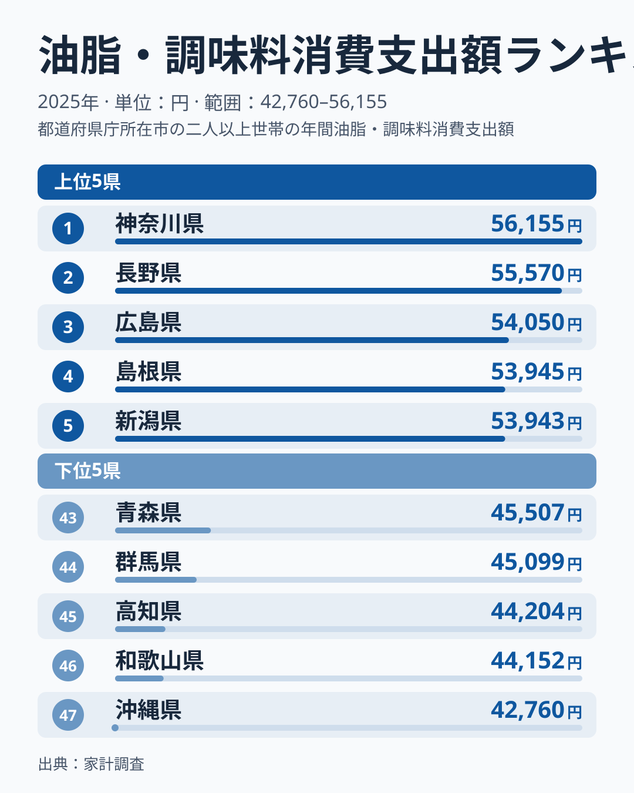
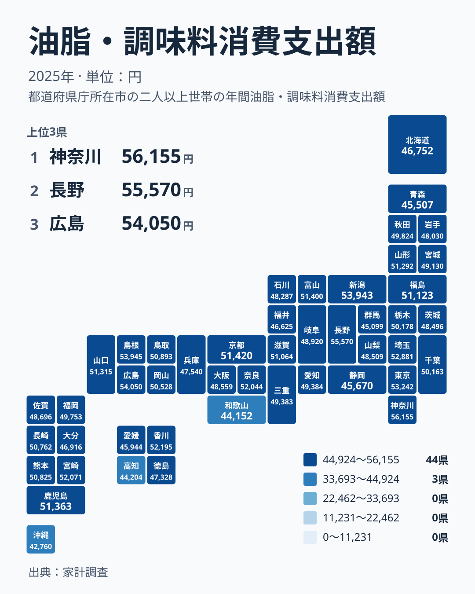

醤油、味噌、食用油、砂糖、ソース。こうした油脂・調味料への支出は、どの家庭でも発生するものです。それでも、都道府県で並べると年間の支出額には差が出ます。2025年の家計調査では、1位の神奈川県が56,155円、47位の沖縄県が42,760円でした。

この記事の主題は「差の原因を当てること」ではありません。この指標だけでは原因を特定できないので、順位や分布から確実に言えることを整理し、そのうえで食文化・気候・産地・暮らし方との結びつきを仮説として考えます。仮説はあくまで読み解きの手がかりであり、データが裏付けているわけではない点をあらかじめお伝えします。

## 上位と下位の顔ぶれを見る

まず、上位5県と下位5県を図で確認します。

<source-link href="/ranking/oils-seasonings-group-consumption-expenditure">油脂・調味料への支出ランキングをもっと見る</source-link>

1位は神奈川県の56,155円です。2位は長野県の55,570円、3位は広島県の54,050円、4位は島根県の53,945円、5位は新潟県の53,943円と続きます。4位と5位の差はわずか2円で、上位は僅差で並んでいます。

下位側は、47位の沖縄県が42,760円です。46位は和歌山県の44,152円、45位は高知県の44,204円、44位は群馬県の45,099円、43位は青森県の45,507円でした。最大の神奈川県と最小の沖縄県の金額は、56,155円と42,760円です。

上位5県の所属を地方で確かめると、関東が神奈川県、中部が長野県と新潟県、中国が広島県と島根県です。3つの地方にまたがっており、特定の地方だけが上位を占める構図ではありません。下位5県も、九州・沖縄の沖縄県、近畿の和歌山県、四国の高知県、関東の群馬県、北海道・東北の青森県と、地方がばらけています。

> [!NOTE]
> この指標は、家計調査における世帯の年間の油脂・調味料への支出額(円)です。家庭で購入した分の金額を表すもので、購入量そのものではありません。外食先で使われる調味料がどう扱われるかは、この記事の数値からは確認できません。

## 順位から言えることと、言えないこと

長野県は2位の55,570円、新潟県は5位の53,943円です。漬物や味噌、米どころといった食文化のイメージと結びつけたくなる県ですが、この指標が支持するのは順位までです。支出額の高さが食文化に由来するかどうかは、この数字からは確かめられません。

中国地方の例を見ると、慎重さが必要な理由がわかります。広島県は3位の54,050円、島根県は4位の53,945円と上位に並ぶ一方、山口県は14位の51,315円、鳥取県は18位の50,893円、岡山県は21位の50,528円です。同じ地方でも順位には幅があり、地方単位の説明では収まりません。

> [!TIP]
> 順位だけでなく金額差も見てください。たとえば8位の香川県は52,195円、9位の宮崎県は52,071円、10位の奈良県は52,044円で、上位10位前後は金額が接近しています。順位が一つ違っても、金額差は小さい場合があります。

## 地理分布から見える傾向

次に、全国の分布を地図で確認します。

地図を見ると、色の濃い県が特定の地方に固まっているわけではなく、各地に散らばっています。関東では神奈川県が1位の56,155円、東京都が6位の53,242円、埼玉県が7位の52,881円と上位に並びます。一方、同じ関東の群馬県は44位の45,099円で、下位に入っています。

九州・沖縄でも幅があります。宮崎県は9位の52,071円、鹿児島県は13位の51,363円と上位ですが、沖縄県は47位の42,760円で最下位です。北海道・東北では、山形県が15位の51,292円、福島県が16位の51,123円である一方、北海道は39位の46,752円、青森県は43位の45,507円です。

このように、同じ地方の中でも順位が大きく分かれます。気温や地域といった単純な区分けでは、この分布を整理しきれないことが、地図から読み取れる確かな点です。

> [!WARNING]
> 家計調査は標本調査であり、各県の結果は限られた世帯の回答にもとづきます。小さな順位差は誤差の範囲に収まる可能性があります。1年分の結果だけで、その県の食文化や暮らしを断定することはできません。

## 神奈川県と沖縄県を対比する

最下位の沖縄県は42,760円です。沖縄の食文化には独自の特徴があるとよく言われますが、それが支出の低さに結びついているかどうかは、この指標だけでは確かめられません。

神奈川県は56,155円で全国1位です。東京都の53,242円、埼玉県の52,881円と並んで、首都圏の県が上位に入っています。大都市圏だから支出が多いのか、別の要因があるのかは、人口や価格のデータがない以上、この記事では判断できません。仮説としては、購入できる商品の幅や、家庭での調理の頻度などが関わる可能性が考えられますが、いずれも本データで裏付けたものではありません。

近畿でも差があります。奈良県は10位の52,044円、京都府は11位の51,420円、滋賀県は17位の51,064円で上位から中位にいます。一方、大阪府は31位の48,559円、和歌山県は46位の44,152円です。近畿の7県の中で順位が大きく開いており、地方単位の一言で語るのは難しいことがわかります。

## 産地との結びつきは説明に使えるか

産地や地元の食材と支出を結びつけて説明したくなる場面もあります。しかし、上位と下位のどちらの例でも、都合のよい説明ができてしまうのが実情です。

香川県は8位の52,195円で、醤油づくりで知られる小豆島を抱えます。産地が近いから支出が多い、という説明は一見もっともらしく見えます。一方、下位の静岡県は42位の45,670円で、茶や水産加工の産地として知られます。地元の産品が多いから調味料の支出が少ない、という説明もできそうに見えます。

けれども、この二つは逆向きの理由づけです。産地があることが支出を増やすとも減らすとも言えてしまうなら、どちらの説明もこのデータの裏付けにはなっていません。産地との関係は、この指標からは根拠を示せない仮説にとどまります。

中位にも目を向けると、福岡県は25位の49,753円、愛知県は26位の49,384円、宮城県は28位の49,130円です。人の多い都市を抱える県でも、順位は上位から中位まで広く散らばっています。下位には、愛媛県の41位の45,944円、福井県の40位の46,625円もあります。

## 数字を読むときの注意点

支出額は、購入量と単価の掛け合わせで決まります。同じ金額でも、量が多い場合と、高価な商品を選んでいる場合があり、この指標だけではどちらかを区別できません。「支出が多い県は味が濃い」と読むことはできません。

物価の地域差が支出額に影響している可能性もありますが、それを示す数値はここにはありません。差の一部が価格によるものなのか、購入量によるものなのかは、別の統計と突き合わせて初めて検討できることです。

全体を見渡すと、1位の神奈川県の56,155円から47位の沖縄県の42,760円まで、金額は連続的に並んでいます。大きな断絶があるわけではなく、特定の県だけが飛び抜けているわけでもありません。個別の県を「突出している」と見るより、全体の広がりの中での位置として捉えるほうが、データに沿った読み方になります。

結局のところ、この指標から確実に言えるのは、各県の金額と順位、そして地方単位ではきれいに分けられない分布の形までです。差を生む原因については、仮説を立てることはできても、結論を出すことはできません。

ほかの統計と合わせて見たい方は、[同じカテゴリの統計一覧](/category/economy)をご覧ください。個別の県の詳しいデータは、[神奈川県のデータ](/areas/14000)や[長野県のデータ](/areas/20000)で確認できます。

## データについて

この記事で使った数値は、家計調査の2025年の結果で、単位は円です。統計名は「油脂・調味料消費支出額」で、全47都道府県の値を用いています。順位は金額の高い順で、1位が最も多く、47位が最も少ない県です。本文中の金額と順位は、すべてこの統計の値をそのまま用いています。
