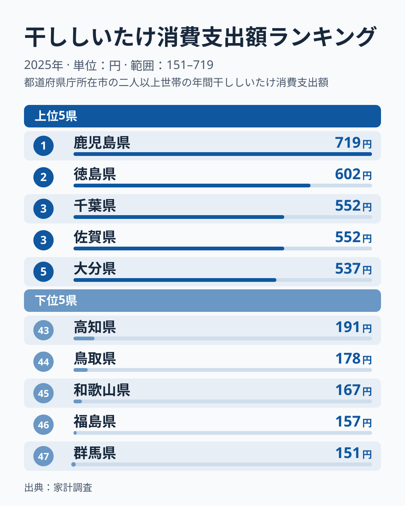
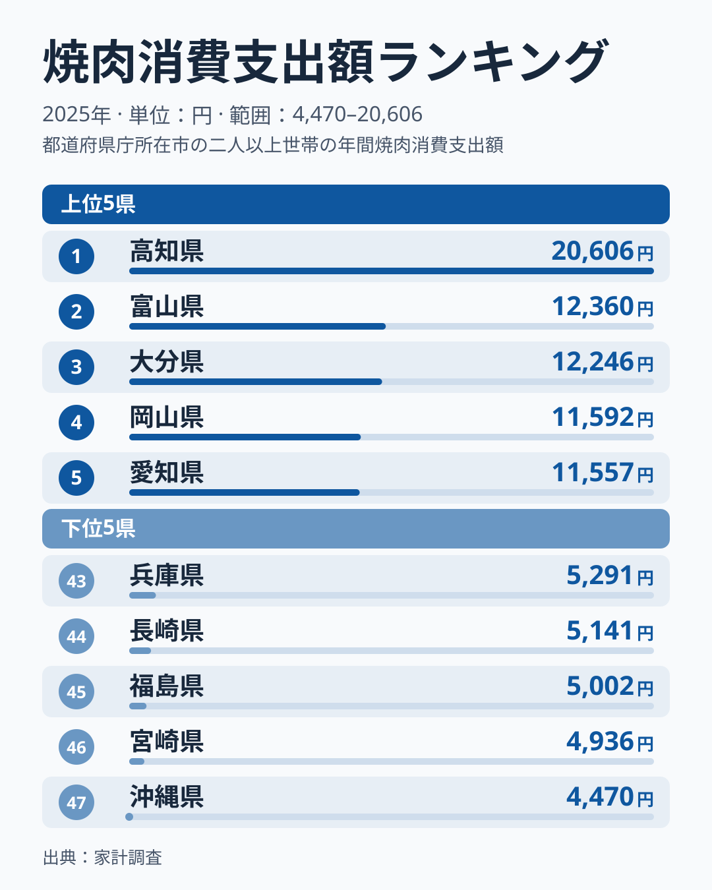
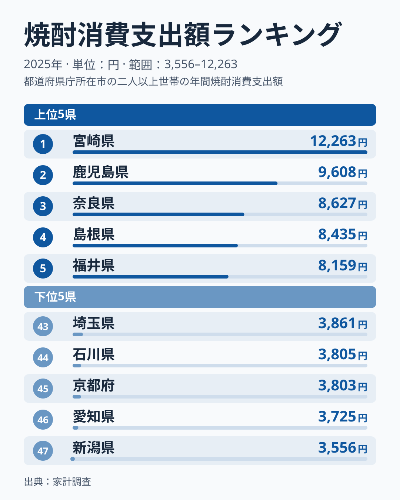
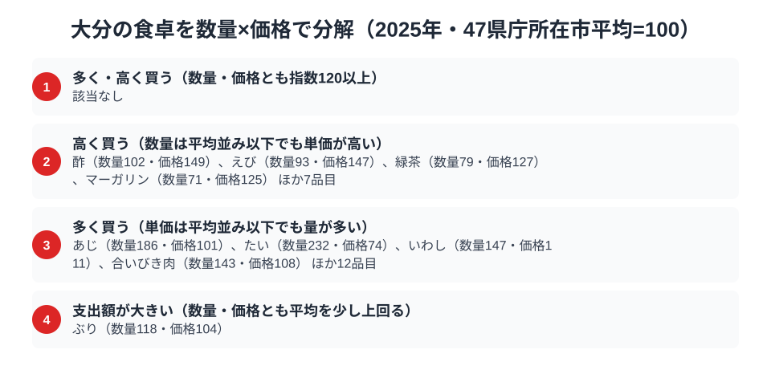

大分県の食卓を数字で覗くと、2025年の家計調査では干ししいたけ・焼肉・焼酎の3品目のどれでも全国1位に届いていません。総務省の家計調査（品目別）によると、大分県庁所在市の二人以上世帯が1年間に干ししいたけへ使う金額は537円で、全国47都道府県のうち5位です。1位の鹿児島県は719円です。

焼肉の支出額は全国3位の12,246円で、1位の[高知県](/areas/39000)の20,606円には大きく離されているものの、2位の富山県は12,360円で、その差は114円です。焼酎の支出額は全国12位の6,713円で、麦焼酎の産地というイメージからすると中位にとどまります。この記事では、家計調査の2025年の実データから、首位のない大分の食卓を3品目の順位と、数量×価格の分解という2つの角度で読み解きます。

> [!NOTE]
> この記事のデータは総務省統計局「家計調査（品目別）」2025年、都道府県庁所在市（大分県は大分市）の二人以上世帯の年間支出額です。県全体の値ではなく、県民1人あたりの消費量でもありません。市別の値は調査世帯数が限られるため年ごとのぶれが大きく、1年の順位だけで食文化の優劣や構造を断定することはできません。

## 干ししいたけ — 全国5位537円、上位は552円前後に集中

<source-link href="/ranking/dried-shiitake-consumption-expenditure">干ししいたけ消費支出額ランキングをもっと見る</source-link>

大分県は干ししいたけ消費支出額で全国5位の537円です。1位の[鹿児島県](/areas/46000)は719円、2位の徳島県は602円と上位2県がやや抜けていますが、3位の千葉県と4位の佐賀県はともに552円で、大分県との差は15円にすぎません。6位の島根県は536円と、大分県とは1円差です。5位前後は金額がほとんど変わらない密集帯で、わずかな買い方の違いで順位が入れ替わりうる位置にあります。

上位5県の顔ぶれは鹿児島県・徳島県・千葉県・佐賀県・大分県で、九州が3県、四国と関東が1県ずつです。地域がまとまって上位を占めているわけではなく、九州・四国・関東に分かれています。最下位の群馬県は47位の151円で、1位の鹿児島県とは4.8倍の開きがあります。

[仮説] 干ししいたけは購入頻度の低い品目で、標本世帯の買い方次第で金額が動きやすいため、順位の入れ替わりは年ごとに起こりうると考えられます。複数年の推移を比べて確かめる必要があります。

## 焼肉 — 全国3位12,246円、2位から4位は接戦

<source-link href="/ranking/yakiniku-consumption-expenditure">焼肉消費支出額ランキングをもっと見る</source-link>

焼肉の支出額で大分県は全国3位の12,246円です。順位を見ると、1位の[高知県](/areas/39000)が20,606円と抜け、2位以下が接戦という二層構造になっています。高知県と2位の富山県の差は8,246円で、富山県は12,360円です。一方、2位から6位は12,360円から11,397円までの963円の範囲に5県が収まっています。大分県と富山県の差は114円、4位の[岡山県](/areas/33000)は11,592円で、大分県との差は654円です。大分県はこの次点集団の先頭寄りにいます。高知県を追う位置というより、高知県を除いた接戦の中で上位にいる、と読むのが実態に近いでしょう。

九州の中で見ると、熊本県は6位の11,397円と大分県に近い水準ですが、宮崎県は46位の4,936円で、九州内でも大きな差があります。九州全体が焼肉に強いわけではなく、大分県の高さは九州一帯の傾向とは言い切れません。最下位の沖縄県は47位の4,470円で、大分県とは2.7倍の差です。

[仮説] 地元産の牛肉が手に入りやすいことや、焼肉店が身近にあることが支出額を押し上げている可能性はありますが、この記事のデータでは確認できません。

## 焼酎 — 全国12位6,713円、九州の中では中位

<source-link href="/ranking/shochu-consumption-expenditure">焼酎消費支出額ランキングをもっと見る</source-link>

焼酎の支出額は大分県が全国12位の6,713円です。1位の[宮崎県](/areas/45000)は12,263円、2位の[鹿児島県](/areas/46000)は9,608円と九州の2県が上位に並ぶ一方、3位は奈良県の8,627円、4位は島根県の8,435円、5位は福井県の8,159円と、九州以外の県が入ってきます。熊本県は8位の7,627円で、大分県より上です。11位の山梨県は6,919円、13位の沖縄県は6,691円で、大分県はその間に挟まれています。最下位の新潟県は3,556円で、大分県とは1.9倍の差、首位の宮崎県とは3.4倍の差です。

大分県は麦焼酎の産地として知られますが、2025年の支出額では宮崎県・鹿児島県・熊本県の後ろにつけています。

> [!WARNING]
> 焼酎の支出額は、麦・芋・米などの原料の区分がなく合算された値です。麦焼酎だけの支出を示すものではないため、「麦焼酎の産地だから高いはず」という見立てを、この順位で検証することはできません。

## 大分の食卓に共通するもの

干ししいたけは5位、焼肉は3位、焼酎は12位と、3品目の順位はそれぞれ違います。ただ、首位との距離を並べると、品目ごとに「首位の遠さ」が違うことが見えてきます。干ししいたけは首位の鹿児島県との差が182円で、1位の約1.3倍にとどまります。焼肉は高知県が約1.7倍、焼酎は宮崎県が約1.8倍で、とくに焼肉と焼酎は首位が大きく先行しています。

つまり大分の食卓は「看板品目が独走する」型ではなく、干ししいたけでは首位に手が届く距離、焼肉では高知県を除いた次点集団の先頭、焼酎では首位が遠い中位と、品目ごとに異なる位置で「競り合う帯に入っている」型と読めます。

[仮説] 1年ごとの調査ではこの帯の中で順位が入れ替わりやすいため、首位がないこと自体が構造的な特徴だと断定はできません。複数年で同じ位置に残るかを確かめる必要があります。

同じように県固有の食文化を数字で読み解いた記事として、麦焼酎文化圏の隣県[熊本の食卓](/blog/kumamoto-food-culture)や、焼酎首位県[宮崎の食卓](/blog/miyazaki-food-culture)もあわせてご覧ください。九州各県の違いを比べると、大分の特徴がより分かりやすくなります。

## 数量×価格で分解する大分市の食卓

<source-link href="/ranking/horse-mackerel-consumption-quantity">あじ消費量ランキングをもっと見る</source-link>

大分市の支出額が高い品目が「単価が高い」からなのか、それとも「たくさん買う」からなのかを、家計調査の数量データで分解してみます。品目ごとに47都道府県庁所在市の平均を100とした指数に置き換え、数量指数と価格指数がともに120以上の品目を「多く・高く買う」と分類すると、2025年の大分市にはその品目が1つもありません。多くの品目は、量が目立つ型と単価が目立つ型のどちらかに寄っています。

> [!NOTE]
> ここでの指数は47都道府県庁所在市（二人以上世帯）の年間データを単純平均し100とした相対値で、総務省が公表する全国平均そのものではありません。分類の閾値は、指数120以上を「多い・高い」、80以下を「少ない・安い」としています。価格指数は「支出額÷数量」から算出した単価の相対値のため、品種やブランドの違いによる価格差を含みます。対象は大分市の2025年の年間データです。

「多く買う」区分で目立つのは魚と肉です。たいは数量指数232・価格指数74で、単価は平均より安いのに量が際立ちます。あじは数量指数186・価格指数101、合いびき肉は数量指数143・価格指数108で、いずれも単価は平均並みで量が多い品目です。[仮説] 魚の購入量が多いのは、鮮魚を家庭で日常的に買う習慣があるためかもしれませんが、購入先や調理法までは本データから確認できません。同様に、焼肉の支出額が全国3位に入る背景にも肉類を多く買う習慣がある可能性がありますが、焼肉そのものの数量はここでは確認できません。この区分には、ここに挙げた品目のほかにも多くの品目が入っています。

ぶり（数量指数118・価格指数104）は、数量も価格も平均を少し上回る品目で、どちらか一方に寄らない例外的な位置にあります。ただし閾値の120には届かないため、「多く・高く買う」ではなく「支出額が大きい」区分に入ります。

逆に、数量は平均並み以下でも単価が高い「高く買う」区分には、酢（数量指数102・価格指数149）、えび（数量指数93・価格指数147）、緑茶（数量指数79・価格指数127）、マーガリン（数量指数71・価格指数125）などが入ります。少量でも単価の高いものを選ぶ買い方は、こうした限られた品目に見られます。

## まとめ

- 干ししいたけ消費支出額は大分県が全国5位の537円、1位は鹿児島県の719円、最下位の群馬県は151円で1位とは4.8倍差
- 焼肉消費支出額は大分県が全国3位の12,246円、1位の高知県は20,606円、2位の富山県とは114円差
- 焼酎消費支出額は大分県が全国12位の6,713円、1位の宮崎県は12,263円で、九州以外の県も上位に入る
- 3品目とも首位ではなく、上位から中位の競り合う帯にいるが、単年の順位から構造は断定できない
- 数量×価格では、たい・あじなどは量が目立ち、酢・えび・緑茶などは単価が目立つ品目だった
- [経済カテゴリ一覧](/category/economy)では大分以外の都道府県の家計調査データも比較できる。県庁所在市ごとの年間支出という調査の特性は、[家計調査のハブ](/survey/kakei-chousa)で確かめられる
