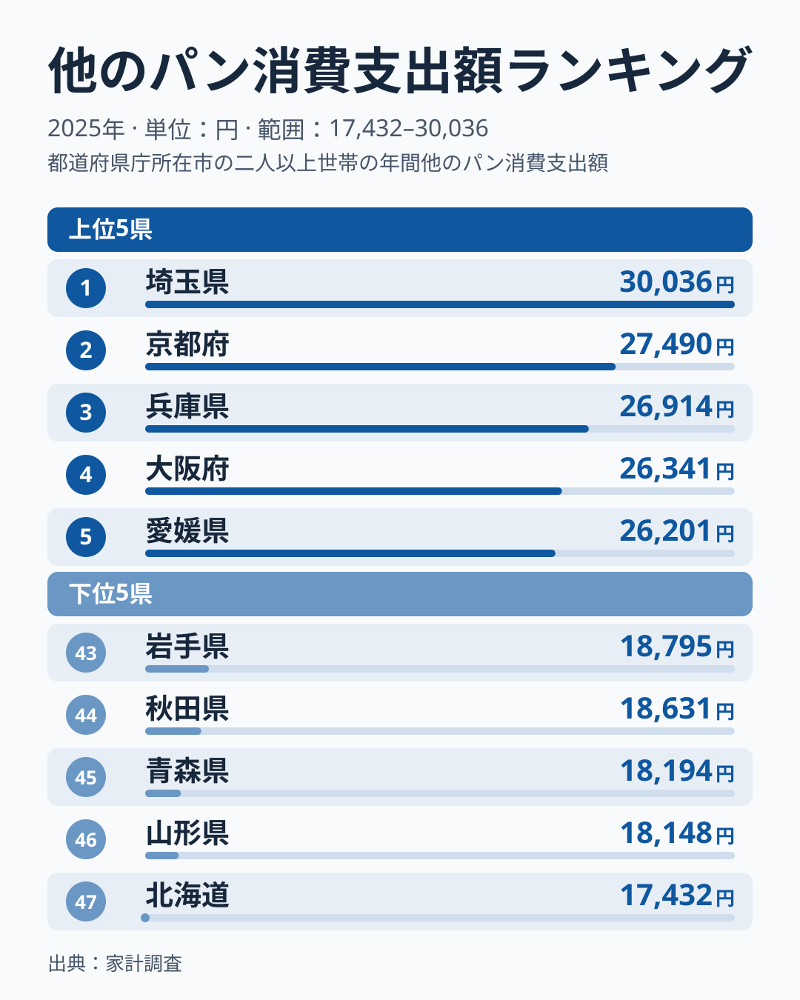
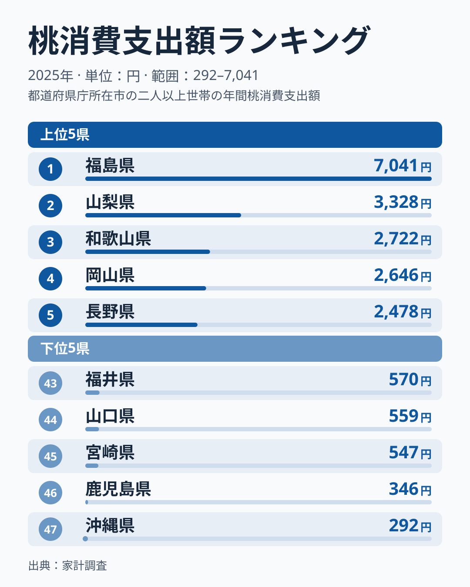
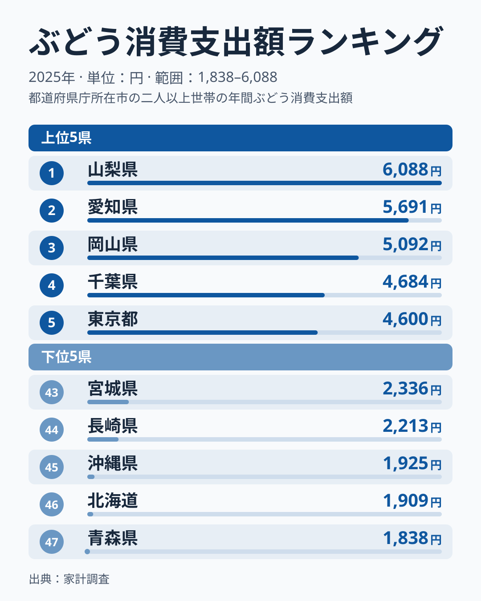
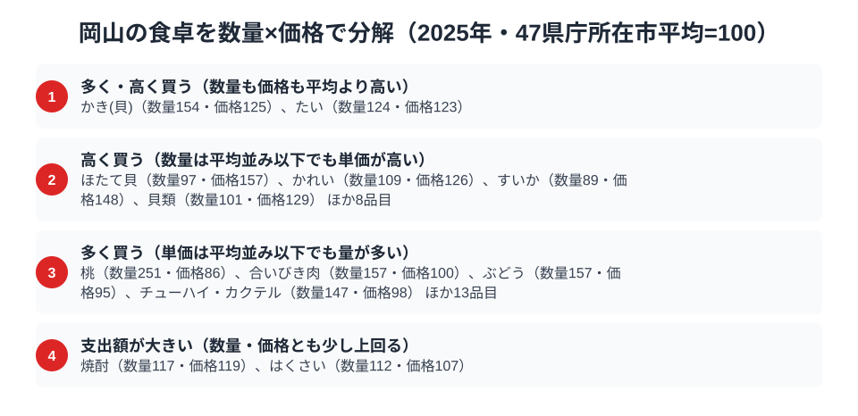

「うどん県」香川、「粉もん」の大阪ほど岡山の食文化は語られません。総務省「家計調査」の品目別データを見ると、岡山県は桃・ぶどうという名産フルーツの消費支出額で、2025年にそれぞれ全国4位・3位につけています。一方、その他パンの支出額は11位でした。

岡山と聞いて多くの人が思い浮かべるのは「白桃」や「マスカット」といった果物のイメージでしょう。家計調査で確かめると、果物の順位の高さは2025年のデータにも表れていました。パンは11位と上位に近い位置ですが、果物ほどの高順位ではありません。ただし、パンは年間の支出額が2万円台、果物は数千円台以下と、金額の規模がそもそも異なる別品目です。この記事では、パン・桃・ぶどうの3品目の全国順位から、岡山県民の食卓の軸を探りつつ、順位で「強い」と言える範囲も確かめます。

> [!NOTE]
> 本記事のデータは総務省統計局「家計調査（品目別）」2025年の**都道府県庁所在市・二人以上世帯**の1世帯あたり年間支出額です。岡山県の数値は岡山市の世帯が対象で、県内の県北・県南など地域差までは反映されません。

## パン消費支出額 — 11位25,249円、上位に近い中位

<source-link href="/ranking/other-bread-consumption-expenditure">他のパン消費支出額ランキングをもっと見る</source-link>

岡山県のその他パン消費支出額は25,249円で全国11位です。首位は埼玉県の30,036円で、2位の京都府は27,490円、3位の兵庫県は26,914円でした。上位10位を地方別に見ると、関東の埼玉県が1位、近畿は京都府・兵庫県・大阪府・奈良県・滋賀県の5府県、四国は愛媛県・香川県・徳島県の3県、中部の福井県が6位に入っています。近畿と四国で合わせて8府県を占めますが、首位は関東の埼玉県で、福井県も含まれるため、「近畿・四国だけが中心」とまでは言えません。10位の徳島県は25,320円で、岡山との差はわずか71円です。「その他パン」は食パン以外の菓子パン・調理パン・惣菜パンを指す区分で、コンビニや街のパン屋で日常的に消費されるカテゴリです。

家計調査の市別の値は1世帯あたりの標本が小さく、単年の順位は動きやすいものです。岡山は首位の埼玉県と4,787円離れており、「パン王国」と呼べるほど突出しているとは言えません。一方で、10位との差は71円しかなく、あと少し支出が多ければ10位以内に入る位置でもあります。[仮説] 近畿・四国を含む西日本の複数の府県で、パン支出が厚い傾向があるのかもしれません。複数年で確かめる必要があります。最下位は北海道の17,432円で、首位の埼玉県の30,036円とは約1.7倍の開きがあります。45位の青森県は18,194円、46位の山形県は18,148円で、北海道・東北が下位に並んでいます。[仮説] 米食中心の食文化との対比として読める可能性があります。

## 桃消費支出額 — 全国4位2,646円、名産フルーツの実力

<source-link href="/ranking/peach-consumption-expenditure">桃消費支出額ランキングをもっと見る</source-link>

岡山の名産といえば「白桃」です。桃消費支出額は2,646円で全国4位に位置します。首位の福島県は7,041円で、岡山の約2.7倍にあたります。2位は山梨県の3,328円、3位は和歌山県の2,722円で、3位とは76円の僅差です。5位の長野県は2,478円で、岡山はこれを168円上回っています。

注目したいのは、福島県の突出ぶりです。首位の福島県は2位の山梨県の3,328円と比べても2倍を超えており、上位の中でも福島県だけが飛び抜けています。岡山は福島ほどではないものの、2位から5位までが2,400円台から3,300円台に収まる集団の中にいます。最下位の沖縄県は292円で、首位の福島県とは約24倍の開きがあります。桃は産地とそれ以外の地域とで消費が大きく分かれる品目で、岡山が上位集団に入っていること自体が、産地としてのイメージと整合的です。

[仮説] 岡山の桃の消費の多さには、瀬戸内の温暖で雨の少ない気候のもとで桃が身近な果物として根づいていることが関係しているのかもしれません。ただし、今回の家計調査の値だけでは、気候や栽培の歴史、贈答用か家庭用かといった背景までは確かめられません。

## ぶどう消費支出額 — 全国3位5,092円、マスカットの産地

<source-link href="/ranking/grape-consumption-expenditure">ぶどう消費支出額ランキングをもっと見る</source-link>

もうひとつの名産フルーツ、ぶどうも岡山県は5,092円で全国3位です。首位の山梨県は6,088円、2位の愛知県は5,691円で、岡山は上位3県の中で最も低い金額です。首位の山梨県とは996円の差があります。一方で、4位の千葉県は4,684円で、岡山はこれを408円上回っています。

ぶどうは桃と違い、首位から上位10位の香川県の4,162円まで、1,000円台後半の幅に収まっています。桃のように首位だけが飛び抜けているわけではなく、山梨県・愛知県・岡山県・千葉県・東京都と、産地とは限らない都市部の県も上位に並びます。[仮説] ぶどうは産地以外でも日常的に買われやすく、そのぶん産地の優位が出にくい品目なのかもしれません。最下位は青森県で1,838円で、首位の山梨県との間には約3.3倍の開きがあります。

岡山のぶどうといえば「マスカット・オブ・アレキサンドリア」のような高級品種のイメージがあります。桃とぶどうがともに全国4位以内という結果は、岡山が「フルーツ王国」と呼ばれる印象と矛盾しません。

> [!WARNING]
> 家計調査の消費支出額はあくまで世帯が実際に「購入した」金額であり、贈答品として県外へ送られた分や、自家消費・観光客が現地で消費した分は含まれません。桃・ぶどうの生産量ランキングでは岡山がさらに上位に来る可能性がありますが、本記事は購入者側の支出額に基づくデータです。

## 岡山の食卓を貫くもの

3品目を並べると、2025年の岡山の食卓で順位が高いのはパンではなく果物でした。桃は4位、ぶどうは3位と、名産地のイメージに沿った順位です。ただし、これは「順位」の比較にとどまります。パンは2万円台、果物は数千円台以下と支出額の水準が違う別品目なので、金額の大きさや食卓での重みを比べたものではありません。順位が高いことは、他の都市と比べて相対的に多く使っていることを示すだけで、「強い」と言い切る根拠としては限られます。

[仮説] 温暖少雨な瀬戸内の気候のもとで、桃・ぶどうが地元で日常的に買われる土壌ができているのかもしれません。パンは11位と上位に近い中位で、果物ほど高い順位ではありません。

[福島県](/blog/fukushima-food-culture)は桃の消費支出額で全国1位です。[仮説] 福島では産地と消費地が近いことが桃の消費を支えているのかもしれませんが、今回のデータからは因果までは言えません。名産フルーツの上位に福島と岡山が並ぶ構図は、地域ごとの食文化の違いを映しているといえるでしょう。

> [!TIP]
> 岡山のパンは25,249円で11位ですが、10位の徳島県とは71円差、首位の埼玉県とは4,787円差です。わずか71円の差で順位が一つ動く以上、「11位」という数字だけで岡山のパンが上位か中位かを断じることはできません。一方、ぶどうの3位と4位の千葉県は408円、桃の4位と3位の和歌山県は76円差で、いずれも近接した順位です。岡山の位置づけは、順位より金額の近さと複数年の推移で確かめるのが安全です。

## 数量×価格で分解する岡山市の食卓

<source-link href="/ranking/peach-consumption-quantity">桃消費量ランキングをもっと見る</source-link>

「支出額の順位」は、数量と単価という2つの要素が掛け合わさって生まれる結果です。同じ支出額でも、たくさん買っているから多いのか、単価が高いから多いのかでは、食文化の姿は違って見えます。そこで、47都道府県庁所在市の1世帯あたり平均を100とした数量指数と価格指数を使い、岡山市の品目を4区分に分けて位置を確かめました。区分は、「多く・高く買う（数量も価格も平均より高い）」「高く買う（数量は平均並み以下でも単価が高い）」「多く買う（単価は平均並み以下でも量が多い）」「支出額が大きい（数量・価格とも少し上回る）」です。

桃は数量指数251、価格指数86で「多く買う」区分に入ります。数量指数が高く、価格指数が平均を下回る点は、購入量の多さが支出額を押し上げる構図と整合します。ぶどうも数量指数157、価格指数95で同じ区分です。高級品種のイメージとは異なり、単価は平均をわずかに下回ります。[仮説] 購入量が多いのは、日常的に買う家庭が多いためかもしれませんが、一部の家庭がまとめて買っている可能性も否定できません。同じ区分には合いびき肉（数量指数157）やチューハイ・カクテル（数量指数147）もあり、量で支出額を押し上げる品目が岡山の食卓には並んでいます。支出額の順位だけでは、こうした「量で買っている」実態は見えません。

> [!NOTE]
> この分解の基準は家計調査の全国値ではなく、47都道府県庁所在市の単純平均を100とした指数です。価格指数は支出額÷数量から算出した相対値のため、同じ品目でも購入する銘柄・品種・グレードの違いも含んだ数値になります。対象は2025年・二人以上世帯の岡山市データで、他の品目と同様に県全体ではなく岡山市の消費傾向を示しています。

## まとめ

- ぶどう消費支出額は岡山県が5,092円で全国3位、首位の山梨県は6,088円で、上位3県の中では最も低い
- 桃消費支出額は岡山県が2,646円で全国4位、首位の福島県は7,041円
- その他パン消費支出額は岡山県が25,249円で全国11位、首位の埼玉県は30,036円、最下位の北海道は17,432円
- 桃とぶどうは数量指数が高く価格指数が平均を下回り、購入量の多さが支出額を押し上げる構図と整合する
- パンと果物の比較は順位にとどまり、金額規模の違う別品目を「強い・弱い」で断定する物差しにはならない

3品目とも[経済カテゴリ一覧](/category/economy)に含まれる家計調査データで、県ごとの食文化の違いを数値で確かめられます。岡山県の統計をさらに詳しく見たい場合は[岡山県の地域プロフィール](/areas/33000)もあわせてご覧ください。
