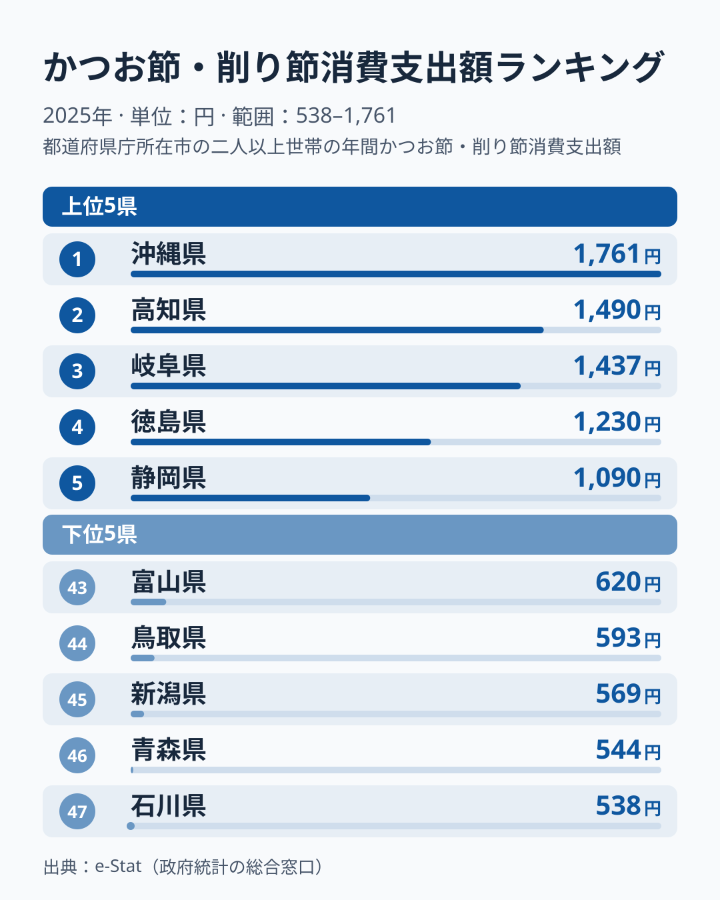
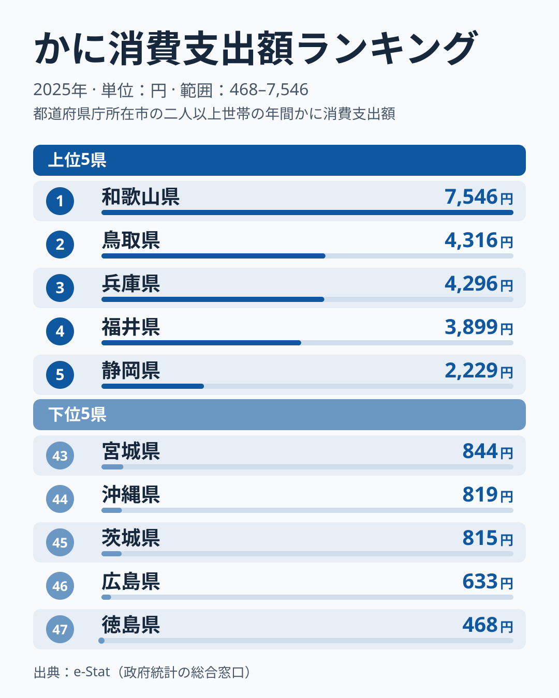
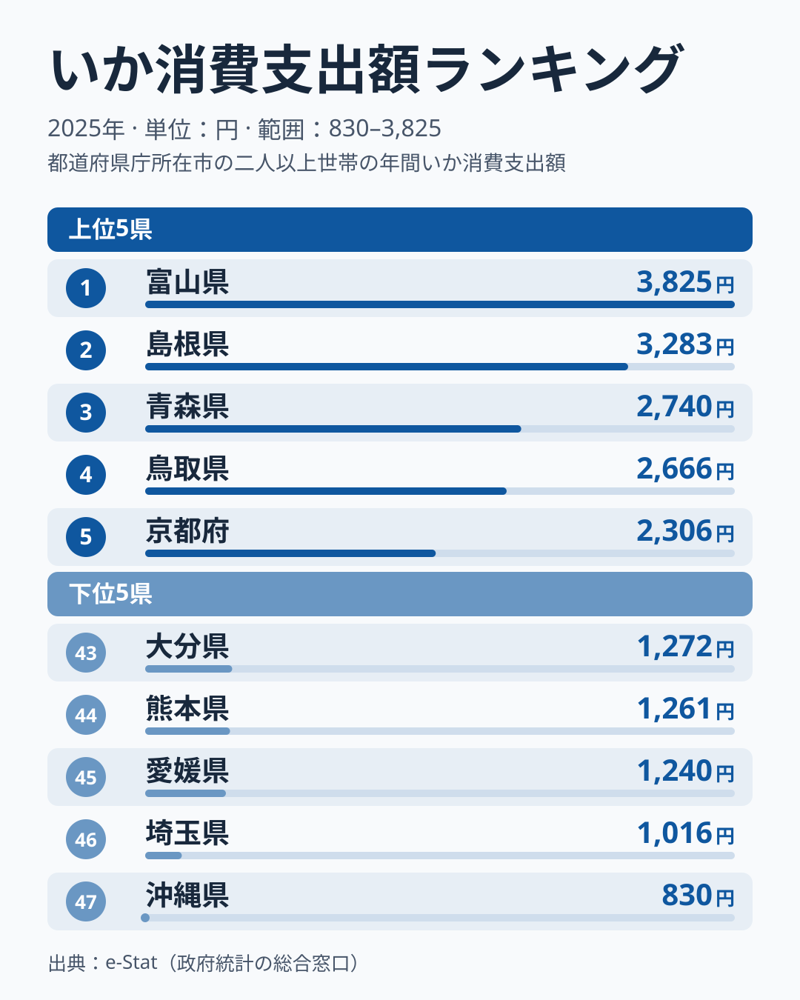
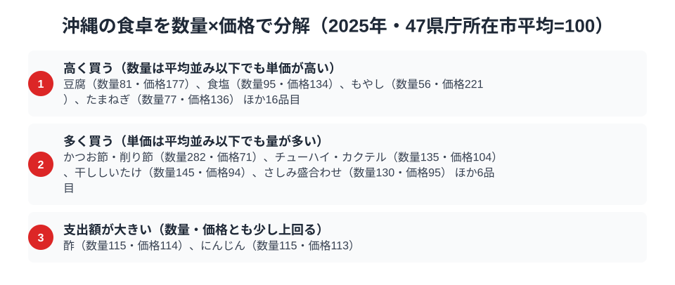

沖縄県の食卓には、本土とはっきり違う「かたより」があります。総務省の家計調査（品目別）で那覇市の二人以上世帯を見ると、2025年のかつお節・削り節の消費支出額は1,761円で全国1位。2位の高知県1,490円を約2割上回っています。

ところが同じ沖縄が、いかでは830円で全国47位の最下位、かにでも819円で44位と、下位に沈みます。かつお節に日本一お金を使う県なのに、魚介そのものでは下位が並びます。この一見ちぐはぐな数字の組み合わせにこそ、琉球料理の伝統と沖縄の地理条件が凝縮されています。

> [!NOTE]
> 家計調査の都道府県データは、県庁所在市（沖縄県は那覇市）の二人以上世帯を対象にした年間支出額です。県全体ではなく那覇市在住世帯の家計簿から見た傾向であり、支出「金額」であって消費「量」そのものではない点にご注意ください。

## かつお節 — 高知を上回る、出汁の島の日本一

<source-link href="/ranking/katsuobushi-consumption-expenditure">かつお節消費支出額ランキングをもっと見る</source-link>

沖縄県のかつお節消費支出額は1,761円で全国1位。2位の高知県1,490円を約2割上回り、最下位の石川県538円の3.3倍にあたります。かつおの本場・高知を抑えて沖縄が首位に立つ構図は、この品目ならではの光景です。なお家計調査の県別の値は単年のぶれが大きく、1位と2位の差が年によって入れ替わることもあります。1位という順位より、沖縄が毎年上位に入る傾向を見るのが妥当です（[仮説]、複数年の推移での確認が必要）。

背景にあるのは、琉球料理の出汁文化です。沖縄そばの出汁、ソーキ汁や中身汁などの汁物、チャンプルーの味付けまで、沖縄の家庭料理はかつお出汁を惜しみなく使います。本土の「削り節を少量ずつ」という使い方と違い、沖縄では厚削りや大容量パックを常備して日常的に大量消費するスタイルが根づいています。明治期以降、鰹節製造が沖縄・奄美で盛んだった歴史も、この食文化の土台になっています。かつお節が東西どちらの食文化圏でも使われるなかで沖縄だけが突出する構図は、[かつお節支出の記事](/blog/katsuobushi-expenditure-ranking)でも詳しく取り上げています。

## かに — 819円で47県中44位、冬の味覚が届きにくい島

<source-link href="/ranking/crab-consumption-expenditure">かに消費支出額ランキングをもっと見る</source-link>

対照的に、かにの消費支出額は819円で47県中44位です。1位の和歌山県7,546円と比べると約9倍の開きがあり、最下位の徳島県468円や、45位の茨城県815円とは近い水準に並びます。ズワイガニやタラバガニは寒い海の生き物で、亜熱帯の沖縄近海では獲れません。日本海側で正月やハレの日の食材として根づいた「冬のかに文化」は、雪の降らない沖縄には持ち込まれにくかったと考えられます（[仮説]、県別の食文化調査での確認が必要）。

産地からの距離、輸送コスト、そして「かにを囲む冬」という季節感の不在。この三つが重なって、かには沖縄の食卓であまり目立たない食材になっていると読めます（[仮説]）。上位に並ぶ県の顔ぶれは[かに消費支出の記事](/blog/crab-expenditure-ranking)で詳しく解説しています。

## いか — こちらは最下位830円、本土と違う魚食

<source-link href="/ranking/squid-consumption-expenditure">いか消費支出額ランキングをもっと見る</source-link>

いかの消費支出額は830円で全国最下位です。1位の富山県3,825円の約2割強にとどまり、46位の埼玉県1,016円も下回ります。いかの主産地は青森・北海道・日本海側といった寒流域で、沖縄は地理的に遠い上に、そもそも県内の魚食文化の重心が本土と異なります。

沖縄の近海魚といえばグルクン（タカサゴ）やイラブチャー（ブダイ類）、マグロなど、本土のスーパーにはあまり並ばない魚たちです。つまり沖縄の「いか最下位」は魚を食べないことを意味せず、本土の大衆魚とは別の魚種で食卓が構成されていることの表れです。家計調査の品目リストが本土の食生活を基準に作られているため、沖縄独自の魚食は「その他」に隠れてしまうのです。

> [!WARNING]
> 家計調査は支出金額の調査であり、消費量そのものではありません。また品目区分は全国共通のため、グルクンなど沖縄固有の魚は個別品目として集計されず、沖縄の魚食の実態は「いか」「さば」など本土型品目の順位だけでは測れない点にご注意ください。

## 沖縄の食卓を貫くもの

沖縄県民の食卓を貫くのは、「琉球料理の体系がいまも現役である」ということです。かつお出汁を大量に使う汁物文化が日本一のかつお節支出を生み、寒流の魚介（かに・いか）は文化にも流通にも組み込まれにくく、いかは最下位、かには44位に並びます。1位と47位が同居する極端な凸凹は、沖縄の食卓が本土の縮小版ではなく、独自の体系として成立していることの証明です。

高知の「黒潮特化」、青森の「北の海と雪国の多面型」と並べると、沖縄は「琉球という独立した食文化圏」。県民の食卓シリーズの中でも、本土との違いが最も鮮明な県と言えます。

> [!TIP]
> 家計調査で沖縄を見るときは、「1位の品目」と「最下位の品目」の落差に注目してください。かつお節1位・いか最下位のように振れ幅が大きいほど、その県の食文化が全国標準から離れている手がかりになります（[仮説]、単年の順位では断定できず、複数年での確認が必要）。

## 数量×価格で分解する那覇市の食卓

<source-link href="/ranking/katsuobushi-consumption-quantity">かつお節・削り節消費量ランキングをもっと見る</source-link>

家計調査は品目ごとの購入数量も公表しており、支出額を「数量×価格」に分解できます。47都道府県庁所在市の平均を100とした指数で見ると、沖縄のかつお節・削り節消費量が全国1位になった理由がはっきりします。年間の購入量は492gにのぼり、47市平均に対する数量指数は282に達し、平均のおよそ2.8倍を買っていることになります。一方で1グラムあたりの単価を示す価格指数は71にとどまり、平均より3割近く安く仕入れています。つまり、かつお節・削り節の支出額日本一は「高い品を買っている」からではなく、「圧倒的な量を安く買っている」から生まれているのです。

上の図には、この4区分に沿って沖縄が平均から外れて買っている品目が並んでいます。「多く買う」区分にはかつお節・削り節のほかにチューハイ・カクテル（数量135・価格104）、干ししいたけ（数量145・価格94）、さしみ盛合わせ（数量130・価格95）が入り、いずれも単価は平均並みかそれ以下に抑えつつ購入量で支出額を押し上げるタイプです。「支出額が大きい」区分の酢（数量115・価格114）とにんじん（数量115・価格113）は、量・単価とも小幅に平均を上回ります。なお、数量も価格も平均を大きく上回る「多く・高く買う」区分には、2025年は該当する品目がありませんでした。一方「高く買う」区分の豆腐（数量81・価格177）、食塩（数量95・価格134）、もやし（数量56・価格221）、たまねぎ（数量77・価格136）は、購入量は平均並みかそれ以下ながら単価指数が高く、平均より少ない量をより高い単価で買っている品目です。

同じ枠組みでいかを見ると、購入量は509gで数量指数は59、価格指数も79.5と、量・単価とも平均を下回ります。支出額が全国最下位になっている理由は、量（数量指数59）も単価（価格指数79.5）もともに平均以下であることにあります。かにについては家計調査の支出額に819円が計上されている一方、同じ2025年の購入数量はグラム単位で0として記録されており、数量×価格には分解できません。支出額と数量の記録が噛み合わないほど購入実績が乏しい品目であることが、この一点からもうかがえます。

かつお節・削り節のように「支出額1位」でも、量で稼いだ1位なのか単価で稼いだ1位なのかは分解しないと分かりません。沖縄の場合は前者にあたり、単価自体は47市平均より安く抑えられています。

> [!NOTE]
> 数量指数・価格指数は47都道府県庁所在市（沖縄県は那覇市）の平均を100とした相対値で、家計調査の全国平均や那覇市単体の絶対水準とは別の見方です。価格指数は品種・銘柄の違いも含み、対象は二人以上世帯の年間値です。

## まとめ

- かつお節消費支出額は沖縄県が全国1位（1,761円）、2位高知県1,490円を約2割上回る
- かには819円で47県中44位、1位和歌山県7,546円との差は約9倍
- いかは830円で全国最下位、寒流域の魚介は文化・流通ともに縁が薄い
- 琉球料理の出汁文化が1位を、亜熱帯の地理と独自の魚食が下位を生むと読める（[仮説]）
- 「1位と47位の同居」は、沖縄の食卓が本土と独立した体系であることの表れ

沖縄県の他の統計は[沖縄県の地域プロフィール](/areas/47000)、食品・家計消費の地域差は[経済カテゴリ一覧](/category/economy)からご覧いただけます。
