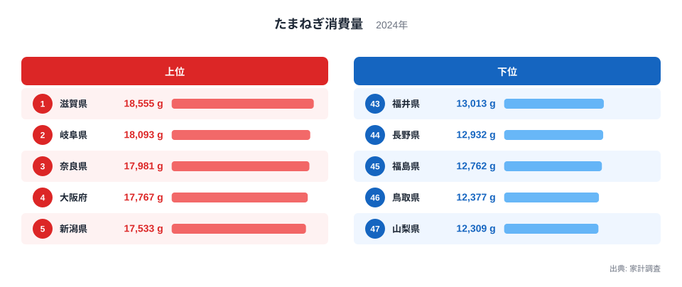
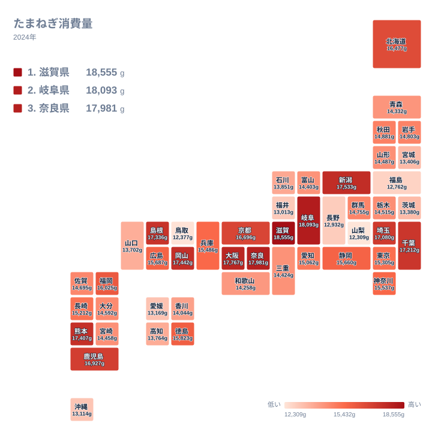

たまねぎは、カレー、味噌汁、炒め物、煮物と、和洋中を問わず使われる野菜です。どの家庭の冷蔵庫にもあるような食材なので、買う量は全国どこでも似たようなものだと思われがちです。ところが県別に並べると、はっきりとした差が現れます。

2024年の家計調査で、たまねぎの購入量が最も多かったのは滋賀県で、18,555gでした。最も少なかったのは山梨県の12,309gです。この記事では、上位と下位の顔ぶれ、地理的な広がり、同じ地方の中での割れ方を順に確かめ、食文化や産地との結びつきを仮説として考えます。

## 上位10県は5つの地方にまたがる

まず、上位5県と下位5県を並べた図を見てみましょう。

<source-link href="/ranking/onion-consumption-quantity">たまねぎ消費量ランキングをもっと見る</source-link>

図でまず目につくのは、上位の顔ぶれが特定の地方に偏っていないことです。1位から10位までの10県は、近畿、中部、中国、九州・沖縄、関東の5つの地方にまたがっています。「たまねぎをよく買う地域」は、地図の一角に固まっているのではなく、全国に点在していると言えます。

もう一つ注目したいのは、人口の多い都市が必ずしも上位ではない点です。大阪府は4位で17,767gですが、東京都は20位で15,305gにとどまります。首都圏の中でも、埼玉県は10位で17,080g、千葉県は9位で17,212gと上位に入る一方、神奈川県は18位で15,537gです。大都市圏だから多い、あるいは少ない、という単純な図式は成り立ちません。

首位の滋賀県の詳しい数字は[滋賀県のデータ](/areas/25000)、2位の岐阜県については[岐阜県のデータ](/areas/21000)で確認できます。両県は18,000g台で並び、3位以下との間にも大きな段差はありません。上位は少しずつ値が下がっていく緩やかな坂のような形をしています。

> [!NOTE]
> この指標は、家計調査の「たまねぎ消費量」です。家庭で購入したたまねぎの数量をグラム単位で集計したもので、外食や総菜、弁当に含まれる分は入りません。「その県の人が食べたたまねぎの総量」ではなく、「家庭の台所に入った量」を表しています。

## 地図で見る地域差:近畿・中国に上位が集まり、隣県で割れる

次に、地理的な広がりを確かめます。

地図にすると、近畿と中国に上位の県が比較的まとまっていることが分かります。近畿では滋賀県、奈良県、大阪府、京都府が12位までに入っています。中国では岡山県が6位、島根県が8位です。

ただし、まとまりは完全ではありません。同じ中国の鳥取県は46位で12,377gと下位に沈み、6位の岡山県の17,442gとの間に大きな差があります。内陸か沿岸か、西日本か東日本かといった切り口では説明しきれず、滋賀県、岐阜県、奈良県のように海のない県が上位に入る一方で、長野県は44位、山梨県は47位に位置します。西日本でも、福井県が43位、沖縄県が42位、愛媛県が41位と下位に入っています。

地図から読み取れるのは、明快な東西差や海沿い・内陸の差よりも、隣り合う県の間で順位が大きく入れ替わる点です。色の濃淡が連続的に変わるのではなく、まだら模様に近い分布になっています。

> [!TIP]
> 地図を読むときは、色の濃い県そのものより、隣り合う県との差に注目してください。岡山県の17,442gと鳥取県の12,377gのように、隣県でこれほど開く場合は、気候のような広域の条件だけでは説明しにくく、家庭の献立や買い物の習慣といった違いが関わっている可能性があります。ただし、この記事のデータだけでは確かめられません。

## 食文化と産地から考える

なぜ差が生まれるのか、考えられる要因を整理します。以下はデータから断定できる因果ではなく、あくまで背景の仮説です。

- 料理との相性:近畿にはお好み焼きや牛肉を使った煮物など、たまねぎを多く使う料理が根づいているという見方があります。大阪府は4位で17,767gです。
- 産地への近さ:北海道、兵庫県の淡路島、佐賀県などが産地として知られますが、北海道は13位で16,477g、佐賀県は26位で14,695gです。産地であることと家庭の購入量は、必ずしも結びつきません。
- 流通と価格:手に入りやすく安価な地域では、まとめ買いが進むことが考えられます。
- 外食や総菜の利用:外食や総菜に頼る度合いが高い地域では、家庭での購入量が相対的に少なくなる可能性があります。

東京都が20位、神奈川県が18位、愛知県が22位と、大都市圏が中位に並ぶ点は、こうした仮説と矛盾しません。ただし、いずれも本記事のデータで検証したものではありません。産地の県が必ずしも上位にならないこと自体が、購入量を決める要因が一つではないことを示唆しています。

## 地方内の順位のばらつき

同じ地方の中でも、順位は大きく割れます。ここでは、地方内の幅に注目します。

東北では、秋田県が23位で14,881g、岩手県が24位、山形県が29位、青森県が33位、宮城県が39位、福島県が45位の12,762gです。上位の県が一つもなく、中位から下位にかけて広がっています。同じ地方でも順位が大きく開くことから、風土の共通性だけで消費量が決まるわけではない可能性があります。

四国は、徳島県が15位で15,823g、香川県が35位、高知県が37位、愛媛県が41位で13,169gです。中部は最も幅が広く、2位の岐阜県と5位の新潟県が上位に入る一方、長野県は44位、山梨県は47位です。九州・沖縄でも、熊本県が7位、鹿児島県が11位であるのに対し、沖縄県は42位です。

なお、にんじんやじゃがいもなど他の野菜の購入量は、本記事のデータには含まれていません。たまねぎは常備野菜として日持ちがよいと一般に言われますが、それが県別の差にどう影響するかは、他の品目と並べて見なければ確かめられません。

> [!WARNING]
> 家計調査は抽出された世帯を対象とする標本調査で、県ごとの標本は限られます。中位では、数十g程度の差で順位が入れ替わる県がひしめいています。たとえば広島県は16位で15,687g、静岡県は17位で15,660gと、わずか27gの違いです。隣り合う順位の違いに強い意味を読み取るのは避け、単年の結果である点にも注意してください。

## 差の大きさをどう受け止めるか

最大の滋賀県18,555gと、最小の山梨県12,309gを比べると、同じ年に同じ野菜を買っていても、これだけの開きがあります。一方で、中位には14,000g台前半から15,000g台に多くの県が密集しており、47県の大半は緩やかな連続した並びです。極端に離れているのは、両端に近い一部の県だけです。

この形から言えるのは、「たまねぎをたくさん買う県」と「あまり買わない県」がはっきり二分されているのではなく、全体としては連続的に広がり、その中で隣県同士でも大きく割れる例が混じっている、ということです。自分の県の順位を、地元の料理や買い物の習慣を振り返る手がかりにしてみてください。

## データについて

この記事で使った「たまねぎ消費量」は、家計調査の2024年の結果にもとづく購入数量のデータです。単位はグラムで、47都道府県を同じ基準で並べています。同じカテゴリの他の統計は、[同じカテゴリの統計一覧](/category/economy)から確認できます。

本文の解釈は、食文化や産地、流通の事情といった一般に知られる背景を手がかりにした推測を含み、因果関係を証明するものではありません。ほかの年や他の野菜の購入量と見比べることで、たまねぎ特有の地域性なのか、野菜全般に共通する傾向なのかを確かめられます。
