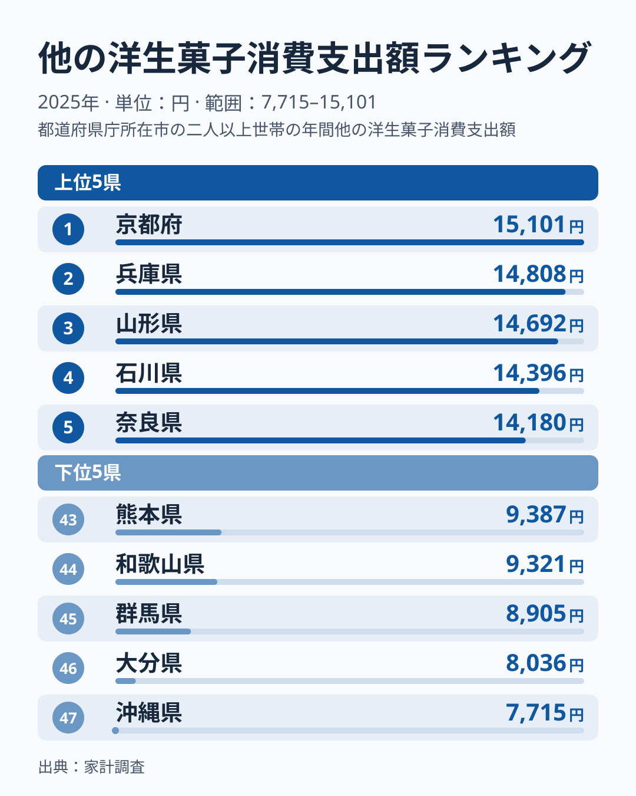
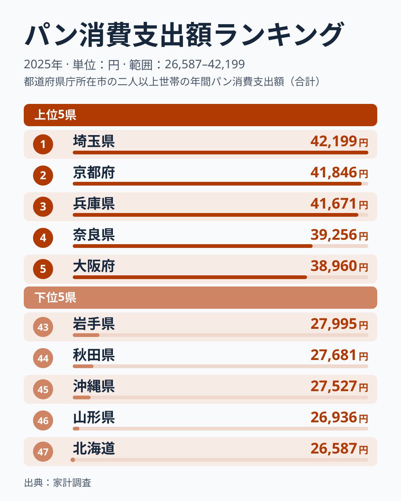
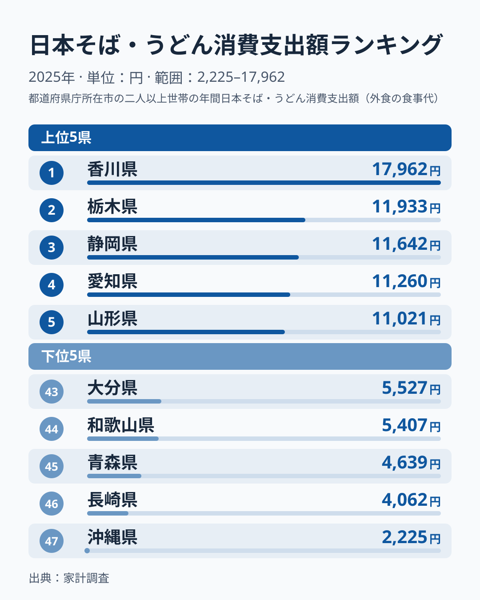
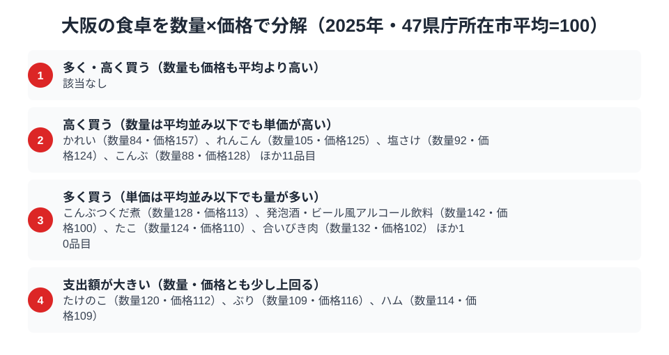

「食い倒れの街」大阪。総務省の家計調査（品目別）で大阪市の二人以上世帯を見ると、パンの消費支出額は38,960円で全国5位です。洋生菓子（ケーキやシュークリームなど、パッケージ商品を除く「他の洋生菓子」）は13,755円で6位と、2025年は粉ものとスイーツで上位に入っています。パンの首位は埼玉県の42,199円、洋生菓子の首位は京都府の15,101円で、大阪はどちらも首位に届かないものの、上位グループに入っています。

一方、日本そば・うどんの消費支出額は8,341円で全国26位と、47都道府県の真ん中あたりにとどまります。うどん県として知られる香川県は全国1位で17,962円と、大阪を大きく上回ります。パンと洋菓子では上位、麺では中位という差は何を意味するのか。この記事では洋菓子・パン・そば・うどんという3つの品目を横断しながら、大阪の食卓の構図を読み解きます。

> [!NOTE]
> 家計調査の都道府県データは、県庁所在市（大阪府は大阪市）の二人以上世帯を対象にした年間支出額です。府全体ではなく大阪市在住世帯の家計簿から見た傾向であり、支出「金額」であって消費「量」そのものではない点にご注意ください。たこ焼き・お好み焼きなど大阪の代表的な「粉もん」は、家計調査の主要品目として個別に集計されていません。

## 洋菓子 — 全国6位13,755円、上位6府県の過半は近畿

<source-link href="/ranking/other-western-sweets-consumption-expenditure">他の洋生菓子消費支出額ランキングをもっと見る</source-link>

大阪府の洋生菓子消費支出額は13,755円で全国6位です。1位は京都府の15,101円、2位は兵庫県の14,808円、3位は山形県の14,692円、4位は石川県の14,396円、5位は奈良県の14,180円で、大阪は5位の奈良にわずかに及ばない位置にいます。下位は沖縄県の7,715円が最下位で、1位との差は約2倍あります。

上位6府県のうち京都・兵庫・奈良・大阪の4つが近畿で、過半を占めています。洋菓子への支出は近畿圏で高めに出ているといえます。大阪の背景として、梅田・心斎橋・北新地といった繁華街に百貨店の銘菓売り場や有名パティスリーが集中し、手土産・贈答の文化が根強いことが理由として考えられます。[仮説] ただし家計調査の市別の値は単年のぶれが大きく、1年分の順位だけでは大阪が構造的に上位だとは言い切れません。複数年の推移を見るまでは、「上位グループに入っている」という読み方にとどめるのが安全です。

## パン — 全国5位38,960円、上位は近畿が4つ

<source-link href="/ranking/bread-consumption-expenditure">パン消費支出額ランキングをもっと見る</source-link>

パンの消費支出額で大阪は全国5位（38,960円）です。首位は埼玉県の42,199円、2位は京都府の41,846円、3位は兵庫県の41,671円、4位は奈良県の39,256円で、大阪は4位の奈良にわずかに及ばない位置にいます。最下位は北海道の26,587円で、1位との差は約1.6倍です。

上位5府県のうち埼玉を除く京都・兵庫・奈良・大阪の4つが近畿で、洋菓子と同じく近畿圏の都市部にパン支出の高い市が集まっています。[仮説] 朝食にパンを選ぶ都市部の生活習慣が数字に反映されている可能性があります。神戸から広がった洋食文化の影響圏に大阪も含まれ、兵庫・京都と並んでパン支出を押し上げているという見方もできますが、これは地域の食文化から立てた仮説で、このデータだけで検証できるものではありません。

## 日本そば・うどん — 全国26位8,341円、中位にとどまる

<source-link href="/ranking/soba-udon-dining-consumption-expenditure">日本そば・うどん消費支出額ランキングをもっと見る</source-link>

日本そば・うどんの消費支出額は8,341円で全国26位です。47都道府県の中央（24位）の8,373円とほぼ同じ水準で、上位でも下位でもない中位に位置します。首位の香川県は17,962円で、2位は栃木県の11,933円、3位は静岡県の11,642円、4位は愛知県の11,260円、5位は山形県の11,021円と、上位5県はいずれも大阪を大きく上回る水準です。最下位の沖縄県は2,225円でした。

パン・洋菓子では上位に並んだ大阪が、麺では平均的な支出にとどまる点は、粉もんの街というイメージとは少し違って見えます。ただし、家計調査が集計する「日本そば・うどん」という品目には、たこ焼きやお好み焼きといった粉ものは含まれません。[仮説] 外食産業の発達した大都市では、麺類を外食や持ち帰りで済ませる機会が多く、家庭内購入としての支出額が伸びにくい可能性があります。一方、讃岐うどんのように地域固有の食文化として家庭に根づく香川のような土地では、家庭での購入が支出額を大きく押し上げていると考えられます。これらは地域の食文化から立てた見立てで、単年のデータだけでは確かめられません。

> [!WARNING]
> 日本そば・うどんの順位だけで大阪の「粉もん文化」の実態を測ることはできません。たこ焼き・お好み焼きは麺類とは別の統計品目であり、麺類の支出が中位であることが粉もん人気の高低を意味するわけではない点にご注意ください。

## 大阪の食卓を貫くもの

3品目を並べると、大阪の食卓には「パンと洋菓子では上位グループ、麺では中位」という輪郭が見えます。パン・洋菓子のように、近畿の都市部で支出が高めに出る品目では大阪も上位に入り、麺類のように地域色の強い品目では突出した香川県とは差があります。外食・中食の厚い大都市という性格が、家庭内購入を前提とする家計調査の数字にどう出るかは、品目ごとに違ってくるのでしょう。

[そば・うどん消費の都道府県地図](/blog/udon-soba-food-culture-prefecture-map)で見たように、香川は家庭で作り食べる文化、大阪は街で食べ歩く文化という違いが、家計調査の品目別支出額の差に表れている可能性があります。[仮説] ただしこの見方も、市別の値が年によって入れ替わりやすいことを踏まえると、複数年で確かめる必要があります。

> [!TIP]
> ある県の名物料理（大阪ならたこ焼き・お好み焼き）が、必ずしも家計調査の品目別ランキングに直接反映されるとは限りません。粉もんのように外食・屋台文化として定着した食は、家庭内購入の統計では見えにくくなります。ランキングを読むときは、その品目が「家で作って食べるものか」「外で食べるものか」という消費形態の違いも合わせて考えると、数字の裏側が見えてきます。

## 数量×価格で分解する大阪市の食卓

<source-link href="/ranking/beef-consumption-quantity">牛肉消費量ランキングをもっと見る</source-link>

洋菓子・パン・そば/うどんの支出額ランキングだけを見ていると、「大阪はこの品目にお金をかけている」という順位しか分かりません。支出額は数量×単価の掛け算なので、順位の裏側には「たくさん買っている」のか「高いものを買っている」のかという、別の理由が隠れている可能性があります。そこで、47都道府県庁所在市の単純平均を100とした指数で、大阪市の食品を数量と価格に分けて見ます。この図で取り上げられているのはかれい、こんぶ、たこなど別の品目で、パン・洋菓子・そば/うどんそのものの指数は示されていません。したがって、主題の3品目が量型か単価型かは、このデータからは判断できません。

> [!NOTE]
> この指数は家計調査の全国平均ではなく、47都道府県庁所在市の単純平均を100とした相対値です。価格指数は支出額÷数量から逆算した値なので、同じ品目でも購入する品種・ブランド・グレードの違いが反映されており、純粋な店頭価格の高さだけを示すものではありません。対象は二人以上世帯の年間支出（2025年）です。

図の分類では、「数量も価格も平均より高い」区分は該当なしでした。一方で、たけのこ（数量120・価格112）、ぶり（数量109・価格116）、ハム（数量114・価格109）の3品目は、数量・価格とも100を少し上回り、支出額が大きい品目として挙げられています。つまり両方が平均を超える品目が皆無というわけではなく、突出して両方高い品目はない、というのが事実に合う読み方です。それ以外では「単価が高い」品目が15、「量が多い」品目が14あり、大半の品目はどちらか一方に偏っています。

「単価が高い」側の代表は、かれい（数量84・価格157）、れんこん（数量105・価格125）、塩さけ（数量92・価格124）、こんぶ（数量88・価格128）です。数量指数は84〜105と平均前後か平均以下ですが、価格指数は124〜157と平均を上回っています。[仮説] 魚介や乾物で、量よりも品質や産地を選んで買う傾向がある可能性はありますが、価格指数には品種やグレードの違いも含まれ、買い方の動機まではこのデータで確かめられません。

「量が多い」側の代表は、こんぶつくだ煮（数量128・価格113）、発泡酒・ビール風アルコール飲料（数量142・価格100）、たこ（数量124・価格110）、合いびき肉（数量132・価格102）です。価格指数は100〜113と平均並みかやや高い程度で、数量指数が124〜142と購入量の多さが目立ちます。たこの数量が多いことは、たこ焼きの街というイメージと整合的に見えます。ただし家庭での調理の中身までは分からず、因果は断定できません。

この分解から言えるのは、支出額の順位が同じ上位でも、量に支えられた上位と単価に支えられた上位が別々にありうるということです。パンや洋菓子の上位が、買う量の多さによるのか、価格の高い商品の選択によるのかは、数量と価格の指数を品目ごとに見なければ分かりません。

> [!TIP]
> 支出額ランキングの順位だけでは、「たくさん食べている」のか「高いものを買っている」のかは区別できません。同じ支出額上位でも、数量指数と価格指数に分解すると背景がまったく違って見えることがあります。気になる品目があれば、その品目の消費量ランキングと消費支出額ランキングを両方確認すると、消費行動の実態がより立体的に見えてきます。

## まとめ

- パン消費支出額は大阪府が全国5位で38,960円、1位は埼玉県の42,199円
- 他の洋生菓子は全国6位で13,755円、1位は京都府の15,101円で、上位6府県のうち4つを近畿が占める
- 日本そば・うどんは全国26位で8,341円、中央の24位（8,373円）とほぼ同水準、1位は香川県の17,962円
- パン・洋菓子では上位、麺では中位という差の理由は[仮説]として食文化や外食の多さが考えられるが、単年の順位では確かめられない
- 大阪市の食品を数量×価格で分解すると、単価の高さで支出が大きい品目（かれい・れんこん等15品目）と購入量の多さで支出が大きい品目（こんぶつくだ煮・たこ等14品目）に分かれる。数量・価格とも少し上回る品目はたけのこ・ぶり・ハムの3つで、突出して両方高い品目はない。ただしパン・洋菓子・そば/うどんの指数はこの図に含まれないため、3品目の内訳までは言えない

大阪府の他の統計は[大阪府の地域プロフィール](/areas/27000)、食品・家計消費の地域差は[経済カテゴリ一覧](/category/economy)からご覧いただけます。近畿圏の食文化の違いは[和歌山県の食卓](/blog/wakayama-food-culture)の記事もあわせてご覧ください。
