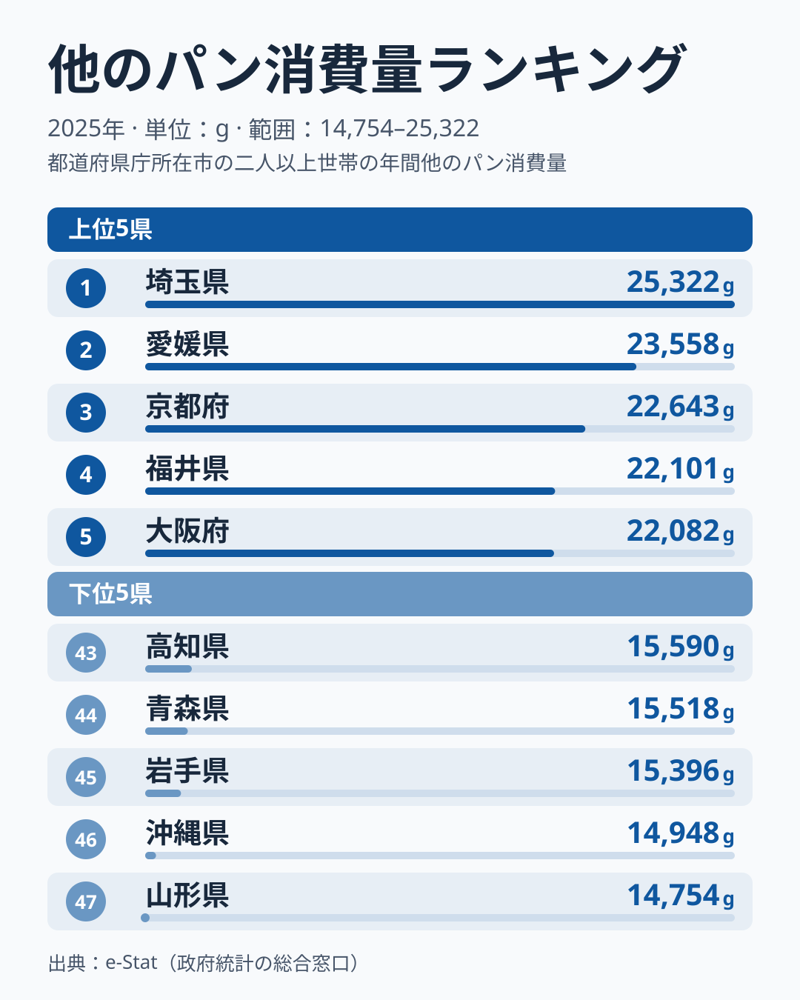

「パンをよく食べる地域」といえば何県を思い浮かべるでしょうか。「京都・大阪などの関西圏」と答える方が多いかもしれませんが、家計調査の2025年の「他のパン消費量」で全国1位になったのは、関西ではなく埼玉県でした。消費量は25,322gです。

「他のパン」とは食パン以外のすべてのパン、つまりロールパン・菓子パン・惣菜パン・フランスパン・クロワッサンなどを指します。2025年調査では、1位の埼玉県と最下位の山形県の消費量に1.7倍の差があります。東北各県が下位に集まる一方、近畿や四国の府県が上位に並ぶ地域構造が浮かび上がります。

ところが、この指標は年ごとの順位の入れ替わりが大きいことも特徴です。この記事では、都道府県別の他のパン消費量の実態と、順位が入れ替わりやすい理由、そして単年の順位をどう読めばよいかを解説します。

## 全国ランキング：埼玉が首位、愛媛と京都が続く

2025年の都道府県別「他のパン消費量」ランキングでは、埼玉県が25,322gで1位となりました。2位は愛媛県で23,558g、3位は京都府で22,643gです。4位以降も福井県が22,101g、大阪府が22,082gと続きます。

> [!NOTE]
> 「他のパン」は総務省の家計調査における品目分類で、食パンを除いたすべてのパンを指します。ロールパン・菓子パン・惣菜パン・フランスパン・クロワッサン・バゲットなどが含まれます。調査対象は都道府県庁所在市の二人以上世帯の年間購入量（単位：g）です。

<source-link href="/ranking/other-bread-consumption-quantity">他のパン消費量ランキングをすべて見る</source-link>

上位10位を見ると、埼玉・愛媛・京都・福井・大阪・兵庫・香川・三重・滋賀・徳島という顔ぶれです。埼玉を除く9府県は、近畿、四国、福井県で占められています。首都圏で上位に入ったのは埼玉県だけで、東京都は31位で18,139g、神奈川県は29位で18,501g、千葉県は35位で16,960gにとどまります。同じ首都圏でも順位が大きく割れており、「大都市＝パンが多い」という先入観とは異なる実態があります。

前年に首位だった岡山県は、2025年には18位の20,455gでした。上位の顔ぶれがここまで変わる指標は珍しく、単年の順位を「その県の食文化の序列」として受け取るのは危うい、と最初に押さえておく必要があります。

## 最下位グループ：山形が最下位

下位5県は、山形県が47位で14,754g、沖縄県が46位で14,948g、岩手県が45位で15,396g、青森県が44位で15,518g、高知県が43位で15,590gです。

東北では、岩手県が45位、青森県が44位、秋田県が42位、宮城県が41位、福島県が38位です。これに最下位の山形県を加えた6県すべてが下位に集まっています。北海道も40位の15,783gで、東北から北海道にかけて消費量が少ない傾向がはっきり出ています。

> [!WARNING]
> 家計調査は二人以上世帯の都道府県庁所在市のデータです。単身世帯や地方中小都市の消費傾向は反映されておらず、県全体の平均とは異なります。年ごとのサンプル変動も大きいため、単年の順位変動を過大解釈しないことが重要です。

東北が下位に集中する背景について、[仮説]として、米を主食とする食習慣が根強く、食パン以外のパンを日常的に買う機会が相対的に少ないことが挙げられます。東北各県は米の主要産地であり、各県を代表するブランド米を持ちます。ただし、この指標だけでは食習慣の違いを確かめられないため、米の消費量や朝食の習慣など別の指標を重ねた検証が必要です。

沖縄県が46位に入っている点も興味深いところです。[仮説]として、沖縄は独自の食文化を持ち、米や麺類を中心にした食生活が根づいているため、惣菜パンや菓子パンの購入量が伸びにくいのかもしれません。こちらも単年の順位だけでは断定できず、複数年の推移を見る必要があります。

## なぜ近畿と四国が上位に並ぶのか

上位に近畿と四国の府県が多い構造には、いくつかの要因が考えられます。ただし、以下はいずれも[仮説]であり、この指標だけで検証できるものではありません。

1つ目は、関西圏が明治以降に西洋文化を受け入れてきた歴史です。京都府、大阪府、兵庫県には、洋菓子やパンの店が早くから根づいてきたとされ、パンを日常的に食べる習慣が世代を超えて受け継がれている可能性があります。2025年は京都府が3位、大阪府が5位、兵庫県が6位、滋賀県が9位で、近畿の府県が上位10位の中に複数入っています。

2つ目は、四国の存在です。愛媛県が2位、香川県が7位、徳島県が10位と、四国の3県が上位10位に入っています。一方で高知県は43位の15,590gで、同じ四国でも大きく分かれました。四国がひとまとまりでパン消費の多い地域だと言い切れないことは、ここからも分かります。

> [!TIP]
> 「他のパン消費量」と食パンの消費量を合わせて見ると、パン食全体の地域差がより鮮明になります。食パンの購入量と、惣菜パン・菓子パンなどの購入量の組み合わせで、各県の「パン食の深さ」を多角的に把握できます。[小麦粉消費量のランキング](/ranking/wheat-flour-consumption-quantity)も参考になります。

[大阪府のエリアページ](/areas/27000)では、食生活に関連するほかの統計もあわせて確認できます。

## 埼玉の首位と岡山の後退：単年データの読み方

今回もっとも目を引くのは、埼玉県が首位に立った点です。2025年の埼玉県は25,322gで、関東の他の都県とは大きく異なる位置にあります。

一方、前年に首位だった岡山県は、2025年は18位の20,455gでした。首位の県が1年で中位まで動くことがある、というのがこの指標の性格です。

ここまで順位が動く理由として、[仮説]ですが、家計調査が抽出調査（サンプル調査）である点が大きいと考えられます。都道府県庁所在市の限られた世帯の購入量を1年間かけて集計するため、標本に入った世帯の構成や購買の癖が、そのまま数字に出やすくなります。埼玉県の首位も、実際の食習慣の変化というより、標本のばらつきを反映した可能性があります。この仮説は、2026年分の家計調査の結果が公表された時点で埼玉県が上位を保っているかどうかで確かめられ、順位が下がるなら標本のばらつきが主因だった可能性が高まります。

「今年が何位か」よりも「複数年を通してどの水準か」を見ることが、実態の把握には有効です。複数年にわたって下位に並び続ける県があれば、単年のぶれでは説明しにくく、構造的に消費量が少ない可能性があります。一方、首位が入れ替わりやすい上位グループは、順位より消費量の水準そのものを見るほうが誤読を避けられます。

[パスタ消費量のランキング](/ranking/pasta-consumption-quantity)も合わせて見ると、小麦を使う食品全体の消費パターンとの比較ができます。[埼玉県のエリアページ](/areas/11000)でも、食生活に関連する統計を確認できます。

## 地域差の構造：近畿・四国が厚く、東北・北海道が薄い

2025年のデータ全体を俯瞰すると、消費量の水準で大きく3つのグループに分けられます。

**上位帯（21,000g以上）**：埼玉・愛媛・京都・福井・大阪・兵庫・香川・三重・滋賀・徳島・長崎・奈良の12県。近畿と四国の府県が目立ちます。

**中位帯（18,000〜21,000g）**：山口・愛知・広島・鹿児島・群馬・岡山・佐賀・富山・新潟・宮崎・石川・大分・静岡・福岡・栃木・和歌山・神奈川・熊本・東京の19県。

**下位帯（18,000g未満）**：茨城・岐阜・長野・千葉・山梨・島根・福島・鳥取・北海道・宮城・秋田・高知・青森・岩手・沖縄・山形の16県。東北・北海道に加え、関東の茨城県と千葉県、中部の岐阜県・長野県・山梨県、中国の島根県・鳥取県、四国の高知県、沖縄県が含まれます。

東北と北海道が下位に集まる一方、近畿や四国が上位に多いという傾向は、米食を中心にした食文化圏とパン食が浸透した食文化圏の境界に近い、という見方もできます。ただし、これはあくまで「他のパン消費量」という単一指標を読んだ[仮説]で、複数の要因が複合的に絡み合っています。埼玉県のように、傾向から外れて突出する県が年ごとに現れる点も、この指標の特徴です。

首都圏の内部が割れている点も見逃せません。2025年は埼玉県が1位、神奈川県が29位、東京都が31位、千葉県が35位でした。[仮説]として、都市部ではコンビニ食や外食など食の選択肢が多く、「他のパン」を家庭で購入する量が必ずしも高くならない面もあります。「パンが好きな都市」と「他のパンを家庭で多く買う都市」は必ずしも一致しないことに注意が必要です。

## まとめ

- **首位は埼玉県で25,322g**：近畿・四国の府県を抑えて1位になりました
- **最下位は山形県で14,754g**：東北6県はすべて下位に集まりました
- **倍率は1.7倍**：最上位と最下位の消費量には1.7倍の差があります
- **近畿・四国が上位、東北・北海道が下位**：ただし高知県のように同じ四国でも下位に沈む例があり、地域でひとくくりにはできません
- **年ごとの変動が大きい**：前年に首位だった岡山県が18位に下がるなど、単年データの解釈には複数年の確認が欠かせません
