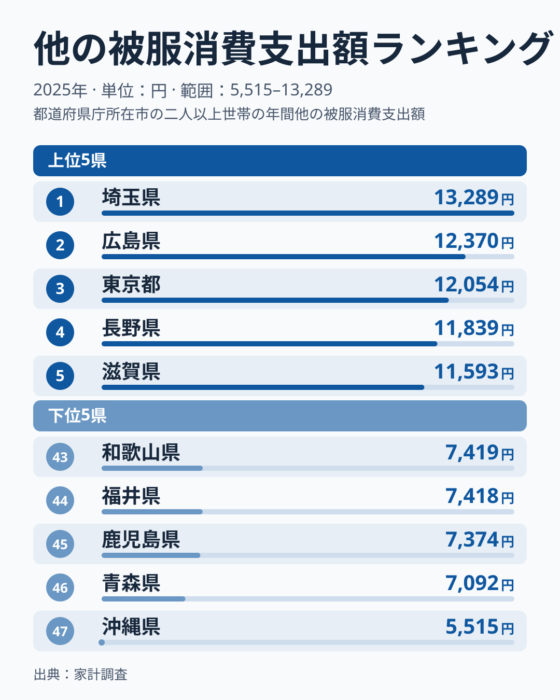
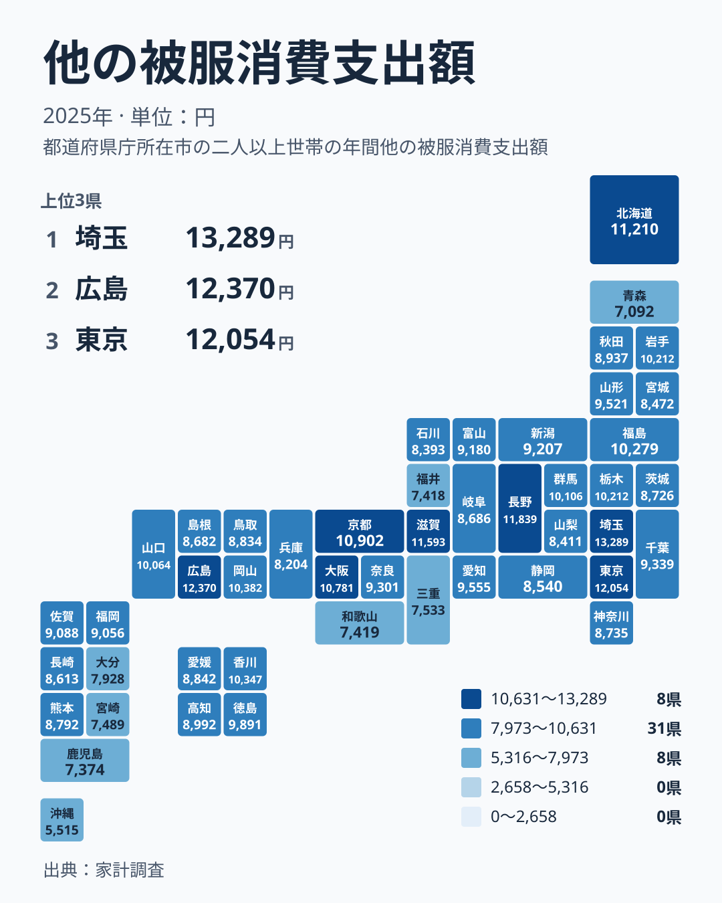

## 最多の埼玉県と最少の沖縄県は2.4倍の開きです

家計調査の2025年の結果で、他の被服への支出が最も多かったのは埼玉県で13,289円でした。最も少なかったのは沖縄県で5,515円です。最大を最小で割ると、埼玉県は沖縄県の2.4倍にあたります。同じ年の同じ調査で、これだけの開きが出ています。

ここでいう「他の被服」は、被服費の中で主要な品目に入らない区分です。中身の細かい内訳までは、今回のデータだけでは確かめられません。そのため、この記事では「何が高いのか」ではなく「どの県が高く、どの県が低いのか」を丁寧に見ていきます。

まず上位と下位の顔ぶれを確認します。次に、地方という別の切り口で並べ直し、同じ地方の中でも順位が大きく割れることを見ます。最後に、差の背景としてよく挙げられる仮説を、実際の順位と突き合わせます。なぜ差が出るのかという答えまでは、このデータからは出せません。その限界も含めて、読者の生活感覚に引き寄せて整理します。

## 上位と下位の顔ぶれを見ます

まず、全国の両端を図で確認します。

<source-link href="/ranking/other-clothing-group-consumption-expenditure">他の被服への支出ランキングをもっと見る</source-link>

上位5位は、埼玉県が13,289円で1位、広島県が12,370円で2位、東京都が12,054円で3位、長野県が11,839円で4位、滋賀県が11,593円で5位です。地方別に数えると、関東が埼玉県と東京都の2県、中国が広島県、中部が長野県、近畿が滋賀県です。上位5県は、関東・中国・中部・近畿の4つの地方にまたがっています。首都圏の県だけが並ぶ形にはなっていません。

下位の側では、最下位の沖縄県が5,515円で47位です。その上に、青森県が7,092円で46位、鹿児島県が7,374円で45位、福井県が7,418円で44位、和歌山県が7,419円で43位と続きます。下位の2位から5位までの青森県から和歌山県は、7,092円から7,419円の幅に収まっており、金額が近く固まっています。

一方、沖縄県はその固まりからも離れた位置にあります。46位の青森県でも7,092円ですが、沖縄県は5,515円にとどまります。最下位だけが突出して低いことが、図から読み取れます。上位の側が13,289円から11,593円まで段階的に続くのに対し、下位は最下位だけが一段低いという、非対称な形です。

生活への含意として、この支出は家計の中では小さな項目かもしれません。それでも都道府県の平均で比べると、2.4倍もの差になります。ただし、平均値の順位から、個々の家計が多いか少ないかは判断できません。

> [!NOTE]
> 「他の被服」が被服費の中のどの品目にあたるのかは、このデータだけでは断定できません。そのため、他の被服の順位が高い県が、被服費の全体でも多いとは限りません。逆に順位が低い県でも、主要な品目で多く使っている可能性があります。この数字は、被服費全体の多寡ではなく、ある一区分の比較として読んでください。

[同じカテゴリの統計一覧](/category/economy)では、家計に関わる他の指標も確認できます。他の項目と見比べることで、この指標の位置づけがつかみやすくなります。

## 地方ごとに並べ直すと見えること

次は、地方という切り口で同じデータを眺めます。

注目したいのは、同じ地方の中での開きです。関東は、埼玉県が1位の13,289円、東京都が3位の12,054円である一方、神奈川県は30位の8,735円、茨城県は31位の8,726円です。近畿も、滋賀県が5位の11,593円、京都府が7位の10,902円、大阪府が8位の10,781円と上位が並ぶ反面、和歌山県は43位の7,419円です。北海道・東北では、北海道が6位の11,210円、青森県が46位の7,092円と、1つの地方に上位と下位が同居しています。

中国は、やや様子が異なります。広島県が2位、岡山県が9位、山口県が15位と、5県のうち3県が15位以内に入ります。ただし鳥取県は28位、島根県は33位で、地方全体がそろって高いとまでは言えません。

九州・沖縄では、佐賀県が23位、福岡県が24位と中位に位置します。熊本県は29位、長崎県は34位です。下位寄りに目を向けると、大分県が40位、宮崎県が42位、鹿児島県が45位、沖縄県が47位です。43位から47位に入るのは、鹿児島県と沖縄県の2県で、九州・沖縄の8県のうち大半は中位から下位寄りに広がっています。

こうして見ると、地方の名前だけで高い低いを決めることはできません。同じ地方の中で、1位と40位台が並ぶ例もあるからです。県ごとに事情が違う可能性がありますが、その中身はこのデータからは分かりません。

[埼玉県のデータ](/areas/11000)と[広島県のデータ](/areas/34000)を見比べると、1位と2位の県でも、他の指標では違う姿が見えるかもしれません。

> [!TIP]
> 中位は金額が近く、順位が1つ違っても差はごくわずかです。たとえば岩手県と栃木県は、どちらも10,212円で、12位と13位に並びます。9位の岡山県は10,382円、10位の香川県は10,347円です。中位では順位の上下より金額に注目し、意味のある差が出ているのは主に両端だと考えると、読み違いを防げます。

## 差の背景を考える手がかり

被服費の地域差を扱う資料では、気候、都市規模、年齢構成の3つが説明の軸としてよく挙げられます。ここでは結論ではなく仮説として、今回の順位と突き合わせてみます。

気候については、寒い地域では防寒具への支出が増えるという見方がよく語られます。沖縄県が最下位であることは、この見方と矛盾しません。しかし、北海道は6位で高く、同じ北の青森県は46位で低い結果です。北の地域で順位が正反対に分かれているため、気候だけでは説明できないことが分かります。

都市規模については、大都市圏には店舗が集まり、外出の機会も多いので、支出が増えやすいという見方があります。東京都は3位、大阪府は8位で、この見方に沿う結果です。ところが神奈川県は30位にとどまります。さらに、埼玉県が東京都を上回って1位であることも、都市の大きさだけでは順位が決まらないことを示しています。

年齢構成については、今回のデータに年齢別の値がないため、突き合わせられません。この記事では、検証できていない仮説にとどまります。

まとめると、3つの視点はいずれも、今回の順位の一部としか合いません。反例が目立つため、どれか1つ、または組み合わせで説明できたとは言えません。差の理由を知るには、世帯の構成や購入方法など、別のデータで確かめる必要があります。

> [!WARNING]
> このデータは2025年の1年分だけです。年による変動を確かめられないため、1回の順位を県の固定的な性格として読むことはできません。また、数値は県ごとの平均値であり、世帯ごとのばらつきは見えません。順位が高い県にも支出の少ない世帯があり、順位が低い県にも多い世帯があります。

## 数字を読むときの使い方

この数字は、自分の家計の良し悪しを判断する基準にはなりません。県の平均値であり、世帯ごとの事情は大きく違うからです。上位の県に住んでいるから支出が多い、下位だから少ないとは限りません。

ただし、全国の中でどのあたりに位置するかを知ることは、地域の消費の傾向を考える入り口になります。支出が低いことが、そのまま需要の少なさを意味するとは限りません。買い物の機会や購入方法の違いが影響している可能性もありますが、これは仮説であり、今回のデータからは裏付けられません。

読み方のポイントを、改めて整理します。

- 最大と最小の比は2.4倍で、開きが際立つのは主に両端です
- 同じ地方の中でも、1位から40位台まで割れる例があります
- 気候と都市規模の仮説は、反例があるため、そのままでは当てはまりません
- 1年分の平均値なので、自分の家計に直接あてはめることは避けます

## データについて

この記事の数値は、家計調査の2025年の結果にある「他の被服消費支出額」で、単位は円です。全国47都道府県の値を使い、本文の金額と順位はすべてこの一覧から引いています。倍率は、最大の埼玉県の13,289円を最小の沖縄県の5,515円で割ったものです。地方の区分は、北海道・東北、関東、中部、近畿、中国、四国、九州・沖縄の7区分に従いました。

背景の説明に使った気候、都市規模、年齢構成の話は、被服費の地域差を論じた資料に基づく一般的な整理です。今回の順位を因果で証明するものではありません。
