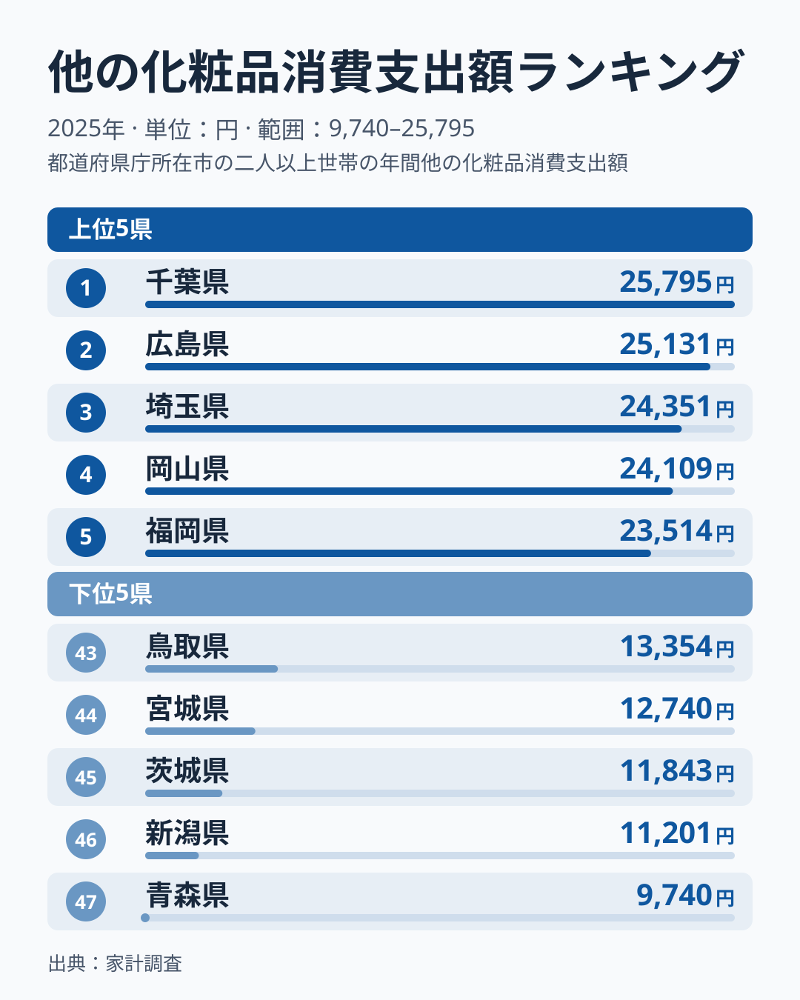
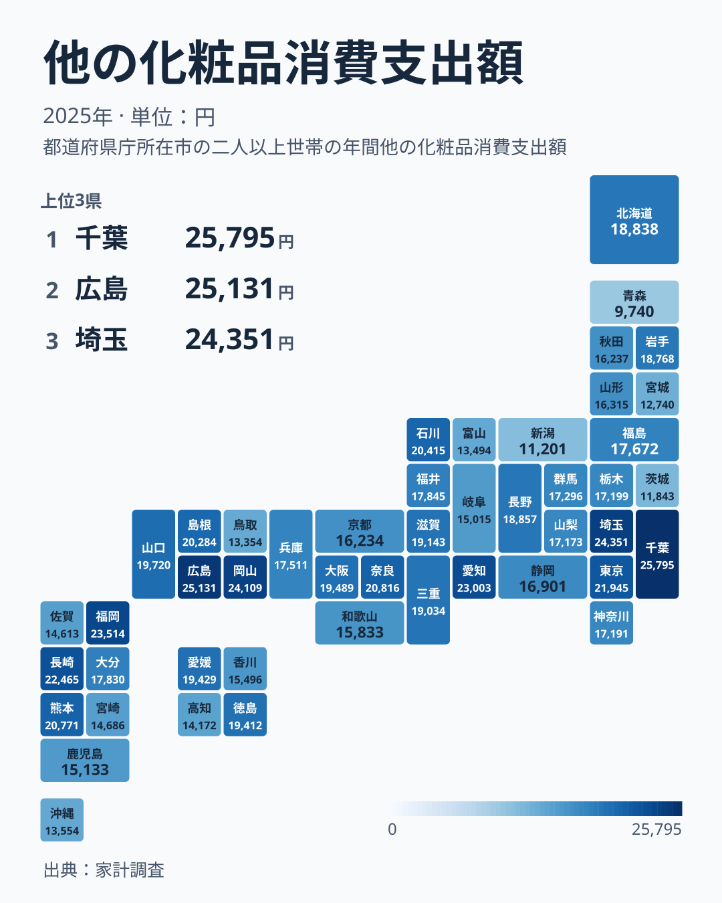

「他の化粧品」という聞き慣れない項目に、都道府県ごとに大きな差があります。家計調査が集計する2025年の他の化粧品消費支出額を見ると、1位の千葉県は25,795円、最下位の青森県は9,740円で、支出額には大きな開きが見られます。同じ日本の消費者でも、住んでいる県によって化粧品にかける金額はこれほど違うのです。

この記事では、47都道府県の他の化粧品消費支出額を上位と下位の両面から確認し、地理的にどのような広がりを見せているのかをタイルマップで可視化します。そのうえで、消費額の差が都市の規模や消費文化とどう結びついているのかを考えていきます。

## 全国ランキングで見る他の化粧品消費支出額

<source-link href="/ranking/other-cosmetics-consumption-expenditure">他の化粧品消費支出額ランキングをもっと見る</source-link>

上位5県は千葉県の25,795円から福岡県の23,514円までで、1位と5位の差は2,281円にとどまります。5県の内訳は、関東の千葉県と埼玉県、中国の広島県と岡山県、九州・沖縄の福岡県で、上位は特定の地方に偏らず、東日本と西日本にまたがっています。

下位5県は青森県の9,740円から鳥取県の13,354円までで、47位と43位の間には3,614円の開きがあります。内訳は北海道・東北の青森県と宮城県、中部の新潟県、関東の茨城県、中国の鳥取県です。上位5県の中での開きよりも、下位5県の中での開きのほうが大きくなっています。

1位の千葉県と最下位の青森県を比べると、支出額は約2.6倍の開きがあります。関東の千葉県と埼玉県が上位に入る一方で、茨城県は45位に沈み、中国の広島県と岡山県が上位に入る一方で、鳥取県は43位です。同じ地方の中でも順位が大きく分かれており、地方単位ではこの差を説明できません。

> [!NOTE]
> 「他の化粧品」は家計調査の化粧品費目のうち、化粧水や口紅などの主要な品目に区分されていない支出をまとめた項目です。特定の商品を示す数値ではなく、化粧品全体の中でも主要品目以外への支出傾向を表している点に注意してください。

## 地理的な広がりをタイルマップで確認する

タイルマップで見ると、関東では千葉県が1位、埼玉県が3位、東京都が8位と上位に入っています。九州・沖縄では福岡県が5位、長崎県が7位と上位に入る一方、沖縄県は41位です。一方で同じ関東でも茨城県は45位、神奈川県は28位にとどまり、地方単位で一様に高いとは言えません。

北海道・東北では、青森県が47位、宮城県が44位と下位に入る一方、岩手県は18,768円で21位、北海道は18,838円で20位と中位に位置します。このため、北海道・東北全体を一様に「支出額が低い地域」と単純化することはできません。近畿でも、奈良県は9位、大阪府は14位ですが、京都府は33位と、県によって順位に幅があります。

> [!WARNING]
> 家計調査の都道府県別データは、原則として都道府県庁所在市の世帯を対象にした調査結果です。県内のほかの地域を含めた県全体の実態とは異なる可能性がある点に注意してください。

## なぜ地域差が生まれるのか

[岡山県のデータ](/areas/33000)を見ると岡山市、[千葉県のデータ](/areas/12000)を見ると千葉市がそれぞれの県庁所在市です。家計調査のデータが県庁所在市の世帯を対象にしていることを踏まえると、[仮説]化粧品を扱う店舗や売り場が豊富な都市ほど支出額が高く出やすい可能性があります。ただし、上位の県庁所在市の商業環境は今回の指標からは確認できておらず、あくまで仮説にとどまります。

一方で、神奈川県の県庁所在市にあたる横浜市は全国でも有数の人口を抱える大都市ですが、神奈川県は17,191円で28位と中位にとどまっています。この点から、[仮説]都市の人口規模だけで消費額の高低を説明することはできず、地域ごとの消費習慣や店舗の分布など、ほかの要因も関係していると考えられます。また家計調査は単年の標本調査であり、順位はぶれやすい点にも注意が必要です。この仮説を検証するには、店舗数や年齢構成といった追加のデータでの確認が必要です。

> [!TIP]
> このランキングは1世帯あたりの支出額であるため、世帯の人数構成や年齢層の違いも数値に影響している可能性があります。県ごとの人口構成もあわせて確認すると、地域差の見え方がより立体的になります。

化粧品に限らず、地域ごとの消費支出の違いをより広く確認したい場合は、[同じカテゴリの統計一覧](/category/economy)から関連する家計調査の各種ランキングをあわせて見ることができます。

## まとめ

- 他の化粧品消費支出額の1位は千葉県で25,795円、最下位は青森県で9,740円で、約2.6倍の開きがあります。
- 上位5県には、関東の千葉県と埼玉県、中国の広島県と岡山県、九州・沖縄の福岡県が並びます。
- 下位5県は、青森県、新潟県、茨城県、宮城県、鳥取県で、特定の地方に集中していません。
- 同じ関東でも千葉県は1位、茨城県は45位と分かれ、地方単位では差を説明できません。
- 神奈川県は県庁所在市が大都市の横浜市であるにもかかわらず28位と中位で、都市規模だけでは説明できない要因があります。
- データは県庁所在市の世帯を対象にした調査結果であり、県全体の実態とは異なる可能性があります。
