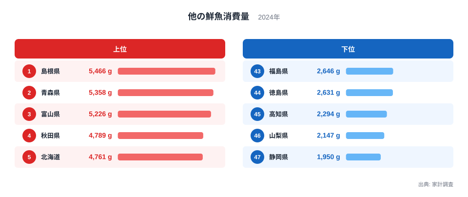
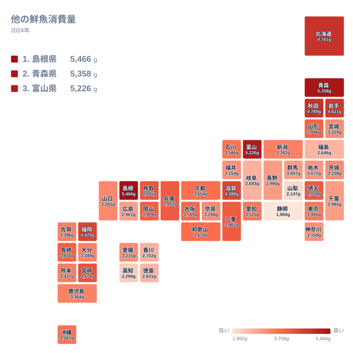

## 鮮魚の「その他」で見える、魚の食べ方の地域差

スーパーの鮮魚売り場には、まぐろ、さけ、あじ、いかなど、名前のついた魚が並びます。家計調査では、こうした主要な品目が個別に集計されています。そのどれにも入らない魚を一つにまとめたものが、今回取り上げる「他の鮮魚」です。

主要な魚を除いた残りの部分なので、その県でどんな魚が買われているかの違いが表れる可能性のある指標です。地元の港で揚がる魚や、季節の地魚などが含まれると考えられます。ただし、中身の内訳までは今回のデータからは分かりません。

2024年の結果を見ると、最も多かったのは島根県の5,466gでした。次いで青森県が5,358g、富山県が5,226gと続きます。一方、最も少なかったのは静岡県の1,950gです。1位と最下位を比べると、2.8倍ほどの開きがあるように見えますが、この記事では実データにある値と順位を並べて読んでいきます。

この記事では、上位と下位の顔ぶれを確かめたうえで、食文化・気候・産地との結びつきから差の理由を考えます。同じ分野の指標を探したい方は、[同じカテゴリの統計一覧](/category/economy)も参照してください。

> [!NOTE]
> 「他の鮮魚」は、家計調査で個別に品目が立てられている魚（まぐろ、あじ、さけなど）を除いた、残りの生鮮魚介の購入数量です。単位はgです。魚全体の消費量ではない点に注意してください。

## 上位と下位の顔ぶれを見る

まずは順位の両端を図で確認します。

<source-link href="/ranking/other-fresh-fish-consumption-quantity">他の鮮魚消費量ランキングをもっと見る</source-link>

上位五県は、島根県の5,466g、青森県の5,358g、富山県の5,226g、秋田県の4,789g、北海道の4,761gです。続く6位は岩手県の4,621gでした。北海道・東北の県が上位に多く入っている点が目を引きます。中国の島根県と、中部の富山県も上位に入っています。

下位五県は、福島県が43位で2,646g、徳島県が44位で2,631g、高知県が45位で2,294g、山梨県が46位で2,147g、静岡県が47位で1,950gです。静岡県と山梨県はどちらも中部、徳島県と高知県はどちらも四国に属します。

意外なのは、下位に高知県や静岡県が入っていることです。この2県はかつおやまぐろなどの水揚げで知られますが、これらは個別の品目として集計される魚です。そのため、有名な魚の消費が別枠に回り、「他の鮮魚」には数字が回りにくい可能性があります。ただし、今回は他の品目のデータを見ていないため、あくまで仮説です。

つまり、この指標が低いことは、魚を食べないことを意味するとは限りません。魚全体の消費量ではなく、「その他」に分類された分だけの数字だからです。

> [!WARNING]
> 「他の鮮魚」は、他の品目に入らなかった魚の寄せ集めです。県ごとに中身が同じとは限らず、順位の高低をそのまま「魚好きの度合い」とは読めません。また、家計調査は調査世帯数が限られるため、僅差の順位は入れ替わりやすいことにも注意が必要です。

## 地元の海と食文化が支える上位県

上位に並ぶ県には、日本海や北の海に面した県が目立ちます。1位の島根県は日本海に面しており、詳しい数値は[島根県のデータ](/areas/32000)でも確認できます。同じ中国の鳥取県も10位で4,095gと上位に入りました。

2位の青森県は、津軽海峡、日本海、太平洋の三つの海に面しています。海に恵まれた環境が、数字の背景にあるとも考えられます。[青森県のデータ](/areas/02000)では、ほかの項目も確認できます。北海道・東北では、秋田県が4位、北海道が5位、岩手県が6位でした。

中部で最上位の富山県は3位です。ただし、中部の県は一様ではありません。同じ中部でも、山梨県は46位、静岡県は47位と最下位圏にあります。地方でひとくくりにはできず、県ごとの食習慣の違いが大きいことがわかります。

九州では、福岡県が7位で4,429g、宮崎県が9位で4,179gでした。近畿では滋賀県が8位で4,388gです。海のない滋賀県が上位に入っている点は興味深く、鮮魚の流通や家庭の購買習慣が関わっている可能性があります。

## 地図で見る、地方ごとの広がりと県ごとの差

次に、地理的な広がりを地図で確認します。

地図からは、北海道・東北に濃い色が集まる様子が読み取れます。北海道、青森県、岩手県、秋田県がいずれも上位十県に入っています。山形県も16位で3,846gです。一方、同じ地方でも宮城県は32位で3,229g、福島県は43位で2,646gと、順位に大きな開きがあります。

関東では、埼玉県が11位で4,039gと健闘しています。海のない県ですが、鮮魚の流通や購買習慣が関わっているのかもしれません。これに対して東京都は23位で3,495g、神奈川県は34位で3,159g、千葉県は39位で2,985gでした。海に面した県ほど高いとは限らないのです。

近畿では、兵庫県が12位、三重県が13位、大阪府が17位、和歌山県が18位、京都府が19位と、中位から上位に集まっています。中国では岡山県が14位、四国では香川県が41位、徳島県が44位、高知県が45位でした。四国は全体に低めです。

この分布は、海に近いかどうかだけでは説明しきれません。流通網や調理の習慣など複数の要因が重なっている可能性がありますが、今回のデータだけでは特定できません。

> [!TIP]
> 順位を見るときは、隣り合う県との値の差にも目を向けてください。たとえば11位の埼玉県は4,039g、12位の兵庫県は3,993gと僅差です。中位は値が密集しているため、順位一つの違いに大きな意味を持たせず、上位群・中位群・下位群のまとまりで読むのが安全です。

## 個別品目との対比で読む

この指標を理解するには、個別に集計される魚との対比が役立ちます。まぐろやかつおのように名前のついた魚は、別の区分で集計されます。そのため、それらの消費が多い県では、「他の鮮魚」が小さく見える可能性があります。

静岡県が1,950gで最下位、高知県が2,294gで45位なのは、この仮説と矛盾しません。ただし、個別品目のデータは今回見ていないため、確かめられてはいません。下位の県を「魚の消費が少ない県」と決めつけるのは早計です。

自分の県の食卓を知りたいなら、この指標だけで判断せず、個別の魚のランキングも合わせて見るとよいでしょう。地元でよく食べられる魚が、どの区分に入っているのかが見えてきます。

## 気候・産地・暮らしから考える差の理由

差の理由として、三つの観点が考えられます。一つ目は気候と海の条件です。北海道、青森県、秋田県、岩手県が上位に並ぶ背景に、北の海の恵みがあるのかもしれません。ただし、魚種や漁獲量のデータは見ていないため、断定はできません。

二つ目は産地と流通です。港の近くでは、市場や鮮魚店で地魚を買いやすいと考えられます。一方、埼玉県や滋賀県のように海から離れていても上位に入る県があり、流通や家庭の購買習慣が関わっている可能性があります。

三つ目は食習慣と暮らし方です。魚を家庭で調理するか、外食や総菜、冷凍品で済ませるかによって、生鮮の購入量は変わるでしょう。山梨県が2,147g、静岡県が1,950gと低い背景にも、こうした違いがあるかもしれません。今回の実データだけでは、原因を一つに絞れません。

ここで挙げた理由は、数字の背景を考えるための手がかりです。因果を断定するものではありません。

## データについて

この記事で使った統計は、家計調査にもとづく2024年の「他の鮮魚消費量」で、単位はgです。調査対象の世帯が購入した生鮮魚介のうち、個別品目に分類されないものの数量を示します。

家計調査は標本調査なので、限られた世帯の結果が各県の値として扱われます。県全体の消費実態をそのまま示すものではありません。また、購入量の統計であるため、自分で釣った魚やもらった魚は含まれません。

## まとめ

2024年の他の鮮魚消費量は、島根県が5,466gで1位、青森県が5,358gで2位、富山県が5,226gで3位でした。最下位は静岡県の1,950gで、山梨県の2,147g、高知県の2,294gが続きます。

上位には北海道・東北の県が多く並び、中国の島根県や中部の富山県も入っていました。一方で、宮城県は32位、福島県は43位と、同じ地方でも差があります。下位の県が魚を食べないとは限らず、有名な魚が別枠で集計される影響の可能性もあります。

自分の県の順位を確かめたら、個別の魚の統計とも見比べてみてください。島根県や青森県のページから、さらに細かいデータをたどることもできます。
