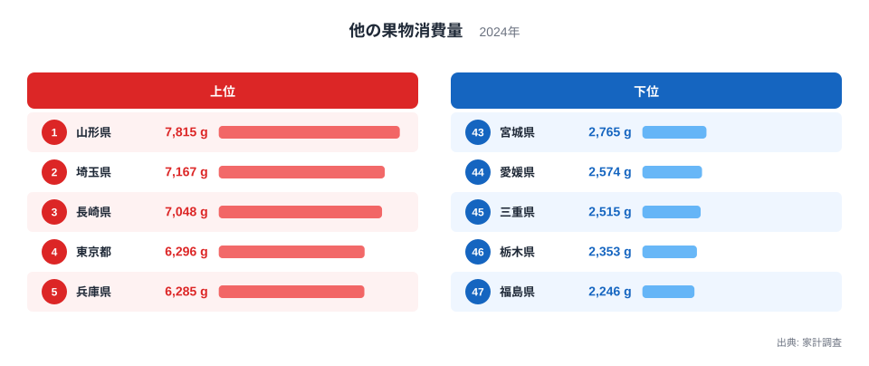
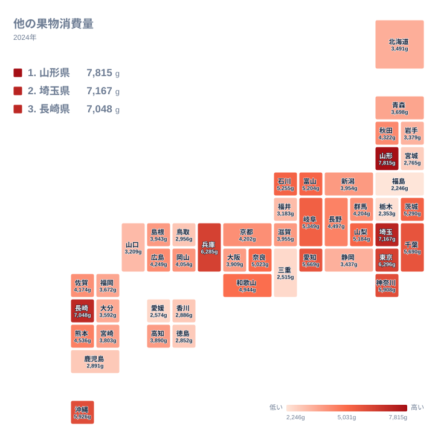

みかんやりんごのように名前の付く果物ではなく、「その他」にまとめられる果物を、どの県の家庭がよく買っているのでしょうか。2024年の家計調査では、首位の山形県が7,815g、最下位の福島県が2,246gでした。同じ日本の家庭でも、1年間に買う量にはこれほどの開きがあります。

この記事では、47都道府県の順位と値を見比べながら、差の大きさと分布の形を確認します。そのうえで、産地や食文化との結びつきについて、データから言えることと言えないことを分けて考えます。

## 他の果物とは何か

> [!NOTE]
> 家計調査の「他の果物」は、調査票で個別の項目が立てられている果物を除いた残りの生鮮果物を指す区分です。どの果物が含まれるかは調査の品目分類によって決まるため、この数字から特定の果物の人気を読み取ることはできません。

この区分は、いわば「名脇役の集合体」です。ひとつひとつの購入量は少なくても、種類が多彩であれば合計は伸びやすくなります。ただし、実際にどの果物がどれだけ含まれているかは、今回の実データには載っていません。したがって、数字が高い県を「果物の食卓が多様な県」と断定することはできず、あくまで一つの見方にとどまります。

単位はグラムで、金額ではなく重さで比べています。高価な果物を少し買う家庭より、手ごろな果物を多く買う家庭のほうが、数値は大きくなりやすい指標です。

## 上位と下位の顔ぶれ

まず、上位5県と下位5県を図で確認します。

<source-link href="/ranking/other-fresh-fruit-consumption-quantity">他の果物消費量ランキングをもっと見る</source-link>

上位は、1位の山形県が7,815g、2位の埼玉県が7,167g、3位の長崎県が7,048gです。4位は東京都の6,296g、5位は兵庫県の6,285gでした。東北、関東、九州、近畿と、地方がばらばらに並んでいる点が特徴です。特定の地方が上位を独占しているわけではありません。

注目したいのは、上位の中での詰まり方です。2位の埼玉県と3位の長崎県は、7,167gと7,048gで並んでいます。4位と5位も6,296gと6,285gでほとんど差がありません。一方、1位の山形県と2位の埼玉県の間は、7,815gと7,167gで、上位の中ではやや離れた首位です。

下位は、47位の福島県が2,246g、46位の栃木県が2,353g、45位の三重県が2,515gでした。44位は愛媛県の2,574g、43位は宮城県の2,765gです。最大の山形県と最小の福島県を比べると、約3.5倍の開きがあります。

1位と47位がともに東北の県であることも見逃せません。山形県と福島県は隣り合っていますが、結果は両端に分かれました。同じ地方でも、消費の姿は大きく異なるということです。

## 産地や食文化との結びつき

山形県が首位である理由を、今回のデータだけで説明することはできません。果樹の産地であることが関係しているのかもしれませんが、確かな根拠は示せず、あくまで仮説にとどまります。実際、同じ東北の福島県や宮城県は下位に沈んでおり、産地という言葉だけでは説明がつきません。詳しい数値は[山形県のデータ](/areas/06000)で他の指標とあわせて確認できます。

長崎県が3位、沖縄県が6位の5,926gに入っている点は、温暖な地域であることと関連している可能性があります。本土とは異なる果物が身近にあるのかもしれませんが、これも品目別の量が分からない以上、推測の域を出ません。

> [!TIP]
> 順位を読むときは、「その県で何が採れるか」と「その県の人が何を買うか」を分けて考えてください。産地が近いと消費も多くなるとは限りません。品目別の消費量ランキングと並べて見ると、全体像がつかめます。同じカテゴリの統計は[同じカテゴリの統計一覧](/category/economy)から探せます。

産地の知名度と順位が一致しない例は、他にもあります。和歌山県は16位の4,944g、長野県は18位の4,497gで、いずれも中位です。この区分では、名前の付く果物が別項目に分かれている県の量は小さく出る可能性があります。もしそうなら、「産地だから多い」とは単純に言えないことになります。

## 関東の県が上位に集まる

関東では、2位の埼玉県が7,167g、4位の東京都が6,296g、7位の神奈川県が5,908g、8位の千葉県が5,690gと、上位10位以内に4県が入りました。大都市圏は全国から多様な果物が集まる消費地ですので、買い物の選択肢の広さが関係している可能性があります。ただし、これも仮説です。

[埼玉県のデータ](/areas/11000)で見える2位という結果は、意外に映るかもしれません。埼玉県は果樹の大産地というイメージが強くないのに、購入量は山形県に次ぐ水準でした。生産の多さと購入量が必ずしも結びつかないことを示す例です。

一方、関東でも栃木県は46位の2,353gで、下位から2番目です。群馬県は21位の4,204g、茨城県は11位の5,290gでした。関東の7県は、2位から46位まで幅広く散らばっており、「関東は多い」とひとくくりにはできません。

> [!WARNING]
> この数値は家計調査にもとづく標本調査の結果で、サンプル数が限られます。年ごとのぶれも大きいと考えられるため、1年分の順位だけで県民の嗜好を断定するのは避けてください。順位が近い県どうしは、差が誤差の範囲かもしれません。

## 地理分布と中位の込み具合

続いて、47都道府県の分布を地図で確認します。

地図では、高い値の県が関東から中部、近畿にかけて目立つ一方、東北や九州にも高い県が点在しています。中部では、9位の愛知県が5,669g、10位の岐阜県が5,349g、12位の石川県が5,255g、13位の富山県が5,204g、14位の山梨県が5,184gでした。中部の県が9位から14位に並んでいます。

低い側では、北海道・東北に下位が多く、43位の宮城県が2,765g、47位の福島県が2,246gでした。北海道も34位の3,491g、岩手県は36位の3,379gです。関東の栃木県は46位でした。四国では、41位の香川県が2,886g、42位の徳島県が2,852g、44位の愛媛県が2,574gと、3県が下位に固まりました。高知県は29位の3,890gで、四国の中では高めです。

九州・沖縄は二極化が目立ちます。3位の長崎県、6位の沖縄県に対して、鹿児島県は40位の2,891gでした。同じ地方でも順位は大きく異なります。

分布の形を見ると、もう一つ特徴があります。5位の兵庫県が6,285gなのに対し、10位の岐阜県は5,349g、20位の広島県は4,249gです。上位10県の間では約940g、10位から20位の間では約1,100g程度と、中位ほど値が込み合い、順位が一つ違うだけで差が小さくなっています。一方で両端、特に1位と下位の数県は値が大きく離れており、分布は中央に厚く、両端が長い形です。

## 中位の県と見比べる

中位の県も見ておきます。17位の熊本県は4,536g、18位の長野県は4,497g、19位の秋田県は4,322gでした。この3県は200g余りの幅に収まっています。20位の広島県は4,249g、21位の群馬県は4,204g、22位の京都府は4,202gで、ここから先は1g刻みに近い僅差です。

中位では順位が入れ替わっても実質的な差はほとんどなく、順位だけで「多い・少ない」を論じるのは適切ではありません。差が意味を持つのは、1位と47位のように大きく離れた県どうしを比べるときです。

## データについて

この記事で使った統計は、2024年の家計調査による「他の果物消費量」です。単位はグラムで、世帯が1年間に購入した量にもとづきます。都道府県別の数値は、調査対象となった都市の世帯の結果であり、県全体の平均とは限りません。

記事中の倍率は、実データの最大値である山形県の7,815gと最小値である福島県の2,246gを比べたものです。順位は実データの順位をそのまま用いており、独自の補正や平均は加えていません。

## まとめ

2024年の他の果物消費量は、山形県が7,815gで首位、埼玉県が7,167gで2位、長崎県が7,048gで3位でした。最下位は福島県の2,246gで、首位との間には約3.5倍の差があります。

上位は地方がばらばらで、中位は僅差で込み合い、両端が長いという分布でした。産地や食文化との結びつきは興味深い論点ですが、品目別の量が分からない以上、今回のデータだけでは確かめられません。数字を見るときは、「その他」という区分の性質を踏まえ、近い順位の差を過大に読まないことが大切です。
