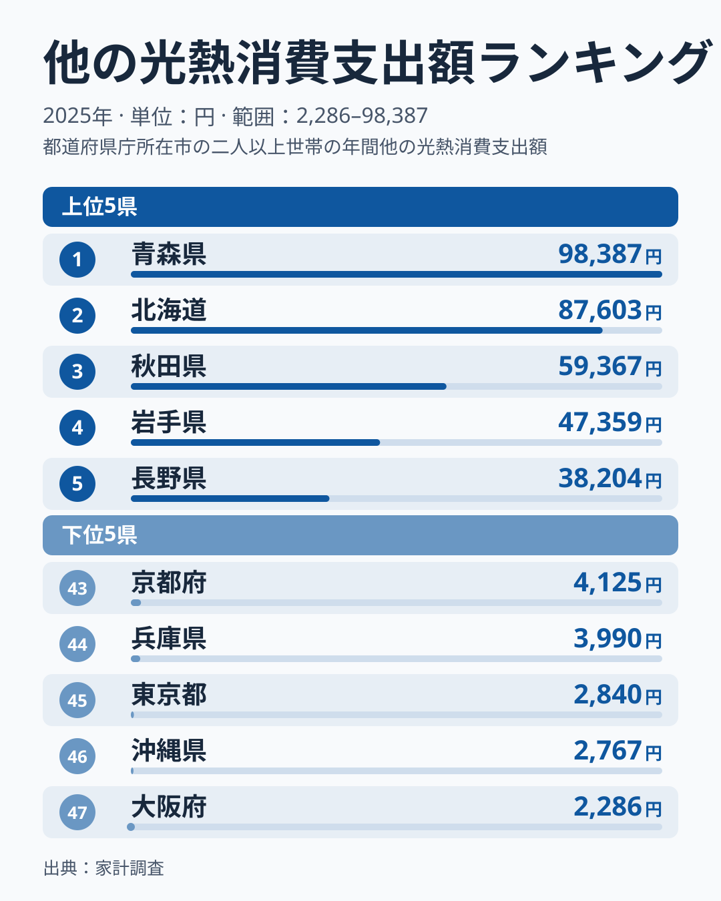
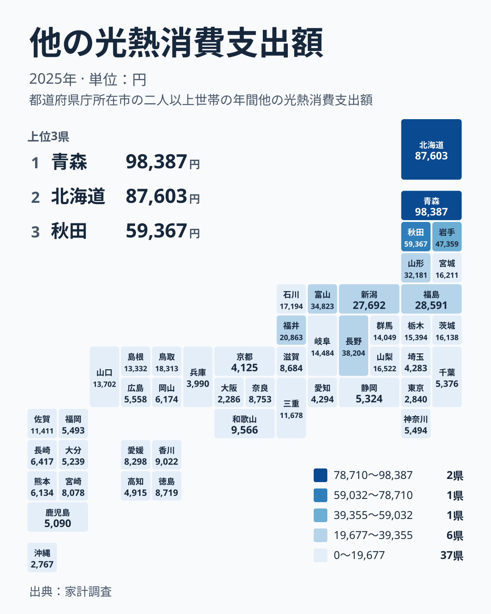

電気代やガス代の請求書は、全国どこでも似たような形をしています。ところが、灯油や薪、炭といった「その他の燃料」にかかる支出を見ると、都道府県の間には桁違いの差があります。この記事では、2025年の家計調査をもとに、他の光熱への支出が県ごとにどれだけ違うのかを確かめ、その差が暮らしに何をもたらすのかを考えます。

最も多いのは青森県で98,387円、最も少ないのは大阪府で2,286円です。最大と最小の比は43倍あまりに開いています。なぜここまで違うのか、分布の形と地図の重なりから、考えられる背景を探っていきます。

## 他の光熱への支出とは何か

ここでいう「他の光熱」とは、電気代・ガス代・上下水道料金を除いた光熱費のことです。代表的なものは灯油で、ほかに薪や炭、固形燃料などが含まれると考えられます。

> [!NOTE]
> この指標の正式な統計名は「他の光熱消費支出額」で、家計調査にもとづく1年間の支出額です。電気代・ガス代は含まれないため、「光熱費の総額」ではありません。灯油のような燃料を暖房に使う地域ほど、この項目が大きくなりやすいと考えられます。

つまり、この数字は「電気やガス以外の燃料にどれだけ支出しているか」を映す指標です。電気やガスで暖房をまかなう世帯が多い地域では、ここに現れる金額は小さくなりやすいと見られます。

同じカテゴリのほかの指標も見たいときは、[同じカテゴリの統計一覧](/category/economy)から探せます。

## 上位と下位の分布を読む

まずは、支出の多い5県と少ない5県を並べた図を見てください。

<source-link href="/ranking/other-fuel-group-consumption-expenditure">他の光熱への支出ランキングをもっと見る</source-link>

図で最初に目に入るのは、上位の急な落ち方です。1位の青森県は98,387円、2位の北海道は87,603円で、3位の秋田県は59,367円です。上位2道県は、3位以下から大きく離れた水準にあります。4位の岩手県は47,359円、5位の長野県は38,204円で、そこからは段階的に下がっていきます。

一方、下位は金額がほとんど横並びです。43位の京都府は4,125円で、47位の大阪府は2,286円です。下位5府県は、いずれも5,000円に届かない狭い範囲に収まっています。全体として、上に長く尾を引き、下に薄く固まる分布だと言えます。

この形から言えるのは、全国の差の大半が「ごく少数の高支出地域」によって生まれているということです。1位と47位の比が大きく開くのも、この上位の尾の長さが主な理由です。詳しくは[青森県のデータ](/areas/02000)や[北海道のデータ](/areas/01000)でも確認できます。

## 地図で見ると北から南へ薄くなる

次に、47都道府県の分布を地図で確かめます。

地図の濃淡は、寒冷な地域ほど高いという傾向と重なって見えます。北海道・東北から中部の一部にかけて濃い色が集まり、近畿や九州・沖縄では薄い色が続きます。北から南へ、金額が薄くなっていく姿です。

注目したいのは、同じ地方の内部でも順位が大きく割れていることです。北海道・東北では、青森県が1位、北海道が2位、秋田県が3位と上位を占めますが、宮城県は14位で16,211円にとどまります。中部では長野県が5位で38,204円である一方、愛知県は41位で4,294円です。同じ地方の中に、上位と下位が同居しています。

関東でも、茨城県が15位で16,138円なのに対し、東京都は45位で2,840円です。こうして見ると、地方という大きなくくりよりも、それぞれの県の気候や暮らし方の違いのほうが、金額に強く表れている可能性があります。

> [!TIP]
> 順位表を読むときは、金額の差と順位の差を分けて考えると便利です。上位では1位から3位の間で金額が大きく開く一方、下位は数百円刻みで順位が入れ替わります。下位での順位が1つ違うだけでは、暮らしぶりの差とは言えません。

## 考えられる背景

差を生む理由として、いくつかの仮説が考えられます。いずれも、この記事で示した都道府県別の値と順位だけでは検証できないため、あくまで読み解きのヒントとして受け取ってください。

1つ目は気候です。地図が寒冷な地域ほど高い傾向と重なることから、冬の暖房にかかる燃料の量が支出に響いている可能性があります。

2つ目はエネルギーの種類です。灯油を暖房に使う世帯が多い地域では、この項目が大きくなると考えられます。反対に、都市ガスや電気で暖房をまかなう世帯が多い地域では、金額が小さくなる可能性があります。大阪府の2,286円や東京都の2,840円といった低い値には、こうした違いが関わっているのかもしれません。

3つ目は住まいの条件です。住宅の広さや造りの違いが、暖房に使う燃料の量に関わっている可能性もあります。ただし、これを裏づける数値はここにはないため、一因かもしれないという程度に受け止めてください。

> [!WARNING]
> この数字は家計調査の標本にもとづく推計で、世帯の人数や住宅の構造、県内の地域差までは反映されません。また、灯油などの燃料は価格が年によって動くため、使用量が同じでも支出は変わります。1年分の金額だけで「その県の寒さ」や「暖房の使い方」を断定しないでください。

## 生活への含意

この差を暮らしに置き換えると、何が見えるでしょうか。

青森県の世帯は、1年に98,387円を他の光熱に支出しています。大阪府の2,286円と比べると、同じ「光熱費」でも、項目ごとの重みは大きく違います。年収や物価を比べるときに電気代やガス代だけを見ていると、この項目の負担を見落とす可能性があります。

また、暖房用の燃料は寒い時期に集中して使われる傾向があると考えられます。毎月ならしたように出るのではなく、季節によって波が出る支出であれば、家計の見通しを立てる際にその波を織り込む必要があります。

県ごとの特徴を整理すると、次のようになります。

- 北海道・東北の青森県、北海道、秋田県、岩手県は上位4位までを占め、支出が際立って大きい
- 中部の長野県、富山県、新潟県は、東北に続く水準で並んでいる
- 近畿や九州・沖縄は下位に多く、温暖さや別の暖房手段が支出の小ささに関わっている可能性がある
- 大阪府や東京都のような都市部は下位にあり、この項目の負担は小さい

引っ越しや転勤で地域をまたぐ人にとって、この指標は判断材料の1つになります。家賃や食費が安くても、暖房にかかる燃料の支出が重ければ、手元に残るお金は変わる可能性があります。逆に、都市部では燃料支出の小ささが、家計の負担を和らげる面もあるかもしれません。

## データについて

このページで使っているのは、家計調査の「他の光熱消費支出額」です。単位は円で、2025年の1年間の値を比べています。電気代・ガス代・水道代は含まれず、灯油などの燃料が中心と考えられます。

比べる際は、金額そのものと順位をそのまま並べて読むのが安全です。支出が少ない県は、暖房が不要という意味ではなく、別のエネルギーで暖房をまかなっている可能性があります。電気代やガス代の統計と合わせて見ると、地域ごとの光熱費の全体像がより正確につかめます。

## まとめ

2025年の他の光熱への支出は、青森県が98,387円で1位、北海道が87,603円で2位、秋田県が59,367円で3位でした。最下位の大阪府は2,286円で、最大と最小の比は43倍ほどです。

分布は、上位の少数が突出し、下位は狭い範囲に固まる形をしています。地図では寒冷な地域ほど高い傾向と重なって見え、暖房燃料の違いが背景にある可能性があります。光熱費は全国どこでも同じではなく、暮らす場所によって負担の中身が変わります。

地域の暮らしを比べるときは、同じカテゴリの[統計一覧](/category/economy)も合わせてご覧ください。数字を通じて、地域ごとの家計の違いがより立体的に見えてくるはずです。
