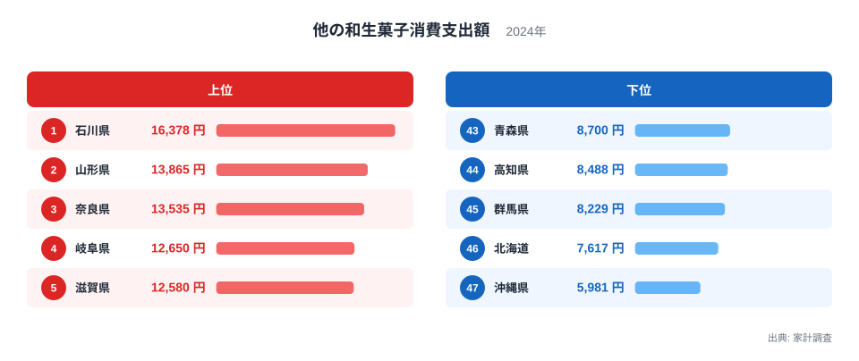
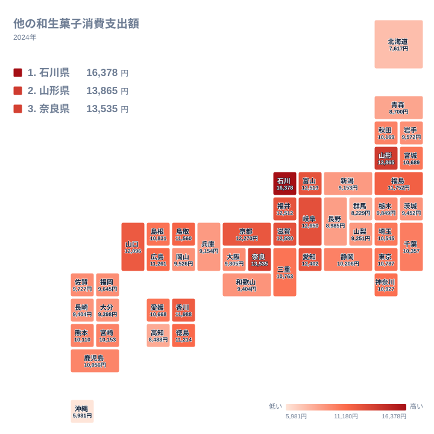

和菓子と聞くと、まんじゅうやようかん、大福を思い浮かべる方が多いと思います。ところが家計調査には、そうした代表的な品目に当てはまらない和生菓子をまとめた区分があります。この記事では、その区分への年間支出を都道府県別に比べます。2024年の結果で最も多かったのは石川県で、16,378円でした。最も少なかったのは沖縄県で、5,981円です。同じ「和菓子」でも、暮らす場所によって家計の中での位置づけが大きく違います。

## 他の和生菓子への支出、上位と下位は？

まず上位5県と下位5県を図で確かめます。

<source-link href="/ranking/other-japanese-sweets-consumption-expenditure">他の和生菓子への支出ランキングをもっと見る</source-link>

この図で目を引くのは、1位の石川県だけが抜けていることです。石川県は16,378円で、2位の山形県は13,865円です。2位から5位までを見ると、山形県の13,865円、奈良県の13,535円、岐阜県の12,650円、滋賀県の12,580円と、金額が少しずつ下がりながら密集しています。1位と2位の間の段差は、2位から5位までの全体の幅よりも大きく開いています。

なぜ石川県だけがここまで高いのか、データからは判別できません。偶然の上振れなのか、安定した傾向なのかも、この1年分の数字だけでは言い切れません。確実に言えるのは、2024年の調査で石川県が他県と大きな差をつけたという事実です。和菓子の習慣との関係は、あくまで考えてみる価値のある仮説にとどまります。

下位側は、沖縄県が5,981円で47位です。その上に北海道が7,617円、群馬県が8,229円、高知県が8,488円、青森県が8,700円と続きます。北海道から青森県の4県は7,617円から8,700円の間に集まり、沖縄県だけが5,981円と、さらに離れて低い位置にいます。1位の石川県の16,378円と47位の沖縄県の5,981円の間には、実データ上で最大の開きがあります。

> [!NOTE]
> ここでの「他の和生菓子」は、家計調査で和生菓子を品目別に分けたとき、個別の品目として立てられていない和生菓子をまとめた区分です。いわば「その他」にあたります。金額は、2024年に1世帯が1年間に支出した額です。

## 地図で見ると、どんな偏りがあるか

次に、県の位置関係を地図で確認します。

地図に落とすと、支出の多い県が中部と近畿に目立つことがわかります。中部では、1位の石川県、4位の岐阜県、6位の富山県、7位の福井県、8位の愛知県が上位に入っています。近畿では、3位の奈良県、5位の滋賀県、9位の京都府が並びます。上位10県のうち8県が、この2つの地方に入っています。残りは2位の山形県と、10位の山口県です。

北海道・東北は、地方ごとにひとくくりにできません。山形県は2位ですが、12位に福島県、20位に宮城県、25位に秋田県、33位に岩手県と続き、43位の青森県、46位の北海道まで幅広く散らばっています。同じ地方の中でも、順位の差が大きいことがわかります。山形県の様子は[山形県のデータ](/areas/06000)でも確認できます。

関東は、上位にも最下位付近にも偏らず、中位から下位に並びます。神奈川県が16位の10,927円、東京都が18位の10,787円、埼玉県が22位の10,545円です。千葉県は23位、栃木県は29位、茨城県は35位で、群馬県は45位の8,229円でした。大都市圏が必ずしも上位にならないことは、この並びから読み取れます。理由までは、この統計だけでは説明できません。

> [!TIP]
> 地図の色が近い県同士でも、「その他」の区分に入る中身が同じとは限りません。どの和菓子がこの区分に入りやすいかは県によって違う可能性があるため、色の濃い県を「和菓子をよく食べる県」とそのまま読み替えず、あくまで「この区分への支出が多い県」として読むのが安全です。

## 上位県と食文化・歴史の関係をどう考えるか

ここからは、データそのものではなく、背景を考えるための仮説として読んでください。上位に中部と近畿の県が目立つのは、茶の湯や寺社の行事、城下町の菓子商など、和菓子と縁の深い文化を持つ土地が多いことと関係しているかもしれません。石川県はしばしば茶の湯の文化と結びつけて語られます。奈良県や京都府は古くから都があった土地で、季節の行事と菓子の結びつきが語られます。ただし、こうした背景が実際の支出額にどれだけ影響しているかは、家計調査だけでは確かめられません。石川県の個別の数字は[石川県のデータ](/areas/17000)から確認できます。

山形県が東北の中で突出して2位に入った点も、文化との関連を示唆する材料に見えるかもしれません。しかし、これも山形県の暮らしに和菓子が根づいているからだと断定できる根拠は、手元のデータにはありません。事実として言えるのは、東北の他の県より山形県の金額が大きいということだけです。

中位の様子も見ておきます。10位の山口県は12,096円、11位の香川県は11,988円、12位の福島県は11,752円、13位の鳥取県は11,560円です。この4県は11,560円から12,096円の間に収まっています。上位と下位の差は大きい一方、中位には似た金額の県が数多く並んでいます。このため、少しの金額の違いで順位が大きく入れ替わりやすい層だといえます。

この区分は「その他」にあたるため、まんじゅうやようかんのように品目がはっきりした和菓子とは順位の傾向が違う可能性があります。品目別のデータと並べて読むと、別の見え方が出てくるかもしれません。他の食料品や嗜好品の指標は、[同じカテゴリの統計一覧](/category/economy)から探せます。なお洋菓子の支出は今回の実データに含まれていないため、和菓子と洋菓子の関係についてはここで数字を挙げません。

## 下位県を読むときの注意

最下位の沖縄県は5,981円です。沖縄県は独自の菓子文化を持つと言われます。そのため、この区分に入る品目が家計で買われにくい可能性は考えられます。ただし、これも仮説です。

46位の北海道、45位の群馬県、44位の高知県、43位の青森県は、北から南、沿岸から内陸まで地理的にばらばらです。下位に共通する一つの理由は、この統計からは見えてきません。洋菓子や乳製品との関係を理由にあげる見方もありますが、洋菓子の支出額のデータがない以上、この記事では根拠のある説明として扱いません。下位の県は「和菓子に関心がない」と受け取らず、この区分への支出が少ない県だと理解しておくのが適切です。

> [!WARNING]
> 家計調査は標本調査で、調査対象の世帯数は県ごとに限られています。県全体の傾向を正確に表すとは限らず、順位が近い県同士の差は、誤差の範囲かもしれません。また和歌山県と長崎県は、どちらも9,404円で同額です。この2県の順位の前後に意味はないため、優劣をつけた読み方はしないでください。

## データについて

この記事で使ったのは、家計調査の「他の和生菓子消費支出額」です。年は2024年で、単位は円です。47都道府県の値が公表されています。数値は1世帯あたりの年間支出額で、本文中の順位は金額の大きい順につけています。

同額の県については、順位の扱いに注意が必要です。和歌山県と長崎県はどちらも9,404円で、本文ではこの2県の順位に意味を持たせていません。記事で取り上げた県の値は、いずれも実データの数字をそのまま使っています。

## まとめ

2024年の他の和生菓子への支出で最も多かったのは、石川県の16,378円でした。2位の山形県が13,865円、3位の奈良県が13,535円で、2位以下は互いに近い金額に集まっています。その中で、石川県だけが大きく離れています。最も少なかったのは沖縄県の5,981円でした。

上位には中部と近畿の県が多く並びますが、東北の山形県が2位に入るなど、地方でひとくくりにはできません。食文化や歴史との結びつきは、数字を読み解く手がかりにはなりますが、あくまで仮説です。この指標は「その他」の区分であり、標本調査でもあるため、断定は避けて受け止めるのが安全です。気になる県があれば、県別のページで他の指標と合わせて確かめてみてください。
