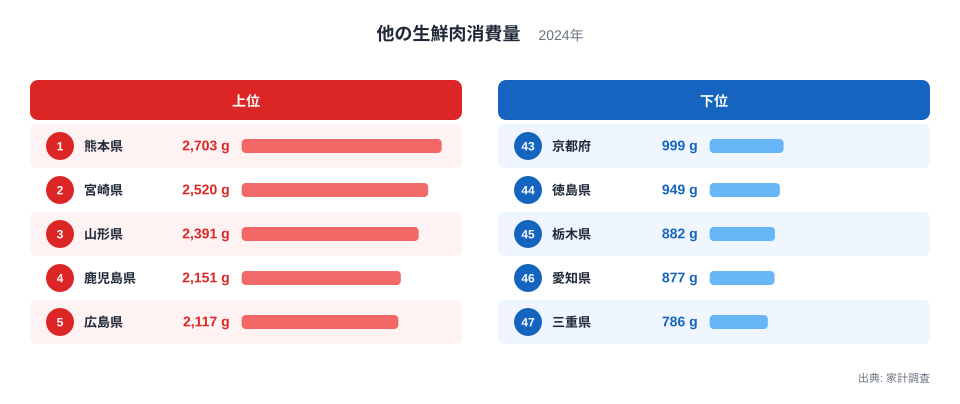
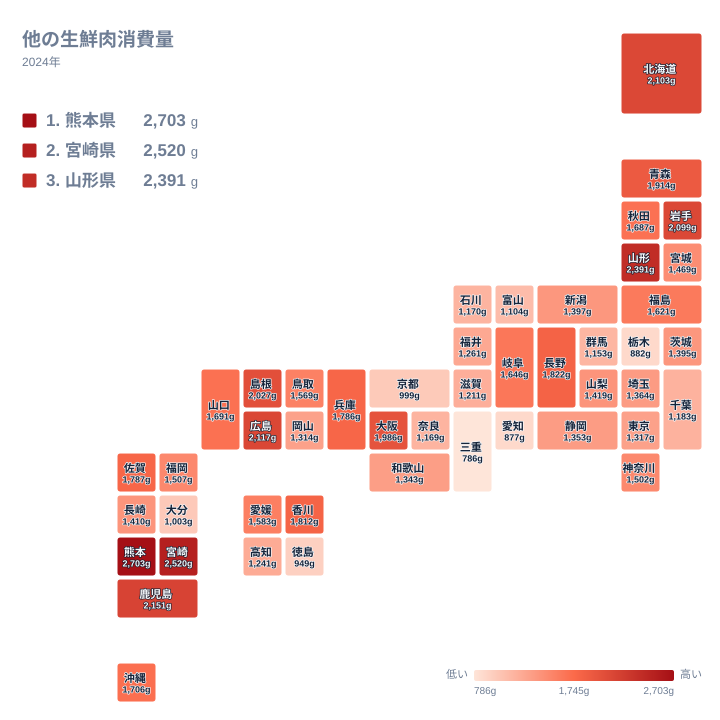

スーパーの精肉売り場には、牛肉・豚肉・鶏肉の三大定番のほかに、馬肉や羊肉などが並ぶことがあります。ふだん目にする機会が多い地域もあれば、ほとんど見かけない地域もあります。この「その他の肉」の購入量を都道府県別に比べると、はっきりした地域差が見えてきます。

この記事では、2024年の家計調査をもとに、他の生鮮肉の消費量が多い県と少ない県を整理します。そのうえで、食文化や産地との結びつきから差の理由を考えます。

> [!NOTE]
> ここでいう他の生鮮肉とは、家計調査で牛肉・豚肉・鶏肉とは別の区分にされている生鮮肉です。馬肉、羊肉、その他の獣肉などが含まれると考えられます。正式な統計名は「他の生鮮肉消費量」で、単位は1世帯あたりの年間購入量を表すgです。外食で食べた量は含まれず、家庭で調理するために買った量だけが対象です。

## 熊本県が首位、宮崎県と山形県が続く

2024年の1位は熊本県で、2,703gでした。2位は宮崎県の2,520g、3位は山形県の2,391gです。4位の鹿児島県は2,151g、5位の広島県は2,117gで、ここまでが2,100g台以上に並びます。

最下位の47位は三重県の786gです。46位の愛知県は877g、45位の栃木県は882gでした。首位の熊本県と最下位の三重県を比べると、1世帯が1年間に買う量にこれだけの開きがあります。肉の種類が違うとはいえ、同じ国の家庭の買い物としては大きな差です。

上位10位には、熊本県、宮崎県、鹿児島県の3県が九州から入っています。山形県、北海道、岩手県、青森県も顔を出し、東北と北海道からも複数の県が並びます。広島県と島根県は中国地方、大阪府は近畿から入っており、上位は一つの地域に固まっているわけではありません。

## 上位と下位の顔ぶれを並べる

次の図は、消費量が多い5県と少ない5県を並べたものです。

<source-link href="/ranking/other-meat-consumption-quantity">他の生鮮肉消費量ランキングをもっと見る</source-link>

上位には熊本県、宮崎県、山形県、鹿児島県、広島県が入ります。九州の3県が目立ちますが、山形県が3位に入っている点は見逃せません。九州に限った現象ではなく、地域ごとに別の理由で消費が膨らんでいる可能性があります。

下位には三重県、愛知県、栃木県、徳島県、京都府が並びます。三重県と京都府は近畿、愛知県は中部、栃木県は関東、徳島県は四国です。上位と違い、下位の5県は地方がばらばらで、特定の地域の傾向とは言いにくい顔ぶれです。

この下位の県に共通する説明を一つに絞るのは難しいです。そもそも「他の生鮮肉」は購入頻度が低く、少数の世帯の購入が平均値を左右しやすい品目です。順位の差には、食習慣の違いに加えて、調査対象世帯の偏りも混ざっていると考えるのが安全です。

[同じカテゴリの統計一覧](/category/economy)では、家計の支出に関わる他の指標も確認できます。肉類全体の傾向を見るときの手がかりになります。

> [!WARNING]
> 家計調査は、都道府県庁所在地と政令指定都市を中心とした調査です。県全体の平均ではなく、主に県庁所在地周辺の世帯の姿を映した数字です。調査世帯の数も限られるため、特に購入頻度の低い品目では年ごとの変動が大きくなります。順位が1つ違うだけの県どうしの優劣を論じるのは避けてください。

## 地理分布で見ると何が分かるか

続いて、全国の分布をタイルマップで確かめます。

地図で見ると、九州の南部に濃い色が集まっています。熊本県、宮崎県、鹿児島県が上位4位までのうち3つを占める形です。一方で、同じ九州でも大分県は1,003gで42位にとどまります。福岡県は1,507gで22位、長崎県は1,410gで26位です。九州だから多い、と一括りにはできません。

東北では、山形県が2,391g、岩手県が2,099g、青森県が1,914gでいずれも上位10位以内です。これに対して宮城県は1,469gで24位、福島県は1,621gで19位、秋田県は1,687gで17位です。北海道は2,103gで6位でした。北海道・東北の7道県の中でも、順位には大きなばらつきがあります。

関東と中部は全体に中位から下位に寄っています。東京都は1,317gで32位、神奈川県は1,502gで23位、愛知県は877gで46位です。長野県だけは1,822gで11位と、中部の中で目立って高い値です。大都市圏の県が必ずしも多く買うわけではなく、むしろ地域に根づいた食習慣の有無が表れている印象です。

> [!TIP]
> 地図を読むときは、色の濃い県そのものよりも、隣り合う県との差に注目してください。熊本県と大分県のように、隣県でも順位が大きく離れる例があります。県境をはさんで差が出るなら、気候よりも、郷土料理や流通の違いが効いている可能性が高いです。

## 食文化と産地から見る背景

熊本県といえば、馬刺しが全国的に知られています。馬肉を食べる文化が根づいている地域では、家庭でも馬肉を買う機会が多くなるはずです。熊本県の2,703gという値は、こうした食文化と整合的です。ただし、統計の区分が馬肉だけを指しているわけではないので、馬肉が主因だと断定はできません。

宮崎県と鹿児島県は、畜産が盛んな県として知られます。肉を日常的に食べる土地柄で、牛肉・豚肉・鶏肉以外にも、多様な肉が食卓に上りやすいのかもしれません。[熊本県のデータ](/areas/43000)と[宮崎県のデータ](/areas/45000)を見ると、地域の産業や暮らしの特徴を合わせて確かめられます。

北海道が6位に入っていることも、食文化から説明できそうです。羊肉を使ったジンギスカンは北海道を代表する料理で、家庭でも親しまれています。青森県や岩手県、山形県などの東北勢が上位に入る背景には、寒冷な土地で肉を食べてきた歴史や、馬肉をはじめとする地域食材の存在が考えられます。

大阪府が9位に入っているのは、少し意外な結果かもしれません。大阪府は1,986gでした。肉をよく食べる都市部の食文化や、多様な食材が流通する市場の厚みが、購入量を押し上げている可能性があります。ただし、これは推測の域を出ません。

## 関連する品目との対比

他の生鮮肉の位置づけを理解するには、牛肉・豚肉・鶏肉との違いを意識することが大切です。この3つは、全国どこでも日常的に買われる主役の肉です。地域差があっても、購入量の多さそのものは各地で安定しています。

これに対して他の生鮮肉は、地域に根ざした「脇役の肉」です。食べる習慣のある地域では頻繁に買われ、習慣のない地域ではほとんど買われません。そのため、主役の肉の消費量と比べると、順位が大きく入れ替わりやすい特徴があります。

東日本で豚肉、西日本で牛肉が好まれるという傾向はよく知られています。他の生鮮肉の順位はそれとは別の軸で並んでいて、地方でくくるだけでは説明しきれません。熊本県のように畜産と食文化の両方を持つ県や、北海道のように特定の料理で知られる県が上位に来ます。

つまり、この指標は肉の消費量の大小よりも、食の多様性や地域性の強さを映す鏡のようなものです。上位の県は、全国標準とは違う肉の選択肢を日常に持っている地域だと読み取れます。

## データについて

この記事の数値は、2024年の家計調査による他の生鮮肉消費量です。単位はgで、都道府県別に比較できる形に整理されたものです。実データの値と順位をそのまま使っており、記事の中で新しく計算した値はありません。

家計調査は標本調査です。調査対象の世帯が偏れば、平均値も揺れます。特に他の生鮮肉のように購入頻度の低い品目は、その影響を受けやすい点に注意が必要です。順位は目安として、地域の傾向を見る材料にとどめるのが適切です。

## まとめ

2024年の他の生鮮肉消費量は、熊本県が2,703gで首位でした。宮崎県の2,520g、山形県の2,391gが続き、九州と東北の県が上位に目立ちます。最下位は三重県の786gで、愛知県の877g、栃木県の882gが下位に並びます。

この差は、馬肉や羊肉に代表される地域の食文化、畜産の盛んな産地、流通の違いなどが重なって生まれたものと考えられます。ただし、調査の性質上、細かな順位の違いにはあまり意味がありません。

自分の住む県が全国のどのあたりにあるのかを知ると、日常の食卓が地域の文化とつながっていることに気づけます。ランキングの全体像は、各県のデータページと合わせて確かめてみてください。
