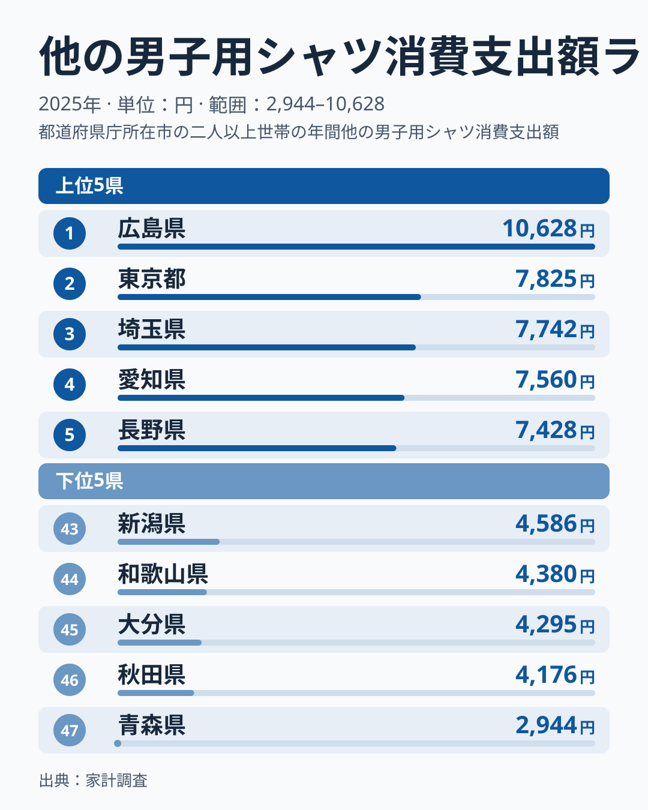
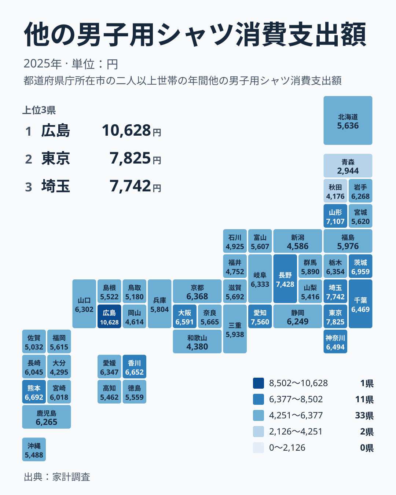

## 広島県が首位、青森県が最下位という落差

男性用のシャツと聞くと、ワイシャツを思い浮かべる方が多いでしょう。ところが家計調査には、ワイシャツとは別に「その他の男子用シャツ」という区分があります。仕事着というより普段着に近い品目で、買い足し方の癖が表れやすい支出です。

2025年のこの支出で首位だったのは広島県で、10,628円でした。最下位の青森県は2,944円にとどまります。首位と最下位の比は、実データ上の最大と最小を並べると約3.6倍にあたりますが、ここでは金額そのものを素直に見ておきます。普段着のシャツにかける金額として、かなり大きな開きです。

この記事では、データから言える範囲に絞って、上位と下位の並び、地方ごとの散らばり、調査の仕組みに由来する読み方の注意を順に確かめます。広島県がなぜ突出するのかという理由までは、この数字だけでは特定できません。代わりに、どこまでが読み取れてどこからが仮説なのかを分けて書きます。

## 上位5と下位5を並べると見えること

まずは上位と下位を並べた図を見てください。

<source-link href="/ranking/other-mens-shirt-consumption-expenditure">他の男子用シャツへの支出ランキングをもっと見る</source-link>

上位は広島県の10,628円に続いて、東京都が7,825円で2位、埼玉県が7,742円で3位、愛知県が7,560円で4位、長野県が7,428円で5位です。首位の広島県と2位の東京都の間には、2位から5位の間隔に比べて大きなすき間があります。2位以下は7,000円台で団子状に並んでいるのに対し、広島県だけが1万円を超えています。

首都圏や愛知県が上位に入っているのは、買い物の選択肢が多い環境が一因として考えられます。ただし、この数字だけでは確かめられません。長野県が5位、山形県が6位に入っていることからも、大都市かどうかだけで説明できる並びではありません。

下位は、47位が青森県の2,944円、46位が秋田県の4,176円、45位が大分県の4,295円、44位が和歌山県の4,380円、43位が新潟県の4,586円です。青森県は46位の秋田県ともかなり離れており、最下位だけが沈んでいる形です。首位の広島県と同じく、両端の県は「端にいる理由」を別の資料で確かめたくなる位置にあります。

> [!NOTE]
> ここでいう「他の男子用シャツ」は、ワイシャツ以外の男子用シャツ類を指す家計調査の品目で、統計上の名称は「他の男子用シャツ消費支出額」です。金額は世帯が一年間に支出した額の平均にあたり、男性一人あたりの購入額や購入枚数ではありません。

## 地図で見ると、地方ごとの並びは一様ではない

次に、地理的な分布を見ます。

地図で目につくのは、特定の地方が丸ごと高い、あるいは丸ごと低いという単純な構図にはなっていないことです。地方ごとに確かめます。

関東は、東京都が2位、埼玉県が3位、茨城県が7位、神奈川県が11位、千葉県が12位、栃木県が14位、群馬県が25位です。上位から中位に広がり、下位には一つも入っていません。7県が揃って25位以内にいる点で、この地方はまとまりが比較的はっきりしています。

一方、北海道・東北は大きく割れています。山形県は6位の7,107円と上位に入りますが、岩手県は18位、福島県は23位、北海道は29位、宮城県は30位です。そのうえ秋田県が46位、青森県が47位です。同じ地方の中で6位と47位が同居しており、「東北は少ない」とひとまとめにはできません。

中部も同様で、愛知県が4位、長野県が5位と上位に入る一方、新潟県は43位、福井県は41位、石川県は40位です。地方という枠は、この指標を説明する単位としては粗すぎると言えます。

> [!TIP]
> 中位の1つや2つの順位差には、あまり意味を読み込まないのがコツです。見るべきは、上位の集団と下位の集団がどこで分かれているか、そして同じ地方の中でどれだけ散らばっているかです。

## 西日本の散らばりから読めること

西日本は、同じ地方内の差が目立つ組に絞って見ます。

中国は、広島県が1位、山口県が17位、島根県が34位、鳥取県が38位、岡山県が42位です。首位の広島県と、隣り合う岡山県が42位で、同じ地方の中で最も差が開いています。広島県の10,628円に対して岡山県は4,614円です。この差が、隣り合う県の支出行動の違いなのか、標本調査のぶれなのかは、この数字だけでは切り分けられません。

四国は、香川県が9位、愛媛県が15位に対して、徳島県が33位、高知県が36位と、上位と中下位に分かれます。九州・沖縄では、熊本県が8位に入る一方、大分県は45位で、同じ九州内で大きく差が開いています。

近畿は、大阪府が10位、京都府が13位と上位に近く、和歌山県が44位と下位に落ちます。ただし、神戸市を含む兵庫県は26位で、大都市を抱えるかどうかで段差が決まるわけではありません。人口の多い県が必ず上位という読みは、このデータでは成り立ちません。

> [!WARNING]
> 家計調査は全国の世帯を抽出した標本調査です。都道府県別の値は、調査対象の世帯数が限られるぶん、たまたまの買い物の影響を受けやすくなります。シャツ類のように購入頻度が低い品目では、少数の世帯の大きな買い物が県全体の平均を押し上げることがあります。広島県の突出や青森県の低さも、一年分の数字として慎重に受け止める必要があります。

## 生活者にとっての意味

では、この数字は暮らしの上で何を意味するのでしょうか。データから言える範囲で三点に整理します。

第一に、広島県の10,628円と青森県の2,944円の開きは、必要な枚数の違いというより、買い足し方の違いが積み重なった結果かもしれません。ただしこれは仮説で、標本のぶれが大きく混じっている可能性も同じくらいあります。

第二に、東京都の7,825円、埼玉県の7,742円、愛知県の7,560円は、都市部の世帯が普段着のシャツにかける金額の目安として使えます。ご自身の支出を見直すときの参照値になります。

第三に、下位の県の数字は「節約上手」と決めつけず、購入先の違いや購入時期の偶然も含めて読むほうが公平です。順位は暮らしぶりの優劣ではなく、一年分の平均がどこに落ち着いたかを示すにすぎません。

自分の住む県の位置を確かめたい方は、[広島県のデータ](/areas/34000)や[東京都のデータ](/areas/13000)で、ほかの指標との組み合わせを見てみてください。暮らしの数字として広く読みたい方には、[同じカテゴリの統計一覧](/category/economy)もおすすめです。

## データについて

この記事で使った指標は、家計調査の「他の男子用シャツ消費支出額」の2025年の値で、単位は円です。47の都道府県を比べた結果を、公表された順位のまま紹介しました。

本文では、実データにある値と順位を並べ、最大と最小の比以外は新たに計算していません。広島県の首位は数字の上では確かですが、その理由を特定するには、世帯構成や購入先、年齢構成などの別の統計を重ねる必要があります。順位の上下に一喜一憂するより、同じ地方でも県ごとに事情が違うという視点で読むと、この数字は暮らしを考える手がかりになります。
