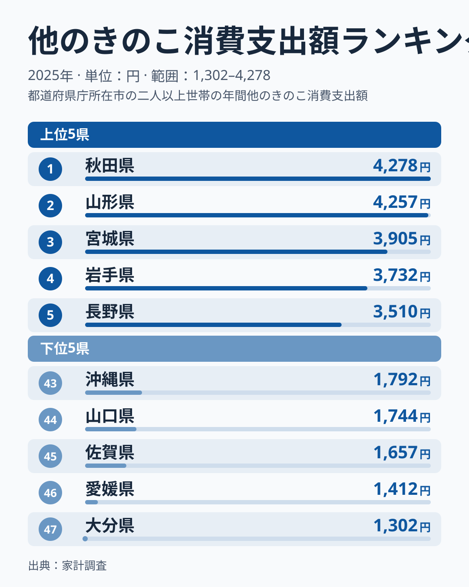
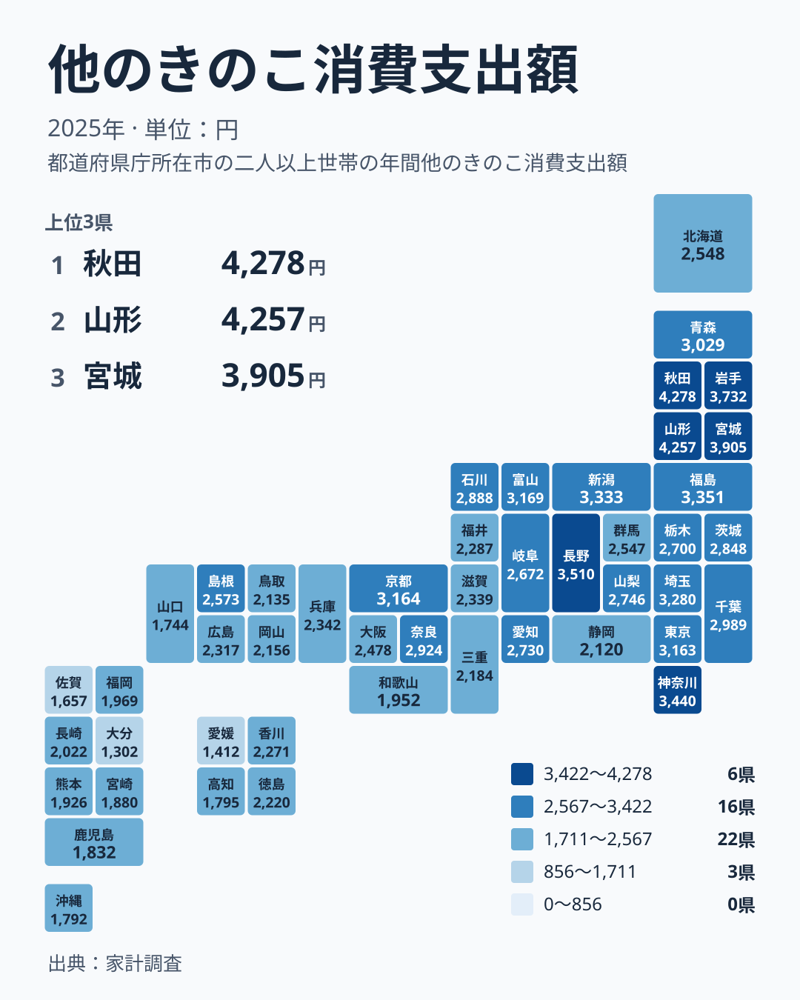

## 秋田県と山形県が並ぶ首位争い

この記事で扱うのは、家計調査で「他のきのこ」に分類される品目への、1世帯あたりの年間支出額です。しいたけなど個別に立てられた品目を除いた残りの区分で、中身は品目ごとに異なります。また家計調査は都市を単位とした標本調査です。本文で「県」の支出と書いていても、実際にはその県の調査対象となった都市の世帯の平均です。県全体の傾向とは限らない点を、最初にお断りしておきます。

2025年の首位は秋田県で4,278円でした。2位は山形県で4,257円、3位は宮城県で3,905円、4位は岩手県で3,732円です。最下位の大分県は1,302円で、首位との比は約3.3倍になります。

<source-link href="/ranking/other-mushroom-consumption-expenditure">他のきのこへの支出ランキングをもっと見る</source-link>

図でまず目を引くのは、上位の近さです。1位の秋田県と2位の山形県の差は21円しかなく、上位4県はいずれも3,700円以上に収まっています。首位が突き抜けているのではなく、東北の4県が団子状に並んでいる形です。5位は中部の長野県で3,510円です。4位の岩手県との間には222円の開きがあり、上位4県と5位以下の間に小さな段差があることがわかります。

下位は大分県、愛媛県、佐賀県、山口県、沖縄県の順で、支出額は1,302円、1,412円、1,657円、1,744円、1,792円です。大分県と愛媛県の間は110円ですが、愛媛県と佐賀県の間は245円と広く、最下位付近は下位の中でも特に低い水準にあります。所属は大分県、佐賀県、沖縄県が九州・沖縄、愛媛県が四国、山口県が中国です。下位5県は西日本に散らばっています。

秋田県と山形県の個別のデータは、[秋田県のデータ](/areas/05000)と[山形県のデータ](/areas/06000)で確認できます。

> [!NOTE]
> 「他のきのこ」は、しいたけやえのきだけなど個別の品目を除いた残りの区分です。含まれる品目は一つではないため、この金額が高い県でも、特定のきのこがよく買われているとは言い切れません。支出額は購入量と価格の両方で決まります。

## 地理分布に見る東と西の差

次の図は、都道府県をタイル状に並べ、支出額の水準を色で示した地図です。

濃い色は北海道・東北から中部にかけて集まっています。上位10県のうち、東北は秋田県、山形県、宮城県、岩手県、福島県の5県です。残りは長野県、新潟県、富山県の中部3県と、神奈川県、埼玉県の関東2県です。上位10位までに近畿から九州・沖縄の県は入っていません。

一方、東北でも青森県は13位で3,029円、北海道は23位で2,548円です。東北の中でも上位に集中しているのは、秋田県、山形県、宮城県、岩手県、福島県です。「東北は高い」とひとまとめにするより、県ごとに見るほうが実態に近いといえます。

関東の7県は、神奈川県が6位で3,440円、埼玉県が9位で3,280円、東京都が12位で3,163円、千葉県が14位で2,989円、茨城県が17位で2,848円、栃木県が20位で2,700円、群馬県が24位で2,547円です。すべて上位から中位の前半に収まり、関東は全体として安定した水準です。ただし1位の秋田県と比べると、神奈川県でも838円の差があります。

九州・沖縄では、熊本県が39位で1,926円、宮崎県が40位で1,880円、鹿児島県が41位で1,832円、沖縄県が43位で1,792円です。地図の右下ほど色が薄くなる傾向は、数字からも確かめられます。

東日本で高く西日本で低い傾向があるのは確かです。ただ、その理由まではこのデータだけでは言えません。気候や食文化の違いが関係している可能性はありますが、仮説にとどまります。

> [!WARNING]
> 家計調査は都市を単位とした標本で、一つの県でも対象世帯は限られます。1年分の順位がわずかに入れ替わっただけでは、実態の変化とは断定できません。特に、秋田県と山形県のように21円しか違わない順位は、誤差の範囲かもしれません。

## 中位は小さな差が密集している

中位から下位の前半は、値がとても近接しています。11位の京都府は3,164円、12位の東京都は3,163円で、差はわずか1円です。18位の山梨県が2,746円、19位の愛知県が2,730円、20位の栃木県が2,700円、21位の岐阜県が2,672円と、4県が74円の幅に収まっています。

さらに22位の島根県は2,573円、23位の北海道は2,548円、24位の群馬県は2,547円で、北海道と群馬県の差は1円です。このあたりでは順位が一つ違っても、金額にはほとんど意味のある差がありません。

反対に、上位と下位の端では順位の間隔が大きくなります。1位から10位の富山県までは4,278円から3,169円まで、1,109円の幅があります。中位に多くの県が密集し、両端に離れた県が並ぶ分布です。順位の差をそのまま生活の差と読むのは避けたほうがよいでしょう。

> [!TIP]
> 順位が近い県を比べるときは、順位ではなく円の差を見てください。この指標は中位に1円差から数十円差の県が並びます。「他のきのこ」は品目構成が地域で違うため、小さな差の背景を探るより、上位の東北と下位の九州・四国のような大きな差に注目するほうが有益です。

## 関連品目との対比と地域差の読み方

「他のきのこ」は、しいたけ、えのきだけ、しめじなど、個別に区分される定番品との対比で考えると理解しやすくなります。定番品は全国で広く買われるため、地域差は比較的小さいと推測できます。これに対して他のきのこは、区分の性質上、地域ごとに買われる品目が異なる可能性があります。ここは推測であり、このデータでは品目別の内訳までは確認できません。

一例を挙げます。上位の東北には、秋に汁物や鍋物できのこを多く使う習慣があるといわれます。この点は、データではなく一般に語られる話です。もし関係があるとしても、芋煮やきりたんぽ鍋が支出を押し上げているとまでは言えません。食文化が関係している可能性を示すにとどまります。

近畿の中でも差があります。京都府は11位で3,164円、奈良県は15位で2,924円ですが、大阪府は25位で2,478円、兵庫県は26位で2,342円、滋賀県は27位で2,339円です。三重県は32位で2,184円、和歌山県は38位で1,952円で、同じ近畿でも順位に大きな幅があります。

中部には、長野県が5位で3,510円、新潟県が8位で3,333円、富山県が10位で3,169円と上位の県が集まります。一方、福井県は29位で2,287円、静岡県は35位で2,120円です。同じ地方でも順位に大きな幅があるため、地方単位でひとくくりに語ることは避けるべきです。

長野県は5位ですが、この指標はえのきだけなど個別の品目を含みません。産地かどうかと支出の多さを直接結びつけることは、このデータからはできません。産地の有無と家庭の支出が一致するかどうかは、別の調査で確かめる必要があります。

同じ分野の統計は、[同じカテゴリの統計一覧](/category/economy)から探せます。他の品目と並べて読むと、他のきのこの位置づけがより見えてきます。

## データについて

この記事の数値は、家計調査の「他のきのこ消費支出額」の2025年の値です。単位は円で、1世帯あたりの年間支出額を示します。47都道府県すべての値が公表されており、本文の順位と金額はこの同じ集計に基づいています。

読むときの要点は三つあります。第一に、支出額は購入した金額の合計であり、購入量ではありません。価格の違いも金額に反映されます。第二に、自家栽培やきのこ採り、もらい物は支出に含まれません。きのこを採る習慣がある地域では、実際の消費量が支出額より多い可能性があります。第三に、調査は都市を単位とした標本で行われているため、県全体の平均を表すものではありません。

最大の秋田県と最小の大分県の比は約3.3倍ですが、これは1年分の標本の結果です。数字の背景にある理由を断定せず、まず分布の形を確かめる読み方をおすすめします。
