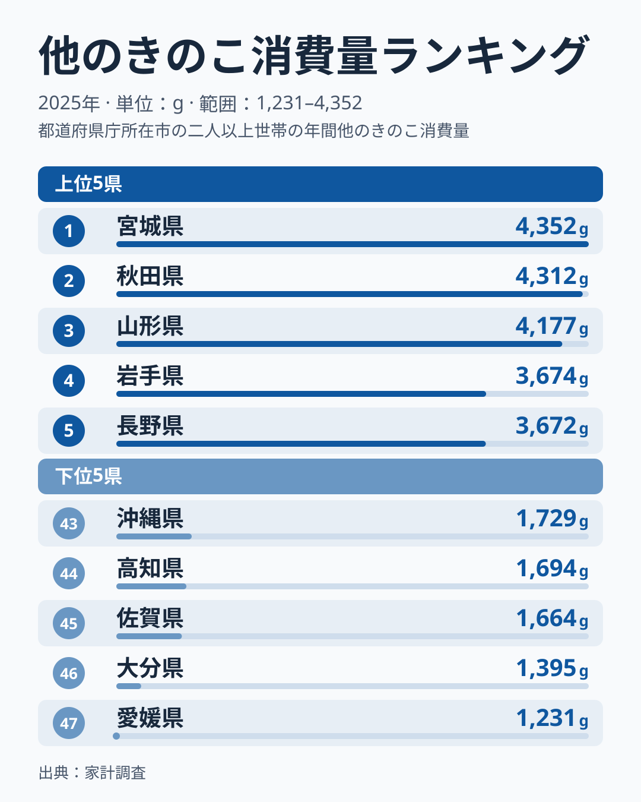
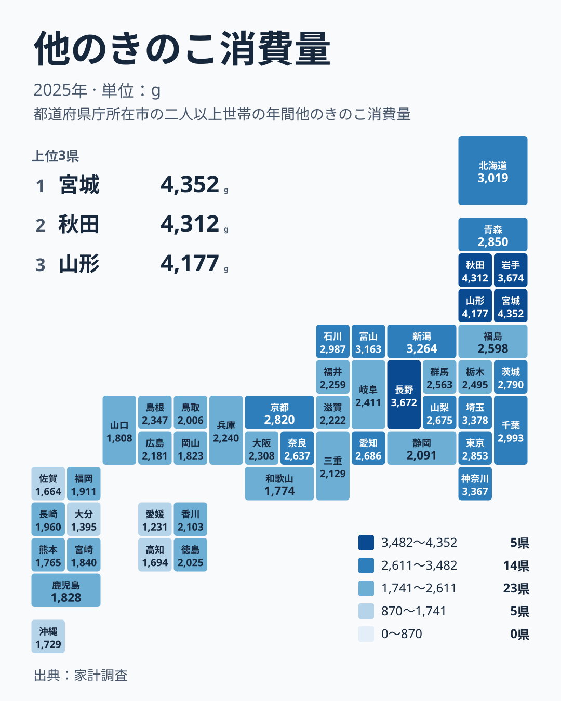

## 宮城県が1位、愛媛県が最下位

しいたけ、えのき、しめじといった主要なきのこ以外の「その他のきのこ」は、なめこ、まいたけ、エリンギ、きくらげなどが含まれうる区分です。この区分の購入量を都道府県で比べると、東北を中心に大きな差が見えてきます。

2025年の家計調査で1位だったのは宮城県で、4,352gです。2位は秋田県で4,312gと、その差は40gしかありません。最下位は愛媛県の1,231gで、1位の宮城県は最下位の3.54倍、差は3,121gです。47都道府県の中央値は2,347gなので、宮城県は中央値を大きく上回り、愛媛県は大きく下回っています。

> [!NOTE]
> 「他のきのこ」は、家計調査でしいたけやえのきなどの個別の品目に分類されないきのこをまとめた区分です。単位はgで、世帯が購入した数量を表します。どのきのこが含まれるかは調査の品目分類に従うため、一般に思い浮かべる「珍しいきのこ」とは範囲が異なる場合があります。

<source-link href="/ranking/other-mushroom-consumption-quantity">他のきのこ消費量ランキングをもっと見る</source-link>

図を見て気づくのは、上位5県の中でも差が一様ではないことです。1位の宮城県4,352gから3位の山形県4,177gまでは175gの幅に収まっています。ところが4位の岩手県は3,674gで、3位の山形県から503g下がります。宮城県、秋田県、山形県の3県が先頭集団をつくり、岩手県3,674gと長野県3,672gが並んでその一段下に続く形です。岩手県は4位で、1位ではありません。

下位5県は愛媛県1,231g、大分県1,395g、佐賀県1,664g、高知県1,694g、沖縄県1,729gです。最下位の愛媛県と46位の大分県の差は164gですが、大分県と45位の佐賀県の差は269gあります。つまり最下位の愛媛県は、下位の中でもさらに一段離れた位置にいます。

## 上位10県は東北と中部に偏る

上位10県を地方で数えると、北海道・東北が5県、中部が3県、関東が2県です。北海道・東北は宮城県、秋田県、山形県、岩手県、北海道、中部は長野県、新潟県、富山県、関東は埼玉県と神奈川県です。上位4位までを東北の4県が占める一方、北海道は10位です。

ただし東北でも一様ではありません。青森県は14位で2,850g、福島県は20位で2,598gと、中位にとどまります。東北の中で上位に集まるのは太平洋側と日本海側を問わず宮城県、秋田県、山形県、岩手県の4県で、青森県と福島県は全国の中位です。「東北だから多い」とひとまとめにはできません。

中部では、長野県が5位で3,672g、新潟県が8位で3,264g、富山県が9位で3,163gと上位に並びます。一方で石川県は12位、愛知県は17位、山梨県は18位、岐阜県は23位、福井県は26位、静岡県は32位です。同じ中部でも順位の幅が広く、山や雪といった条件だけでは説明しきれません。

## 食文化と産地から考える仮説

なぜ東北で多いのかを、データだけから断定することはできません。ただし、仮説として次のような背景が考えられます。

- 秋にきのこ狩りや山菜採りの習慣が根づいている地域がある
- なめこ、まいたけ、きのこ汁、芋煮、鍋物など、きのこを使う郷土の料理がある
- 産地や直売所が近く、手に入りやすい

宮城県や山形県といえば芋煮会が秋の風物詩として知られます。秋田県にもきのこを使った鍋やきのこ汁の文化があります。こうした食べ方が、購入量の多さにつながっている可能性があります。

> [!TIP]
> 家計調査は購入した数量なので、自分で採ったり、近所からもらったりしたきのこは含まれません。きのこ狩りが盛んな地域ほど実際に食べる量が購入量を上回る可能性があり、順位をそのまま「食べる量の順位」と受け取らないのが読み解くコツです。

ここで挙げた背景は、あくまで食文化や産地にもとづく仮説です。この記事で示せるのは2025年の値と順位に見られる地域の傾向までで、主要なきのこなど個別の品目との数値の対比は含みません。他の統計は[同じカテゴリの統計一覧](/category/economy)から確認できます。

## 地理分布を見ると東に厚く西に薄い

タイルマップで見ると、色の濃い県は東北から中部、関東に集まり、西へ進むほど薄くなる傾向があります。ただし単純な東西の二分ではなく、地方の中にも差があります。

関東では、埼玉県が6位で3,378g、神奈川県が7位で3,367gと上位に入り、千葉県は11位、東京都は13位です。一方、群馬県は21位、栃木県は22位で、関東の7県は6位から22位までに広がります。きのこの産地というイメージの県が必ずしも上位ではない点は、購入量が産地の近さだけでは決まらないことを示しています。

近畿では京都府が15位で2,820gと最も高く、和歌山県は41位で1,774gと下位に入ります。同じ近畿でも26位差があり、地方の平均的なイメージでは語れません。

> [!WARNING]
> 家計調査は標本調査で、都道府県ごとの対象世帯数は限られます。年ごとの変動や標本の偏りが出やすく、順位が近い県同士の差は誤差の範囲かもしれません。たとえば宮城県と秋田県の40gの差は、実質的な優劣とは言えません。

## 下位は九州・沖縄と四国に目立つ

下位10県の内訳は、九州・沖縄が5県、中国が2県、四国が2県、近畿が1県です。38位の鹿児島県、39位の岡山県、40位の山口県、41位の和歌山県、42位の熊本県、43位の沖縄県、44位の高知県、45位の佐賀県、46位の大分県、47位の愛媛県の10県で、九州・沖縄は鹿児島県、熊本県、沖縄県、佐賀県、大分県が該当します。

九州・沖縄では、長崎県が35位で1,960gと最も順位が良く、福岡県は36位、宮崎県は37位です。八つの県すべてが35位から46位に収まり、上位に食い込む県がありません。この地方は全体として購入量が少ない側にそろっています。

四国は香川県が31位で2,103g、徳島県が33位で2,025gと中位の下あたりですが、高知県は44位、愛媛県は47位です。同じ四国でも差が大きい点は見逃せません。中国では島根県が24位で2,347gと、中央値と同じ値で中位に入っています。広島県は29位、鳥取県は34位、岡山県は39位、山口県は40位です。

## 注目県のデータを確かめる

1位の宮城県の詳しい指標は[宮城県のデータ](/areas/04000)、2位の秋田県は[秋田県のデータ](/areas/05000)で見られます。他の指標とあわせて見ることで、きのこの購入量が各県の食の特徴とどう重なるかを探る手がかりになります。

大都市圏の東京都は13位で2,853g、大阪府は25位で2,308gです。ただし2都市だけの比較から、東日本と西日本の傾向の違いを言うことはできません。地方全体の並びを見るほうが、傾向をつかむ手がかりになります。

## データについて

この記事の数値は、家計調査の2025年の結果にある「他のきのこ消費量」を使っています。単位はgです。順位は47都道府県の値の大きい順で、中央値は47県の真ん中にあたる2,347gです。

地方のくくりは、北海道・東北、関東、中部、近畿、中国、四国、九州・沖縄の7区分で統一しています。
