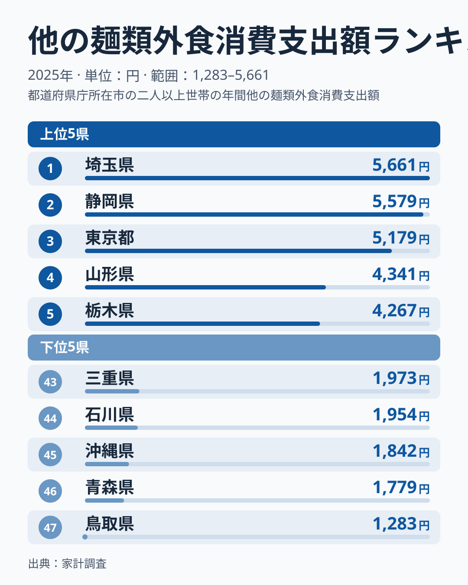
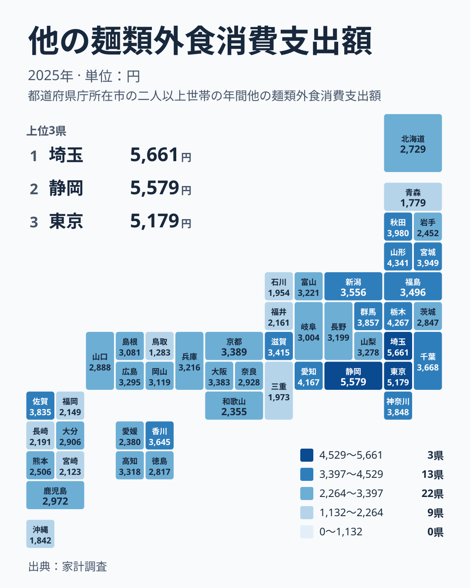

## 他の麺類の外食支出は、県によってどれだけ違うのか

そばやうどんの外食は、全国どこでも身近な存在です。一方で、それ以外の麺類を外で食べる金額には、県ごとにはっきりした差があります。2025年の家計調査によると、1位の埼玉県は5,661円、最下位の鳥取県は1,283円でした。同じ日本国内でも、麺を外で食べるお金の使い方は大きく異なります。

この記事では、家計調査にある「他の麺類」の外食支出を取り上げます。そば・うどん以外の麺類を外食で食べた支出額で、中華麺系の店で使う金額などが入る区分と考えると読みやすいです。都道府県庁所在地などの世帯を対象にした調査なので、県全体の平均というより、調査対象となった都市の暮らしぶりを映した数字になります。

> [!NOTE]
> この指標の正式な統計名は「他の麺類外食消費支出額」で、出典は家計調査、単位は円です。そば・うどんの外食とは別の区分で、麺類全体の支出ではありません。2025年の1世帯あたりの支出額が各県の調査対象都市について集計されています。

まず上位と下位の顔ぶれを図で確認します。

<source-link href="/ranking/other-noodle-dining-consumption-expenditure">他の麺類外食への支出ランキングをもっと見る</source-link>

上位には、1位の埼玉県が5,661円、2位の静岡県が5,579円、3位の東京都が5,179円と並びます。上位3つの間隔はそれほど大きくなく、埼玉県と静岡県は拮抗しています。続く4位は山形県で4,341円、5位は栃木県で4,267円です。3位の東京都から4位の山形県へは、金額が一段階下がる形になっています。

下位を見ると、47位の鳥取県が1,283円、46位の青森県が1,779円、45位の沖縄県が1,842円、44位の石川県が1,954円、43位の三重県が1,973円です。最下位の鳥取県は、46位の青森県からも大きく離れています。下位5県は中国、東北、九州・沖縄、中部、近畿に散らばっており、特定の地方だけが低いという単純な構図ではありません。

## 上位は関東と中部に集まるが、東北の健闘も目立つ

上位10位までの顔ぶれを地方ごとに整理すると、傾向が見えてきます。

- 関東: 1位の埼玉県、3位の東京都、5位の栃木県、9位の群馬県、10位の神奈川県
- 中部: 2位の静岡県、6位の愛知県
- 北海道・東北: 4位の山形県、7位の秋田県、8位の宮城県

10位までのうち、関東が5県と半数を占めます。11位の佐賀県を挟んで、12位に千葉県が3,668円で入っています。千葉県は関東の中で、10位の神奈川県よりわずかに下の位置です。関東全体で見ると、茨城県だけが32位の2,847円と大きく離れており、同じ関東でも差があることが分かります。

埼玉県のデータは[埼玉県のデータ](/areas/11000)で、静岡県のデータは[静岡県のデータ](/areas/22000)で確認できます。1位と2位の県を見比べると、どの分野で外食への支出が厚いかが分かり、麺類の消費の背景を考える手がかりになります。

地理的な広がりを次の図で確認します。

タイルマップで見ると、関東から中部の太平洋側にかけて支出の多い県が連なっています。そこへ、山形県、秋田県、宮城県といった東北の県が加わります。東北は北海道・東北の区分の中でも順位の幅が広く、4位の山形県、7位の秋田県、8位の宮城県が上位に入る一方、36位の岩手県は2,452円、46位の青森県は1,779円にとどまります。同じ東北でも県ごとの差が大きい点は見逃せません。

西日本に目を向けると、上位に入るのは11位の佐賀県の3,835円と13位の香川県の3,645円が目立つ程度です。近畿では、17位の京都府が3,389円、18位の大阪府が3,383円と、ほぼ並んでいます。大都市圏を抱える県でも、東京都のように上位へ入るとは限りません。

## 食文化や外食環境との結びつき

この支出差を、単純に「麺が好きかどうか」だけで説明するのは難しいです。背景として考えられるのは、外食できる店の多さ、通勤や買い物の動き方、家庭で食べる習慣との役割分担などです。

東京都、埼玉県、神奈川県、栃木県、群馬県を含む関東の上位県は、人口が多く、駅前や幹線道路沿いに多様な麺類の店が並びます。昼食を外で済ませる機会が多い地域では、麺類の外食が日常に組み込まれやすいと考えられます。ただし、これは統計から直接分かる事実ではなく、あくまで一つの見方です。

静岡県が2位に入っている点も興味深い結果です。静岡県は5,579円で、東京都の5,179円を上回っています。外食の習慣が根づいていることをうかがわせますが、店の種類や価格帯までは、この統計では分かりません。

山形県の4位、4,341円も印象的です。山形県は、そばやラーメンなど麺類の食文化がよく知られた地域です。そば・うどん以外の麺類の外食でも上位に入っていることは、麺を外で食べる習慣の強さを示唆しています。同じ東北でも、秋田県は3,980円で7位、宮城県は3,949円で8位と続きます。

一方、下位の県には別の事情がありそうです。鳥取県の1,283円、青森県の1,779円、沖縄県の1,842円は、いずれも他県と比べて低い水準です。ただし、地元でよく食べられる別の外食や主食が支出を分け合っている可能性があります。低い数字は「麺を食べない」という意味ではなく、この区分に分類される支出が少ないという意味です。

> [!TIP]
> 順位だけでなく、隣り合う県の金額差も見てください。たとえば10位の神奈川県は3,848円、11位の佐賀県は3,835円、12位の千葉県は3,668円、13位の香川県は3,645円です。中位は数百円の違いで順位が大きく入れ替わるため、1つの順位差を過大に読まないのがコツです。

## そば・うどんなど関連品目との対比で見えること

麺類の外食には、そば・うどんの区分もあります。この統計は、そのうち「他の麺類」だけを取り出したものです。そのため、そばやうどんの外食が盛んな地域と、この区分が高い地域は、必ずしも重なりません。

たとえば、うどんで知られる香川県は、この区分では13位の3,645円です。上位にはいますが、1位や2位ほど突出してはいません。そば・うどんの区分に入る支出が多い地域では、他の麺類に回る金額が相対的に少なくなる可能性があります。この点は、2つの区分を並べてはじめて分かることです。そば・うどんの外食支出とあわせて見ると、麺類の消費の性格がよりはっきりします。

麺類の外食を考えるときは、1つの区分だけで地域の麺好きを決めつけないことが大切です。別の外食品目や中食、家庭での調理も含めた食生活全体の中で、麺類がどこに位置づけられているかを見る必要があります。同じカテゴリの他の統計は[同じカテゴリの統計一覧](/category/economy)から探せるので、品目ごとの違いも見比べてみてください。

> [!WARNING]
> 家計調査は標本調査であり、調査対象は各県の県庁所在地などの世帯に限られます。県全体の傾向とは異なる場合があります。また、対象世帯の数が限られるため、年によって値が上下しやすい点にも注意が必要です。1年分の順位だけで、地域の食習慣を断定することはできません。

## 地方ごとのまとめと読み解きのポイント

地方ごとに特徴を整理すると、次のようになります。

- 北海道・東北: 4位の山形県が4,341円、7位の秋田県が3,980円、8位の宮城県が3,949円と高い一方、34位の北海道は2,729円、46位の青森県は1,779円です。県ごとの差が大きい地方です。
- 関東: 1位の埼玉県、3位の東京都、5位の栃木県が上位に並びます。32位の茨城県は2,847円で、関東内の差も見られます。
- 中部: 2位の静岡県が5,579円、6位の愛知県が4,167円です。一方、44位の石川県は1,954円で、上位と下位が同居しています。
- 近畿: 16位の滋賀県が3,415円、17位の京都府が3,389円、18位の大阪府が3,383円と中位に集まります。43位の三重県は1,973円で、近畿の中では低い位置です。
- 中国・四国: 20位の広島県が3,295円、13位の香川県が3,645円と中位から上位に位置します。47位の鳥取県が最下位です。
- 九州・沖縄: 11位の佐賀県が3,835円と高い一方、41位の福岡県は2,149円、45位の沖縄県は1,842円です。

こうして並べると、「東高西低」のような単純な言い方は当てはまりきりません。西日本にも佐賀県や香川県のように上位の県があり、東日本にも青森県のように下位の県があるからです。県ごとの外食環境や食習慣の違いが、そのまま数字に出ていると考えるほうが自然です。

## データについて

この記事で使った数値は、家計調査の2025年の「他の麺類外食消費支出額」です。単位は円で、全47件の都道府県別の値を使いました。本文中の金額と順位は、すべて公表された値をそのまま用いています。

数字を読むときは、次の点に気をつけてください。第一に、この値は調査対象世帯の1世帯あたりの支出であり、県民全体の消費量ではありません。第二に、外食の価格水準が高い地域では、同じ回数の外食でも支出額が大きくなります。第三に、そば・うどんなど別の区分に入る麺類は含まれていません。

麺類の外食の多さは、人口構成、店舗の数、物価、食習慣が重なり合って決まります。ランキングは、そうした違いを一つの数字にまとめた入口です。気になる県があれば、県別のページで他の品目も確認し、食の違いを広い視点で味わってみてください。
