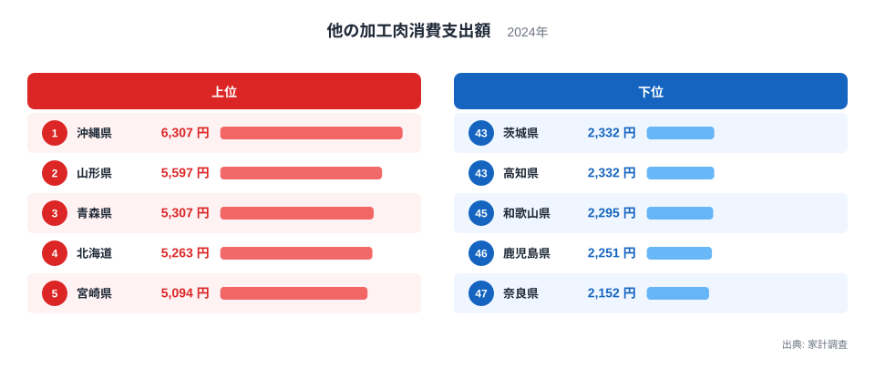
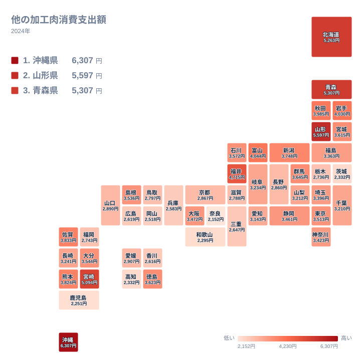

ハムやソーセージは全国どこの食卓にも並びます。一方で、それ以外の加工肉となると、地域によって買われ方に大きな差が出ます。2024年の家計調査では、1世帯あたりの「他の加工肉」への年間支出が、1位の沖縄県で6,307円、最下位の奈良県で2,152円でした。同じ国内で、これだけの開きがあります。

この記事では、都道府県ごとの支出額を並べ、上位と下位にどんな県が集まっているのかを確認します。そのうえで、食文化や産地との結びつきを仮説として考えます。ただし、手元にあるのは支出額の順位だけです。理由まで言い切れる部分は多くありません。

> [!NOTE]
> ここでの「他の加工肉」は、家計調査の品目分類で、ハム・ソーセージ・ベーコンとは別に集計される区分です。品目名が似ていても、ハムやソーセージの支出額とは別の数字です。単位は1世帯あたりの年間支出額(円)で、購入した量ではありません。

## 沖縄県が1位、山形県と青森県が続く

まず、上位5県と下位5県を並べた図を見てください。

<source-link href="/ranking/other-processed-meat-consumption-expenditure">他の加工肉への支出ランキングをもっと見る</source-link>

1位は沖縄県の6,307円です。2位は山形県の5,597円で、1位との間には710円の差があります。3位は青森県の5,307円、4位は北海道の5,263円、5位は宮崎県の5,094円と続き、5,000円を超えているのはこの5県です。6位の福井県は4,715円、7位の富山県は4,044円で、6位と7位の間は671円あります。上位の中では、1位と2位の間、6位と7位の間に比較的大きな差があります。

下位に目を向けると、47位が奈良県の2,152円、46位が鹿児島県の2,251円、45位が和歌山県の2,295円です。43位の茨城県と44位の高知県は、どちらも2,332円で並んでいます。1位の沖縄県と47位の奈良県を比べると、6,307円と2,152円で、約3倍という大きな開きがあります。

上位5県を地方で見ると、北海道・東北に山形県、青森県、北海道の3県が入り、残る2県は九州・沖縄の沖縄県と宮崎県です。北海道・東北が上位に目立つ点は、この指標の特徴のひとつです。

## 沖縄県はなぜ突出するのか

沖縄県の6,307円は、2位の山形県の5,597円を上回っています。背景として考えやすいのは、沖縄の食卓に根づいた豚肉文化と、缶詰や加工肉を日常的に使う食習慣です。ランチョンミートのような保存性の高い加工肉が、炒め物や弁当の具材として家庭に定着しているという見方があります。こうした食材が「他の加工肉」の区分に含まれていれば、支出額を押し上げている可能性があります。

ただし、区分の内訳までは今回の実データでは確認できません。ここで言えるのは、沖縄県が全国で最も支出が多いという事実と、食文化が関係していそうだという推測までです。詳しくは[沖縄県のデータ](/areas/47000)で、ほかの食料品目の支出も見比べてください。

> [!WARNING]
> 「他の加工肉」の金額が高いからといって、ハムやソーセージもよく買われているとは限りません。区分が別なので、この数字だけでは加工肉全体の支出は分かりません。逆に、この区分が低い県でも、ハムやベーコンの支出が多い場合があります。加工肉の好みの違いを、この一つの数字で断定しないでください。

## 東北・北海道に厚い層があるのか

次に、地理的な分布を図で見ます。

分布を眺めると、北海道・東北の県が上位に目立ちます。2位の山形県が5,597円、3位の青森県が5,307円、4位の北海道が5,263円です。さらに、岩手県が8位で4,030円、秋田県が9位で3,985円、宮城県が15位で3,615円と続きます。一方、福島県は24位の3,363円で、中位にとどまっています。

寒冷な地域では保存のきく肉加工品が冬の食卓を支えてきた、という見方もあります。北海道や東北に畜産や食肉加工の拠点が多く、地元の加工肉を買う習慣が根づきやすいという説明も考えられます。ただし、この指標だけではどちらも確認できません。宮城県が15位、福島県が24位と、同じ東北でも順位に開きがあり、仮説が地方全体に当てはまるとは言えません。[山形県のデータ](/areas/06000)もあわせて確認すると、食料品全体の中での位置づけが見えてきます。

九州・沖縄でも県ごとの差は大きく出ています。宮崎県は5位で5,094円ですが、鹿児島県は46位の2,251円、福岡県は36位の2,743円です。地方単位のイメージだけで語ると、実態を見誤ります。

## 関東・近畿・中国・四国はどう見えるか

関東では、群馬県が13位で3,645円、東京都が19位で3,513円、神奈川県が22位で3,423円、埼玉県が23位で3,396円、千葉県が28位で3,210円です。栃木県は37位の2,736円、茨城県は43位の2,332円と、同じ関東でも差があります。

近畿では、大阪府が20位で3,472円ですが、京都府は32位の2,867円、滋賀県は35位の2,788円、兵庫県は41位の2,583円です。和歌山県は45位の2,295円、奈良県は47位の2,152円です。近畿7県のうち3県が41位以下に入っており、沖縄県と最下位の奈良県の間には、約3倍の開きがあります。この差の理由は、データからは分かりません。仮説としては、沖縄県のような保存性の高い加工肉を使う習慣が奈良県では弱く、別の食材が日常的に選ばれている、といった可能性があります。ただし、これは推測にとどまります。

中国・四国には上位に入る県がありません。徳島県の14位で3,623円が最高で、島根県は18位の3,536円です。広島県は39位の2,619円、香川県は40位の2,616円、岡山県は42位の2,518円と、下位寄りの県が並びます。

> [!TIP]
> 「他の加工肉」の順位を見るときは、ハム・ソーセージ・ベーコンの順位と混同しないことが大切です。同じ県でも、区分が違えば順位は大きく変わりえます。この記事の数字は、あくまで「ハムなどの主要品目に入らない加工肉」の支出順位として読んでください。

## ほかの加工肉との対比と、中部の見え方

「他の加工肉」の支出が多いことは、肉をたくさん食べていることを意味するとは限りません。ハム・ソーセージ・ベーコンや生鮮肉の実データは今回ありません。そのため、それらとの関係は、この記事では比べられません。

中部では、福井県が6位で4,715円、富山県が7位で4,044円と、10位以内に2県が入っています。新潟県は12位の3,748円、石川県は16位の3,572円です。一方、愛知県は29位の3,143円、長野県は33位の2,860円で、中部にひとまとめの傾向があるわけではありません。

## 結論

最も支出が多いのは沖縄県の6,307円、最も少ないのは奈良県の2,152円で、約3倍の差がありました。上位には沖縄県、山形県、青森県、北海道、宮崎県が並び、食文化や産地との関わりを想像させます。ただし、同じ地方の中でも順位は大きく割れており、背景は仮説にとどまります。ほかの食料品目も比べたいときは、[同じカテゴリの統計一覧](/category/economy)から探してみてください。

## データについて

この記事で使った数値は、家計調査(2024年)の「他の加工肉消費支出額」です。単位は円で、1世帯あたりの年間支出額を表します。順位は、この支出額が大きい順に付けています。同額の県は同じ金額で並び、掲載順は実データの並びに従っています。
