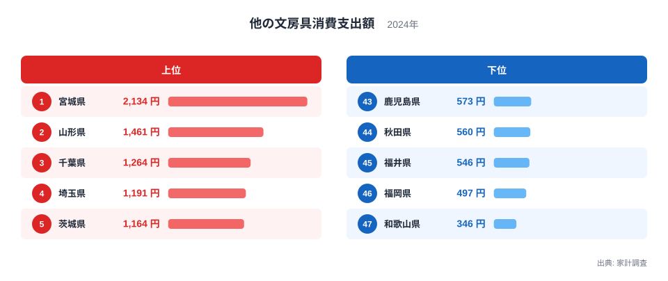
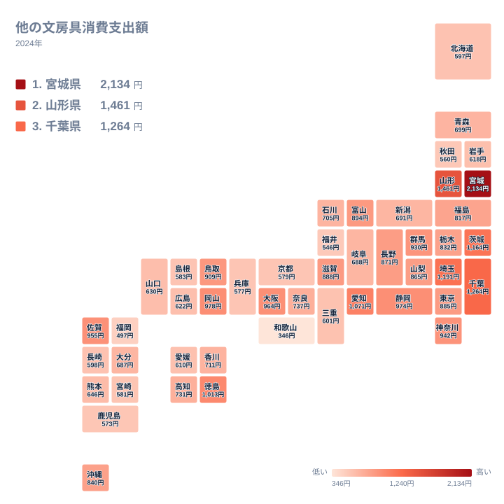

## 他の文房具への支出で首位に立つのは宮城県

ノートやペンといった定番の品を除いた文房具に、家庭はどれほどお金を使っているのでしょうか。2024年の家計調査で、この「他の文房具」への支出が最も多かったのは宮城県でした。金額は2,134円で、全国47位まで並べても頭ひとつ抜けた1位です。

2位は山形県の1,461円でした。3位の千葉県は1,264円、4位の埼玉県は1,191円、5位の茨城県は1,164円と続きます。首位と2位の間にも差があり、東北の隣り合う2県が上位に並んでいるのが目を引きます。

一方、最下位の47位は和歌山県で346円でした。46位の福岡県は497円で、下位は500円を切る水準です。首位の宮城県と最下位の和歌山県では、同じ家計調査の指標でここまで違いが出ています。

この記事では、順位表をたどるだけでなく、地方ごとの並び方や、この品目の性格が数字にどう影響しうるかを整理します。県庁所在地ごとの少数サンプルをもとにした統計なので、読み方のコツも合わせて紹介します。

> [!NOTE]
> ここでいう「他の文房具」は、家計調査の品目分類で、ノートや筆記具など個別に立てられた品目に入らない文房具類をまとめた区分です。細かな中身は品目の定義に依存するため、「文房具全体の支出」ではありません。

## ランキングで見る上位と下位

まず、上位と下位の顔ぶれを図で確認します。

<source-link href="/ranking/other-stationery-consumption-expenditure">他の文房具への支出ランキングをもっと見る</source-link>

図を見ると、上位は宮城県、山形県、千葉県、埼玉県、茨城県の順です。東北が2県、関東が3県という構成になっています。大都市圏の中心である東京都は885円で17位、大阪府は964円で10位にとどまり、必ずしも人口の多い都府県が上位に来るわけではありません。

下位側は、和歌山県の346円を最下位に、福岡県の497円、福井県の546円、秋田県の560円、鹿児島県の573円と続きます。顔ぶれは近畿、九州・沖縄、中部、北海道・東北に分かれており、特定の地方だけが低いという単純な形にはなっていません。

上位5県の金額は1,164円から2,134円の範囲で、下位5県は346円から573円の範囲です。両者の間には大きな空白があり、中位の県が数百円刻みで密集していることがわかります。上位の数県が全体の幅を押し広げている構造です。

> [!WARNING]
> 家計調査は、都道府県庁所在地と政令指定都市を中心とした限られた世帯を対象にしています。そのため、県全体の実態というより、調査対象の都市の傾向が強く出ます。少額品目ほど、数世帯の買い物が順位を動かす点に注意が必要です。

## 地理分布で見る東北と関東の厚み

次に、全国の分布を地図で見ます。

地図で色の濃い部分を探すと、東北の宮城県と山形県、関東の千葉県、埼玉県、茨城県が目立ちます。関東では神奈川県が942円で12位、群馬県が930円で13位、東京都が885円で17位、栃木県が832円で21位です。関東の7都県はすべて20位台前半までに収まっており、地方としてのまとまりが比較的はっきりしています。

東北は県ごとの差が大きい地方です。宮城県が1位、山形県が2位である一方、福島県は817円で22位、青森県は699円で27位、岩手県は618円で34位、秋田県は560円で44位です。北海道も597円で38位でした。同じ地方でも、上位と下位が混在しています。

中部では愛知県が1,071円で6位、静岡県が974円で9位、富山県が894円で15位と上位寄りの県がある一方、福井県は546円で45位です。近畿では大阪府の10位、滋賀県の16位に対し、京都府は579円で41位、兵庫県は577円で42位、和歌山県は47位と、低めの県が並びます。

中国・四国では、徳島県が1,013円で7位、岡山県が978円で8位、鳥取県が909円で14位と、中位から上位に入る県があります。九州・沖縄では佐賀県が955円で11位、沖縄県が840円で20位ですが、福岡県は46位です。地域差は一方向ではなく、県ごとのばらつきが大きいと言えます。

> [!TIP]
> 地図を読むときは、隣り合う県の色が大きく違う場所に注目してください。たとえば福岡県と佐賀県のように、近い県でも順位が離れる場合があります。地域性だけでなく、調査都市の買い物環境や世帯構成の影響を疑う手がかりになります。

## 食文化や気候では説明しにくい品目だからこそ

この統計は、食品や衣料のように気候や産地で説明しやすい品目とは性格が違います。米や魚介類であれば、地元の産地や食文化が消費差に直結します。文房具の場合は、そうした地域固有の結びつきが弱く、むしろ学校や職場、家庭での用途に左右されると考えられます。

その点で、この指標は「地域の風土」よりも「暮らし方」の差を映すものです。通学する子どもがいる世帯の割合、事務作業を自宅で行う頻度、趣味の工作や手帳づくりなどの習慣が、支出額に関わっている可能性があります。ただし、これらを裏づける数値は今回の実データに含まれていないため、あくまで読み解きの視点としてお考えください。

関連品目との対比も意識したいところです。ノートや筆記具のような定番品は、購入頻度が高く、世帯間の差が小さくなりやすい品目です。一方、「他の文房具」は、テープ、のり、ファイル、事務用品など多様な品が含まれ、買う年と買わない年の差が出やすいと考えられます。このため、県ごとの金額が大きく動きやすく、順位の入れ替わりも起こりやすい指標です。

宮城県が2,134円と突出している点も、こうした性格を踏まえて見る必要があります。仙台市という大きな都市を調査対象としていることに加え、少数の世帯でまとまった購入があれば平均が押し上げられます。山形県の1,461円も同様の可能性があり、東北が強いと断定するより、2024年の調査では両県が大きく出たと受け止めるのが安全です。

反対に、和歌山県の346円は、全国で唯一400円を下回る水準です。ただし、これも低い支出が常態化していると決めつけられるわけではなく、年によって変わりうる値だと考えられます。

## 順位の読み方と各県のデータへの入口

数字を使うときの基本は、1年分の順位を絶対視しないことです。中位の県は金額がかなり接近しています。たとえば、20位の沖縄県が840円、21位の栃木県が832円、22位の福島県が817円と、1桁から十数円の差で順位が入れ替わります。この範囲では、順位の違いに大きな意味を持たせるべきではありません。

一方で、首位の宮城県と最下位の和歌山県のように、桁違いに近い差がある比較は、調査の揺れを考慮しても無視できません。実データにある最大と最小を並べるだけでも、地域の消費行動に差があることは読み取れます。

さらに詳しく見たい場合は、[宮城県のデータ](/areas/04000)や[山形県のデータ](/areas/06000)で、ほかの指標と並べて確認できます。文房具への支出が、教育費や通信費など近い分野とどう並ぶのかを見ると、数字の背景を考える手がかりが増えます。幅広い統計を探すときは、[同じカテゴリの統計一覧](/category/economy)も便利です。

上位に入った関東の千葉県、埼玉県、茨城県は、それぞれ1,264円、1,191円、1,164円で3位から5位に並びます。近い金額が連続しているため、隣接県での生活圏や買い物行動の共通性が、数字にも反映されているのかもしれません。ただし、これも推測の域を出ないため、他の年の動きと合わせて確認する姿勢が大切です。

## データについて

この記事で使った値は、家計調査の「他の文房具消費支出額」(2024年、単位は円)です。1世帯あたりの年間支出額を都道府県別に並べたもので、47都道府県すべてが対象です。

家計調査は標本調査であり、金額が小さい品目は誤差の影響を受けやすい特徴があります。そのため、順位が近い県同士の優劣を断定せず、全体の傾向と、上位・下位の大きな差に注目することをおすすめします。

## まとめ

2024年の他の文房具への支出は、宮城県が2,134円で1位、山形県が1,461円で2位、千葉県が1,264円で3位でした。最下位は和歌山県の346円で、福岡県の497円、福井県の546円が続きます。

地方で見ると、関東は全県が20位台前半までに入る一方、東北は宮城県と山形県が上位、秋田県が44位と開きがあります。近畿や九州・沖縄にも上位と下位が混在し、単純な東高西低のような図式では整理できません。

数字を読むときは、調査都市の少数サンプルという限界を意識しつつ、上位と下位の大きな差に注目してください。身近な文房具の支出にも、県ごとの暮らし方の違いがうっすらと表れています。
