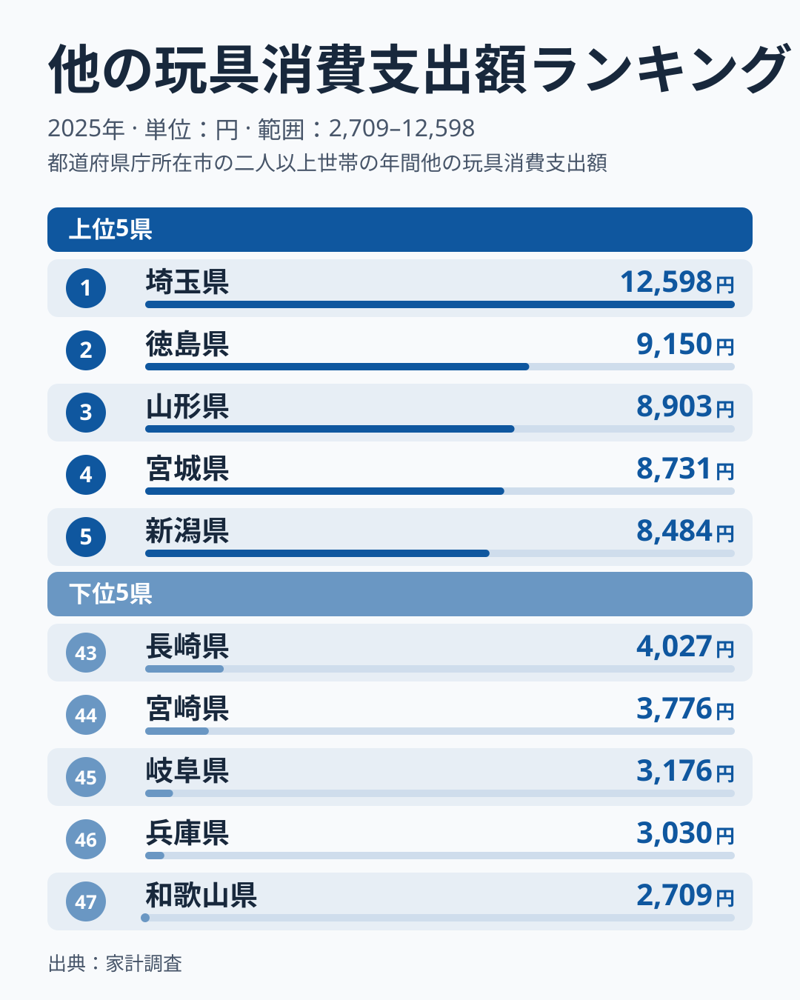
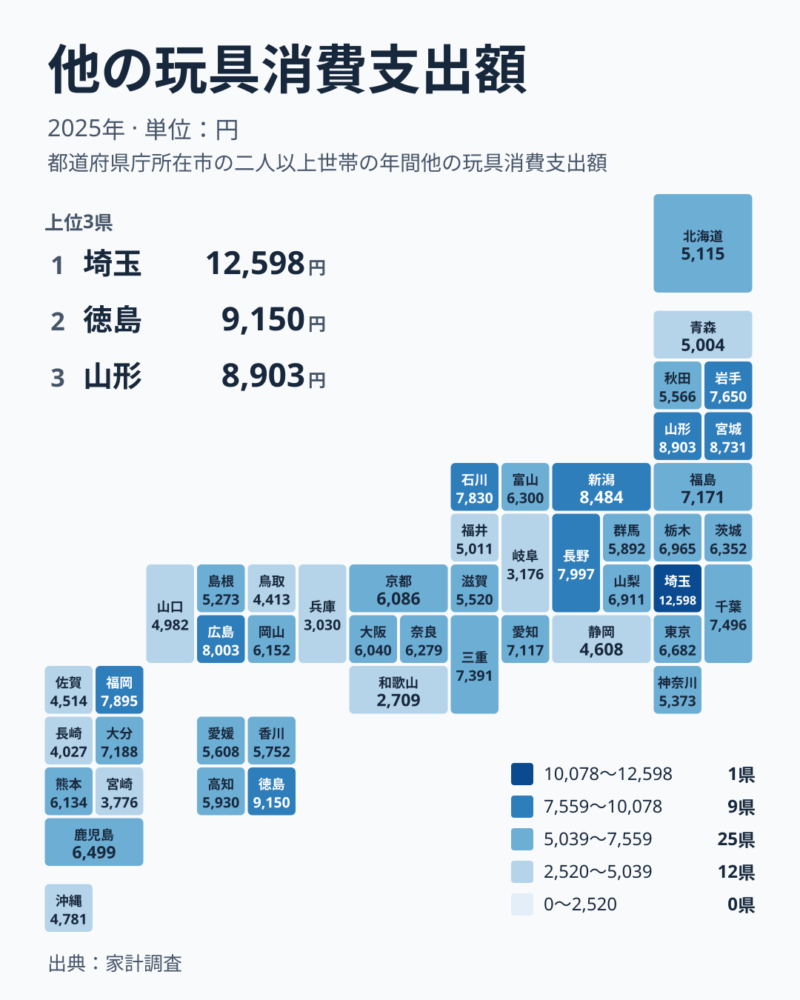

ゲーム機やぬいぐるみのような主役級ではなく、その周辺にある「他の玩具」。家計のなかでは目立たない支出ですが、都道府県で並べると、顔ぶれは意外なほどばらけます。2025年の家計調査では、1位の埼玉県が12,598円、47位の和歌山県が2,709円でした。

この記事では、まず上位と下位の顔ぶれを確かめます。次に地方ごとに切り分けて、差が「地域の色」なのか「県ごとのばらつき」なのかを探ります。そのうえで、数字を暮らしの目線でどう読めばよいかを整理します。

## 上位と下位の顔ぶれ

<source-link href="/ranking/other-toys-consumption-expenditure">他の玩具への支出ランキングをもっと見る</source-link>

上位は、埼玉県、徳島県、山形県、宮城県、新潟県の順です。埼玉県は12,598円で、2位の徳島県の9,150円を大きく引き離しています。3位の山形県は8,903円、4位の宮城県は8,731円、5位の新潟県は8,484円で、2位から5位までは互いに近い水準で並んでいます。突出しているのは埼玉県ひとつで、その後ろは団子状態だと読めます。

下位は、43位の長崎県が4,027円、44位の宮崎県が3,776円、45位の岐阜県が3,176円、46位の兵庫県が3,030円、47位の和歌山県が2,709円です。最下位の和歌山県の2,709円は、埼玉県の12,598円のごく一部にすぎません。最大と最小の間には、家計の小さな項目とは思えないほどの隔たりがあります。

ここで目を引くのは、上位にも下位にも、特定の地方がまとまっていないことです。上位の埼玉県は関東、徳島県は四国、山形県と宮城県は北海道・東北、新潟県は中部です。下位では、長崎県と宮崎県が九州・沖縄、岐阜県が中部、兵庫県と和歌山県が近畿に分かれます。地方の名前だけでは、上位も下位も言い当てられません。

> [!NOTE]
> 「他の玩具」は、玩具のうち個別の品目として分類されないものをまとめた区分です。ゲーム機などの品目とは別枠で集計されています。金額は年間の支出額で、単位は円です。また、本記事の地方区分では三重県を近畿に含めています。

## 地方ごとに切り分けてみる

地図で色の濃淡を追うと、濃い県と薄い県が地方をまたいで入り混じっています。各地方の県の順位を並べてみます。

- 北海道・東北は、山形県が3位、宮城県が4位、岩手県が10位、福島県が14位です。一方で秋田県は31位、北海道は35位、青森県は37位です。
- 関東は、埼玉県が1位、千葉県が11位、栃木県が16位、東京都が18位、茨城県が20位、群馬県が28位、神奈川県が33位です。
- 中部は、新潟県が5位、長野県が7位、石川県が9位、愛知県が15位、山梨県が17位、富山県が21位、福井県が36位、静岡県が40位、岐阜県が45位です。
- 近畿は、三重県が12位、奈良県が22位、京都府が25位、大阪府が26位、滋賀県が32位、兵庫県が46位、和歌山県が47位です。
- 中国は、広島県が6位、岡山県が23位、島根県が34位、山口県が38位、鳥取県が42位です。
- 四国は、徳島県が2位、高知県が27位、香川県が29位、愛媛県が30位です。
- 九州・沖縄は、福岡県が8位、大分県が13位、鹿児島県が19位、熊本県が24位、沖縄県が39位、佐賀県が41位、長崎県が43位、宮崎県が44位です。

この並びから分かることは三つあります。ひとつ目は、地方の内側の幅が大きいことです。中部は5位の新潟県から45位の岐阜県まで、関東は1位の埼玉県から33位の神奈川県まで広がっています。「関東は高い」「九州は低い」といった地方単位の言い方は、このデータにはあてはまりません。

ふたつ目は、近畿の特異さです。10位以内に入る県がなく、最も高い三重県でも12位です。そのうえ最下位の和歌山県と46位の兵庫県を抱えており、地方全体として上位が薄い形になっています。ただし、三重県を近畿に含めない区分で見れば、この印象は変わります。地方のくくり方に左右される読みであることには注意が必要です。

みっつ目は、大都市を抱える都府県が上位に並ばないことです。愛知県は15位、東京都は18位、大阪府は26位、神奈川県は33位です。人口が多いから支出も多い、という単純な図式にはなっていません。ただし、人口や世帯構成のデータは今回扱っていないため、理由までは分かりません。

> [!WARNING]
> 家計調査は標本調査で、都道府県ごとの調査世帯は限られています。他の玩具は金額が小さく、買う時期も不規則なので、少数の世帯の大きな買い物が県の数字を動かすことがあります。順位がひとつふたつ違う程度の差は、実際の差とは言い切れません。

## 数字を暮らしに引き寄せて読む

他の玩具の支出は、毎月決まって出ていく費用ではありません。誕生日やクリスマス、入学や帰省といった節目に、まとまって発生しやすい買い物です。そのため県の数字は、その地域の人の好みというより、節目の買い物が年間の家計簿にどれだけ記録されたかの違いを映している可能性があります。

目安として、47県の真ん中にあたる24位は熊本県の6,134円です。20位の茨城県は6,352円、25位の京都府は6,086円で、中位では値がぎっしり詰まっています。上位と下位は大きく離れていても、中位の県同士では順位の違いがほとんど意味を持たないかもしれません。自分の県が中位にあるなら、「平均的な水準」と受け止めておくのが無難です。

自分の家計と比べるときは、1回の買い物ではなく年間の合計で見てください。子どもの人数や年齢、贈り物の頻度によって、家庭ごとの支出は大きく変わります。県の数字より少なくても、使い方が控えめだとは限りません。逆に多くても、節目の買い物が重なっただけかもしれません。県の数字は、あくまで一つの物差しとして使うのが安全です。

また、徳島県のように、同じ四国のなかでも他の県と順位が大きく離れる例があります。生活圏が近くても支出の水準がそろうとは限らないため、地方でひとくくりにせず、県ごとに見る必要があります。

> [!TIP]
> この指標は、順位そのものより「上位・中位・下位のどこにいるか」で読むのが安全です。さらに、隣の県との差より、47県の真ん中にあたる24位の6,134円との位置関係を見ると、極端な年の揺れに惑わされにくくなります。

## 考えられる読み方

今回の実データは支出額だけで、世帯構成や年齢構成、購入場所は含まれていません。そのため、差の原因は断定できません。以下は、あくまで読み方の候補です。

- 子どものいる世帯の多さが関わっているかもしれません。玩具の支出は子育て世帯で増えやすいと想像できますが、世帯構成のデータがないため、埼玉県の1位をこれで説明することはできません。
- 贈り物の習慣が関わっているかもしれません。祖父母から孫への贈り物が多い地域では支出が膨らむ可能性がありますが、徳島県や山形県でそうなっているかどうかは、このデータからは確かめられません。
- 購入の場所や手段が関わっているかもしれません。店舗での購入とネット通販とで、家計簿への記録のされ方が変わる可能性があります。
- 標本の揺れが関わっているかもしれません。特に1位の埼玉県のように突出した値は、少数の世帯の影響を受けていることも考えられます。

県ごとの背景を詳しく知りたい場合は、[埼玉県のデータ](/areas/11000)や[徳島県のデータ](/areas/36000)で、ほかの指標と見比べてみてください。家計に関わる別の統計は、[同じカテゴリの統計一覧](/category/economy)から探せます。単年の値だけでは継続的な傾向までは言えないため、複数の指標を重ねて考えることが、読み違いを避ける近道です。

## データについて

この記事で使った統計は、家計調査の「他の玩具消費支出額」です。2025年の値で、単位は円、年間の支出額を表します。47都道府県すべてが対象です。家計調査の都道府県別の値は、都道府県庁所在市などを単位とした集計が基になる場合があり、県全体の平均とは必ずしも一致しません。記事中の値と順位は、すべて元データに記載されたものをそのまま使っています。
