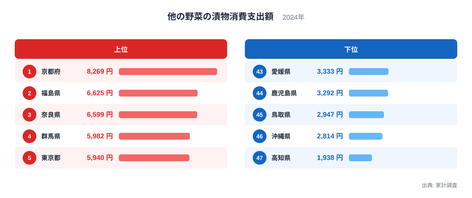
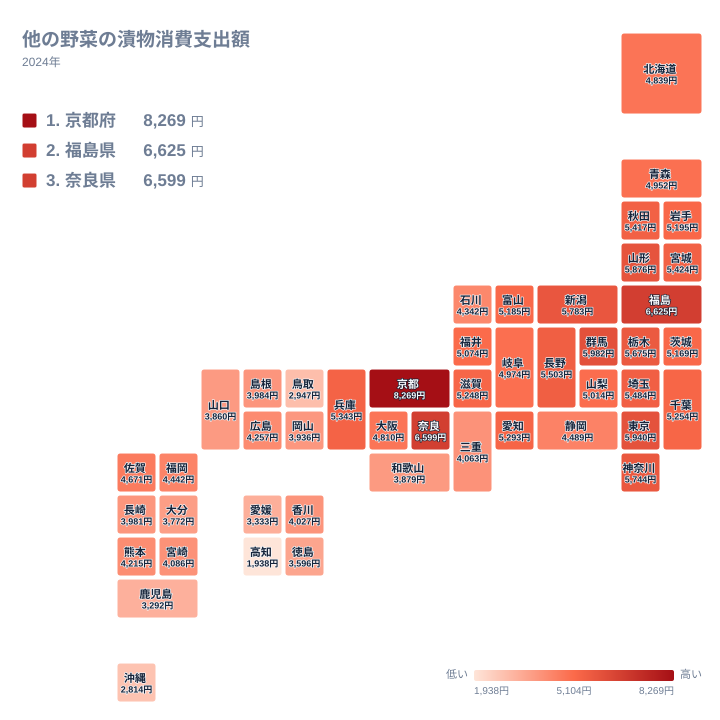

食卓の小さな一品である漬物ですが、1年間に使う金額を都道府県ごとに並べると、思いのほか大きな開きが見えてきます。この記事で取り上げるのは、「他の野菜の漬物」への支出です。2024年の家計調査をもとに、どこで多く、どこで少ないのかを確かめます。食文化や気候、産地との結びつきも考えますが、データから確かめられることと仮説は分けて書きます。

## 京都府は高知県の4倍を超える

先に答えを書きます。2024年の支出額が最も多いのは京都府で8,269円、最も少ないのは高知県で1,938円です。1位の金額は47位の4倍を超えており、同じ品目でも住む県によってこれだけ違います。

> [!NOTE]
> ここでいう支出額は、家計調査で世帯が1年間に「他の野菜の漬物」へ支払った金額です。個人の消費量や県民全体の消費量ではなく、世帯あたりの購入金額です。この区分にどの漬物が含まれるのかは、今回のデータからは確認できていません。品目名から中身を決めつけず、区分の名前のまま読む必要があります。

次の図は、上位5府県と下位5県を並べたものです。

<source-link href="/ranking/other-vegetable-pickles-consumption-expenditure">他の野菜の漬物への支出ランキングをもっと見る</source-link>

図で目を引くのは、1位の京都府だけが8,269円と飛び抜けていることです。2位の福島県は6,625円、3位の奈良県は6,599円、4位の群馬県は5,982円、5位の東京都は5,940円です。2位から5位は5,940円から6,625円のあいだに収まっており、1位との間にはそれより大きな段差があります。

下位側にも似た形が表れています。43位の愛媛県は3,333円、44位の鹿児島県は3,292円、45位の鳥取県は2,947円と、このあたりまでは緩やかに下がります。ところが46位の沖縄県は2,814円、47位の高知県は1,938円と、最下位で急に落ち込みます。上位も下位も、端の一県が集団から離れた分布です。

## 京都府の高さをどう読むか

京都府はすぐき漬け、しば漬け、千枚漬けといった漬物で知られる土地です。そのため、漬物文化の厚みが高い支出につながっているのではないかと考えたくなります。ただし、これはあくまで仮説です。京都府の8,269円にどの品が含まれているのかは、この数字からは確かめられません。

3位の奈良県も、奈良漬けで知られる土地です。京都府と奈良県が1位と3位に並んだことは、名産の漬物と日常の購買が何らかの形で結びついている可能性を思わせます。ただ、名産地であることと支出額の高さを因果で結ぶ根拠は、今回のデータにはありません。

見方を変えれば、京都府と奈良県が上位に並ぶという事実だけが、確かなことです。理由まで知りたい場合は、品目別の内訳や購入場所など、別の統計に当たる必要があります。京都府の他の統計は[京都府のデータ](/areas/26000)で確認できます。

> [!WARNING]
> 家計調査は標本調査で、都道府県別の値には標本の偏りによる振れが含まれます。1年分の数字だけで食文化の優劣は決められません。また、順位が近い県同士の差は小さな違いにすぎない可能性があり、順位の一つ二つの違いを大きな意味のある差と読むのは避けるべきです。

## 上位に入った県の顔ぶれを地方別に見る

地方ごとの傾向を読むときは、上位10位に入った県に限って整理するのが安全です。上位10県は、京都府、福島県、奈良県、群馬県、東京都、山形県、新潟県、神奈川県、栃木県、長野県です。

地方別に数えると、関東が群馬県、東京都、神奈川県、栃木県の4県で最も多くなります。近畿は京都府と奈良県、北海道・東北は福島県と山形県、中部は新潟県と長野県が、それぞれ2県ずつです。上位10県は、この4つの地方に分かれて入っています。

次の図は、47都道府県の分布をタイルマップにしたものです。

地図では、関東や東北の県に色の濃いところが目立ち、四国や九州・沖縄では色の薄い県が目立ちます。ただし、同じ地方の中でも差は小さくありません。たとえば近畿では、京都府が1位、奈良県が3位である一方、和歌山県は39位です。北海道・東北でも、福島県は2位、山形県は6位ですが、岩手県は18位、青森県は24位、北海道は25位です。

地図は「どのあたりが多いか」をつかむための図で、県ごとの違いは数値で確かめる必要があります。上位に入った県の共通点を探すことはできても、地方の名前で一括りにはできません。福島県の詳細は[福島県のデータ](/areas/07000)にまとめています。

背景の仮説として、寒い地域で冬の保存食として野菜を漬ける習慣が続いてきたことが考えられます。ただし、これは裏付けのある結論ではありません。同じ北海道・東北でも順位が大きく分かれていることを考えると、気候だけで説明できるとは言えません。

## 下位に並ぶ県と、読み取れること

下位7位、つまり41位から47位に絞ると、四国の3県、九州・沖縄の3県、中国の鳥取県が入ります。四国は、徳島県が42位の3,596円、愛媛県が43位の3,333円、高知県が47位です。九州・沖縄は、大分県が41位の3,772円、鹿児島県が44位、沖縄県が46位です。中国で下位7位に入るのは、45位の鳥取県だけです。

中国地方の5県を見ると、広島県は31位、島根県は36位、岡山県は38位、山口県は40位、鳥取県は45位です。41位より上の県が多いとはいえ、5県はいずれも中位から下位にあり、上位に入る県はありません。この地方は、全体として支出額が高くない傾向にあります。

温暖な地域で冬の保存食としての漬物の必要性が小さい、という仮説を立てることはできます。しかし例外もあります。静岡県は28位の4,489円、兵庫県は14位の5,343円で、中位から中位の上寄りです。高知県の1,938円が突出して低い理由については、この数字だけでは判断できません。

> [!TIP]
> 順位が低い県を「漬物を食べない県」と読むのは早計です。この指標は、あくまで「他の野菜の漬物」という一つの区分への支出額です。区分の中身が確認できていない以上、他の区分での漬物の購入まで含めた県民の漬物消費の多寡は、この数字だけでは分かりません。

同じカテゴリの他の統計は[同じカテゴリの統計一覧](/category/economy)で見られます。

## 大都市圏と、漬物のイメージがある県の中位

中位に目を向けると、大都市圏の県も入ります。兵庫県は14位の5,343円、愛知県は15位の5,293円、千葉県は16位の5,254円です。一方で、大阪府は26位の4,810円、福岡県は29位の4,442円です。東京都が5位に入る一方で、大阪府は中位にとどまっています。

大都市では、百貨店やスーパーに全国各地の漬物が並ぶため、地元の伝統だけでは決まらない消費があるかもしれません。ただしこれは推測で、東京都と大阪府で順位が分かれる理由は、この数字からは断定できません。

漬物のイメージがある県でも、必ずしも上位に入るとは限りません。石川県は30位の4,342円、富山県は19位の5,185円です。食文化の印象と、この区分の支出額は一致しない場合があります。印象と数字が食い違うときは、数字が測っているのは何かに立ち返ることが大切です。

## データについて

この記事で使う「他の野菜の漬物消費支出額」は、家計調査(2024年)の品目別支出を、都道府県ごとに円単位で示したものです。順位は金額の大きい順に付けています。家計調査は標本調査のため、順位が近い県同士の差は小さな違いとして受け止めるのが妥当です。区分に含まれる漬物の具体的な範囲は、今回は確認していません。

## まとめ

2024年の「他の野菜の漬物」への支出は、京都府の8,269円が1位、高知県の1,938円が47位で、1位は47位の4倍を超えていました。上位には福島県、奈良県、群馬県、東京都が並び、下位には高知県、沖縄県、鳥取県、鹿児島県、愛媛県が並びます。

上位10県は関東、近畿、北海道・東北、中部に分かれて入っており、下位7県は四国、九州・沖縄、中国の鳥取県が占めます。冬の保存食の歴史や名物漬物の存在は有力な仮説ですが、同じ地方内の順位差や、静岡県、兵庫県のような例外を見ると、単純な説明では収まりません。

最後に、この数字は漬物全体ではなく、一つの区分への世帯あたり支出額である点を忘れないでください。自分の暮らす県の順位を確かめたうえで、身近な漬物の買い方と照らして読むと、数字がより身近に感じられるはずです。
