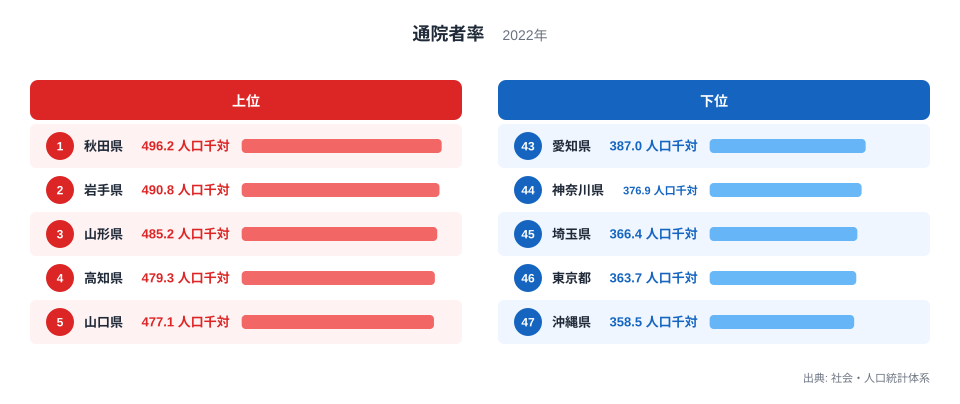
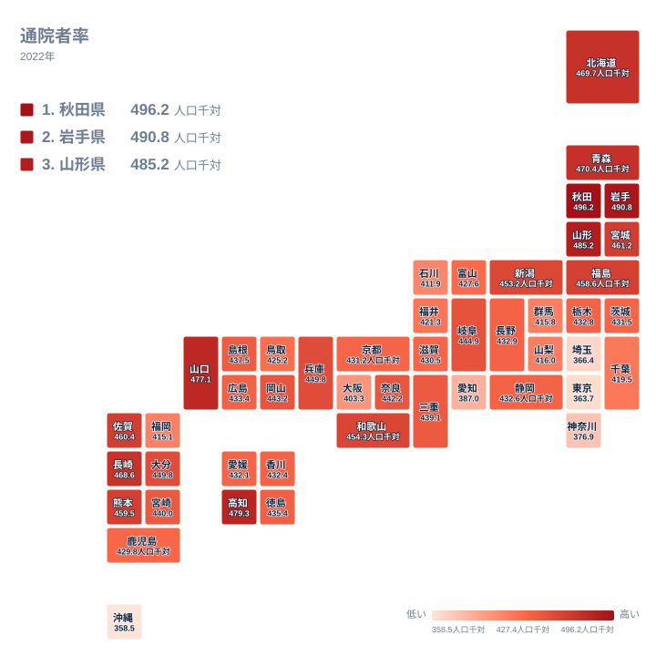

## 通院者率が最も高い県は秋田県、最も低い県は沖縄県

病院や診療所に通っている人の割合は、どの県でも同じようなものなのでしょうか。2022年の統計を見ると、人口千人あたりの通院者数には県ごとにはっきりした開きがあります。

最も高いのは秋田県の496.2人口千対で、最も低いのは沖縄県の358.5人口千対です。この二県の比は、実データ上の最大と最小の比として約1.38倍にあたります。同じ日本の中で、千人あたりの通院者が百人以上も違う計算です。

この記事では、上位と下位がどの県で、どのような並び方をしているのかを確かめたうえで、その差をどう読めばよいかを考えます。手元にあるのは都道府県別の値と順位だけです。年齢構成や疾患別の通院データは含まれていないため、背景の説明はすべて「そう考えられる」という仮説にとどまります。その前提で読み進めてください。

> [!NOTE]
> ここでの通院者率は、人口千人あたりで、調査時点に病気やけがで通院している人の数を表します。入院している人は含みません。人口規模の違いは千対で揃えられていますが、年齢構成の違いは調整されていません。また、集計は住んでいる県を単位としているため、通院先の県とは一致しない場合があります。

## 上位五県と下位五県の顔ぶれ

<source-link href="/ranking/outpatient-rate-per-1000">通院者率ランキングをもっと見る</source-link>

図で目を引くのは、1位から5位までの棒が互いにほとんど差のないことです。1位の秋田県は496.2人口千対、2位の岩手県は490.8人口千対、3位の山形県は485.2人口千対、4位の高知県は479.3人口千対、5位の山口県は477.1人口千対です。43位から47位までの下位五県も、愛知県の387人口千対から沖縄県の358.5人口千対の範囲に収まっています。両端のグループの中では差が小さく、グループ同士の間に大きな段差があります。

地方のくくりで見ると、1位から5位は東北が三県、四国が一県、中国が一県です。43位から47位は、43位の愛知県が中部、44位の神奈川県、45位の埼玉県、46位の東京都が関東、47位の沖縄県が九州・沖縄です。上位は地方の県、下位は大都市を含む県が中心という対比が見えます。なお、42位は大阪府の403.3人口千対で、下位五県には含まれません。

この対比の理由として考えられるのは、年齢構成の違いです。高齢の人が多い県ほど、持病で定期的に通院する人も多くなるはずだ、という仮説です。逆に、働き盛りの世代が多い大都市圏では、通院者率が低めに出ているのかもしれません。ただし、本記事のデータには年齢構成が含まれていないため、この仮説を確かめることはできません。

> [!TIP]
> 中位は値が詰まっています。15位の兵庫県と16位の大分県は、どちらも449.8人口千対で同じ値です。25位の長野県432.9から29位の愛媛県432.1までは、五県が1人未満の幅に収まっています。中位では順位が一つ違っても実質的な差はほとんどないので、順位より値の近さで読むのがコツです。

## 東北に高い県が集まる事実

1位の秋田県、2位の岩手県、3位の山形県は、いずれも東北です。さらに6位の青森県は470.4人口千対、9位の宮城県は461.2人口千対、12位の福島県は458.6人口千対で、東北の六県がすべて12位以内に入っています。北海道も7位で469.7人口千対です。

この集中には、気候や産業が関わっている可能性があります。冬の寒さが持病の管理と結びつくのではないか、農業の比重が大きい地域では体を使う仕事の負担が通院につながるのではないか、といった見方です。しかし、疾患別の通院データがない以上、このデータからは確かめられません。

手堅く言えるのは、東北の県が互いに近い順位に並んでいるという事実だけです。隣り合う県が似た水準になるのは、条件が似ているためかもしれませんが、どの条件がどれだけ効いているかは分かりません。

各県の詳しい数値は、[秋田県のデータ](/areas/05000)や[岩手県のデータ](/areas/03000)のページで確認できます。ほかの社会保障関連の指標とあわせて見たい場合は、[同じカテゴリの統計一覧](/category/socialsecurity)が参考になります。

> [!WARNING]
> 通院者率は、世帯への調査にもとづく自己申告の数字です。何を通院と数えるかは回答者の認識に左右され、医療機関の診療記録から集計した受診率とは一致しません。また、この指標だけでは病気の種類も重さも分からないため、「通院者が多い県は健康状態が悪い」と結論づけることはできません。

## 同じ地方でも順位は大きく離れる

タイルマップで全国を眺めると、濃い色は東北から北海道にかけてのまとまりとして現れます。一方、淡い色は関東を中心に、大都市を含む一帯に連なっています。西日本では、濃い色が飛び地のように点在しています。

ここで注目したいのは、同じ地方の中でも順位が大きく離れる例があることです。九州では、長崎県が8位であるのに対し、福岡県は40位です。九州・沖縄には、最下位の沖縄県も含まれています。同じ地方というだけで、通院者率が揃うわけではありません。

この散らばり方からは、「地方だから高い」という単純な説明では足りないことが分かります。県ごとに医療機関の配置や人口の構成が異なり、それが絡み合っている可能性があります。ただし、その中身を解きほぐすには、年齢別の通院者数や医療施設数など、別のデータが必要です。

## 下位の県が低い背景の仮説

最下位の沖縄県は358.5人口千対です。沖縄県は平均年齢が若いことで知られており、若い世代が多ければ通院者の割合は小さくなりやすいはずだ、という見方があります。ただし、これはデータで確かめたものではありません。

低さを「健康だから」と読むのも早計です。医療機関へのかかりやすさや、受診に対する意識の違いが影響している可能性も捨てきれません。年齢構成の効果と医療アクセスの効果は、この数字だけでは切り分けられません。

大都市を含む県では、44位の神奈川県が376.9人口千対、45位の埼玉県が366.4人口千対、46位の東京都が363.7人口千対です。働き盛りの世代が多いことが通院者率を低めにしているという仮説は成り立ちますが、これも年齢構成のデータで裏づけたものではありません。

## 順位の差をどう読むか

秋田県の496.2人口千対と沖縄県の358.5人口千対という開きは、病気の多さの差というより、年齢構成、医療へのかかりやすさ、受診行動といった複数の条件が重なった結果かもしれません。その内訳を、このデータだけで分けることはできません。

読者が持ち帰れる確かな事実は、次の三点です。

- 東北の六県と北海道が、いずれも12位以内に入っています
- 43位から47位は、愛知県、神奈川県、埼玉県、東京都、沖縄県です
- 中位は値が詰まっており、順位の差が小さくなっています

高い県でも低い県でも、数字の意味は一つではありません。通院者が多いことは、医療に通いやすい環境があることを示すのかもしれませんし、持病を抱える人が多いことを示すのかもしれません。数字を入口として、次に調べる指標を選ぶ姿勢が大切です。

## データについて

通院者率は、人口千人あたりの通院者数で表した指標です。出典は社会・人口統計体系で、掲載の値は2022年のものです。単位は人口千対で、この記事の数値はすべて同じ基準の値を使っています。

この指標は、年齢構成を揃えて比較したものではありません。高齢の人が多い県ほど通院者率は高く出やすいと考えられるため、県どうしの差を医療の質や住民の健康度の差としてそのまま解釈しないことが、数字を正しく読むための基本です。年齢構成や医療施設の数など、通院者率と組み合わせて読める指標を併せて確かめると、順位の背景がより立体的に見えてきます。
