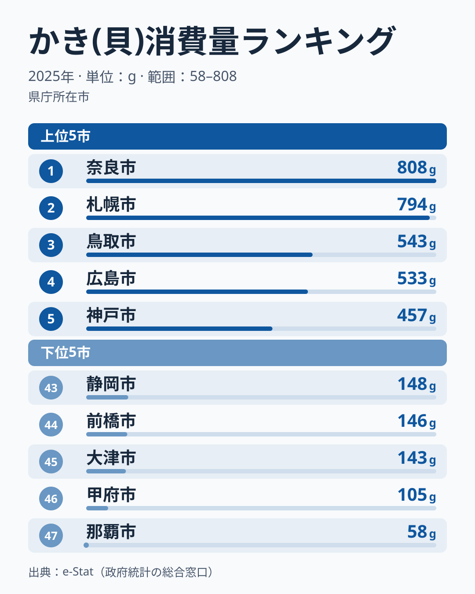

「牡蠣といえば広島」――この連想は、家計調査の長い記録でもおおむね正しいものでした。2007年から2024年までの18年間で、[広島県](/areas/34000)は家庭のかき購入量で14回1位になっています。

ところが2025年の家計調査（都道府県庁所在市・二人以上世帯の年間かき消費量）で1位だったのは、海に面していない奈良県の808gでした。2位は北海道の794g、3位は鳥取県の543gで、広島県は533gで4位です。さらに2024年に940gで2位に入っていた滋賀県は、2025年は143gで45位まで下がりました。

> [!NOTE]
> ここでの「かき消費量」は、各都道府県庁所在市の二人以上世帯が1年間に購入した「かき（貝）」の量（家計調査、単位g）です。本文の県名は、その県の県庁所在市の値を指します。生産量や水揚げ量ではなく、家庭が店で買って食べた量で、外食や贈答での消費は含まれません。

この記事では、2025年の順位を確かめたうえで、19年分のデータから「1年で大きく動く部分」と「何年も変わらない部分」を分けて読んでいきます。過去の年の値と順位は、ランキングページと同じ家計調査の値から数えたもので、同じ値の県は上の順位にそろえています。

## かき消費量の上位5県と下位5県（2025年）

まずは2025年の上位と下位を見てみましょう。

2025年のかき（貝）消費量は、奈良県が808gで1位、北海道が794gで2位、鳥取県が543gで3位、広島県が533gで4位、兵庫県が457gで5位でした。1位と2位がほぼ並び、3位以下とは250g近い開きがあります。

奈良県は2024年も900gで3位に入っていました。2023年は7位、2012年と2014年は5位で、上位の常連とまでは言えないものの、ときどき上位に顔を出す県です。2位の北海道は2020年と2022年にも2位に入っています。

下位は、沖縄県が58gで47位、山梨県が105gで46位、滋賀県が143gで45位、群馬県が146gで44位、静岡県が148gで43位でした。1位の奈良県と47位の沖縄県の差は約14倍です。

<source-link href="/ranking/oyster-consumption-quantity">かき(貝)消費量ランキングの全47都道府県を見る</source-link>

## 1年で大きく動く順位

この指標では、1年で順位が大きく入れ替わる県が少なくありません。最も極端なのは滋賀県です。2024年は2位でしたが、それ以前の17年間は5位から41位の間を行き来しており、2025年は45位でした。2024年の2位は、滋賀県の位置としては例外的な1年だったことになります。

前の年と次の年の順位がどれだけそろうかを順位相関係数（1なら全く同じ順位、0なら無関係）で見ると、2024年と2025年の間は0.57でした。2008年以降の隣り合う年どうしでは0.40から0.73の間です。順位がまったくでたらめに動いているわけではありませんが、2024年から2025年にかけては14県が10位以上動きました。

> [!WARNING]
> 家計調査は標本調査のため、購入する世帯が限られる品目では年ごとの振れ幅が大きく出ます。2024年の福岡県の0gは、その年の標本に購入世帯がほぼ含まれなかった結果と読むべきです。単年の順位は「1年分の写真」として扱い、何年も同じ位置にいるかを確かめてから地域の特徴と読むのが安全です。

[仮説] 牡蠣のように購入世帯が限られる品目では、標本の振れに、その年の価格や天候が重なって、順位が大きく動くのかもしれません。家計調査の値だけでは、これらの要因を分けることはできません。

## 何年も変わらない部分

一方で、19年分を並べると変わらない部分もはっきり見えます。

広島県は、1位でなかった年も含めて19年のうち18年で5位以内に入っています。5位より下だったのは2022年の11位だけです。2025年の4位も、この記録の中では上位にとどまった年と読めます。5位以内に入った回数は、広島県に続いて[岡山県](/areas/33000)が13回で、瀬戸内の2県が上位の常連です。

下位の側で最も安定しているのは[沖縄県](/areas/47000)です。19年のうち12年で47位になり、43位以下に入った回数は17回にのぼります。宮崎県・鹿児島県・青森県も、少ないほうから5県の中に12回ずつ入っています。下位の常連は沖縄県と南九州、北東北の県です。2025年の宮崎県は280gで中ほどにおり、下位の常連の県でも年によっては順位を上げます。

全体の水準は下がっています。47市の単純平均は2007年の528gから2025年の294gへ、19年で約44%減りました。1位の県の値も、2007年の広島県の1,548gから、2025年の奈良県の808gまで小さくなっています。

> [!TIP]
> 2025年に広島県が首位を譲ったのは、他県が増えたからではなく、広島県自身の値が959gから533gへ約44%減ったためです。同じ期間に奈良県は900gから808gへ約10%減、47市の平均は307gから294gへ約4%減にとどまりました。1位と2位の奈良県と北海道の差は14gしかなく、この差は標本の振れの範囲に収まりうる大きさです。

## まとめ

- 2025年のかき（貝）消費量は、奈良県が808gで1位、北海道が794gで2位、広島県は533gで4位でした
- 広島県は2007〜2024年の18年で14回1位、19年のうち18年で5位以内に入っており、2025年も上位にとどまっています
- 2024年に2位だった滋賀県は2025年に45位で、2024年の順位は例外的な1年でした
- 沖縄県は19年のうち12年で47位、43位以下に17回入っています
- 47市の単純平均は2007年の528gから2025年の294gへ約44%減りました
