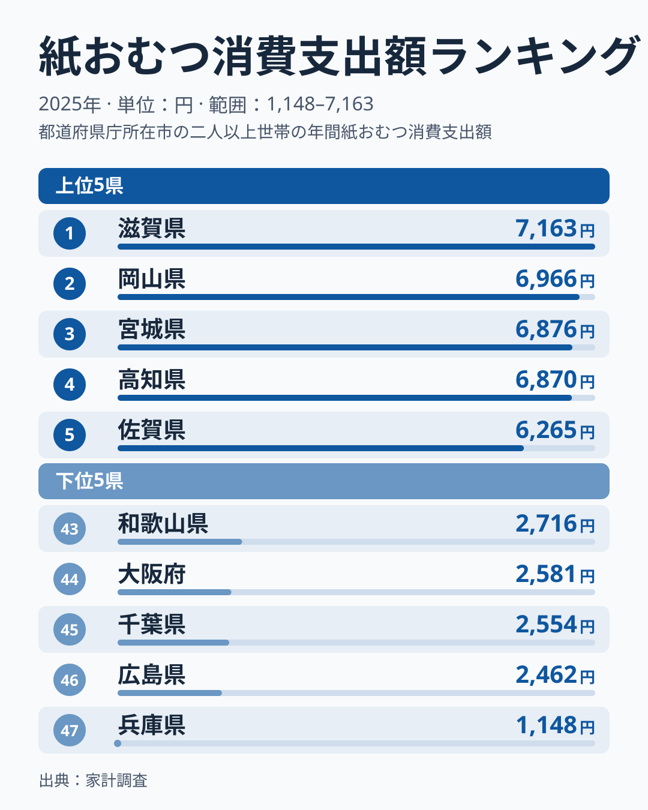
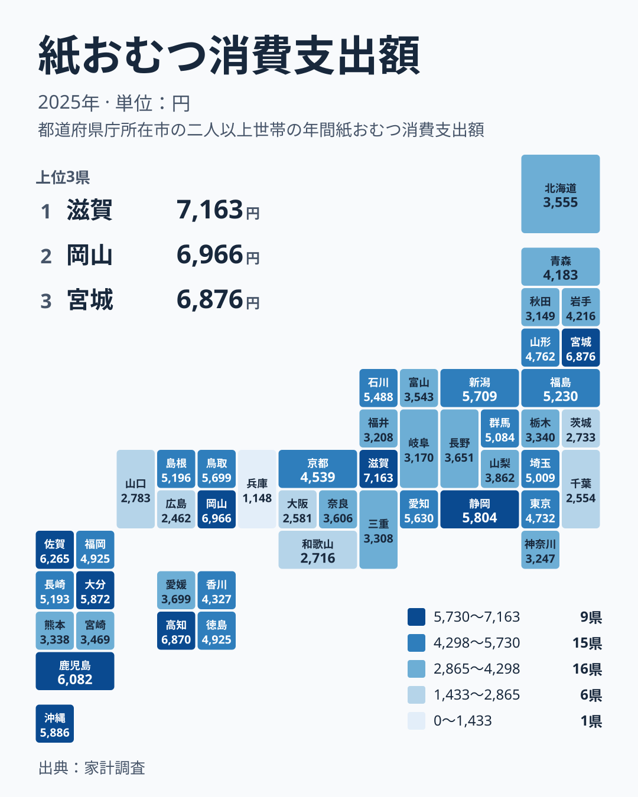

紙おむつは、赤ちゃんのいる家庭にとって欠かせない日用品です。一方で、介護が必要な家族のいる家庭でも日々使われます。毎日使うものなので、家計の中でも負担を実感しやすい支出です。ところが都道府県別に見ると、1世帯あたりの支出額には大きな開きがあります。

この記事では、2025年の家計調査をもとに、紙おむつへの支出が多い県と少ない県を比べます。そのうえで、数字の差がそのまま「暮らしの負担の差」とは言い切れない理由を、世帯の種類という別の切り口から考えます。

## 上位と下位の間にある「段差」

2025年に紙おむつへの支出が最も多かったのは、滋賀県の7,163円です。2位は岡山県の6,966円、3位は宮城県の6,876円、4位は高知県の6,870円、5位は佐賀県の6,265円でした。

最も少なかったのは兵庫県の1,148円で、47位です。46位は広島県の2,462円、45位は千葉県の2,554円、44位は大阪府の2,581円、43位は和歌山県の2,716円でした。1位と47位の比は、実データの最大と最小で見ると約6倍です。

<source-link href="/ranking/paper-diapers-consumption-expenditure">紙おむつへの支出ランキングをもっと見る</source-link>

図で注目したいのは、下位の並び方です。43位から46位までは2,400円台から2,700円台に収まっていますが、47位の兵庫県だけが1,148円と、46位の広島県の2,462円から大きく離れています。下位5県の中で、ひとつだけ断崖のように低い位置にあります。

上位側は様子が違います。1位から4位までは6,870円から7,163円の間に並び、順位が1つ違っても差は小さくなっています。ただし4位の高知県の6,870円と5位の佐賀県の6,265円の間には、やや大きな開きがあります。上位は団子状、下位は兵庫県だけが突出して低い、という形です。

また、上位に並ぶのは滋賀県、岡山県、宮城県、高知県、佐賀県で、いわゆる大都市圏の県ばかりではありません。下位には大阪府や千葉県も入っています。

> [!NOTE]
> ここでの数値は、家計調査における紙おむつの消費支出額で、1世帯あたりの年間支出額(円)です。紙おむつは乳幼児用だけでなく大人用も含まれる品目として扱われます。県全体の総額ではなく世帯あたりの平均ですので、県の人口の多さとは直接関係しません。

## 地方でくくれない分布

次に、地図で分布を確認します。

上位5県を地方で分けると、近畿の滋賀県、中国の岡山県、北海道・東北の宮城県、四国の高知県、九州・沖縄の佐賀県と、5つの地方に1県ずつ散らばっています。つまり、特定の地方に支出の多い県が固まっているわけではありません。

同じ地方の中でも順位は大きくばらつきます。九州・沖縄では、鹿児島県が6,082円で6位、沖縄県が5,886円で7位、大分県が5,872円で8位と上位に入る一方、宮崎県は3,469円で33位、熊本県は3,338円で35位です。福岡県は4,925円で19位、長崎県は5,193円で16位でした。

関東も同じです。群馬県は5,084円で17位、埼玉県は5,009円で18位、東京都は4,732円で22位と中位に入ります。一方、栃木県は3,340円で34位、神奈川県は3,247円で37位、茨城県は2,733円で42位、千葉県は2,554円で45位です。関東の中だけでも、2,000円台から5,000円台まで広く散らばっています。

> [!TIP]
> 地図で色の濃い県だけを見て「この地域は育児や介護にお金をかけている」と読むのは早計です。同じ地方の中でも順位が大きく分かれるため、地方ごとの印象よりも、県ごとの金額と順位を確かめる読み方が安全です。

## 乳幼児用と大人用、世帯の種類で差が出る可能性

ここからは、数字の差の背景を考えます。ただし、今回の実データは県ごとの支出額と順位だけですので、以下は確かめられた事実ではなく、読み解くための仮説です。

紙おむつを使うのは、乳幼児のいる世帯と、介護が必要な家族のいる世帯が中心と考えられます。使わない世帯の支出は小さくなるため、使う世帯の割合が高い県ほど、世帯あたりの平均は高く出やすくなる可能性があります。この場合、乳幼児用と大人用のどちらが効いているのかは、今回のデータからは分かりません。

さらに、家計調査は全国から選ばれた世帯を対象とした標本調査です。県別に見ると調査対象の世帯数は多くないため、紙おむつのように使う世帯が限られる品目では、たまたま対象に該当する世帯が多く含まれた県の値が大きくなる可能性があります。

兵庫県の1,148円が46位の広島県の2,462円から大きく離れていることも、実態の差だけでなく、調査対象の入れ方による偏りが混ざっている可能性があります。ただ、そうなっているかどうかを、このデータだけで裏付けることはできません。つまり、6倍という開きの一部は調査のぶれである可能性があり、実態の差と調査のぶれの内訳は、今回の数字からは切り分けられません。

> [!WARNING]
> 家計調査の県別データは、調査対象の世帯数が限られた標本調査です。紙おむつのように購入する世帯が限られる品目は、1年の値が大きくぶれる可能性があります。1位や47位という順位を、県の子育て環境や介護環境の優劣として断定することはできません。

## 生活への含意をどう読むか

それでも、数字から読み取れることはあります。紙おむつは、使う世帯にとって毎月かかる出費です。年間の世帯あたり支出で、滋賀県が7,163円、岡山県が6,966円という水準は、この品目が家計の中で一定の存在感を持つことを示しています。

また、中位の県の間では順位が近くても金額の差は小さくなっています。愛知県は5,630円で12位、鳥取県は5,699円で11位、新潟県は5,709円で10位、静岡県は5,804円で9位です。9位から12位の間は、1つ順位が違っても10円から100円ほどの差です。順位の上下に一喜一憂するより、金額の水準で見るほうが実態に近いといえます。

中位から下位では、北海道が3,555円で31位、福井県が3,208円で38位、秋田県が3,149円で40位です。これらの県で支出が少ない理由は、今回のデータだけでは分かりません。紙おむつ単体の数字で、育児や介護の負担全体を判断することはできません。

住んでいる県の位置を確かめたい方は、[滋賀県のデータ](/areas/25000)や[岡山県のデータ](/areas/33000)のように、県ごとのページで他の指標もあわせて見ると、地域の特徴が立体的に見えてきます。[同じカテゴリの統計一覧](/category/economy)から、家計の別の支出も比べてみてください。

## データについて

この記事で使った統計は、家計調査の紙おむつ消費支出額(2025年、単位は円)です。1世帯あたりの年間支出額を都道府県別に並べたもので、順位は金額の大きい順です。

徳島県と福岡県は、どちらも4,925円で同額で、同じ19位です。このように金額が同じ場合は同順位として扱っています。

## まとめ

2025年の紙おむつへの支出は、滋賀県の7,163円が最も多く、兵庫県の1,148円が最も少ない結果でした。最大と最小の開きは約6倍です。

ただし、紙おむつは使う世帯が限られる品目で、県別の家計調査は標本が小さくなりやすいため、順位や差の大きさは、実態とぶれの両方を含んでいる可能性があります。数字は、地域の暮らしを考えるきっかけとして受け止め、他の指標とも合わせて読むことをおすすめします。
