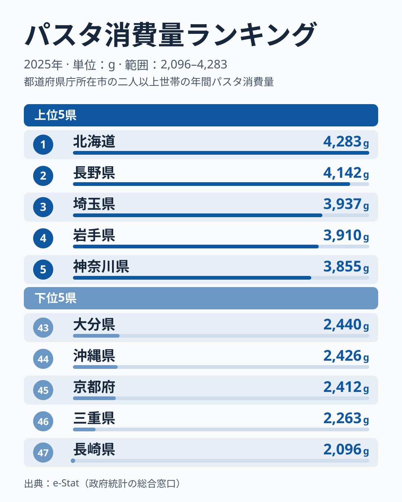

「同じ日本でも、住む県によってパスタを食べる量がこれほど違うのか」——2025年の家計調査でそんな事実が浮かび上がりました。最も多いのは北海道で年間4,283g、最も少ない長崎県は2,096gと、その差は2.0倍にのぼります。2024年に首位だった埼玉県は3位に下がり、最下位だった山口県は42位まで上がるなど、1年で顔ぶれが大きく入れ替わっている点も見逃せません。

パスタは今や日本の家庭食の定番と思われていますが、実態は「食べる量に地域差が残り、しかも年によって順位が動く食品」でした。この記事では2025年の値をもとに、上位と下位の特徴と、順位の読み方の注意点を整理します。

## パスタ消費量の上位5・下位5

<source-link href="/ranking/pasta-consumption-quantity">パスタ消費量ランキングの全件データを見る</source-link>

上位5県は北海道、長野県、埼玉県、岩手県、神奈川県で、関東の県は埼玉県と神奈川県の2県です。残る北海道・長野県・岩手県の3県は関東以外にあたります。関東でも千葉県は9位で3,664g、東京都は14位で3,552g、栃木県は29位で3,025g、茨城県は30位で2,983gと、関東がひとくくりに上位を占めているわけではありません。

下位5県は大分県、沖縄県、京都府、三重県、長崎県で、43位の大分県から47位の長崎県までは2,440gから2,096gの間に収まっています。

> [!NOTE]
> 本データは総務省「家計調査」2025年の二人以上世帯における品目別の年間購入量（g）を、都道府県庁所在市の値で表したものです。県全体の平均ではありません。パスタは重量で測られるため、乾麺・生麺・調理済みの違いや、1回あたりの使用量によって見え方が変わる可能性があります。また中位は値が密集しており、たとえば16位の静岡県3,518gと17位の群馬県3,451gは67gしか違わず、15位の香川県3,550gと17位の群馬県でも99gの差です。隣り合う順位でも数十gで入れ替わるため、中位の順位差は小さな違いと考えてください。

## 上位は関東と、それ以外の県が混在する

上位10県は北海道・長野・埼玉・岩手・神奈川・愛媛・宮城・熊本・千葉・広島です。このうち関東は埼玉・神奈川・千葉の3県です。残る7県の内訳は、北海道・東北の北海道・岩手・宮城の3県、中部の長野1県、中国の広島1県、四国の愛媛1県、九州・沖縄の熊本1県です。関東の県だけが上位を占める構図ではありません。

> [!WARNING]
> 上位入りの理由は本データだけからは確定できません。[仮説] 関東の埼玉・神奈川・千葉については、調理が短時間で済むパスタが日常の主食として選ばれやすい可能性があります。北海道・長野・岩手については、小麦や粉物の食文化がパスタの受け入れやすさにつながった可能性があります。いずれも各県の小麦消費・パン消費などとの照合が必要で、現時点では仮説にとどまります。

東京都が14位の3,552gで埼玉や神奈川より下であることも、関東の中で差があることを示しています。その理由も本データからは判断できません。

上位5県の平均は約4,025g、下位5県の平均は約2,327gで、その差は約1,700gです。47県の中央値は3,145gなので、上位5県は中央値を約900g上回り、下位5県は約800g下回ります。上位側のほうがやや大きく離れています。1位の北海道4,283gと2位の長野県4,142gは141g差で、3位の埼玉県3,937gから10位の広島県3,656gまでは約280gの範囲に収まります。

## 下位は西日本に多いが、麺文化では説明しきれない

下位10県は38位の福井から47位の長崎までで、福井・大阪・兵庫・高知・山口・大分・沖縄・京都・三重・長崎です。ここでは三重を中部として数えると、中部が福井と三重の2県、近畿が大阪・兵庫・京都の3県、中国が山口の1県、四国が高知の1県、九州・沖縄が大分・沖縄・長崎の3県です。近畿と九州・沖縄がそれぞれ3県で並び、特定の1地方に集中しているわけではありませんが、10県すべてが中部以西にあります。一方、上位10県のうち中国・四国・九州・沖縄の県は、愛媛・熊本・広島の3県です。

この偏りを「うどん・そうめんなど和の麺文化がすでに食卓を満たしているから」と説明したくなりますが、データはそう単純ではありません。「うどん県」を名乗る香川は15位で3,550g、そうめんで知られる奈良は18位で3,383gと、47県の中央値3,145gより上の、中位の上寄りに位置しています。麺文化が強い県ほどパスタが少ない、という関係は2025年の値からは読み取れません。

> [!WARNING]
> 本ランキングは「家計調査」を基にしているため、外食・中食での消費は反映されていません。レストランやテイクアウトでのパスタを多く食べる県でも、家庭での購入量には表れません。

下位に西日本の県が多い理由は、本データからは確定できません。[仮説] 米に加えてうどん・そば・お好み焼きなど粉物の主食が日常的に多様な地域では、パスタが家庭の主食として入り込む余地が相対的に小さいのかもしれません。一方で、スーパーなどでの品揃えや購入頻度の違いが影響している可能性もあります。いずれも検証には外食を含む消費データや、複数年の推移が必要です。

## 1年で入れ替わる順位をどう読むか

家計調査の都道府県別の値は、県庁所在市の限られた世帯の家計簿から集計されるため、単年ではぶれやすい性質があります。パスタ消費量でも、同じことが起きている可能性があります。

同じ家計調査の2024年の値では、埼玉県が4,368gで首位、山口県が1,880gで最下位でした。ところが2025年は埼玉県が3位の3,937g、山口県が42位の2,446gとなり、北海道が首位に立っています。埼玉県は1年で400g以上減り、山口県は500g以上増えた計算です。上位でも下位でも、1年のうちに大きく順位を動かす県が出ているのです。

このため、「どの県が1位か」という単年の結果にこだわるよりも、複数年で安定して上位や下位にいる県があるかを見るほうが、地域の食習慣を読み取る手がかりになります。長野県は2024年に4,314gで2位、2025年も4,142gで2位と、2年続けて上位に入っています。一方で、首位や最下位の入れ替わりは、実際の消費の変化である可能性も、調査のぶれによる可能性もあります。比較できるのは2年分の順位だけなので、[仮説] 調査のぶれが大きく含まれているのではないか、と考えるにとどめます。

他の食品も含めた地域差は[農業・食料カテゴリ](/category/agriculture)で、埼玉県の位置づけは[埼玉県のエリアプロフィール](/areas/11000)で確認できます。

## まとめ

- 最も多いのは北海道の4,283g、最も少ないのは長崎県の2,096gで2.0倍差
- 上位5県は北海道・長野・埼玉・岩手・神奈川で、上位10県のうち関東は埼玉・神奈川・千葉の3県
- 2024年に首位だった埼玉は3位、最下位だった山口は42位と、1年で顔ぶれが大きく入れ替わった
- 下位10県は近畿3県、九州・沖縄3県、中部2県、中国1県、四国1県で、うどん県の香川は15位、奈良は18位と、麺文化だけでは説明できない
- 単年の順位はぶれやすいため、複数年の傾向で読むことが大切（背景の説明は仮説段階）
