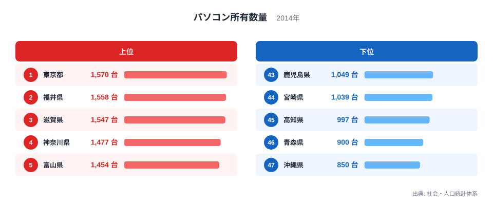
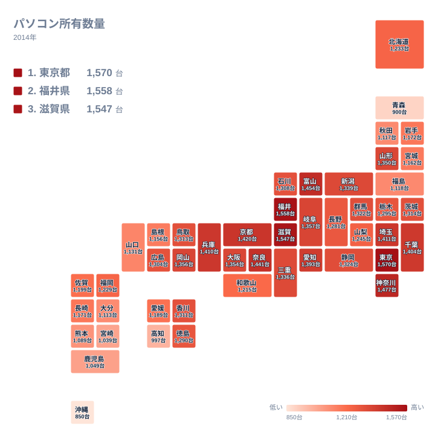

パソコン所有数量が最も多いのは、2014年のデータでは東京都で1,570台でした。ところが、2位の福井県は1,558台、3位の滋賀県は1,547台と、すぐ後ろに迫っています。一方で最下位の沖縄県は850台にとどまり、最大と最小の比は約1.8倍です。

この記事では、47都道府県の値と順位を並べ、上位がどれほど拮抗しているか、下位でどこから間隔が広がるかを確かめます。そのうえで、地方ごとの並び方を整理します。同じ分野の他の指標は[同じカテゴリの統計一覧](/category/ict)から探せます。

> [!NOTE]
> この記事で使うのは、社会・人口統計体系に収録された2014年の値で、単位は台です。台数をそろえる際の分母となる世帯の範囲など、細かな定義は、この記事で使うデータからは確認できません。そのため、数字を「県内のパソコンの総台数」と読むのは避け、県どうしを同じ基準で並べた値として扱ってください。

## 上位は三県がほぼ並ぶ

まず、上位5県と下位5県を図で確認します。

<source-link href="/ranking/pc-ownership-multi-person-households-per-1000">パソコン所有数量ランキングをもっと見る</source-link>

上位の特徴は、1位から3位までの値が近いことです。東京都が1,570台、福井県が1,558台、滋賀県が1,547台で、三県は1,500台台の前半に収まっています。ところが4位の神奈川県は1,477台で、3位との間には一段の開きがあります。5位の富山県は1,454台です。つまり上位は「三県の先頭集団」と「その後ろに続く二県」に分かれる形です。

所属する地方を見ると、東京都と神奈川県は関東、福井県と富山県は中部、滋賀県は近畿です。三つの地方から顔ぶれが出ており、首都圏の大都市だけが高いわけではありません。[東京都のデータ](/areas/13000)と[福井県のデータ](/areas/18000)を並べて見ると、大都市圏の東京都と、中部の福井県が、ほぼ同じ水準にあることがわかります。

> [!TIP]
> 本記事の数字では、1位の東京都と2位の福井県の差は12台しかありません。一方、1位と4位の神奈川県の差は93台あります。上位3県は順位が入れ替わっても不思議ではない僅差で、「1位だから突出している」とは読めません。順位より、先頭集団に何県が入るかに注目すると誤読を防げます。

## 下位は隣の順位との間隔が広がる

下位に目を移すと、様子が変わります。47位は沖縄県で850台、46位は青森県で900台、45位は高知県で997台、44位は宮崎県で1,039台、43位は鹿児島県で1,049台です。

注目したいのは、順位が一つ違うときの値の開き方です。43位の鹿児島県と44位の宮崎県は1,049台と1,039台で、ほとんど並んでいます。ところが、44位の宮崎県から45位の高知県、46位の青森県、47位の沖縄県と進むにつれ、値は1,039台、997台、900台、850台と大きく下がります。上位の三県が12台と11台の間隔で並んでいたのに比べ、下位の端では隣の順位との間隔が広くなっています。順位が一つ違うだけでも、意味の重さは上位と下位で同じではありません。

最大の東京都と最小の沖縄県の差は、1,570台と850台の間にあります。このうち43位の鹿児島県から47位の沖縄県までの開きは、下位の端に集まった一部分です。差の全体は、中位の広い範囲にも分かれています。

地方別に見ると、青森県は北海道・東北、高知県は四国、宮崎県と鹿児島県と沖縄県は九州・沖縄です。なお、この図だけでは、これらの県がなぜ低いのかまでは言えません。産業や世帯構成との関係は、別の統計を重ねて確かめる必要があります。

> [!WARNING]
> このデータは2014年の一時点の値です。スマートフォンやタブレットが広がる時期にあたるため、現在の端末の持ち方とは異なる可能性があります。また、パソコンが仕事用か家庭用かは区別されていません。順位の差を、そのまま情報活用の力の差と読むことはできません。

## 地理分布で見る並び方

続いて、全国の分布をタイルマップで見ます。

地図で目につくのは、関東から中部、近畿へとつながる帯状の高い地域です。上位10位は関東が4県、中部が2県、近畿が4県で占められ、北海道・東北、中国、四国、九州・沖縄からは1県も入りません。上位10位の顔ぶれは、本州の中央部に集中しています。

北海道・東北では、山形県が15位で1,350台と最も高く、北海道は29位で1,233台です。東北の他の県は34位以下に並びます。同じ東北でも、山形県と他の県の間には順位の開きがあります。

九州・沖縄では、福岡県が30位で1,229台と最も高く、他の7県はいずれも30位より下です。最下位の沖縄県は850台で、九州・沖縄の中でも低い側にあります。つまり、地図の両端には低い色の県が目立つ構図です。

## 地方の中でも順位はそろわない

同じ地方の中でも、順位が大きく離れる例があります。

関東では、神奈川県が4位である一方、群馬県は19位で1,322台、茨城県は20位で1,314台、栃木県は25位で1,295台です。関東の7県は、1位から25位までに広がっています。中部も同様で、福井県が2位、富山県が5位に対し、長野県は27位で1,281台、山梨県は28位で1,245台です。

中国では、岡山県が13位で1,356台、鳥取県が21位で1,313台、広島県が24位で1,304台と中位に並び、島根県は37位、山口県は38位です。四国では、香川県が22位で1,311台、徳島県が26位で1,290台、愛媛県が33位で1,189台、高知県が45位です。

近畿には、大阪府が14位で1,354台、三重県が17位で1,336台という中位の県もあります。和歌山県は31位で1,215台です。大阪府は近畿の中心ですが、14位であり、滋賀県の3位や奈良県の6位より下です。大都市かどうかだけでは、並びは説明できません。

このように、地方という大きなくくりでは傾向が見えても、県ごとの違いはかなり大きいことがわかります。地方名だけで県の順位を言い切るのは避けたほうがよいでしょう。

## 考えられる背景と確かめ方

データから確かに言えるのは、ここまでの分布です。その背景について、読者の方が自分で確かめられるよう、仮説を挙げておきます。

- 働き方：事務や情報関連の仕事が多い県では、自宅にも端末を置く家庭が多いかもしれません。
- 世帯の姿：家族の人数が多い世帯や、住まいに余裕のある世帯では、複数台を持ちやすいかもしれません。
- 端末の選び方：スマートフォンで用が足りる家庭が多い県では、パソコンの台数が伸びにくいかもしれません。

これらはいずれも、このデータだけでは検証できません。ある県が上位か下位かを説明するには、就業構造や世帯の人数、住宅の広さなどの統計を重ねる必要があります。ご自身の関心のある県は、[東京都のデータ](/areas/13000)や[福井県のデータ](/areas/18000)のようなページで、他の指標とあわせて見比べてみてください。

最大の東京都と最小の沖縄県の比は約1.8倍でした。上位は拮抗し、下位の端では隣の順位との間隔が広がります。これが、2014年のパソコン所有数量の分布の特徴です。

## データについて

この記事で使った統計は、社会・人口統計体系に収録された「パソコン所有数量」の2014年の値です。単位は台で、47都道府県すべての値があります。記事中の順位は、この値を大きい順に並べたものです。他の年や別の調査と比べるときは、調査の対象や集計の方法が同じかどうかを確かめてください。
