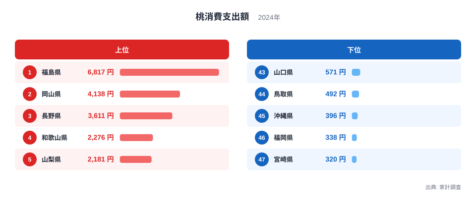
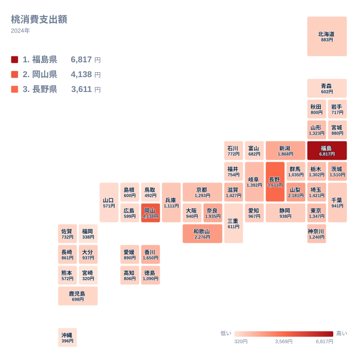

## 桃への支出が最も多い県は？

2024年の家計調査で、桃への支出が最も多かったのは福島県で、6,817円でした。2位は岡山県の4,138円です。6,817円を4,138円で割ると約1.6倍で、福島県は2位の岡山県をはっきり上回っています。3位は長野県の3,611円で、岡山県とは527円の差があります。

この記事では、まず「福島県は岡山県の約1.6倍」という首位争いの差を確認します。そのうえで、上位の県がどのように並び、全国にどう分布しているかを見ていきます。産地や食文化との関係については、データから確かめられる範囲と、仮説にとどまる範囲を分けて書きます。

最下位の宮崎県は320円で、福島県との間には大きな開きがあります。ただし、この記事の主題は首位と2位の差です。最下位との比較は、全体の幅を示す参考として触れるにとどめます。

> [!NOTE]
> この指標は、二人以上の世帯が1年間に桃へ支払った金額です。家計調査は県庁所在市などの結果をもとにしているため、都道府県の値は「その県の代表的な都市の世帯」の支出です。桃は旬が短い果物なので、たとえば福島市のような特定の市の購入状況が、県全体の消費として受け取られやすい点に注意してください。

## 上位5県と下位5県の差

まず、上位5県と下位5県を図で確認します。

<source-link href="/ranking/peach-consumption-expenditure">桃への支出ランキングをもっと見る</source-link>

図で目を引くのは、1位と2位の間の開きです。福島県と岡山県の差は2,679円あり、2位から3位の差である527円の5倍ほどに相当します。上位の中でも、福島県だけが一段高い位置にいます。

一方、上位5県の中で3位の長野県は3,611円、4位の和歌山県は2,276円で、その間には1,335円の開きがあります。上位5県は一枚岩ではなく、福島県、岡山県、長野県の3県と、和歌山県、山梨県の2県に分かれる構造です。4位と5位は2,276円と2,181円で、差は95円しかありません。

下位側は、40位台後半に300円台から400円弱の県が固まっています。宮崎県が320円、福岡県が338円、沖縄県が396円で、3県の差は76円の範囲に収まっています。上位の差が大きいのに対し、下位は小さな差で並んでいるため、順位の入れ替わりは下位ほど起きやすいと考えられます。

> [!WARNING]
> 桃は購入が夏の短い期間に集中するため、調査対象の世帯がその時期に何度か買ったかどうかで、年間の値が動きやすい品目です。この図の順位は2024年1年分の結果であり、とくに下位で数十円しか違わない県どうしの順位は、実態の差と見なさないでください。

## 産地との関係は仮説として読む

上位に福島県、岡山県、長野県、山梨県、和歌山県が並ぶことから、桃の産地として語られることの多い県で支出が高い、という見方はできます。ただし、今回使えるデータは支出額だけで、収穫量や出荷先は含まれていません。そのため、産地であることが支出を押し上げているかどうかは、この数字だけでは確認できません。

仮説として考えられるのは、産地では旬の時期に桃を手に取る機会が多く、1世帯あたりの支出が増えやすいという点です。福島県の詳しい数字は[福島県のデータ](/areas/07000)、岡山県は[岡山県のデータ](/areas/33000)で見られます。ただし、これは説明の候補であって、データから導かれた結論ではありません。

また、直売所での購入や知人からのいただきものは、家計調査の支出に含まれない場合があります。産地で支出が高く出ているのだとすれば、それは店頭などで購入した分の金額が大きいということです。逆に、産地で購入以外の入手が多い県は、実際の消費に比べて支出が低く出る可能性もあります。

> [!TIP]
> 支出額が高いことは、桃をたくさん食べていることと同じではありません。価格の高い品種を買う世帯と、手頃な桃を多く買う世帯では、同じ金額でも中身が違います。この数字は「購入にいくら使ったか」として読むと、誤解が少なくなります。

## 地理分布で見る広がり

次に、全国の分布を地図で見ます。

地図では、支出の多い県が一つの地方に固まらず、東北の福島県、甲信の長野県・山梨県、中国の岡山県、近畿の和歌山県・奈良県と、離れた地域に散らばっています。近畿では和歌山県が4位、奈良県が6位で、5位の山梨県をはさんで並んでいます。北陸・信越の新潟県は7位で、1,868円でした。

東北に限って見ると、福島県が1位であるのに対し、山形県は1,323円で14位、秋田県は800円で31位、青森県は602円で39位です。同じ東北でも、福島県と青森県では6,817円と602円で、大きな開きがあります。地方単位でひとくくりにすると、県ごとの違いが見えなくなります。

大都市圏は中位に収まっています。東京都は1,347円で13位、神奈川県は1,240円で17位、愛知県は967円で21位、大阪府は940円で23位です。首位の福島県と比べると、いずれも水準はかなり低めです。

九州・沖縄では、福岡県が338円で46位、宮崎県が320円で47位、沖縄県が396円で45位と、下位に並びます。一方で、大分県は937円で25位、長崎県は861円で29位と、中位に位置する県もあります。九州の中でも差があり、地方全体を同じ傾向として語ることはできません。

## 食文化や気候をどう考えるか

気候や食文化が支出に関わっている可能性はありますが、今回のデータだけでは証明できません。たとえば、桃は傷みやすい果物なので、産地から近いほど手に入れやすいかもしれません。贈答などで季節の果物を楽しむ習慣がある地域では、購入が増えるかもしれません。こうした点は、いずれも仮説です。

確実にいえるのは、2024年の家計調査で、桃への支出が県によって大きく違ったということです。首位の福島県は2位の岡山県の約1.6倍で、上位3県は3,000円を超えています。一方、4位以下は2,276円から下がり、段階的に低くなっていきます。

関連する統計は、[同じカテゴリの統計一覧](/category/economy)から確認できます。ほかの果物や食品の支出と見比べることで、桃に特有の傾向かどうかを検討する手がかりになります。ただし、品目をまたいだ比較は、それぞれの旬や価格の違いを踏まえて読む必要があります。

## データについて

この記事の数値は、家計調査の桃消費支出額(2024年、単位は円)に基づく、1世帯あたりの年間支出額です。順位は全47都道府県を支出額の高い順に並べたものです。倍率や差額は、記事内に示した数値から計算しています。

## まとめ

2024年の桃への支出は、福島県が6,817円で1位、岡山県が4,138円で2位でした。福島県は岡山県の約1.6倍で、2位と3位の差よりもはるかに大きな開きがあります。

産地や気候、食文化との関係は、仮説としては考えられるものの、この数字だけでは確かめられません。県庁所在市などの結果であることと、旬が短い品目であることを踏まえ、上位の差を中心に読むのが安全です。
