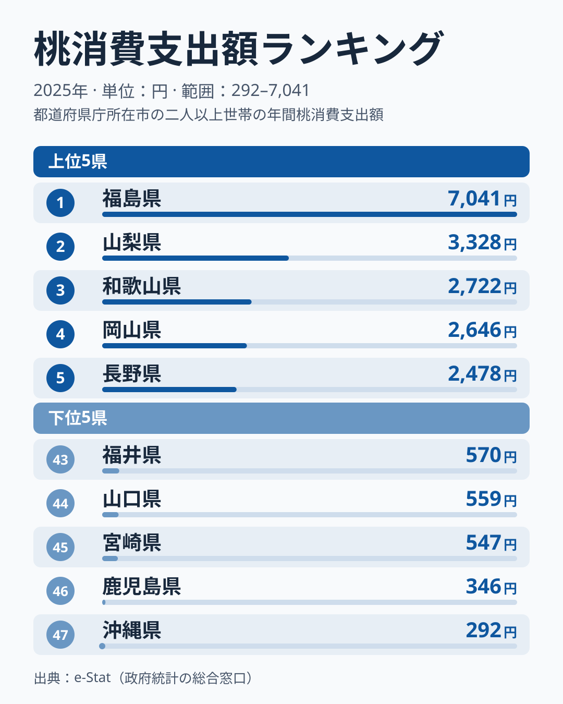

もも(桃)は夏の代表的な贈答用フルーツです。総務省家計調査による1世帯あたり年間購入額を都道府県庁所在地別に見ると、1位と2位以下の差がとりわけ目立つ結果になりました。今回のランキングでは、福島だけが突出している実態と、その理由として考えられる仮説、そして僅差で続く産地勢の顔ぶれを見ていきます。

2025年の家計調査によると、もも購入額の47都道府県庁所在市の平均は1世帯あたり1,233円です。1位福島は7,041円で、これは平均のおよそ5.7倍にあたります。最下位の沖縄は292円で、福島との差は24.1倍に達します。同じ果物でも、住む県によってこれだけ購入額が変わるのです。

> [!NOTE]
> このランキングは総務省「家計調査」の品目別支出金額(都道府県庁所在市及び政令指定都市)を基にしています。実際にもも狩りや自家消費で入手した分は購入額に含まれないため、産地の実際の消費量とは必ずしも一致しません。

## もも購入額 上位5県と下位5県

<source-link href="/ranking/peach-consumption-expenditure">もも購入額ランキングをもっと見る</source-link>

1位は福島で7,041円。2位山梨3,328円との差だけでも3,713円、倍率にして2.1倍あり、福島の突出ぶりが際立ちます。3位は和歌山2,722円、4位岡山2,646円、5位長野2,478円と続き、ここから先は僅差の争いになっていきます。

福島の突出は単年のぶれではありません。2007年から2025年の19年間で、福島は16回が1位でした。[仮説] 理由として、県内での購入機会の多さが考えられます。福島は東北有数のもも産地であり、地元スーパーや直売所での購入頻度が高い可能性があります。加えて、お盆や帰省シーズンの贈答需要も購入額を押し上げているかもしれません。ただし家計調査は購入先や用途を区別しないため、確かめるには別の統計が必要です。[福島県の統計](/areas/07000)を見ると、農業関連の指標でも東北の中で存在感のある県であることがわかります。

2位は山梨です。山梨は国内有数のもも産地で、購入額3,328円は47県平均の2.7倍にあたります。3位和歌山2,722円も「あら川の桃」などのブランド桃を抱える有力産地です。[山梨県の統計](/areas/19000)や[和歌山県の統計](/areas/30000)を見ても、農業産出額の高さがうかがえます。

> [!TIP]
> 2位以下の山梨・和歌山・岡山・長野はいずれも国内有数のもも産地です。「産地=消費地」の構図が上位5県にはっきり表れていますが、福島だけが平均の5.7倍という水準にあり、産地であることだけでは説明しきれない突出があります。

## 下位グループの顔ぶれ

下位を見ると、九州南部と沖縄が目立ちます。最下位は沖縄292円、46位鹿児島346円、45位宮崎547円と、九州南部と沖縄の温暖な地域が下位3つを占めます。

もも産地は東北・甲信越・近畿・中国地方などに広がっています。[仮説] 九州南部と沖縄は産地から遠く、入手しやすさの面で不利なことに加えて、マンゴーやパイナップルなど地元産の果物の選択肢が豊富で、もも以外の果物への支出が優先されやすい可能性があります。ただし九州全体が低いわけではなく、長崎は19位、大分は28位で、福岡は33位、佐賀は34位です。九州南部と沖縄に限った現象で、確かめるには果物全体の支出の内訳が必要です。[宮崎県の統計](/areas/45000)も参考になります。

家計調査の他の果物ランキングと比べても、もも購入額の地域差は際立って大きい部類に入ります。果物消費全体の傾向は[経済カテゴリ](/category/economy)で他の家計調査データとあわせて確認できます。

> [!WARNING]
> 家計調査は都道府県庁所在市及び政令指定都市のみの調査です。県内の農村部・産地近郊での消費実態を必ずしも反映していない点に注意してください。標本世帯の違いで順位も動きやすく、前年の2024年と比べると産地の順位が入れ替わっており、山梨は2025年に2位へ上がって2,181円から3,328円に、岡山は4位に下がって4,138円から2,646円になりました。

## 3位争いは僅差の激戦区

福島の圧倒的な1位、それに続く山梨の2位に対して、3位和歌山から5位長野までは、長野の2,478円から和歌山の2,722円までの間にひしめき合っています。特に3位和歌山2,722円と4位岡山2,646円の差はわずか76円で、年によって順位が入れ替わる可能性がある水準です。

この僅差構造は、複数の有力産地が拮抗している証拠でもあります。[仮説] 岡山の「白桃」、長野の「川中島白桃」、和歌山の「あら川の桃」など、各県ともブランド桃を抱えており、地元での消費・購入需要が根強い可能性があります。47県平均1,233円と比べると、5位長野でもおよそ2.0倍、4位岡山は2.1倍の水準にあり、上位5県はいずれも平均を大きく上回っています。

一方で、6位以下になると数字は一段と落ち着きます。6位香川2,355円、7位宮城2,029円と続き、10位茨城は1,286円で平均に近づきます。産地のイメージが強くない香川が6位に入っています。香川は2013年・2017年・2023年にも6〜7位に入っており、単年の偶然とは言い切れませんが、家計調査の数字だけでは理由を特定できません。[仮説] 中位から下位にかけては、産地の有無よりも果物全般への支出傾向や世帯構成の違いが購入額を左右している可能性があります。

## まとめ

- 1位は福島7,041円で、47県平均1,233円の5.7倍
- 最下位は沖縄292円で、福島との差は24.1倍
- 2位山梨3,328円、3位和歌山2,722円、4位岡山2,646円、5位長野2,478円と、上位はもも産地が独占
- 3位和歌山と4位岡山の差はわずか76円で、産地県同士の僅差争いが続く
- 下位は九州南部と沖縄が中心で、産地からの距離と代替果物の存在が背景にある可能性がある（[仮説]）
