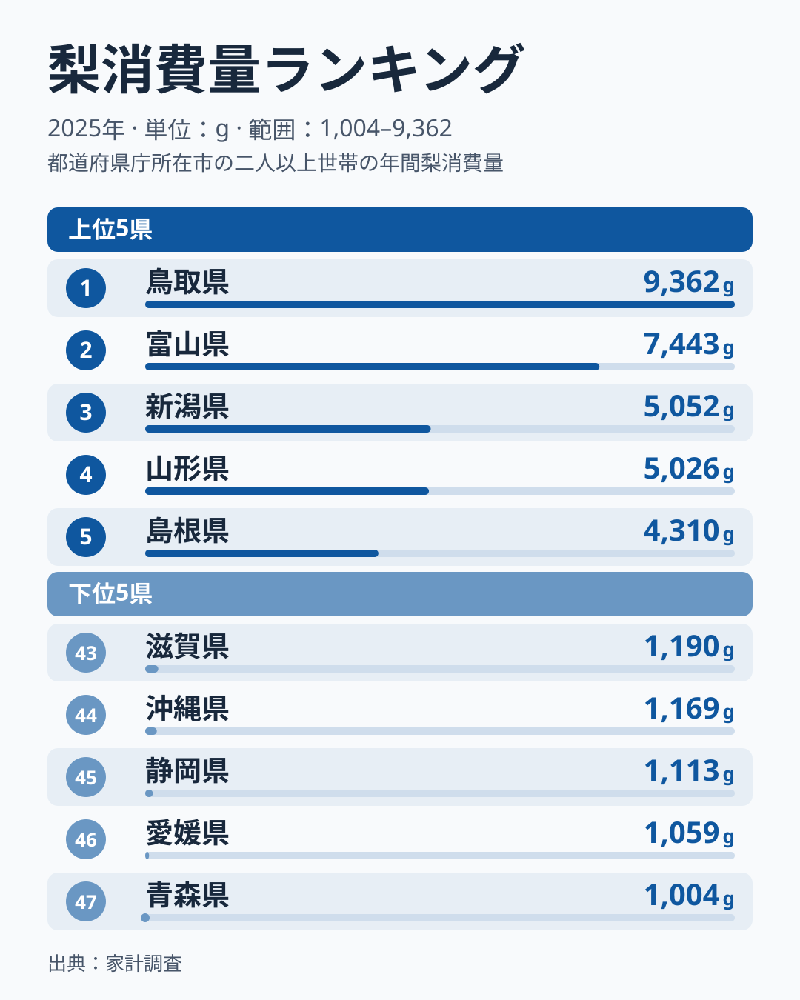
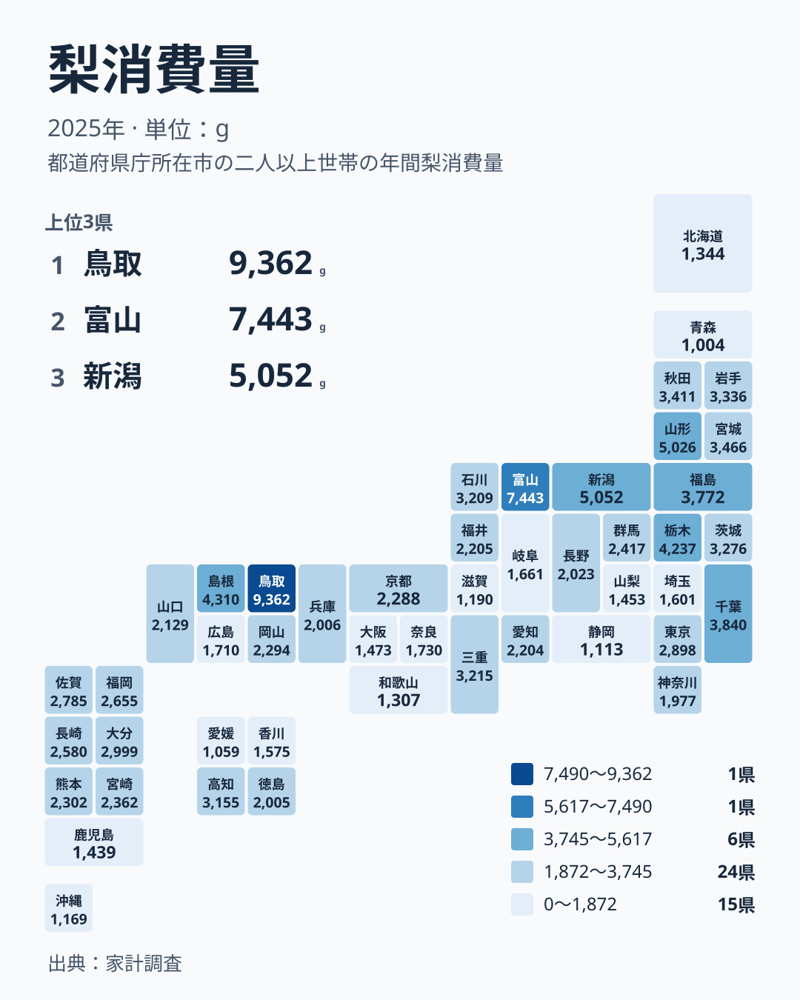

秋の果物の代表格である梨は、買われる量が県によって大きく違います。2025年の家計調査で1位だったのは鳥取県の9,362gです。最下位の青森県は1,004gで、差は8,358g、鳥取県は青森県の9.32倍にあたります。同じ日本の果物売り場でも、梨の存在感は地域ごとにこれほど異なります。

この記事では、梨の購入量の都道府県ランキングを見ながら、どの地方に多く、どの地方に少ないのかを整理します。あわせて、産地や食文化との結びつきについて仮説を示します。

## 梨の購入量ランキング上位5県と下位5県

まず、上位と下位を並べた図を見てみましょう。

<source-link href="/ranking/pear-consumption-quantity">梨消費量ランキングをもっと見る</source-link>

上位5県は、1位が鳥取県の9,362g、2位が富山県の7,443g、3位が新潟県の5,052g、4位が山形県の5,026g、5位が島根県の4,310gです。下位は、43位の滋賀県が1,190g、44位の沖縄県が1,169g、45位の静岡県が1,113g、46位の愛媛県が1,059g、47位の青森県が1,004gとなっています。

目を引くのは、1位と2位の開きです。鳥取県と富山県の差は1,919gあり、2位の富山県でさえ、3位の新潟県の5,052gを大きく上回っています。つまり、鳥取県だけが突出しているのではなく、鳥取県と富山県の2県が全体から抜け出している構図です。

一方、全47都道府県の中央値は2,294gです。上位の県は中央値の数倍の量を買っており、梨が日常的な果物として定着している地域があることがうかがえます。下位の県は1,000g台前半にとどまり、購入の頻度や量に大きな差があります。

## 鳥取県と富山県が突出する理由の仮説

鳥取県は、梨が県を代表する果物として知られています。県の果物として大切にされている地域では、贈答だけでなく、家庭で日常的に買って食べる習慣が根づいていると考えられます。鳥取県の詳しい数字は[鳥取県のデータ](/areas/31000)で確認できます。

2位の富山県は、産地というイメージが鳥取県ほど強くない県です。それでも7,443gと高い水準にあります。ここには、産地の近さだけでは説明できない食文化や購買習慣が関わっている可能性があります。ただし、今回の家計調査は購入量を示すもので、その理由までは示していません。富山県の数字は[富山県のデータ](/areas/16000)から見られます。

> [!NOTE]
> ここでの数値は、家計調査にもとづく1世帯あたりの梨の年間購入量で、単位はgです。人口1人あたりの消費量ではなく、世帯の購入が対象です。自宅の庭で採れた梨や、贈答でもらった梨は、購入として数えられない場合があります。

## 上位10県の地方分布を地図で見る

続いて、地理的な広がりを地図で確認します。

上位10県を地方別に分けると、北海道・東北が4県、関東が2県、中部が2県、中国が2県です。北海道・東北は山形県、福島県、宮城県、秋田県、関東は栃木県と千葉県、中部は富山県と新潟県、中国は鳥取県と島根県が入っています。

注目したいのは、近畿・四国・九州・沖縄の県が上位10県に1つも入っていないことです。梨の消費が多いのは、本州の中国地方から中部、関東、東北にかけての広い範囲です。とくに中部の富山県は2位、新潟県は3位と、上位に集まっています。中国では鳥取県が1位、島根県が5位です。

ただし、同じ地方の中でも差は小さくありません。この点は次の節で詳しく見ます。

## 同じ地方でも順位が大きく割れる

地方でひとまとめにすると、実態を見誤ります。地方別の順位を確かめてみましょう。

北海道・東北では、山形県が4位、福島県が8位、宮城県が9位、秋田県が10位、岩手県が11位と、東北の5県は上位から11位までに収まっています。ところが北海道は41位、青森県は47位です。東北でも最下位の青森県は、全国で最も梨の購入量が少なくなっています。

中部も同じです。富山県が2位、新潟県が3位、石川県が14位である一方、山梨県は39位、静岡県は45位です。関東では栃木県が6位、千葉県が7位、茨城県が12位と上位が並び、埼玉県は36位、神奈川県は32位にとどまります。

近畿は全体に低めです。三重県の13位が最高で、京都府が25位、兵庫県が30位、奈良県が33位、大阪府が38位、和歌山県が42位、滋賀県が43位と続きます。下位10県には大阪府、和歌山県、滋賀県の3県が入っています。

四国では高知県が15位、徳島県が31位、香川県が37位、愛媛県が46位です。九州・沖縄では大分県が16位、佐賀県が18位、福岡県が19位、長崎県が20位と中位に集まり、鹿児島県は40位、沖縄県は44位となっています。

> [!WARNING]
> 家計調査は標本調査で、県庁所在地や政令指定都市を中心とした世帯が対象です。県全体の消費をそのまま表すものではありません。また、1年だけの結果なので、天候による出荷の増減や価格の変動で順位が入れ替わる可能性があります。

## 産地・気候・食文化から考える

梨の購入量が多い県には、産地としての顔を持つ県が目立ちます。上位には鳥取県のほか、栃木県の6位、千葉県の7位、福島県の8位などが並びます。産地が近ければ新鮮な梨を手に入れやすく、直売や贈答のかたちで家庭に届く機会も増えると考えられます。

その一方で、関連品目との対比で考えると、別の見方もできます。たとえば、同じ秋の果物であるりんごやぶどう、柿などと比べたときに、梨が選ばれやすい地域とそうでない地域があるはずです。青森県は47位で1,004gと最下位です。青森県はりんごの大産地として知られているため、果物の選択がりんごに偏っていることが背景にあるのではないか、と考えられます。これは仮説であり、今回のデータだけでは確かめられません。

愛媛県の46位も同様に読めます。柑橘類の産地として知られる県では、日常の果物の主役がみかん類になり、梨の出番が相対的に少なくなっている可能性があります。静岡県の45位についても、柑橘やメロンなど、ほかの果物の存在感が関わっているかもしれません。

気候の面では、梨は秋に旬を迎える果物であり、冷涼な地域で栽培が盛んです。東北や北陸、山陰に上位の県が集まる傾向は、こうした条件と無関係ではなさそうです。ただし、沖縄県が44位であることからは、栽培地から離れた地域では消費が少なくなる傾向もうかがえます。

> [!TIP]
> 順位だけでなく、実際の量の差に注目すると読みやすくなります。たとえば、中央値の2,294gに近い県が多い中位の順位は、少しの購入量の違いで入れ替わります。順位の1つや2つの違いよりも、上位の鳥取県や富山県と、下位の県との大きな差に注目してください。

## データについて

この記事で使ったのは、家計調査による2025年の梨消費量です。単位はgで、1世帯あたりの購入数量を都道府県別に並べたものです。梨の種類や、生鮮か加工品かの違いまでは、この数値からは読み取れません。同じカテゴリの他の統計は、[同じカテゴリの統計一覧](/category/economy)から確認できます。

## まとめ

2025年の梨の購入量は、鳥取県が9,362gで1位、富山県が7,443gで2位でした。最下位の青森県は1,004gで、鳥取県はその9.32倍です。上位10県は北海道・東北、関東、中部、中国に分布し、同じ地方の中でも順位が大きく割れていました。

産地との近さ、他の果物との競合、気候といった要因が重なって、この差が生まれていると考えられます。ただし、これらは仮説であり、データだけで原因を断定することはできません。気になる県があれば、ランキングで順位と値を見比べてみてください。
