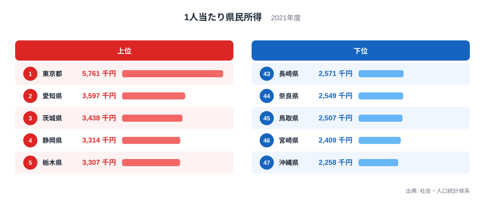
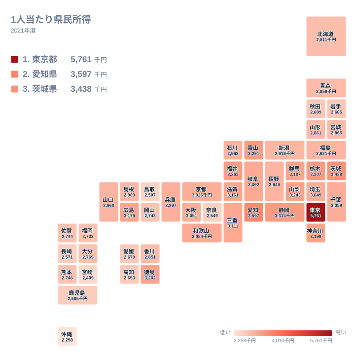

## 東京都だけが飛び抜ける所得の地図

1人当たり県民所得で最も高いのは東京都で、5,761千円です。2位の愛知県は3,597千円、3位の茨城県は3,438千円です。首位と2位の差は2,164千円あり、2位から3位の差よりもはるかに大きな開きです。一方、最下位の沖縄県は2,258千円です。

県民所得とは、県民が働いて得た報酬や、企業や財産から得た所得などを合計したものです。これを人口で割った1人当たりの値は、県の経済力をおおまかに映します。ただし、そのまま賃金の高さを表すわけではありません。

この記事では2021年の値を使い、順位がどの地方に偏っているかを整理します。産業や歴史との関係は、データだけでは確かめられないため、あくまで考えられる背景として述べます。まず上位と下位の顔ぶれを図で確認します。

<source-link href="/ranking/per-capita-prefectural-income-h27">1人当たり県民所得ランキングをもっと見る</source-link>

上位5県は、東京都、愛知県、茨城県、静岡県、栃木県の順です。注目したいのは、東京都を除いた2位から5位の幅です。愛知県の3,597千円から栃木県の3,307千円まで、4県が290千円の範囲に収まっています。東京都だけが別の水準にあることが、図から読み取れます。

下位5県は、沖縄県が2,258千円、宮崎県が2,409千円、鳥取県が2,507千円、奈良県が2,549千円、長崎県が2,571千円です。最下位の沖縄県と46位の宮崎県の差は151千円ですが、宮崎県から43位の長崎県までは162千円です。下位は上位ほど極端な差がなく、なだらかに並んでいます。東京都と沖縄県の比は、5,761千円と2,258千円という実データの両端で見るのが最も確かです。

下位5県の地方区分も確認します。沖縄県、宮崎県、長崎県は九州・沖縄、鳥取県は中国、奈良県は近畿です。下位は特定の一地方に完全にはまとまっておらず、5県が3つの地方にまたがっています。

> [!NOTE]
> この指標は、県内に住む人が受け取った所得を人口で割った値です。県内の事業所が生み出した付加価値を示す県内総生産とは別のものです。働く場所と住む場所が異なる地域では、両者の見え方が変わります。

## 地理から読む:上位は関東と中部に集まる

地方別に見ると、上位5県のうち東京都、茨城県、栃木県は関東、愛知県と静岡県は中部です。上位5県はすべて関東か中部の県です。

なぜこの配置になるのかは、データだけでは断定できません。大都市圏に近いことや、製造業が集まりやすい土地であることが関係しているという見方があります。ただし、本記事が使えるのは県別の値と順位だけです。産業の中身まで確かめたわけではないため、仮説として受け止めてください。

次の図で、全国の分布を地図の形で見てみます。

地図では、関東から中部にかけて、値の高い県が連なって見えます。富山県は3,291千円で6位、福井県は3,263千円で7位、山梨県は3,243千円で8位です。いずれも中部の県で、上位10位以内に入っています。さらに、群馬県は3,187千円で11位、神奈川県は3,199千円で10位です。大都市圏の周辺だけでなく、中部の各県にも高い値が並んでいることがわかります。

一方、九州・沖縄は、福岡県が2,733千円で37位、佐賀県が2,744千円で35位、熊本県が2,746千円で34位、大分県が2,769千円で33位です。九州・沖縄で最も順位が高い大分県でも33位で、上位に入る県はありません。これは図の下位側に九州・沖縄の県が集まっていることと一致します。

> [!TIP]
> 地図を読むときは、色の濃い県が隣り合っているかに注目してください。帯のようにつながっていれば、個々の県の事情だけでなく、地域のまとまりが関係している可能性があります。ただし、理由まではこの図から言えません。

## 産業構造から読む:仮説として考えられること

所得の高低には、産業の違いが関係している可能性があります。たとえば、愛知県や静岡県は製造業の集積地として知られており、それが上位に入る背景にあるという見方があります。東京都については、本社機能や金融業の集中が高い値に関わっていると考えられています。

ただし、これらは一般に語られる見方です。この記事の実データには産業別の数値がないため、順位との因果をここで示すことはできません。同じ関東でも、茨城県は3位、埼玉県は19位、千葉県は17位と順位に幅があります。地方が同じでも、値は一様ではありません。

下位の県についても同様です。沖縄県や宮崎県の値が低い理由として、観光や農業の比重を挙げる見方がありますが、本記事では確かめていません。確実に言えるのは、九州・沖縄の県が地図の低い側に偏っているという事実までです。

> [!WARNING]
> 1人当たり県民所得は、子どもや高齢者を含む全人口で割った値です。年齢構成が違えば、働く人の賃金が同じでも数字が変わる可能性があります。「賃金が低い県」とそのまま読み替えないでください。

## 歴史から読む:近畿の中の奈良県

歴史との関係は、データから直接は導けません。ここでは、実データで言える近畿の並びに絞ります。

意外なのは奈良県です。近畿に属しますが、2,549千円で44位です。同じ近畿では、三重県が3,111千円で14位、滋賀県が3,161千円で13位、和歌山県が3,084千円で16位、大阪府が3,051千円で18位、京都府が3,026千円で20位、兵庫県が2,997千円で21位です。奈良県だけが、近畿の中で突出して低い位置にあります。

その理由として、大阪府に隣接して住宅地としての性格が強いことを挙げる見方があります。県外へ通勤する人が多ければ、県民所得は居住地ベースで計上されるため、働く場所と数字の関係が単純でなくなります。ただし、本記事ではこの点を検証していません。

近畿の7府県は、13位の滋賀県から44位の奈良県まで、順位が大きく広がっています。同じ地方でも一括りにできないことが、この並びからわかります。

## 中位の県を見ると見えてくること

上位と下位だけでなく、中位にも目を向けます。

中国の県を見ると、広島県は3,179千円で12位、山口県は2,960千円で23位、島根県は2,909千円で27位、岡山県は2,743千円で36位、鳥取県は2,507千円で45位です。同じ中国の5県で、12位から45位まで順位が広がっています。広島県と鳥取県の差は672千円です。

北海道・東北は、宮城県が2,865千円で28位、福島県が2,921千円で25位、北海道が2,811千円で32位です。さらに山形県が29位、青森県が30位、秋田県が38位、岩手県が39位と続きます。北海道・東北の7道県は、25位から39位の間に収まっています。上位10位以内に入る県はありません。

四国は、徳島県が3,202千円で9位と高い一方、高知県は2,653千円で41位、愛媛県は2,670千円で40位です。香川県は2,851千円で31位です。四国の4県でも、9位から41位まで大きく分かれています。

> [!TIP]
> 3,000千円前後の順位は、少しの差で入れ替わります。たとえば20位の京都府は3,026千円、21位の兵庫県は2,997千円で、差は29千円です。中位の順位は、値の差が小さい点を踏まえて読むのがコツです。

## 数字を読み違えないために

最後に、この指標を読むときの注意点をまとめます。

- 県民所得は居住地ベースで集計されるため、通勤の流れが数字に影響することがあります。
- 全人口で割るため、年齢構成の違いが値に反映されます。
- 物価や家賃の水準は反映されないため、所得の順位がそのまま生活の余裕を表すとは限りません。
- 東京都の値には、企業の利益や財産から得られる所得も含まれると考えられます。

東京都と沖縄県の間には、5,761千円と2,258千円という大きな差があります。ただし、これは豊かさの差をそのまま示すものではありません。年齢構成や通勤の流れなど、複数の要因が重なった結果かもしれません。

地域別の詳しいデータは、[東京都のデータ](/areas/13000)や[愛知県のデータ](/areas/23000)で確認できます。ほかの経済指標と合わせて読みたい場合は、[同じカテゴリの統計一覧](/category/economy)も役に立ちます。

## データについて

この記事で使った統計は、社会・人口統計体系の「1人当たり県民所得」です。2021年の値を、単位は千円で示しています。県ごとの値と順位は、この統計に載っているものをそのまま用いています。

> [!NOTE]
> 県民所得は、県民経済計算という統計体系の一部です。推計方法や基準年が改定されると、過去の値が見直されることがあります。異なる年の記事と数字を並べる際は、同じ基準かどうかを確認してください。
